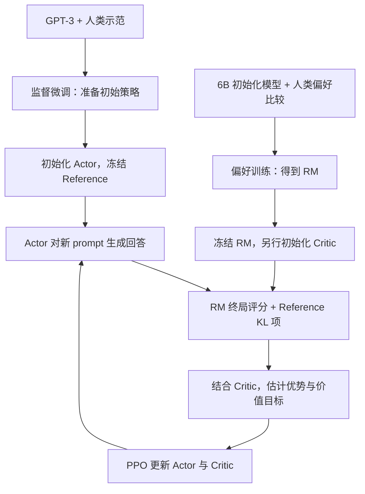

# 经典论文解读（八）｜对齐与微调：Training Language Models to Follow Instructions with Human Feedback

大规模预训练让语言模型拥有了越来越强的生成、问答和推理能力，但能力更强，不等于更愿意按照用户的意图行动。

预训练模型学习的是：

```text
给定前文，什么 token 最可能接在后面？
```

而用户真正关心的是：

```text
这个回答是否理解了我的要求？
是否有帮助、真实，并且不会造成伤害？
```

这两个目标并不相同。互联网文本中存在错误信息、有害内容、互相矛盾的观点和大量并非问答形式的文本。即使扩大模型规模，下一个 token 预测也不会自动变成“按照用户意图提供可靠帮助”。

2022 年，Ouyang 等人在 **《Training Language Models to Follow Instructions with Human Feedback》** 中系统展示了 InstructGPT：先用人类示范进行监督微调，再从人类对模型回答的排序中训练奖励模型，最后通过强化学习优化语言模型的行为。

> RLHF 并非 InstructGPT 首创。它的关键贡献是把人类示范、偏好建模和强化学习整合成一套面向通用语言模型的后训练流程，使“模型如何回应用户”成为独立于预训练能力的优化目标。这套流程后来也成为 ChatGPT 和许多主流 LLM 后训练方案的基础。

要理解这套流程，关键是把几件事接起来：人类数据训练出了什么模型，哪些模型在 PPO 阶段冻结，新的回答从哪里来，以及一次回答评分怎样影响生成每个 token 的概率。下面先沿着训练数据和参数的流向展开，再看实验结果与局限。

---

## 一、从“生成语言”到“符合用户意图”

GPT-3 已经展示了强大的 few-shot 能力。用户可以通过 prompt 和少量示例让模型执行翻译、摘要、问答等任务，但它仍经常误解要求、编造事实、生成无关内容，甚至延续提示中的偏见与有害模式。

InstructGPT 论文把这个问题描述为语言模型与用户意图之间的 **misalignment**。

论文采用了 helpful、honest、harmless 三个方向来描述理想行为：

| 目标 | 含义 | 典型失败 |
| --- | --- | --- |
| Helpful | 理解并完成用户任务 | 答非所问、忽略格式要求、拒绝正常请求 |
| Honest | 不欺骗，不把未知内容伪装成事实 | 幻觉、迎合错误前提、虚构来源 |
| Harmless | 避免造成不合理伤害 | 提供危险建议、仇恨或滥用内容 |

不过，这三个目标并没有天然对应一个可计算的损失函数。

分类任务可以用准确率，语言建模可以用交叉熵，但“这个回答是否真正有帮助”通常取决于上下文、用户意图和人的判断。即使能列出一组规则，也很难穷举所有任务与失败模式。

RLHF 的基本想法是：既然很难直接写出“好回答”的目标函数，就让人类通过示范和比较表达判断，再训练模型近似这种判断。

### 1. 能力和行为是两条不同的轴

InstructGPT 没有用对齐取代 scaling，它把模型训练拆成两个互补问题：

```text
预训练：模型能做什么？
后训练：模型面对用户时会做什么？
```

一个模型可能拥有回答问题的知识，却不知道用户希望它直接给出结论；也可能具备翻译能力，却继续补全 prompt 而不是执行翻译要求。

后训练会改变能力的调用方式与外显行为，也可能影响模型在具体任务上的表现。后面讨论的 alignment tax，就说明这两方面不能完全分开。

---

## 二、InstructGPT 的三阶段训练流程

InstructGPT 从 GPT-3 的 1.3B、6B 和 175B 三种参数规模开始。预训练已经完成，论文研究的是如何通过人类反馈继续塑造这些模型。



图中的人类示范、偏好比较和 PPO prompt 是三类用途不同的数据。人类先提供示范和比较；PPO 阶段则由策略生成新回答，交给已经训练好的 RM 评分。RM 的实际初始化来源及其与 Critic 的关系，见下面的模型准备部分。

### 1. 阶段一：监督微调 SFT

首先，标注员阅读 prompt，并编写他们认为理想的回答。这些 `(prompt, demonstration)` 样本被用于监督微调 GPT-3，得到 SFT 模型。

论文中的 prompt 来自两类来源：

- 标注员根据要求人工编写，包括普通任务、few-shot 任务和模拟 API 用例的任务；
- 用户提交给早期 InstructGPT API Playground 的真实 prompt，在过滤个人身份信息后用于训练。

SFT 数据集约有 **13k 个训练 prompts**，覆盖生成、开放问答、对话、摘要、抽取和分类等多种用途。

从训练形式看，SFT 仍然是标准语言模型微调：给定 prompt 和人类回答，最大化人类回答 token 的似然。

```text
Prompt：给六岁孩子解释登月。
Human demonstration：一段简短、准确、适合儿童的回答。
```

SFT 让模型学会基本的指令—回答格式，也为后续强化学习提供一个已经会尝试执行任务的初始策略。此时训练依赖人类示范，不需要奖励模型、Critic 或环境探索。

但示范数据有明显成本：标注员必须亲自写出完整的高质量回答。对于复杂问题，“从零写出最佳答案”通常比“比较几个现有答案哪个好”更耗时。

### 2. 阶段二：训练奖励模型 RM

第二阶段不再要求标注员编写答案。研究者让模型针对同一个 prompt 生成多个回答，再让标注员按质量排序。候选回答来自数据收集过程中使用的不同模型；不能把它理解成只使用最终 SFT 检查点生成的一份固定数据。

```text
同一个 Prompt
  |-- 回答 A
  |-- 回答 B
  |-- 回答 C
  |-- 回答 D
        ↓
人类排序：C > A > D > B
```

论文每次向标注员展示 4–9 个模型回答。一个排序可以拆成多个成对偏好，例如：

```text
C 胜过 A
C 胜过 D
C 胜过 B
A 胜过 D
A 胜过 B
D 胜过 B
```

这些比较构成约 **33k 个训练 prompts** 的 RM 数据集。研究者用它训练一个奖励模型 `Rψ(x, y)`：输入 prompt `x` 和回答 `y`，输出一个标量，表示这个回答被标注员偏好的程度。33k 是 prompt 数，不是比较对数；同一 prompt 可以贡献多个比较对。

### 3. 阶段三：用 PPO 优化策略

有了奖励模型后，策略可以对约 **31k 个未标注 API prompts** 反复生成新回答。RM 为回答打分，PPO 根据扣除 KL 惩罚后的回报及优势更新策略，增加比预期好的动作的概率。

论文把这个任务描述为 bandit 环境：环境提供一个 prompt，模型提交完整回答，收到奖励后 episode 就结束。但回答内部仍由一串 token 构成，训练时可以把“prompt + 已生成前缀”视为状态，把下一个 token 视为动作。

PPO 与混入预训练梯度的 PPO-ptx 是论文比较的两种 RL 训练设置；论文将通过人类反馈训练的模型称为 InstructGPT。下面分别说明模型准备与一批训练数据的流向。

### 4. 开始 PPO 前，Actor、Critic、RM 和 Reference 怎样初始化？

| 角色 | 输入与输出 | 初始化来源 | PPO 阶段 |
| --- | --- | --- | --- |
| Actor，策略模型 | 读入 prompt 与前缀，输出下一个 token 的分布 | 用于 RL 初始化的监督微调 GPT-3 | 更新参数 |
| Reference，参考模型 | 对相同前缀给出 token 概率 | 固定保留 Actor 的初始检查点 | 冻结 |
| Reward Model，奖励模型 | 读入完整 prompt 与回答，输出偏好评分 | 6B 语言模型改标量输出头，再经偏好训练 | 冻结 |
| Critic，价值模型 | 读入前缀，预测后续的期望回报 | 从训练好的 6B RM 初始化 | 独立更新参数 |

RM 负责回答“这份完整答案有多受偏好”，Critic 负责预测“从这个生成前缀继续下去，预计还能得到多少总回报”。二者虽然存在初始化关系，训练目标却不同；Critic 的更新不会回写给冻结的 RM。所有策略规模都使用 6B RM 和 6B Critic，Actor 则可以是 1.3B、6B 或 175B。

论文正文把 RM 描述为从 SFT 模型移除最后的词表投影层、改成输出标量。附录 C.2 进一步说明，**最终使用的 RM 实际从经过多种公开 NLP 任务微调的 6B GPT-3 初始化**，再训练偏好目标。作者说这主要出于历史原因，从 GPT-3 或 SFT 初始化也能得到类似结果。因此，通用流程图中的“SFT → RM”只是概括，不能代替这篇论文的实际实验设置。

Actor 的初始化也有一个容易混淆的细节。附录 C.1 单独评估的 SFT 基线训练了 16 个 epoch；用于后续 RL 初始化的模型则按 C.3 训练了 2 个 epoch，并混入 10% 预训练数据。Reference 固定的正是**后者这个 RL 起点**。这与 PPO-ptx 在强化学习期间混入预训练梯度，是发生在不同阶段的两件事。

### 5. 一批 Rollout 怎样收集和更新？

Rollout 是当前策略实际生成回答得到的轨迹。它包含 token 序列、概率与价值信息，不只是一个 prompt 列表。以“给六岁孩子解释登月”为例，一批训练依次做以下工作：

1. **抽取 prompt 并生成回答。** 本批开始时的 Actor 作为采样旧策略 `π_old`，按温度 1 自回归采样。生成期间不更新参数，记录回答 token、旧策略对所选 token 的 log probability、Critic 价值预测和结束位置。
2. **计算奖励。** 冻结 RM 对完整回答给一个分数；冻结 Reference 计算同一条回答中各 token 的参考 log probability。两者组合成“逐 token KL 惩罚 + 末尾 RM 分数”的奖励序列，下一节会写出公式。
3. **估计优势与价值目标。** 用奖励、采样时价值预测和结束边界计算 GAE。优势表示每次 token 选择比原来预计的好多少；价值目标用于训练 Critic。终局评分通过这些估计影响前面的 token，并不需要人工对每个 token 单独打分。
4. **在已有回答上更新。** 当前 Actor 重新计算已采样 token 的概率，与保存的旧概率构成 PPO 比率，用 Clip 目标更新；Critic 拟合固定价值目标。优势与旧概率在本批更新中保持固定，不把梯度传进 RM 或 Reference。
5. **重新采样。** 本批用完后，用更新后的 Actor 生成下一批回答。再次抽到同一个 prompt，也可以采到不同回答；不会一直拿最初 SFT 的回答训练。

RM 输出在这条流程中作为采样奖励使用。Actor 的梯度来自它对已生成 token 的 log probability，优势决定更新方向和权重；不需要穿过 RM 或离散 token 采样过程求导。Critic 同样通过自己的价值回归目标更新。

注意当前 Actor、采样旧策略和 Reference 是三个不同概念：当前 Actor 在 minibatch 更新中变化；旧策略只作为本批概率比的分母，可以通过保存的 log probability 表示；Reference 在整个 PPO 训练中保持固定。

附录 C.4 报告：每批 512 个 episode，拆成 8 个大小为 64 的 minibatch，只训练 **1 个内部 epoch**。因此一批仍有多次梯度更新，但没有把同一批反复训练多个 epoch。通用 PPO 允许更多内部 epoch，不能把这一点直接套到 InstructGPT 的配置上。

论文总计训练 256k 个 episode，来自约 31k 个不同 prompt；使用 Clip 参数 0.2，GAE 不做回报折扣，即 `γ = 1`。这里不需要人工给每次 Rollout 排序：人工比较的作用已经通过 RM 进入后续训练。

---

## 三、奖励模型如何学习人的偏好？

奖励模型并不知道什么是真理或普遍价值。它学习的是：面对同一个 prompt，标注员更可能选择哪个回答。

设 `y_w` 是人类更偏好的回答，`y_l` 是较差回答，奖励模型分别输出：

```math
R_\psi(x,y_w),\qquad R_\psi(x,y_l)
```

论文使用类似 Bradley–Terry 模型的成对偏好概率：

```math
P(y_w\succ y_l\mid x)=\sigma\left(R_\psi(x,y_w)-R_\psi(x,y_l)\right)
```

对应的训练损失可以简化写成：

```math
\mathcal L_{\mathrm{RM}}(\psi)=
-\mathbb E_{(x,y_w,y_l)}\left[
\log\sigma\left(R_\psi(x,y_w)-R_\psi(x,y_l)\right)\right]
```

这里 `σ` 是 sigmoid 函数。如果标注员选择了 `y_w`，训练就推动它的奖励高于 `y_l`。论文还把同一个 prompt 的所有比较放在一起处理，避免将高度相关的回答对当成完全独立的训练样本反复使用。

成对损失只约束分数差，对所有分数加同一个常数并不改变损失。不过，数值基线会影响 RL 训练，所以论文在开始 RL 前调整 RM 的偏置，让人类示范回答的平均分为零。不能把奖励分数直接解释为正确率或某种客观质量单位。

### 1. 为什么比较比直接打分更合适？

让人给回答打“82 分”很难保持一致：不同标注员对分数尺度的理解不同，同一个人在不同时间也可能改变标准。

而回答“这两个答案哪个更好”通常容易一些。它允许人类综合考虑多个难以形式化的因素：

- 是否正确理解指令；
- 是否完成用户任务；
- 是否准确、清晰和相关；
- 是否遵守长度、格式等显式约束；
- 是否包含不必要的有害内容。

奖励模型把大量局部比较压缩成一个可以反复调用的评分器。人不需要参与每次 PPO 更新，这使偏好优化能够扩展到远多于人工标注数量的模型回答。

### 2. 奖励模型是代理目标，不是人类价值本身

这里也产生了 RLHF 的核心风险：PPO 优化的不是人类偏好，而是**奖励模型对人类偏好的预测**。

```text
真实目标：人类认为回答有帮助、真实且无害
代理目标：奖励模型给出的标量分数
```

当策略模型生成的回答逐渐偏离奖励模型的训练分布时，就可能找到奖励模型的漏洞。某些回答可以获得高预测奖励，却不一定真正受人喜欢。这就是 reward hacking 或 reward overoptimization 的来源之一。

因此，训练时需要同时关心奖励改善和策略离开原有分布的程度。

---

## 四、从回答评分到 PPO 损失：KL、Clip 和 ptx 各管什么？

### 1. 任务目标：奖励改善要抵得过偏离参考模型的代价

先看不含 ptx 的强化学习目标。以 `θ` 表示 Actor 参数，`ψ` 表示已经冻结的 RM 参数，论文目标可写成：

```math
J_{\mathrm{RL}}(\theta)=\mathbb E_{x\sim D,\,y\sim\pi_\theta(\cdot\mid x)}\left[
R_\psi(x,y)-\beta\log\frac{\pi_\theta(y\mid x)}{\pi_{\mathrm{ref}}(y\mid x)}
\right]
```

`π_ref` 是固定的 SFT 参考策略。对给定 prompt，完整回答的 log 概率比在当前策略下取期望，得到：

```math
\mathbb E_{y\sim\pi_\theta(\cdot\mid x)}\left[
\log\frac{\pi_\theta(y\mid x)}{\pi_{\mathrm{ref}}(y\mid x)}\right]
=D_{\mathrm{KL}}\left(\pi_\theta(\cdot\mid x)\,\|\,\pi_{\mathrm{ref}}(\cdot\mid x)\right)
```

这解释了为什么称它为 KL 惩罚。单个回答的 log 概率比只是采样值，可能为负；非负性属于完整分布的 KL，不能机械地套到每个回答或 token 上。

为什么要参考最初的 SFT？因为 SFT 提供了一个经过人类示范训练、已经能执行指令的行为起点，而 RM 只在有限比较数据上学会了评分。如果只追求 RM 高分，策略可能生成偏离训练分布的回答，利用评分器的盲点。

KL 惩罚让这种偏移带来成本。它约束的是输出分布，而不是参数距离，也不要求每次生成与 SFT 相同的文本。系数 `β` 决定愿意用多大的分布变化换取多少偏好奖励；论文设置为 0.02。它有助于缓解过度优化，但不保证彻底消除 reward hacking 或能力回退。

### 2. Rollout 奖励：末尾给 RM 分，每个 token 加偏离代价

完整回答的概率可以分解成各 token 条件概率的乘积，log 概率比就成为逐 token 的和。在本批 Rollout 中，以采样旧策略计算：

```math
k_t=\log\pi_{\mathrm{old}}(y_t\mid x,y_{<t})
-\log\pi_{\mathrm{ref}}(y_t\mid x,y_{<t})
```

```math
\tilde r_t=-\beta k_t+
\mathbf 1[t=T-1]R_\psi(x,y)
```

回答 token 从 0 编到 `T-1`。生成中间步骤只有 KL 惩罚项，最后一步再加完整回答的 RM 分数。因此“奖励模型只给一个分”与“逐 token 训练”并不矛盾：终局评分会通过未来回报进入较早 token 的优势估计。

Critic 在每个生成前缀预测后续总回报，包含终局 RM 奖励和未来 KL 项，不是简单复述 RM 对完整回答的评分。GAE 利用时序差分误差组合这些信息：

```math
\delta_t=\tilde r_t+\gamma V_{\mathrm{old}}(s_{t+1})-V_{\mathrm{old}}(s_t),
\qquad
\hat A_t=\sum_{l\geq0}(\gamma\lambda)^l\delta_{t+l}
```

求和只覆盖本条轨迹，真正结束后价值为零；若是采样截断，则需要按结束语义处理自举。InstructGPT 使用 `γ = 1`。Critic 的回归目标可取固定的 `Ĝ_t = Â_t + V_old(s_t)`，价值预测误差会更新 Critic。训练时只对回答位置计算对应的策略目标，prompt 和 padding 不作为生成动作。

### 3. PPO Clip：限制本批更新，不能代替固定 SFT 的 KL

有了固定优势，PPO 用当前 Actor 与采样旧策略的概率比构造代理目标：

```math
\rho_t(\theta)=\frac{\pi_\theta(y_t\mid s_t)}{\pi_{\mathrm{old}}(y_t\mid s_t)}
```

```math
L^{\mathrm{CLIP}}(\theta)=\hat{\mathbb E}_t\left[
\min\left(\rho_t(\theta)\hat A_t,
\operatorname{clip}(\rho_t(\theta),1-\epsilon,1+\epsilon)\hat A_t\right)
\right]
```

Actor 最大化这个目标；若写成需要最小化的策略损失，就取其负值。Critic 则最小化价值预测与固定回归目标的平方误差。两者的职责和更新目标不同，不能把 RM 分数直接当作每个 token 的监督标签。

Clip 对有利方向的过大概率变化停止增加收益，但没有把概率比硬锁进区间，也没有严格的 KL 上界。它看的是**当前 Actor 与本批采样旧策略**。相对 SFT 的 KL 看的是**策略与训练全程固定的 Reference**。

即使每批只小幅偏离上一批，很多批之后仍然可以离最初的 SFT 很远，因此这两种机制不能互相替代。本文只给出训练所需的公式；Clip 正负优势的数值例子和 PPO 算法讲解见本系列第十八篇，链接放在文末。

### 4. PPO-ptx：额外保留预训练分布上的能力

最初的 PPO 实验在 SQuADv2、DROP 等公开 NLP 数据集上出现性能回退。模型变得更符合标注员偏好，却损失了部分预训练能力。论文把这种代价称为 **alignment tax**。

为缓解它，作者在强化学习期间额外混入预训练语言建模目标：

```math
J_{\mathrm{PPO\text{-}ptx}}(\theta)=J_{\mathrm{RL}}(\theta)
+\eta\,\mathbb E_{z\sim D_{\mathrm{pretrain}}}[\log\pi_\theta(z)]
```

这里用 `η` 表示混合系数，避免与回报折扣 `γ` 混淆；原论文式（2）用 `γ` 表示这个混合系数。论文在每个 minibatch 中分别计算 PPO 梯度和预训练梯度，再累积到 Actor 的梯度缓冲区。预训练样本来自原 GPT-3 训练数据，不是 Rollout 回答，也不需要人类偏好分数。

混合预训练梯度缓解了多项公开 NLP 任务的性能退化，同时基本不牺牲人类偏好结果，但没有恢复所有任务的表现。提高 KL 系数也不能完全替代它。

| 机制 | 比较或训练对象 | 主要作用 |
| --- | --- | --- |
| PPO Clip | 当前策略与本批采样旧策略 | 控制局部策略更新的激励 |
| RLHF KL penalty | 策略与固定 SFT 参考模型 | 限制累计策略漂移与奖励过度优化 |
| Pretraining mix | 原始预训练数据上的语言建模 | 缓解更广泛任务上的能力回退 |

---

## 五、实验结果：对齐不能被参数规模替代

论文最醒目的结果是：在人类偏好评估中，标注员更喜欢 **1.3B InstructGPT** 的回答，而不是 **175B GPT-3** 的回答，尽管前者参数量少了 100 多倍。

这不意味着 1.3B 模型在知识、推理和所有 benchmark 上全面超过 175B 模型。它证明的是一个更具体、也更重要的结论：

> 参数规模和符合用户意图是不同的优化方向。更大的 raw model，不会自动变成更好的语言助手。

### 1. 人类偏好逐阶段提升

论文比较了 GPT-3、经过精心 few-shot prompting 的 GPT-3、SFT、PPO 和 PPO-ptx。总体结果呈现出清晰的阶段性改善：

```text
Raw GPT-3
  → 使用 few-shot prompt
  → SFT 学习人类示范
  → PPO 学习人类比较
```

175B InstructGPT 与同规模 GPT-3 直接比较时，回答有 **85 ± 3%** 的概率被标注员偏好；与经过 few-shot prompting 的 175B GPT-3 比较时，偏好率仍达到 **71 ± 4%**。

标注员还认为 InstructGPT：

- 更能尝试正确的任务；
- 更常遵守明确的长度和格式要求；
- 输出更适合作为面向客户的助手回答；
- 在摘要、封闭域问答等任务中更少编造输入之外的信息。

### 2. 真实性改善，但安全结果并不整齐

在 TruthfulQA 上，论文总体报告了真实性与信息量的改善，但结果依赖模型规模和提示设置；其中 1.3B PPO-ptx 的表现略差于同规模 GPT-3，不能概括成每个模型都提升。在论文评估的封闭域 API 任务中，幻觉指生成输入中没有的信息，报告的比例从 GPT-3 的 41% 降至 InstructGPT 的 21%；这不是所有开放问答场景的通用幻觉率。

毒性方面，模型在被明确要求保持尊重时，生成的有毒内容比 GPT-3 少约 25%。但论文没有观察到偏见指标上的显著改善，其他有害内容类别也并非都出现显著变化。

因此，不能据此断言“RLHF 解决了安全”。实验支持的结论是：在特定 prompt、评价规范和代理指标下，人类反馈改善了若干有用性、真实性与毒性行为。

### 3. Held-out 标注员仍然偏好 InstructGPT

为了检查模型是否只拟合训练标注员，论文另外邀请没有参与训练数据生产的标注员进行评价。他们对 InstructGPT 与 GPT-3 的相对偏好，与训练标注员大致一致。

另一个实验将标注员分成五组，用四组的数据训练 RM，再预测留出一组的偏好。留出组准确率为 **69.6 ± 0.9%**，同组标注员的验证准确率为 **72.4 ± 0.4%**。后一个数字不是 RM 在训练样本上的拟合准确率。结果支持它能泛化到同一标注员群体中未参与该次训练的人，不能据此推断它代表更广泛人群。

---

## 六、谁的反馈？对齐了什么？

“Reinforcement Learning from Human Feedback”中的 human 很容易制造一种错觉：仿佛模型正在对齐全人类共同认可的价值。

论文对此非常明确：这套流程让模型更符合**特定标注员与研究者群体表达的偏好**，而不是某种普遍的人类价值。

### 1. 偏好来自有限人群与规则

标注员需要通过筛选测试，并按照研究团队提供的指南工作。这有助于提高一致性，但也意味着奖励模型学习的是一套经过制度化的数据生产过程。

论文数据超过 96% 是英文，prompt 主要来自特定时期的 API Playground 用户。不同文化、语言、专业背景和使用场景中的人，可能对“帮助”“伤害”和“合适回答”持有不同判断。

即使 held-out 标注员结果相近，也只能说明模型泛化到来源相似的另一批评价者，不能证明它代表更广泛人群。

### 2. Helpful、Honest、Harmless 可能互相冲突

如果用户要求生成危险操作指南，“遵循用户意图”会与“避免伤害”发生冲突。模型应该直接帮助、拒绝回答，还是提供有限的安全信息？这不是一个仅凭回答排序就能自动解决的问题。

论文的数据收集优先训练 helpfulness，没有专门让模型普遍拒绝有害指令。因此 InstructGPT 仍可能执行危险请求。作者也指出，提高指令遵循能力甚至可能让模型更容易被滥用，例如生成更有说服力的虚假信息。

这揭示了对齐工程中的基本张力：

```text
用户想要什么
    ≠
系统在所有情境下都应该做什么
```

### 3. 更受偏好不等于可以信任

InstructGPT 仍会：

- 接受问题中的错误前提；
- 编造事实；
- 对简单问题过度保留；
- 在包含多个约束的指令上退化；
- 生成有害或带偏见的回答。

RLHF 改善的是给定数据分布上的平均行为，不提供真实性或安全性的形式保证。更自然、更自信的表达甚至可能让错误更难被用户察觉。

这些局限也是为什么论文同时使用人类评估、任务指标和行为分析，而没有把 RM 分数当作最终质量证明。

---

## 七、它没有发明 RLHF，但改变了 LLM 的训练方式

RLHF 并非从 InstructGPT 开始。此前工作已经将人类偏好用于 Atari 和机器人控制，也将奖励学习用于文本摘要、对话等任务。InstructGPT 自己明确建立在 Christiano et al. 2017、Ziegler et al. 2019 和 Stiennon et al. 2020 等工作的基础上。

它真正推进的是：**把 RLHF 从特定任务实验，整合成面向开放任务分布和真实用户 prompt 的通用语言模型后训练流程。**

### 1. ChatGPT 的重要技术前奏

ChatGPT 后来同样采用监督微调和 RLHF：人类训练者提供对话示范，再对模型回答排序，由奖励模型和强化学习继续优化行为。

但不应把 InstructGPT 与 ChatGPT 当成同一个系统。ChatGPT 面向多轮对话，模型底座、数据组织、产品目标和具体训练细节都有变化。更准确的说法是，InstructGPT 系统验证了 ChatGPT 所延续的核心后训练思路。

### 2. 此后主流 LLM 的共同骨架

InstructGPT 的影响也不限于 ChatGPT。此后许多主流语言模型都采用类似的分阶段结构：

```text
大规模预训练
  → 指令监督微调
  → 偏好或奖励优化
```

后续论文展示了不同的优化选择：

- **DPO** 直接从 chosen/rejected 回答对优化策略，省去显式奖励模型和 PPO。
- **Llama 3** 的后训练结合 SFT、奖励模型、rejection sampling 和 DPO。
- **DeepSeek-V3** 在预训练后继续进行 SFT 与强化学习。
- 其他路线还会使用 AI feedback、规则奖励、可验证奖励或多个奖励模型。

这些工作的共同点，是在预训练之后继续使用示范、偏好或奖励塑造模型行为；它们并不都沿用 PPO，也不应把所有后训练技术都归为 InstructGPT 的直接发明。

### 3. 分别评估能力与实际行为

评估这套训练流程时，只看预训练 loss 或公开 benchmark 都不够，还要检查实际用户 prompt 上的行为。两类评估回答的问题有所不同：

| 能力工程 | 行为与对齐工程 |
| --- | --- |
| 模型知道什么？ | 模型何时应该表达这些知识？ |
| 模型能否完成任务？ | 模型是否理解并遵守用户要求？ |
| 如何扩大模型、数据和计算？ | 如何定义、收集并优化期望行为？ |
| 如何提高 benchmark 能力？ | 如何处理有用、真实和无害之间的冲突？ |

InstructGPT 通过人类比较与行为标注来评估第二列问题，同时保留公开 NLP 任务测试。这种分开检查，也让研究者能够发现偏好提升与能力回退同时发生的情况。

---

## 八、回到一次具体的参数更新

读完训练流程，再看“用人类反馈训练语言模型”，就能知道反馈究竟落在了哪里：人类写出的回答用于 SFT；人类的回答排序用于训练 RM；PPO 则在新生成的回答上，用冻结 RM 的分数与 SFT 参考模型的 KL 项构造奖励，再通过 Critic 和优势估计更新 Actor。

最终用于生成回答的是 Actor。RM、Critic 和 Reference 为训练提供不同信号，并不要求在部署时继续参与每一次生成。论文中小模型在人类偏好上胜过大模型的结果，说明针对用户意图的训练确实能改变实际使用体验；奖励代理与评价人群的局限，则决定了这种改善能够说明什么、不能说明什么。

---

## 参考资料

1. Long Ouyang et al., **Training Language Models to Follow Instructions with Human Feedback**, NeurIPS 2022. https://arxiv.org/abs/2203.02155
2. OpenAI, **Aligning Language Models to Follow Instructions**, 2022. https://openai.com/index/instruction-following/
3. Paul F. Christiano et al., **Deep Reinforcement Learning from Human Preferences**, NeurIPS 2017. https://arxiv.org/abs/1706.03741
4. Daniel M. Ziegler et al., **Fine-Tuning Language Models from Human Preferences**, 2019. https://arxiv.org/abs/1909.08593
5. Nisan Stiennon et al., **Learning to Summarize with Human Feedback**, NeurIPS 2020. https://arxiv.org/abs/2009.01325
6. Rafael Rafailov et al., **Direct Preference Optimization: Your Language Model is Secretly a Reward Model**, NeurIPS 2023. https://arxiv.org/abs/2305.18290
7. AI @ Meta, **The Llama 3 Herd of Models**, 2024. https://arxiv.org/abs/2407.21783
8. DeepSeek-AI, **DeepSeek-V3 Technical Report**, 2024. https://arxiv.org/abs/2412.19437
9. OpenAI, **Introducing ChatGPT**, 2022. https://openai.com/index/chatgpt/
10. John Schulman et al., **Proximal Policy Optimization Algorithms**, 2017. https://arxiv.org/abs/1707.06347
11. John Schulman et al., **High-Dimensional Continuous Control Using Generalized Advantage Estimation**, ICLR 2016. https://arxiv.org/abs/1506.02438
12. 本站相关文章：[经典论文解读（十八）｜PPO](category.html?category=papers&post=2026-10-20-ppo-paper-notes)。

本文模型初始化、冻结关系及 Rollout 配置主要依据 InstructGPT 原论文第 3.5 节与附录 C.2–C.4；人类偏好、幻觉与跨标注员结果见第 4 节。文中的逐 token 公式与数据流用于展开这些训练步骤，不把一般 PPO 实现中的所有默认设置视作 InstructGPT 的原论文配置。
