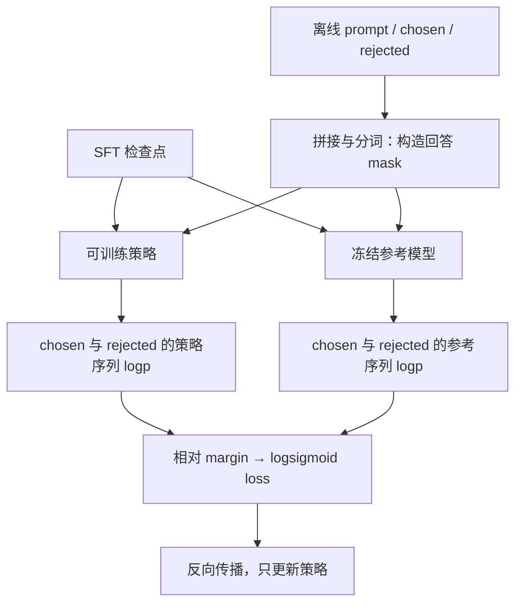

# 经典论文解读（十九）｜强化学习与对齐：Direct Preference Optimization: Your Language Model is Secretly a Reward Model

上一篇把 PPO 式 RLHF 拆成了生成回答、奖励打分、估计优势和更新策略。现在换一个问题：我们手里已经有“同一个问题下，回答 A 比回答 B 好”的数据，能不能直接拿它训练语言模型，省掉中间的奖励模型与强化学习循环？

2023 年 Rafael Rafailov 等人提出的 **Direct Preference Optimization（DPO，直接偏好优化）** 给出了一种做法。它从带 KL 正则的奖励最大化目标出发，把奖励写成策略与参考模型之间的对数概率比，再用这个表达式拟合偏好标签。最后得到的训练形式很接近普通监督学习：读取固定样本，计算 loss，反向传播。

理解 DPO 的关键，是看清这次变量替换为何成立，以及它省掉了哪些计算。本文沿着原论文第 4 节和附录 A、B 的思路推导，再用一条偏好样本说明代码怎样落地。

## 一、PPO 式 RLHF 的成本在哪里？

在常见的 Actor-Critic 实现中，Actor 根据 prompt 自回归生成回答；奖励模型 RM 对完整回答打分；固定参考模型提供 KL 惩罚所需的概率；Critic 预测各个位置的未来回报，用于估计优势。随后更新 Actor 和 Critic，再用近期策略生成下一批 Rollout。

这意味着训练系统需要同时处理逐 token 生成、多个模型的前向计算、价值估计和策略更新。生成阶段与训练阶段对显存、吞吐和并行调度的需求也不同。四种角色未必对应四份完整独立的网络，例如 Actor 和 Critic 可以共享部分参数，但这些计算职责仍然存在。

DPO 将优化过程改为直接读取离线偏好对：

| 环节或对象 | 常见 PPO 式 RLHF | 原始离线 DPO |
| --- | --- | --- |
| 偏好数据 | 用来训练独立 RM | 直接训练策略 |
| 可训练策略 | Actor | 语言模型策略 |
| 固定参考模型 | 提供 KL 惩罚 | 提供相对概率基准 |
| 独立奖励模型 | 训练后给新回答打分 | 核心算法不需要 |
| Critic 与优势估计 | 常见 Actor-Critic 流程需要 | 不需要 |
| 优化循环中的在线回答生成 | 用近期策略采集 Rollout | 对已有回答做 teacher forcing |
| 参数更新 | 策略与价值目标配合更新 | 对偏好分类损失反向传播 |

这里的“训练时不采样”有明确边界。偏好数据中的回答通常仍需要事先生成，再由人或模型比较；如果后续重新收集数据，也会产生新的采样成本。DPO 省去的是每轮梯度优化所依赖的在线策略采样，并没有让回答生成与标注免费。

## 二、从 KL 正则目标推导 DPO loss

### 1. 先规定我们希望优化什么

令 `x` 为 prompt，`y` 为完整回答，`r(x,y)` 为回答的奖励，`π_ref` 为固定参考策略。先假设奖励已经给定，我们希望寻找一个策略，使期望奖励最大，同时控制它相对参考策略的偏离：

```math
\begin{aligned}
\max_{\pi}\quad &\mathbb E_{x\sim\mathcal D,\,y\sim\pi(\cdot|x)}[r(x,y)]\\
\text{s.t.}\quad &\mathbb E_{x\sim\mathcal D}
[D_{\mathrm{KL}}(\pi(\cdot|x)\|\pi_{\mathrm{ref}}(\cdot|x))]\leq\varepsilon.
\end{aligned}
```

这里的 KL 方向是 `π || π_ref`：按当前策略的分布取期望，衡量它偏离参考分布多少。对应的拉格朗日形式在舍去与策略无关的常数后，是：

```math
\max_{\pi}\quad
\mathbb E_x\left[\mathbb E_{y\sim\pi}[r(x,y)]
-\beta D_{\mathrm{KL}}(\pi\|\pi_{\mathrm{ref}})\right],
\qquad \beta>0.
```

在满足相应对偶条件时，约束问题的解可以与某个拉格朗日乘子对应。但实际选定一个 `β` 进行训练，并不等于预先指定且严格满足某个 KL 上界。下面推导的是固定 `β` 的正则化问题。

### 2. 固定一个 prompt，把目标凑成另一个 KL

对一个给定的 `x`，省略外层 prompt 期望，将目标写成：

```math
J_x(\pi)=\sum_y\pi(y|x)\left[
r(x,y)-\beta\log\frac{\pi(y|x)}{\pi_{\mathrm{ref}}(y|x)}
\right].
```

奖励较高的回答应该被上调，但上调多少还受参考概率与 `β` 影响。先定义归一化常数：

```math
Z(x)=\sum_y\pi_{\mathrm{ref}}(y|x)
\exp\left(\frac{r(x,y)}{\beta}\right).
```

假设 `Z(x)` 有限，并在参考策略有正概率的支持集上讨论。用它构造一个合法的回答分布：

```math
\pi_r(y|x)=\frac{\pi_{\mathrm{ref}}(y|x)
\exp(r(x,y)/\beta)}{Z(x)}.
```

这里下标 `r` 表示“奖励 r 对应的理论最优策略”，暂时还没有引入神经网络参数。把目标里的两项并进同一个对数，得到：

```math
\begin{aligned}
J_x(\pi)
&=-\beta\sum_y\pi(y|x)
\log\frac{\pi(y|x)}{\pi_{\mathrm{ref}}(y|x)e^{r(x,y)/\beta}}\\
&=-\beta\sum_y\pi(y|x)
\log\frac{\pi(y|x)}{\pi_r(y|x)Z(x)}\\
&=-\beta D_{\mathrm{KL}}(\pi\|\pi_r)+\beta\log Z(x).
\end{aligned}
```

对于固定奖励，`Z(x)` 与待优化的 `π` 无关。KL 非负，在 `π = π_r` 时为零，所以刚才构造的分布恰好最大化目标。它是在参考分布上按 `exp(r/β)` 重新加权的结果。

这个结论暂时还不方便直接拿来训练：回答空间太大，枚举所有 `y` 来算 `Z(x)` 通常不可行。DPO 的下一步，就是让这个归一化项在比较中消失。

### 3. 反过来，用最优策略表示奖励

对最优策略表达式两边取对数：

```math
\log\pi_r(y|x)=\log\pi_{\mathrm{ref}}(y|x)
+\frac{r(x,y)}{\beta}-\log Z(x).
```

整理后得到：

```math
r(x,y)=\beta\log\frac{\pi_r(y|x)}{\pi_{\mathrm{ref}}(y|x)}
+\beta\log Z(x).
```

这一步说的是奖励与它对应的最优策略之间的关系。不能把一个任意的、还没训练好的策略直接当成未知真实奖励的最优解。我们随后会利用这个关系，选择一种由策略参数化的奖励形式，再通过偏好数据学习参数。

### 4. 引入 Bradley–Terry 偏好模型

偏好数据只告诉我们哪个回答更好，并不给出绝对奖励。Bradley–Terry（BT）模型假设，两个回答的偏好概率由奖励差决定：

```math
p(y_w\succ y_l|x)
=\frac{e^{r(x,y_w)}}{e^{r(x,y_w)}+e^{r(x,y_l)}}
=\sigma(r(x,y_w)-r(x,y_l)),
\qquad \sigma(t)=\frac{1}{1+e^{-t}}.
```

`y_w` 是 chosen，`y_l` 是 rejected。标签表示这一次比较的结果；BT 则允许同一对回答在不同标注中出现不同结果，并非声称所有人都必须同意。

将上一节的奖励表达式代入同一个 prompt 下的奖励差：

```math
\begin{aligned}
r(x,y_w)-r(x,y_l)
={}&\beta\log\frac{\pi_r(y_w|x)}{\pi_{\mathrm{ref}}(y_w|x)}
+\beta\log Z(x)\\
&-\beta\log\frac{\pi_r(y_l|x)}{\pi_{\mathrm{ref}}(y_l|x)}
-\beta\log Z(x)\\
={}&\beta\left[
\log\frac{\pi_r(y_w|x)}{\pi_{\mathrm{ref}}(y_w|x)}
-\log\frac{\pi_r(y_l|x)}{\pi_{\mathrm{ref}}(y_l|x)}
\right].
\end{aligned}
```

两条回答共享 `x`，因此共享 `Z(x)`。归一化项就这样精确抵消，训练不需要估计它。来自不同 prompt 的回答不能直接照这个步骤相减。

### 5. 用参数化策略拟合偏好

现在引入语言模型策略 `π_θ`，定义它相对参考模型的隐式奖励：

```math
\hat r_\theta(x,y)=\beta\log
\frac{\pi_\theta(y|x)}{\pi_{\mathrm{ref}}(y|x)}.
```

把这份奖励放进 BT 模型，对数据集里实际观察到的 chosen 标签做最大似然估计。负对数似然就是完整的 DPO loss：

```math
\begin{aligned}
\mathcal L_{\mathrm{DPO}}(\theta)
=-\mathbb E_{(x,y_w,y_l)\sim\mathcal D}\log\sigma\Big(&\beta\big[
(\log\pi_\theta(y_w|x)-\log\pi_{\mathrm{ref}}(y_w|x))\\
&-(\log\pi_\theta(y_l|x)-\log\pi_{\mathrm{ref}}(y_l|x))
\big]\Big).
\end{aligned}
```

因此，论文标题里的“语言模型暗中也是奖励模型”，指的是策略与固定参考模型共同定义了一个相对评分函数。我们没有额外添加评分头，也没有单独训练一个 RM。

为什么可以省略奖励里的 `β log Z(x)`？因为给同一 prompt 的所有回答都加上某个 `c(x)`，BT 偏好概率不变，正则化目标的最优策略也不变。DPO 只需学习这类等价奖励中的一个代表，无须恢复某种唯一的绝对分数。不同 prompt 的隐式奖励也不应直接当成统一标尺比较。

## 三、怎样理解这个 loss？

### 1. 它比较的是相对参考模型的变化

定义不含 `β` 的相对偏好 margin：

```math
m_\theta=
[\log\pi_\theta(y_w|x)-\log\pi_{\mathrm{ref}}(y_w|x)]
-[\log\pi_\theta(y_l|x)-\log\pi_{\mathrm{ref}}(y_l|x)].
```

单样本损失为 `−log σ(βm_θ)`。正 margin 表示，相比参考模型，策略更偏向 chosen；负 margin 表示相对排序朝着 rejected 倾斜。

下面用一组教学数值计算，所有 log 都是自然对数，与实验成绩无关：

| 完整回答的序列 log probability | chosen | rejected |
| --- | --- | --- |
| 固定参考模型 | −12 | −10 |
| 当前策略模型 | −10 | −11 |
| 策略减参考 | +2 | −1 |

于是 `m_θ = 2 − (−1) = 3`。取 `β = 0.5`，BT logit 为 `1.5`，预测偏好概率约为 `0.8176`，损失约为 `0.2014`。

如果策略刚初始化为参考模型，四个数两两相等，margin 为零，偏好概率为 `0.5`，每条样本的 loss 都是 `log 2 ≈ 0.6931`。这不表示模型无法训练：策略参数仍然可导，参考分数则是固定常量，两者数值相等不会让梯度一起抵消。

### 2. 梯度给排序错误的样本更大权重

对单样本损失求导：

```math
\nabla_\theta\ell
=-\beta\sigma(-\beta m_\theta)
\left[
\nabla_\theta\log\pi_\theta(y_w|x)
-\nabla_\theta\log\pi_\theta(y_l|x)
\right].
```

固定参考模型不参与反向传播。系数 `σ(−βm_θ)` 在 margin 很负时接近 1，在 margin 已经很正时接近 0。也就是说，在同一个 `β` 下，模型越把 rejected 相对排在前面，这条样本的标量权重越大。实际参数梯度大小还取决于后面两项，不能只看这个系数。

初始化时，这个系数是 `1/2`，所以梯度为两条回答 log probability 梯度之差乘上 `−β/2`。除非两项梯度刚好抵消，否则仍然会更新。

只训练 chosen 的 SFT 使用 `−log π_θ(y_w|x)`，不读取 rejected，也不比较相对参考模型的变化。直接最大化原始概率比 `log π_θ(y_w|x) − log π_θ(y_l|x)`，则缺少 DPO 的 sigmoid 自适应权重。参考分数虽然没有参数梯度，却会进入 margin，进而改变每条样本的权重。

还要注意，DPO 优化相对差值，不保证每次更新都提高 chosen 的绝对概率。例如参考分数仍为 `−12、−10`，策略变成 `−13、−14`，margin 仍有 `3`，与表格中的损失相同。此时 chosen 的绝对概率反而低于参考模型，只是 rejected 下降得更多。共享参数、多样本梯度和概率归一化都会影响实际更新结果。

### 3. β 和参考模型分别控制什么？

在给定奖励的理论最优策略中，`β` 越大，`exp(r/β)` 对奖励差异越不敏感，策略越倾向于保留参考分布。参考模型则规定“从哪里出发”：相同回答在参考模型里原本有多常见，会影响 DPO 如何解释它当前的概率。

在训练损失里，`β` 又直接乘在 margin 上，同时影响梯度尺度和 sigmoid 饱和速度。因此不能脱离学习率、训练步数和数据，简单地把“β 大”翻译成“每次更新一定小”。应通过验证集与生成评估选择它，并监测实际偏移。

推导把奖励拟合与最优策略联系起来，但有限数据、神经网络表达能力、优化误差以及 BT 假设是否成立，都会影响结果。DPO 与 PPO 并不因此保证在现实训练中得到相同模型；固定参考模型也不是一个自动执行的硬 KL 边界。

## 四、一次 DPO 训练具体做什么？

### 1. 从一条已有偏好样本开始

考虑下面的教学样本：

```text
prompt: 用一句话解释为什么冬天窗户会起雾。
chosen: 室内温暖潮湿的空气遇到较冷的玻璃，水蒸气凝结成小水滴。
rejected: 因为玻璃会在冬天自动产生水。
```

先准备适合任务的 SFT 模型，复制为可训练策略 `π_θ` 与冻结参考模型 `π_ref`。原论文还讨论了复用公开偏好数据时找不到原始 SFT 检查点的情况：先在偏好数据的 chosen 回答上做最大似然训练，以得到参考起点，缓解它与数据来源策略的分布差异。这并不保证完全恢复原来的采样分布。



训练时不让模型回答这个问题，而是把已知回答作为上下文逐位置输入，这就是 teacher forcing。策略与参考模型分别为 chosen 和 rejected 打分，得到四个序列 log probability。

### 2. 序列概率怎样从 token 得到？

对回答 `y = (y_1, …, y_T)`，自回归分解给出：

```math
\log\pi_\theta(y|x)
=\sum_{t=1}^{T}\log\pi_\theta(y_t|x,y_{<t}).
```

这里求和的是回答 token；prompt 虽然作为条件输入，却不计入回答分数。padding 也必须排除。如果使用 EOS 作为回答结束标记，应在策略和参考计算中一致地处理。

因果语言模型在某个位置输出的 logits 用来预测下一个 token，因此需要把 `logits[:, :-1]` 与 `input_ids[:, 1:]` 对齐。第一个回答 token 的概率来自最后一个 prompt 位置的输出；不能因为这个输出位置位于 prompt，就把它误删。mask 应根据被预测的目标 token 是否属于回答构造。

原始 DPO 使用 log probability **求和**。改成按回答长度取平均，会改变相对 margin 与优化目标，不能当作无关紧要的实现细节。求和同时意味着回答长度会影响分数的统计特征，这需要在数据与评估中关注，不能靠静默改公式解决。

### 3. 一段 PyTorch 风格的训练代码

下面假设 `policy` 与 `reference` 是从同一 SFT 检查点独立加载的因果语言模型；优化器只持有策略参数。batch 将前 `B` 行放 chosen、后 `B` 行放 rejected，并把它们右侧 padding 到同一长度。两组 prompt 完全一致，`answer_mask` 在回答目标 token 上为 1，在 prompt 和 padding 上为 0。

```python
import torch
import torch.nn.functional as F

# 初始化阶段：reference 与 policy 参数独立，数值起点相同。
reference.eval()
reference.requires_grad_(False)
# 为使概率计算确定，关闭策略的 dropout；eval 不会关闭梯度。
policy.eval()
optimizer = torch.optim.AdamW(policy.parameters(), lr=1e-6)


def sequence_logps(model, input_ids, attention_mask, answer_mask):
    logits = model(
        input_ids=input_ids,
        attention_mask=attention_mask,
    ).logits
    # 位置 t 的输出预测位置 t+1 的 token。
    targets = input_ids[:, 1:]
    logps = F.log_softmax(logits[:, :-1, :].float(), dim=-1)
    token_logps = logps.gather(-1, targets.unsqueeze(-1)).squeeze(-1)
    mask = answer_mask[:, 1:].bool() & attention_mask[:, 1:].bool()
    return token_logps.masked_fill(~mask, 0.0).sum(dim=-1)


def dpo_step(batch, beta=0.1):
    ids = batch["input_ids"]          # [2B, L]
    attention = batch["attention_mask"]
    answers = batch["answer_mask"]
    policy_logps = sequence_logps(policy, ids, attention, answers)
    with torch.no_grad():
        reference_logps = sequence_logps(reference, ids, attention, answers)

    policy_w, policy_l = policy_logps.chunk(2, dim=0)
    ref_w, ref_l = reference_logps.chunk(2, dim=0)
    margin = (policy_w - ref_w) - (policy_l - ref_l)
    loss = -F.logsigmoid(beta * margin).mean()

    optimizer.zero_grad(set_to_none=True)
    loss.backward()
    optimizer.step()
    return loss.detach()
```

`logsigmoid` 直接计算稳定的对数 sigmoid，避免先算概率再取对数。冻结参考模型既要禁止梯度，也要关闭 dropout 等训练态随机行为；策略在这里关闭 dropout 后仍然可以正常反向传播。实际训练还需按模型规模选择混合精度、梯度累积和分布式方案，这些不会改变四个序列分数构成 loss 的关系。

输入处理必须固定且一致，包括 tokenizer、聊天模板、截断规则和回答边界。如果截断把两条回答的有效差异删掉，或者误把 prompt 计入一部分样本，loss 仍然可能下降，但训练问题已经被改写。

由于参考模型冻结，输入处理确定后，可以预先计算每条回答的参考分数，训练时直接读取缓存。它减少重复前向计算，不改变算法。若参考检查点、模板或截断规则变化，就需要重新计算，不能继续复用旧缓存。

一次离线训练可以在固定数据上运行多个 epoch。之后用更新后的模型生成回答、重新标注，再启动下一轮偏好训练，则是额外的数据迭代流程。它可以与 DPO 配合使用，但不应被误写成上面每个训练 step 都包含的操作。

## 五、原论文实验说明了什么？

原论文的实验覆盖情感控制、摘要和单轮对话，比较了 SFT、PPO，以及不同任务中的偏好学习或推理时筛选基线。其结果需要结合任务与评价方式阅读：

| 任务 | 训练反馈与评估方式 | 可以支持的结论 |
| --- | --- | --- |
| IMDb 正面情感生成 | 用情感分类器构造偏好，并观察奖励与相对参考策略 KL 的关系 | 在可控奖励下，DPO 得到了有竞争力的奖励与 KL 权衡 |
| Reddit TL;DR 摘要 | 使用人类偏好数据，主要以 GPT-4 比较生成摘要与参考摘要 | 在论文设置中，DPO 相比所比较的 PPO 配置有优势 |
| Anthropic HH 单轮对话 | 从偏好对学习，以 GPT-4 对生成回答作成对评价 | DPO 在这组对话设置中达到有竞争力的表现 |

情感分类器的分数只衡量指定属性；GPT-4 胜率依赖裁判模型、比较提示和生成配置。论文也进行了人类判断核验，但这些结果仍不能推导出“所有模型、任务和预算下 DPO 全面优于 PPO”。尤其是 PPO 的 RM、采样与超参数配置都会改变比较结果。

这里更有用的证据是：省掉独立奖励拟合与 Actor-Critic 更新后，直接偏好训练仍然能够在这些任务上取得有效结果。算法简化并没有让偏好信号失去作用。

## 六、后续使用与仍然存在的问题

### 1. Zephyr：偏好可以来自模型反馈

Zephyr 将 SFT 与 DPO 结合，使用 UltraFeedback 构造偏好对。回答由语言模型生成，评分来自 GPT-4，再据此选择 chosen 与 rejected。这说明 DPO 的输入接口并不要求标签一定由人直接给出；标签可以来自 AI 反馈，其偏差也会随训练进入策略。

因此，介绍 Zephyr 时应区分“学习偏好”和“学习人工标注”。它的模型裁判评估也有局限，不能只凭聊天榜单成绩断言所有能力都提升了。

### 2. Llama 3：使用 DPO 的系统仍然可以有 RM

Llama 3 的后训练流程包含奖励建模、拒绝采样、SFT 与 DPO，并在多轮过程中收集和调整数据。RM 可以负责从多个候选中筛选回答，DPO 则承担偏好策略更新，两者服务于不同环节。

所以，“DPO 的损失不需要独立 RM”描述的是算法接口，不能扩展成“采用 DPO 的整个系统都没有 RM”。大型后训练系统通常还要安排候选生成、质量控制和不同任务的数据配比。

### 3. IPO：有限偏好数据下，持续拉大差距可能过拟合

后续的 IPO 论文《A General Theoretical Paradigm to Understand Learning from Human Preferences》讨论了偏好目标与过拟合。一个直观问题是：某对回答在有限数据里总由 chosen 获胜，并不意味着真实偏好概率就是 1，但经验 logistic loss 可以继续奖励更大的 margin。

IPO 用另一种偏好目标限制这种无界拉大差距的倾向。这里不展开第二套推导；需要记住的是，DPO 有参考模型并不自动免除过拟合，训练时长、正则化与验证仍然重要。

### 4. 简化优化以后，哪些难题还在？

离线偏好数据只能直接约束它覆盖的 prompt 与回答对。模型更新后可能生成训练集中没有出现过的回答，对它们的质量仍需依赖泛化与实际评估；数据来源策略与当前策略相差越大，这个问题越需要关注。

标注噪声也不会因为 loss 简单就消失。事实正确但简短的回答，可能输给措辞流畅却有错误的长回答；不同标注者对安全性、帮助性和风格的权衡，也可能互相冲突。应检查偏好标准和长度分布，并在验证中区分内容质量与表达形式，不能把训练偏好准确率当作唯一目标。

DPO 把一段复杂的优化循环变成了对现有回答概率的可微计算。它让训练更容易组织，也让问题更集中地落在偏好数据是否可靠、是否覆盖实际使用场景，以及生成质量是否真的改善上。完成 loss 的实现，只是这项工作的起点。

## 参考资料

1. Rafael Rafailov et al., [Direct Preference Optimization: Your Language Model is Secretly a Reward Model](https://arxiv.org/abs/2305.18290), NeurIPS 2023。核心推导见第 4、5 节及附录 A，实现细节见附录 B，实验与评估见第 6 节及附录 C、D。
2. 作者参考实现：[eric-mitchell/direct-preference-optimization](https://github.com/eric-mitchell/direct-preference-optimization)。本文 token 对齐、回答 mask 与序列求和参考其中的 `trainers.py`；仓库后续也加入了其他损失选项，阅读时需区分原始 DPO。
3. Lewis Tunstall et al., [Zephyr: Direct Distillation of LM Alignment](https://arxiv.org/abs/2310.16944), 2023。模型反馈偏好、SFT 与 DPO 的组合及评价局限。
4. Aaron Grattafiori et al., [The Llama 3 Herd of Models](https://arxiv.org/abs/2407.21783), 2024。第 4 节介绍奖励模型、拒绝采样、SFT、DPO 与迭代后训练。
5. Mohammad Gheshlaghi Azar et al., [A General Theoretical Paradigm to Understand Learning from Human Preferences](https://arxiv.org/abs/2310.12036), 2023。偏好目标、有限数据过拟合与 IPO。
6. 本站相关文章：[经典论文解读（十八）｜PPO](category.html?category=papers&post=2026-10-20-ppo-paper-notes)；[经典论文解读（八）｜InstructGPT](category.html?category=papers&post=2026-08-03-instructgpt-paper-notes)。
