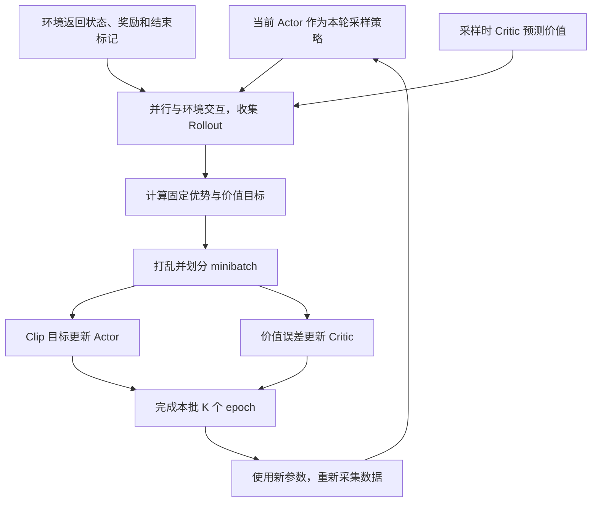

# 经典论文解读（十八）｜强化学习与对齐：Proximal Policy Optimization Algorithms

读 InstructGPT 时，很容易把最后一步理解成：奖励模型给回答打分，PPO 让语言模型多生成高分回答。但这个说法跳过了最关键的一段：一个完整回答只有一个质量分数，怎样用它更新生成过程中成百上千次 token 选择？更新以后，为什么模型不会为了追逐这个分数一下子变得很奇怪？

这些问题需要回到 2017 年 John Schulman 等人提出的 **Proximal Policy Optimization（PPO，近端策略优化）**。它最初研究的是游戏与机器人控制中的策略优化，后来成为 InstructGPT 使用的强化学习算法。

PPO 关心的是一个很具体的训练问题：与环境交互得到一批昂贵的样本后，能否多利用几次，同时避免策略更新得太猛？理解这个问题，也就能看懂 Clip 目标、Actor-Critic 和 Rollout 为什么会出现在同一条训练流程里。

## 一、PPO 出现时，DQN 和 TRPO 各有什么局限？

先看一个机器人走路的例子。每一步，机器人读取关节角度和速度，选择各关节施加的力矩，环境再返回新的状态和奖励。目标是经过多次试验，找到一种能持续向前走、又不容易摔倒的行为方式。

### 1. DQN：先估计动作的价值，再选动作

DQN 学习一个动作价值函数 `Q(s, a)`：在状态 `s` 下执行动作 `a`，此后继续行动，预期能获得多少累计奖励。选动作时，通常偏向 Q 值最大的动作，同时保留一定探索概率。

原始 DQN 的网络为每个离散动作输出一个 Q 值。在 Atari 里，动作可以是向左、向右、开火，这种形式很自然。机器人关节的力矩却是连续数值；把每个关节都离散成若干档，多关节动作组合会迅速膨胀，不能直接照搬“输出所有动作的 Q 值，再取最大值”的做法。

DQN 已经通过经验回放和目标网络缓解了训练不稳定的问题。但对带函数近似的 Q-learning，采样分布、估计误差与自举目标之间仍然存在复杂的相互作用。PPO 论文把这些困难作为背景，转向直接优化策略。

这不意味着 PPO 修复了 DQN 的所有问题。PPO 没有沿着 DQN 的 Q-learning 更新规则做修改；连续控制也有 DDPG 等其他路线。两者的数据使用方式也不同：DQN 可以从历史经验池反复采样，标准 PPO 则主要依赖近期策略新采集的数据。

### 2. 普通策略梯度：直接学怎么行动，但更新幅度不好控制

策略网络直接输出动作分布，记作 `πθ(a|s)`。离散动作可以用分类分布，连续动作可以用高斯分布，再从分布中采样动作。

假设机器人某次发力后，比预期走得更稳，训练就提高在类似状态下选择这个动作的概率；如果比预期差，就降低它。问题在于，神经网络的参数被许多状态和动作共享。在一批样本上做一次梯度更新，可能改变大量未观察状态下的行为。

步子太小，交互样本用得不充分；步子太大，原本还能走的机器人可能突然只会摔倒。把同一批样本在普通策略梯度目标上训练很多遍，又会让策略越来越偏离产生这批数据时的分布。

### 3. TRPO：限制策略变化，但优化过程复杂

TRPO（Trust Region Policy Optimization，信赖域策略优化）用 KL 散度衡量新旧策略分布的距离，在优化收益时约束这个距离。

它给出的思路很有吸引力：改进策略时，同时限制行为改变的幅度。实际优化通常要用共轭梯度、Fisher 向量积和回溯线搜索，而不是直接把一个普通损失交给 Adam。PPO 论文还指出，原来的 TRPO 实现方式对策略与价值网络共享参数、带随机性的网络结构等情形不够方便。

PPO 希望保留这种保守更新的效果，同时使用常规的一阶优化方法，让并行采样、共享网络和 minibatch 训练更容易实现。

| 方法 | 主要学习什么 | 与 PPO 相关的背景问题 |
| --- | --- | --- |
| 原始 DQN | 每个离散动作的 Q 值 | 连续动作不能直接枚举；价值估计与自举训练有稳定性难点 |
| 普通策略梯度 | 动作概率分布 | 样本利用有限，较大的策略更新可能破坏已有行为 |
| TRPO | 带信赖域约束的策略 | 更新较保守，但优化实现复杂 |
| PPO | 便于一阶优化的策略代理目标 | 在更新约束、样本利用与实现成本之间作折中 |

## 二、Actor、Critic 和环境奖励分别做什么？

在写 Clip 公式前，需要分清三个量：眼前拿到的奖励、未来累计能拿多少奖励，以及这个动作比平常好多少。

### 1. 奖励与回报：一步反馈和长期结果

记状态为 `s_t`，动作为 `a_t`，执行该动作后得到的环境奖励为 `r_t`。从这一步向后累计的折扣回报为：

```math
G_t = \sum_{k=0}^{T-t-1}\gamma^k r_{t+k}
```

这里暂时假设 episode 在时刻 `T` 结束，`γ` 是折扣因子。即时奖励可能是这一步前进的距离，回报还考虑后面会不会继续前进、会不会摔倒。强化学习优化的是长期回报，而非每一步眼前的得分。

### 2. Actor 选动作，Critic 估计未来

**Actor** 是策略 `πθ`，回答“当前应该怎样行动”。**Critic** 通常学习状态价值 `Vφ(s)`，回答“从这里开始，按照当前策略继续行动，预期能拿多少回报”。

Critic 不负责产生环境奖励。它是一个回报预测器，可以用实际经历和自举目标训练；预测本身可能有误差。

考虑一个仅用于说明的例子：Critic 预估当前状态的回报是 5，这次试验得到的回报是 8，我们就有理由认为，这条经历比预期好。若另一个状态本来就能拿到 20，实际只得到 15，即使 15 比 8 大，第二条经历也可能比预期差。

这就引出了优势函数：

```math
A^\pi(s,a) = Q^\pi(s,a) - V^\pi(s)
```

优势衡量的是：在这个状态选择这个动作，相比按当前策略行动的平均水平，好了多少。上面的“回报减价值预测”是一种直观估计；实际 PPO 常用后面介绍的 GAE，让估计的方差更可控。

### 3. 策略梯度把优势变成概率变化

典型的策略梯度估计是：

```math
\hat g = \hat{\mathbb E}_t\left[
\nabla_\theta \log \pi_\theta(a_t\mid s_t)\,\hat A_t
\right]
```

hat 表示这些量来自有限样本的估计。沿这个梯度做上升，正优势推动对应动作的概率增加，负优势推动概率减小。这里并不需要把一个离散动作的采样过程本身求导；训练使用的是已采样动作的对数概率。

Actor-Critic 是把策略学习与价值估计结合起来的训练方式，早于 PPO。PPO 的贡献主要在于怎样优化策略；论文给出了适合这种训练方式的算法，并没有发明 Actor 或 Critic。

## 三、从旧策略的数据，到 Clip 目标函数

### 1. 为什么需要新旧策略的概率比？

假设我们先用 `π_old` 收集一批数据，随后更新 Actor。数据里的动作来自旧策略，优化中的新策略却已经变了。为衡量同一个动作在新旧策略下的变化，定义：

```math
\rho_t(\theta)=
\frac{\pi_\theta(a_t\mid s_t)}{\pi_{\mathrm{old}}(a_t\mid s_t)}
=\exp\left(\log\pi_\theta(a_t\mid s_t)-\log\pi_{\mathrm{old}}(a_t\mid s_t)\right)
```

原论文用 `r_t(θ)` 表示概率比；本文改用 `ρ_t`，避免与环境奖励 `r_t` 混淆。新旧参数相同时，概率比为 1。旧策略选择该动作的概率是 0.2，新策略变成 0.3，概率比就是 1.5。

重要性采样提供了用旧分布样本评价新分布的思路，由此构造策略代理目标：

```math
L^{\mathrm{sur}}(\theta)=
\hat{\mathbb E}_t\left[\rho_t(\theta)\hat A_t\right]
```

不过，这个比值只校正给定状态下的动作分布，没有把旧策略访问的状态全部变成新策略的状态分布。因此它是局部代理目标，不能理解为“任意旧数据都能精确评价任意新策略”。新旧策略越接近，使用这批数据就越有依据。

### 2. TRPO 怎样限制这个目标？

TRPO 的实用近似形式可以写成：

```math
\begin{aligned}
\max_\theta\quad &\hat{\mathbb E}_t[\rho_t(\theta)\hat A_t] \\
\text{subject to}\quad &
\hat{\mathbb E}_t\left[D_{\mathrm{KL}}\left(
\pi_{\mathrm{old}}(\cdot\mid s_t)\,\|\,\pi_\theta(\cdot\mid s_t)
\right)\right]\leq\delta
\end{aligned}
```

KL 看的是给定状态下整个动作分布，而不是只看这次抽中的动作。这个约束让优化不能只顾着把代理目标推高，还要检查新旧行为是否相差过大。实际 TRPO 使用近似求解，理论上的改进保证也有相应假设，不能直接等同于所有神经网络实验中的严格保证。

### 3. PPO Clip：改善到一定程度，便不再奖励继续走远

PPO-Clip 把约束的想法放进目标函数：

```math
L^{\mathrm{CLIP}}(\theta)=\hat{\mathbb E}_t\left[
\min\left(
\rho_t(\theta)\hat A_t,
\operatorname{clip}(\rho_t(\theta),1-\epsilon,1+\epsilon)\hat A_t
\right)\right]
```

这是一个**最大化**目标。`clip` 把概率比截在指定区间内，`min` 则在原始项和裁剪项之间选较小的一项。论文给出的示例是 `ε = 0.2`，对应区间 `[0.8, 1.2]`。

为什么不能只保留裁剪项？因为当策略朝错误方向变化时，我们仍然希望目标继续变差，让优化器看到纠正它的信号。取 `min` 的效果是：对有利方向上的过大改变不再增加收益，对不利方向的改变继续计入损失。

下面都是单个样本的教学计算，不是论文实验数据。

| 优势 | 概率比 | 原始项 | 裁剪项 | 最终取值 |
| --- | --- | --- | --- | --- |
| `+2` | `1.1` | `2.2` | `2.2` | `2.2` |
| `+2` | `1.5` | `3.0` | `2.4` | `2.4` |
| `+2` | `0.5` | `1.0` | `1.6` | `1.0` |
| `-2` | `0.9` | `-1.8` | `-1.8` | `-1.8` |
| `-2` | `0.5` | `-1.0` | `-1.6` | `-1.6` |
| `-2` | `1.5` | `-3.0` | `-2.4` | `-3.0` |

正优势表示这个动作值得增加概率。概率比从 1 增加到 1.2 时，目标增加；超过 1.2，单个样本的目标不再继续增加。但如果概率反而大幅下降，目标仍然下降，不会被下边界遮住。

负优势的方向相反：减小动作概率能够改善目标，但概率比低于 0.8 后，继续减小不再给这个样本增加收益；如果概率反而增加，目标会继续恶化。

需要特别注意，Clip **没有把网络输出的概率比强制锁在 `[0.8, 1.2]`**。多个样本共享参数，其他样本的梯度仍可能推动这个动作继续变化；Clip 也没有建立严格的 KL 上界。它构造的是不高于未裁剪代理目标的保守目标，不是实际回报的无条件下界。

### 4. PPO 还有 KL penalty 版本

原论文也研究了在代理目标中直接减去新旧策略 KL 的方案，并根据观测到的 KL 调整惩罚系数。变化太大就提高系数，变化太小则降低。

这通常称为 PPO-Penalty。论文实验中 Clip 版本总体表现更好，所以后面谈 PPO 时以 PPO-Clip 为主。这里的新旧策略 KL，与 InstructGPT 相对固定 SFT 模型的 KL 惩罚，参照对象和作用范围都不同。

## 四、Rollout 怎样变成 Actor 和 Critic 的训练数据？

Rollout 就是让策略实际运行，记录它与环境交互产生的一段轨迹。它不要求包含完整 episode：机器人可能还没摔倒，采样器已经收够固定步数，开始训练。

### 1. 先采样，暂时不更新 Actor

在从头学习的控制任务中，Actor 与 Critic 可以随机初始化，奖励由环境的任务规则提供；这时不需要 SFT 模型或偏好评分器。后面介绍 InstructGPT 时，会看到这些部件怎样换成已经训练过的语言模型。

在一轮开始时，把当前 Actor 作为本轮采样策略 `π_old`。可以让多个环境副本并行运行，每个副本收集 `T` 步，得到总共 `N × T` 个 transition。

每一步至少记录状态、动作、实际奖励、结束标记、旧策略对该动作的 log probability，以及采样时 Critic 的价值预测。训练阶段可以重新计算新策略的概率，但**旧 log probability 必须保持为采样时的数值**，否则概率比的参照对象会跟着移动。

这里的多个 actor 也可能指并行采样进程，通常使用相同的策略参数，不是同时训练多个互不相同的策略模型。

### 2. 用 GAE 估计每一步的优势

只用完整回报减去价值预测，容易受整段未来轨迹的随机性影响。GAE（Generalized Advantage Estimation，广义优势估计）把多步时序差分误差组合起来：

```math
\delta_t = r_t+\gamma V_{\mathrm{old}}(s_{t+1})-V_{\mathrm{old}}(s_t)
```

```math
\hat A_t=\sum_{l=0}^{T-t-1}(\gamma\lambda)^l\delta_{t+l},
\qquad \hat G_t=\hat A_t+V_{\mathrm{old}}(s_t)
```

第二个式子写的是不跨 episode 的一段轨迹；在真正终止状态，后续价值为零。如果只是采样步数用完，就需要用末状态的价值自举，而不能误当成任务终止。时间限制等截断也应按任务定义区分。

`δ_t` 可以理解为“这一步奖励加上下一状态的预估，是否超过此前预期”。`λ` 控制向后混合多少步：较小的值更依赖价值预测，较大的值更依赖实际经历，需要在偏差与方差之间折中。GAE 是 PPO 使用的已有估计方法，并非 Clip 目标的一部分。

例如，在一条两步后真正结束的教学轨迹中，奖励是 `[0, 1]`，采样时的价值预测是 `[0.4, 0.6]`。取 `γ = λ = 1`，最后一步的 TD 误差为 `1 - 0.6 = 0.4`，第一步为 `0 + 0.6 - 0.4 = 0.2`，所以优势是 `[0.6, 0.4]`，价值目标都是 1。末尾拿到的奖励由此进入前面动作的学习信号，但没有假装环境曾为每个动作单独打分。

### 3. Actor 和 Critic 分别更新什么？

Actor 最大化 Clip 目标；Critic 则拟合价值目标：

```math
\mathcal L_V(\phi)=\hat{\mathbb E}_t\left[
\left(V_\phi(s_t)-\hat G_t\right)^2\right]
```

把它们放进常见的**最小化**写法，并加入鼓励探索的熵奖励，可写成：

```math
\mathcal L_{\mathrm{total}}=
-L^{\mathrm{CLIP}}+c_V\mathcal L_V
-c_H\hat{\mathbb E}_t[H(\pi_\theta(\cdot\mid s_t))]
```

两个网络可以独立，也可以共享一部分主干；共享时，这个组合损失会共同影响主干参数。熵项鼓励保留探索，不应与后面相对 SFT 的 KL 惩罚混为一谈。

在同一批数据的内部更新中，优势、价值目标和旧 log probability 都作为固定训练量，不让梯度通过这些目标反向传播。Critic 更新后，下一轮 Rollout 再使用新的价值估计。

### 4. 完整循环



```text
初始化 Actor θ 与 Critic φ
重复：
  固定本轮采样策略 π_old = π_θ
  用 π_old 与环境交互，记录轨迹、old_logp、old_value
  按终止/截断边界计算 GAE 与价值目标，并固定这些训练量

  重复 K 个 epoch：
    遍历打乱后的 minibatch：
      new_logp = 当前 Actor 对已采样动作的 log probability
      ratio = exp(new_logp - old_logp)
      用 ratio 与固定优势计算 Clip 目标
      更新 Actor；用固定价值目标更新 Critic

  丢弃本批训练数据，进入下一轮 Rollout
```

PPO 的样本复用发生在这批近期数据的有限更新中。它没有因此变成可以任意使用多年历史经验的 off-policy 算法。更新过多，仍可能偏离采样分布，Clip 无法消除这个问题。

## 五、InstructGPT 怎样把这套流程用于语言模型？

PPO 原论文没有奖励模型、SFT 或人类回答排序。InstructGPT 在 2022 年直接采用 PPO，把它放进“监督微调—奖励建模—强化学习”的流程。这里有明确的算法继承关系，超过了笼统的“受到启发”。

### 1. 从机器人轨迹到回答生成

| 一般控制任务 | InstructGPT 中的对应物 |
| --- | --- |
| 环境初始状态 | 抽取一个用户 prompt |
| 状态 `s_t` | prompt 加已经生成的回答前缀 |
| 动作 `a_t` | 下一个 token |
| 状态转移 | 将该 token 追加到前缀 |
| 一次 episode | 生成一条完整回答 |
| 环境任务奖励 | 固定 RM 对完整回答的评分 |
| 价值预测 | Critic 对当前前缀后续总回报的估计 |

论文把任务称作 bandit 环境：给定 prompt，提交完整回答，收到评分后结束；并不存在必须与外部世界交互多轮的任务。但回答内部仍是自回归 token 序列，可以用逐 token 的价值与优势估计训练。

### 2. 哪些模型从哪里来？

把 InstructGPT 概括成“四个模型都从同一个 SFT 复制”并不准确。按论文附录 C 的实际设置：

| 角色 | 初始化及输出 | PPO 阶段是否更新 |
| --- | --- | --- |
| Actor | 从经过监督微调的 GPT-3 初始化，输出 token 分布 | 更新 |
| Reference | 固定保留 Actor 的初始监督微调检查点，输出参考 token 概率 | 冻结 |
| Reward Model | 6B GPT-3 主干改为标量输出，经偏好比较训练，评价完整回答 | 冻结 |
| Critic | 从训练好的 6B RM 初始化，预测前缀后续回报 | 更新 |

还有两点值得单独记住。第一，最终 RM 的初始化来自已经在若干公开 NLP 数据集上微调过的 6B GPT-3。论文正文用“SFT 模型换输出头”概括奖励建模，但附录说明了这个实际来源，并报告从 GPT-3 或 SFT 初始化也得到相近结果。

第二，用于 RL 初始化的监督微调进行了 2 个 epoch，并混入 10% 预训练数据；它与论文单独评估的 16-epoch SFT 基线配置不同。固定参考模型对应的是 **RL 起点的那个检查点**，不能随意换成另一个 SFT 模型。

Actor 有 1.3B、6B 和 175B 三种规模，而 RM 与 Critic 始终是 6B。Critic 从 RM 开始，不意味着二者此后共享参数或承担同一任务：RM 继续评价回答是否受偏好，Critic 则学习当前策略及奖励设置下的预期回报。

### 3. Rollout 从哪里来，记录什么？

人类排序数据先用于训练 RM。PPO 阶段不要求标注员在每次生成后重新评分，也不把偏好数据中的 chosen 回答当成标准答案直接训练。

训练器从未标注 prompt 集合中采样，用本轮 Actor 生成新的回答。采样温度为 1，记录回答 token、采样旧策略的 log probability、Critic 的价值预测和结束位置。Reference 评价同样的生成 token，RM 则读取完整的 prompt 与回答，提供终局分数。

随后，把终局分数与 token 级 KL 惩罚组合成奖励序列，计算 GAE、价值目标，再做 PPO 更新。更新阶段是在**已有回答上重新计算概率**，不需要每做一个梯度步骤就生成一次新答案。下一批 Rollout 才使用更新后的策略采样。

这一轮需要区分三个策略：不断更新的当前 Actor、本批数据的采样旧策略，以及训练全程固定的 Reference。旧策略可以用保存的 log probability 表示，不一定要额外常驻一个完整模型。

### 4. 为什么 Clip 之外还需要相对 SFT 的 KL？

Clip 关注一次迭代中新旧策略的变化。即使每一步都走得不远，很多步之后仍可能离最初的 SFT 很远。与此同时，RM 只是有限人类偏好数据训练出来的代理目标，离它熟悉的回答分布越远，评分越可能不可靠。

因此 InstructGPT 优化的任务目标包含：

```math
J(\theta)=\mathbb E_{x,\,y\sim\pi_\theta(\cdot\mid x)}\left[
R_\psi(x,y)-\beta\log\frac{\pi_\theta(y\mid x)}{\pi_{\mathrm{ref}}(y\mid x)}
\right]
```

`Rψ` 是冻结的奖励模型；`β` 控制偏好奖励和偏离代价的权衡。它不要求模型逐字复现 SFT 的回答，而是让提高奖励所带来的收益，需要抵得过分布变化的代价。

对完整回答求当前策略下的期望，log 概率比对应 `D_KL(πθ || π_ref)`。自回归概率可以按 token 分解，于是在采集这批 Rollout 时，对每个生成 token 构造：

```math
k_t=\log\pi_{\mathrm{old}}(y_t\mid x,y_{<t})
-\log\pi_{\mathrm{ref}}(y_t\mid x,y_{<t})
```

```math
\tilde r_t=-\beta k_t
+\mathbf 1[t=T-1]R_\psi(x,y)
```

这里回答 token 从 0 编到 `T-1`。RM 分数只放在末尾，KL 项则分布到每一步；随后用总奖励序列估计优势。单个采样 token 的 `k_t` 可以为负，它是 KL 的采样项，不能把每个数都叫作非负的 KL 散度。

KL 约束有助于抑制奖励模型过度优化，但不能保证彻底杜绝 reward hacking，也不能代替评估。若 `β` 太大，策略很难学到偏好改善；若太小，又可能为了 RM 的高分离开可靠区域。

| 机制 | 比较对象 | 解决的问题 |
| --- | --- | --- |
| PPO Clip | 当前策略与本批采样旧策略 | 避免一次局部优化过激 |
| RLHF KL penalty | 策略与固定 SFT 参考模型 | 限制训练累计产生的策略漂移 |
| PPO-ptx | 在原始预训练数据上继续做语言建模 | 缓解公开 NLP 任务的能力回退 |

### 5. 原论文配置与通用 PPO 有什么不同？

PPO 的一般流程允许一批数据训练 `K` 个 epoch；InstructGPT 附录 C.4 报告的实际配置却只有 **1 个内部 epoch**。每批 512 个 episode，拆成 8 个大小为 64 的 minibatch，所以一个 epoch 仍然包含多次参数更新。

实验使用约 31k 个不同 prompt，总计训练 256k 个 episode，重复抽到 prompt 时可以生成新回答，而不是重复使用同一条旧回答。其 Clip 参数为 0.2，KL 系数为 0.02，GAE 估计不使用回报折扣，即 `γ = 1`。

PPO-ptx 又在更新中混入预训练语言建模梯度，缓解论文观察到的 alignment tax。这里要区分数据流：Rollout 提供偏好优化所需的新回答，预训练数据提供额外的语言建模样本，后者不需要经过 RM 打分。

## 六、PPO 的影响，应该怎样评价？

PPO 原论文的证据来自连续控制和 Atari 实验。它在所比较的连续控制任务中整体表现较好，在 49 个 Atari 游戏上，相比 A2C 有明显优势，与更复杂的 ACER 则各有胜负：按训练全程平均回报计，PPO 赢了更多游戏；按训练末尾表现计，ACER 赢了更多。

因此，PPO 的价值不能简化成“分数永远最高”。它用普通自动微分和 minibatch 优化，就能得到相当有竞争力的策略学习效果，让信赖域式的保守更新更容易用于实际系统。

InstructGPT 展示了这种可用性在语言模型中的意义：策略不再输出机器人力矩，而是输出 token；训练仍然可以沿着“采样—评价—估计优势—更新策略”组织。人类偏好先被压缩进 RM，PPO 再把 RM 提供的分数转化为语言模型的参数变化。

不过，PPO 既没有发明人类反馈学习，也不是偏好后训练的唯一算法。后来的 DPO 直接使用偏好对优化策略，省去显式 RM 和 PPO；这也提醒我们，要把“从偏好中学习”的目标与“用 PPO 更新”的具体方法分开。

回到开头的问题：完整回答的一次评分，通过奖励序列、Critic 和优势估计进入 token 级学习；Clip 控制近期策略更新的激励，固定 SFT 的 KL 惩罚则约束更长时间尺度上的偏移。理解这几层分工，才算把“用 PPO 优化奖励”还原成了一条可以执行的训练流程。

## 参考资料

1. John Schulman et al., **Proximal Policy Optimization Algorithms**, 2017. https://arxiv.org/abs/1707.06347 。本文 Clip 目标、KL penalty 变体、训练循环与实验比较的主要来源。
2. Volodymyr Mnih et al., **Human-level Control through Deep Reinforcement Learning**, Nature 2015. https://doi.org/10.1038/nature14236 。DQN 的动作价值学习、经验回放与目标网络。
3. John Schulman et al., **Trust Region Policy Optimization**, ICML 2015. https://arxiv.org/abs/1502.05477
4. John Schulman et al., **High-Dimensional Continuous Control Using Generalized Advantage Estimation**, ICLR 2016. https://arxiv.org/abs/1506.02438
5. Long Ouyang et al., **Training Language Models to Follow Instructions with Human Feedback**, NeurIPS 2022. https://arxiv.org/abs/2203.02155 。训练目标见第 3.5 节，初始化与 PPO 实验配置见附录 C.2–C.4。
6. OpenAI, **Spinning Up: Proximal Policy Optimization**. https://spinningup.openai.com/en/latest/algorithms/ppo.html
7. Rafael Rafailov et al., **Direct Preference Optimization: Your Language Model Is Secretly a Reward Model**, NeurIPS 2023. https://arxiv.org/abs/2305.18290
8. 本站相关文章：[经典论文解读（八）｜InstructGPT](category.html?category=papers&post=2026-08-03-instructgpt-paper-notes)。
