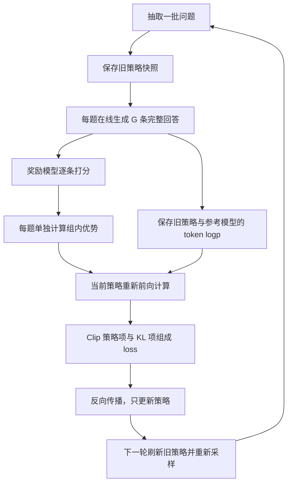

# 经典论文解读（二十）｜强化学习与对齐：DeepSeekMath: Pushing the Limits of Mathematical Reasoning in Open Language Models

PPO 篇解释了语言模型怎样通过奖励、Critic 和优势估计学习，DPO 篇则直接用已有偏好对更新策略。现在考虑另一条路线：如果仍然希望模型在线生成解题过程、根据评分继续探索，能不能省去与策略同步训练的 Critic？

2024 年 Zhihong Shao 等人提出的 **DeepSeekMath**，在数学预训练和指令微调之外，引入了 **Group Relative Policy Optimization（GRPO，组相对策略优化）**。它为同一道题生成一组回答，用组内分数构造相对优势，再沿着 PPO 式的策略更新流程训练。价值网络的工作，由这一组真实采样的结果来承担一部分。

这篇文章重点解释三个问题：组内比较为什么能提供训练信号，信号怎样进入 token 级 loss，以及没有 Critic 后，整条强化学习流程还剩下什么。

## 一、PPO 的 Critic 为什么昂贵？

### 1. 奖励模型与 Critic 各管什么？

在常见的 PPO 式 RLHF 中，Actor 生成回答，奖励模型 RM 评价回答质量，参考模型提供偏移约束，Critic 则预测各个生成位置的预期未来回报。它们回答的问题不同：RM 判断“这份回答好不好”，Critic 判断“走到这个位置，后面通常还能得到多少回报”。

优势衡量一次选择比基线好多少。PPO 常用 Critic 的状态价值预测，结合实际奖励和 GAE 构造优势，再决定哪些 token 选择值得强化。Critic 自己也需要用回报目标训练，不能只加载一份模型就一直使用。

对语言模型而言，价值网络可能与策略网络规模相近。它除了参数，还需要梯度、优化器状态和训练激活，增加显存与前后向计算。如果大部分质量奖励只在回答结束后给出，网络还要学会从不同的中间前缀预测结果。各个角色可以共享部分参数，因此不能把这些成本简单理解成固定的“四份模型”。

GRPO 的切入点是：针对同一道题，能否用几条实际回答的平均得分，代替额外网络预测的基线？

| 计算职责 | 常见 PPO 式 RLHF | DeepSeekMath 的 GRPO |
| --- | --- | --- |
| 产生训练回答 | 近期策略在线 Rollout | 旧策略为每题生成多条回答 |
| 评价回答 | 奖励模型 | 仍使用奖励模型 |
| 估计优势 | 价值网络与 GAE | 组内奖励的相对比较 |
| 控制更新 | PPO Clip 与参考策略约束 | 保留 Clip，独立加入 KL 项 |
| 可训练价值网络 | 需要维护与更新 | 省去 |

省掉 Critic 能减少一项显著开销，但多回答生成、奖励打分和策略反向传播仍然存在。节省多少总资源取决于模型结构、组大小、回答长度与系统实现，不能直接宣称成本减半。

### 2. GRPO 在 DeepSeekMath 中的位置

DeepSeekMath 从 DeepSeek-Coder-Base-v1.5 7B 出发，通过数学相关语料等数据继续预训练，得到 Base；再用解题与工具使用等指令数据训练 Instruct，最后通过强化学习得到 RL 模型。

因此，GRPO 优化的是已经有一定解题能力的策略。数学数据与 SFT 提供了重要起点，不能把最终成绩全部归功于组内比较。本文将预训练作为背景，集中讨论 Instruct 之后的训练。

## 二、同一道题的多条回答，怎样提供优势？

### 1. 基线来自组内平均分

记问题为 `q`，旧策略为 `π_old`。对同一个问题，独立采样 `G` 条完整回答，每条回答包含解题过程与最终答案：

```math
\{o_1,\ldots,o_G\}\sim\pi_{\mathrm{old}}(\cdot|q),
\qquad r_i=r_\varphi(q,o_i).
```

`r_φ` 是奖励模型。先讨论每份完整回答只有一个分数的结果监督。设组内均值与标准差为：

```math
\bar r=\frac{1}{G}\sum_{i=1}^{G}r_i,
\qquad
s_r=\sqrt{\frac{1}{G}\sum_{i=1}^{G}(r_i-\bar r)^2}.
```

这里为了便于复算，明确采用总体标准差的约定。组内相对优势写成：

```math
\hat A_i=\frac{r_i-\bar r}{s_r},
\qquad \hat A_{i,t}=\hat A_i.
```

减均值回答“比这道题的平均表现好多少”，除以标准差则调整分数尺度。高于平均分的回答得到正优势，低于平均分的得到负优势。同一回答的所有有效 token 共用这个值，最后通过策略目标改变生成它们的倾向。

这里的“相对”很重要。一个绝对得分不高的回答，也可能因为同组其他回答更差而得到正优势；反过来，一组较好的回答仍然可能有成员得到负优势。优势表达的是这次同题采样中的相对表现。

### 2. 用四条回答算一遍

假设问题是“解方程 `2x + 3 = 11`”。模型生成四条推理路径，最终答案分别为 `7、5.5、4、4`。下面为了演示，给出分数 `[0, 0, 1, 1]`，不把这组简化评分当作原论文的奖励模型实现。

均值是 `0.5`，方差是 `0.25`，标准差是 `0.5`，所以：

| 回答 | 教学分数 | 分数减均值 | 相对优势 |
| --- | --- | --- | --- |
| 第一条 | 0 | −0.5 | −1 |
| 第二条 | 0 | −0.5 | −1 |
| 第三条 | 1 | +0.5 | +1 |
| 第四条 | 1 | +0.5 | +1 |

训练会倾向于降低前两条轨迹的概率，提高后两条轨迹的概率。两条正确回答即使措辞和推理路径不同，也都可以获得正向信号；不需要先把它们配成一对 chosen/rejected。

但这仍然是整条轨迹的评价。第三条回答得到正优势，不代表奖励系统已经证明它的每一步都正确。如果答案碰巧正确、推理中却有错误，结果监督可能把这条路径一起强化，这就是后面过程监督想缓解的问题。

### 3. 它替代了什么，没有估计出什么？

组内统计必须按问题分开计算。把简单题和困难题混在同一个均值里，容易把题目难度误当成回答质量。这里比较的是“同样条件下还有哪些解法”，而非不同问题的原始分数高低。

GRPO 用采样结果构造基线，并没有训练出一个能为任意中间前缀预测未来回报的价值函数。组均值还包含样本自己的奖励，标准差也由同一批样本估计，因此不应把这种有限样本的标准化直接说成精确或无偏的 PPO 优势。

如果所有分数相同，标准差为零。教学实现会在分母加一个小量：此时所有相对优势为零，策略项没有区分信号。全对和全错都可能出现这种情况；KL 项则仍可能产生梯度。增加组大小有时能采到差异，但不能保证模型一定探索出更好的回答。

## 三、优势怎样进入完整 GRPO 目标？

### 1. 先分清三个策略

`π_θ` 是正在更新的策略；`π_old` 是生成当前这批回答时的策略快照；`π_ref` 是提供 KL 约束的参考策略。三者开始时可以相同，训练中的用途和刷新频率却不同。

对回答 `o_i` 的第 `t` 个 token，定义当前概率与采样时概率的比值：

```math
\rho_{i,t}(\theta)=
\frac{\pi_\theta(o_{i,t}|q,o_{i,<t})}
{\pi_{\mathrm{old}}(o_{i,t}|q,o_{i,<t})}.
```

这个比值按 token 计算，不能先把整条回答的 log probability 求和，再把整段概率比代进 token 目标。旧概率在当前这轮更新中保持不变，否则分母会跟着分子一起变化，失去记录采样分布的作用。

### 2. Clip 控制继续推动更新的激励

GRPO 保留 PPO 的裁剪代理项：

```math
S_{i,t}=\min\left[
\rho_{i,t}\hat A_{i,t},
\operatorname{clip}(\rho_{i,t},1-\epsilon,1+\epsilon)\hat A_{i,t}
\right].
```

正优势鼓励增大该 token 的概率，负优势鼓励减小概率。裁剪通过 `min` 限制朝有利方向继续推动的收益，并不保证概率比真的被锁在区间内。

例如取 `ε = 0.2`。当优势为 `+1`、概率比为 `1.4` 时，两项是 `1.4` 和 `1.2`，最终取 `1.2`；继续增加概率比不再提高这一项收益。当优势为 `−1`、概率比为 `0.6` 时，两项是 `−0.6` 和 `−0.8`，取 `−0.8`，过度降低概率也不再获得额外激励。优势的符号决定裁剪在哪个方向起作用。

### 3. KL 单独约束相对参考模型的偏移

原文在策略目标中单独减去 KL 惩罚，而不先把它混进奖励再做组内归一化。对采样 token，使用以下表达式：

```math
u_{i,t}=\frac{\pi_{\mathrm{ref}}(o_{i,t}|q,o_{i,<t})}
{\pi_\theta(o_{i,t}|q,o_{i,<t})},
\qquad k_{i,t}=u_{i,t}-\log u_{i,t}-1.
```

因为 `log u ≤ u − 1`，所以它非负，相等时为零。在固定前缀下，若 token 按当前策略采样，有：

```math
\mathbb E_{a\sim\pi_\theta}[k(a)]
=D_{\mathrm{KL}}(\pi_\theta(\cdot|\text{prefix})
\|\pi_{\mathrm{ref}}(\cdot|\text{prefix})).
```

原因是此时 `E[u] = 1`，剩下的期望正是当前策略相对参考策略的对数概率比。因此 KL 方向为 `π_θ || π_ref`，而 `u` 本身的分子是参考概率，两者不要写反。

实际回答来自 `π_old`。刚开始更新时新旧策略相同，随后可能不同；不能脱离这个采样条件，把旧策略数据上的有限估计称为当前策略精确、始终无偏的 KL。这个惩罚也没有提供严格的 KL 上界。

### 4. 合起来就是训练目标

设 `T_i` 为回答 `i` 的有效 token 数，原始 GRPO 目标可整理为：

```math
\mathcal J_{\mathrm{GRPO}}(\theta)=
\mathbb E_{q,\,\{o_i\}\sim\pi_{\mathrm{old}}}
\left[
\frac{1}{G}\sum_{i=1}^{G}\frac{1}{T_i}
\sum_{t=1}^{T_i}\left(S_{i,t}-\beta k_{i,t}\right)
\right].
```

这里先对每条回答内部求平均，再对组内回答求平均，最后对问题求期望。直接把 batch 中所有 token 平铺取平均，会让较长回答获得不同的相对权重，改变原始目标。它也不同于 DPO 先计算整条回答的序列 log probability。

实现时最小化 `L = −J`，所以 loss 里是负的策略项加正的 KL 项。优势、旧概率和参考概率均不参与梯度计算，梯度只沿当前策略传播。

一个容易疑惑的地方是：初始化时 `ρ = 1`，组内优势又均值为零，策略怎么还能更新？零的是这一点上的标量均值。对参数求导时，不同回答对应不同的 log probability 梯度，带符号加权后通常不会抵消。只有所有优势本身都为零等特殊情况，才没有这部分训练信号。

## 四、一轮训练具体做什么？

### 1. 从在线生成到参数更新

以结果监督为例，从 SFT 检查点初始化策略，准备冻结的参考模型和已经训练好的奖励模型。然后执行：



Rollout 阶段是真实的自回归生成，训练阶段则把已经生成的回答喂回模型，通过 teacher forcing 重新计算每个已选 token 的概率。奖励高低与采样结果都当作固定数据，不需要对生成操作或奖励模型反向传播。

旧策略只需在采样与旧概率计算期间保持一致，之后保存分数即可服务当前批次更新，不必为了 loss 始终保留一份参与计算的旧网络。参考模型与奖励模型在这轮策略更新中同样冻结。

### 2. 教学代码中的张量怎样组织？

假设 batch 有 `B` 个问题，每题 `G` 条回答。分词后按题连续排列为 `[B×G, L]`，其中 `L` 包含 prompt、回答与右侧 padding。`answer_mask` 只在回答 token 上为 1，包含约定的 EOS，排除 prompt 和 padding。

因果模型位置 `t` 的 logits 预测位置 `t+1` 的 token，所以要把 `logits[:, :-1]` 与 `input_ids[:, 1:]` 对齐。第一个回答 token 由最后一个 prompt 位置的输出预测，mask 应按目标 token 判断，不能误删这个概率。

下面代码只实现概率与 loss，采样、打分和模型加载由训练框架负责；它不是作者公开的完整训练程序。示例采用总体标准差，并加 `1e-6` 处理零方差。

```python
import torch
import torch.nn.functional as F


def answer_logps(model, ids, attention, answer_mask):
    logits = model(input_ids=ids, attention_mask=attention).logits
    targets = ids[:, 1:]
    logps = F.log_softmax(logits[:, :-1].float(), dim=-1)
    chosen = logps.gather(-1, targets.unsqueeze(-1)).squeeze(-1)
    mask = answer_mask[:, 1:].bool() & attention[:, 1:].bool()
    return chosen.masked_fill(~mask, 0.0), mask


def group_advantages(rewards):  # rewards: [B, G]
    rewards = rewards.detach()
    mean = rewards.mean(dim=1, keepdim=True)
    std = rewards.std(dim=1, keepdim=True, correction=0)
    return ((rewards - mean) / (std + 1e-6)).reshape(-1, 1)


def grpo_loss(logps, old_logps, ref_logps, mask, advantages,
              clip_eps=0.2, beta=0.04):
    # logps / old_logps / ref_logps / mask: [B*G, L-1]
    ratio = (logps - old_logps.detach()).exp()
    advantages = advantages.detach()
    unclipped = ratio * advantages
    clipped = ratio.clamp(1 - clip_eps, 1 + clip_eps) * advantages
    surrogate = torch.minimum(unclipped, clipped)

    log_u = ref_logps.detach() - logps
    kl = torch.expm1(log_u) - log_u
    token_loss = -surrogate + beta * kl
    lengths = mask.sum(dim=-1)  # 数据准备须保证每条回答非空。
    per_answer = token_loss.masked_fill(~mask, 0.0).sum(-1) / lengths
    return per_answer.mean()
```

`expm1(log_u) − log_u` 与 `exp(log_u) − log_u − 1` 等价，小数值附近更稳定。实际调用顺序如下，`sample_and_pack` 和 `score_answers` 分别代表采样整理与奖励评价接口：

```python
# eval 关闭 dropout，不会禁止策略参数求梯度。
policy.eval()
reference.eval().requires_grad_(False)
reward_model.eval().requires_grad_(False)
batch = sample_and_pack(policy, questions, group_size=G)
with torch.no_grad():
    rewards = score_answers(reward_model, batch)  # [B, G]
    old_logps, _ = answer_logps(policy, **batch["model_inputs"])
    ref_logps, _ = answer_logps(reference, **batch["model_inputs"])
advantages = group_advantages(rewards)

# 首次更新前 policy 就是本批次的旧策略；旧分数随后保持固定。
logps, mask = answer_logps(policy, **batch["model_inputs"])
loss = grpo_loss(logps, old_logps, ref_logps, mask, advantages)
optimizer.zero_grad(set_to_none=True)
loss.backward()
optimizer.step()
```

采样及重算旧概率期间不能更新策略，分词、聊天模板和概率口径也要一致。代码中的 `model_inputs` 提供 `ids、attention、answer_mask` 三个字段；奖励只用于算优势，优化器只持有策略参数。生产实现还需安排混合精度、梯度累积和分布式计算。

如果对同批 Rollout 更新多次，`old_logps` 仍需固定，不能每次重新用当前策略替换。原论文第 4.2 节给出的配置是每题采样 64 条回答、最大长度 1024、策略学习率 `1e-6`、KL 系数 `0.04`，每轮探索之后只进行一次策略更新。一般算法允许的多次更新，与这组具体实验设置应分开理解。

### 3. 过程监督与外层迭代改变什么？

原文也研究过程监督：过程奖励模型为各推理步骤评分，对同题这一组回答的步骤奖励做归一化，再把当前位置之后的归一化步骤奖励相加：

```math
\hat A_{i,t}=\sum_{j:\,\operatorname{end}(j)\geq t}
\widetilde r_i^{(j)}.
```

这里 `end(j)` 是步骤结束位置。不同 token 因为后面剩余步骤不同，可以获得不同优势。它提供更细的监督，但增加了对过程奖励质量的依赖，上面的代码则只覆盖结果监督。

外层迭代解决另一件事：策略不断变化后，旧 RM 可能不再足够可靠。论文算法 1 在一轮外层训练开始时把当前策略设为参考策略，在内层训练结束后，使用新采样数据继续训练 RM，并回放一部分历史数据。下一轮再刷新参考策略。不要把这个较慢的外层更新，与每批 Rollout 前保存旧策略混为一谈。

## 五、实验说明了什么，后来又怎样使用？

### 1. 从 Instruct 到 RL 的提升

原论文表 5 报告了以下无工具、思维链解题成绩，均为单回答的 Top1 评估：

| 基准 | DeepSeekMath-Instruct 7B | DeepSeekMath-RL 7B |
| --- | --- | --- |
| GSM8K | 82.9% | 88.2% |
| MATH | 46.8% | 51.7% |
| CMATH | 84.6% | 88.8% |

强化学习阶段使用约 14.4 万道与 GSM8K、MATH 相关的训练问题，从 Instruct 继续训练。CMATH 等评估展示了这组设置下的跨任务收益，但不代表任意领域都能同幅度提升。

论文还报告了多样本投票结果；它消耗更多推理计算，不能与单回答成绩混写。这里的 Instruct → RL 比较说明整个 RL 阶段有效，也不是隔离 GRPO 估计器贡献、与 PPO 严格等预算的消融实验。最终效果同时依赖起点、奖励、采样与训练配置。

### 2. 从数学训练到 V3、R1

DeepSeek-V3 的报告明确采用 GRPO，将组内相对优化用于数学、代码、写作等更广的后训练任务。可验证问题使用规则反馈，其他问题可以依赖学习型奖励模型。组内优势的算法接口没有规定奖励必须来自哪一种系统。

DeepSeek-R1 报告同样沿用 GRPO。尤其是 R1-Zero，从基座模型直接进行强化学习，使用正确性和格式等规则奖励，区别于 DeepSeekMath 从 Instruct 出发并使用学习型 RM 的配置。后来常见的“GRPO 加规则判题”并非 DeepSeekMath 全部实验的原样描述。

R1 完整系统还包含冷启动、强化学习、拒绝采样与再训练等阶段，通用场景也使用奖励模型。GRPO 是其中的策略更新方法，不能独自解释整套系统的训练效果。这些具体采用，比笼统地说它“让大模型学会推理”更能说明影响落在何处。

### 3. 没有 Critic，仍然有哪些难题？

首先，多回答 Rollout 成本可能很高。每题生成 64 条长回答，与省去价值网络是两笔不同的账；组内没有奖励差异时，还会消耗计算却缺少策略区分信号。

其次，标准差归一化改变了不同组的信号尺度。绝对分差很小但方差也很小的一组，仍可能得到明显的标准化优势，其中可能夹杂奖励噪声。回答长度、题目难度和采样多样性也会影响训练，不能只看平均奖励是否上涨。

最后，组内比较不会自动修复奖励漏洞。策略可能学会讨好 RM，结果监督也可能强化碰巧得到正确答案的错误过程。仍需检查实际解题质量、评估数据覆盖与训练后的生成行为。

GRPO 提供的具体改进，是用同题采样的相对表现构造优势，省去可训练的价值网络，同时保留在线探索和策略梯度更新。理解它，应当沿着“生成一组回答—评价—比较—更新—再次生成”这条链条，把节省的计算与仍需支付的成本一起看清。

## 参考资料

1. Zhihong Shao et al., [DeepSeekMath: Pushing the Limits of Mathematical Reasoning in Open Language Models](https://arxiv.org/abs/2402.03300), 2024。本文以 v3 为依据；GRPO 目标、优势与迭代流程见第 4.1 节和算法 1，配置见第 4.2 节，成绩见表 5。
2. DeepSeek-AI, [DeepSeek-Math 官方仓库](https://github.com/deepseek-ai/DeepSeek-Math)。模型说明、评测与使用示例；本文代码为教学重写，不是官方完整训练实现。
3. DeepSeek-AI, [DeepSeek-V3 Technical Report](https://arxiv.org/abs/2412.19437), 2024。第 5.2 节介绍奖励来源与 GRPO 后训练。
4. DeepSeek-AI, [DeepSeek-R1: Incentivizing Reasoning Capability in LLMs via Reinforcement Learning](https://arxiv.org/abs/2501.12948), 2025。本文后续影响部分依据初版第 2 节，区分 R1-Zero 与 R1 完整流程。
5. John Schulman et al., [Proximal Policy Optimization Algorithms](https://arxiv.org/abs/1707.06347), 2017。概率比与裁剪代理目标的来源。
6. 本站相关文章：[经典论文解读（十八）｜PPO](category.html?category=papers&post=2026-10-20-ppo-paper-notes)；[经典论文解读（十九）｜DPO](category.html?category=papers&post=2026-10-20-dpo-paper-notes)。
