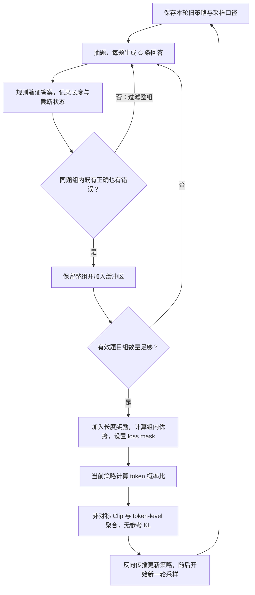

# 经典论文解读（二十一）｜强化学习与对齐：DAPO: An Open-Source LLM Reinforcement Learning System at Scale

上一篇 DeepSeekMath 介绍了 GRPO：同一道题生成多条回答，根据组内奖励计算相对优势，再更新策略。把这套方法用于长思维链训练，会遇到一个实际问题：即使优势公式没有写错，模型也可能很快失去探索能力，或者不断生成更长、质量却没有提高的回答。

2025 年，Qiying Yu 等人提出 **DAPO（Decoupled Clip and Dynamic sAmpling Policy Optimization）**。他们从 Qwen2.5-32B 基座模型出发，分析 GRPO 在长 CoT 强化学习中的训练问题，并公开算法、基于 verl 的训练实现和数据。本文依据论文 arXiv v2，重点讨论移除 KL 惩罚，以及 Clip-Higher、token-level loss、动态采样和超长奖励处理。

这些改动分别落在不同位置：允许策略偏离初始模型、保留探索空间、调整长短回答的损失权重、筛掉缺少区分信号的样本组，以及减少截断带来的奖励噪声。沿着这条训练链来看，更容易理解它们为什么要一起使用。

## 一、长 CoT 给 GRPO 带来了什么问题？

先统一符号。对问题 `q`，旧策略 `π_old` 生成 `G` 条回答，回答 `i` 的奖励是 `R_i`，有效回答长度是 `T_i`。结果监督下，同一条回答的所有 token 共用组内优势：

```math
\hat A_i=\frac{R_i-\bar R}{s_R},
\qquad \hat A_{i,t}=\hat A_i.
```

其中 `R̄` 和 `s_R` 分别是同题奖励的均值和标准差。标准差为零时需要做数值处理，此时各奖励减均值也都是零，没有组内区分信号。

当前策略对已采样 token 的概率，与生成它时的旧概率之比为：

```math
\rho_{i,t}(\theta)=
\frac{\pi_\theta(o_{i,t}\mid q,o_{i,<t})}
{\pi_{\mathrm{old}}(o_{i,t}\mid q,o_{i,<t})}.
```

把 PPO 式裁剪项记为：

```math
S_{i,t}=\min\left(
\rho_{i,t}\hat A_i,
\operatorname{clip}(\rho_{i,t},1-\epsilon,1+\epsilon)\hat A_i
\right).
```

原始 GRPO 的目标可简写为：

```math
\mathcal J_{\mathrm{GRPO}}=
\mathbb E\left[
\frac{1}{G}\sum_{i=1}^{G}\frac{1}{T_i}
\sum_{t=1}^{T_i}\left(S_{i,t}-\beta k_{i,t}\right)
\right],
```

`k` 是相对参考策略的 token 级 KL 惩罚估计。训练通常最小化 `L = −J`，下文用最大化目标来说明更新方向。

长 CoT 场景把几个问题放大了。回答长度可能相差很多，先按回答平均就会改变每个 token 的相对权重；达到长度上限的回答还没写出答案，却可能直接被当成错误。与此同时，如果策略越来越确定，同题采样容易得到相似回答，组内比较能利用的信息也会减少。

论文把 Clip-Higher、动态采样、token-level loss 和超长奖励处理列为四项核心技术。移除 KL 则在前置讨论中单独说明。下面先从这个约束讲起。

## 二、移除 KL：允许推理策略偏离初始模型

在常见 RLHF 中，KL 惩罚约束当前策略与冻结参考策略之间的偏移。奖励负责推动改进，KL 则让模型不要离初始行为太远。

长 CoT 训练的目标不同：基座模型原本不常生成的长推理、自我检查与尝试其他解法，可能正是训练希望强化的行为。作者认为，这时策略分布可能显著偏离初始模型，继续维持这项限制并无必要，因此从 DAPO 目标中移除了参考策略 KL 项。

这里的理由应当理解为**允许有用的分布变化**。不能仅凭“回答更长，累计 KL 可能更大”，就推出应该删除 KL；原始 GRPO 本身还做了长度归一化，实际惩罚大小取决于具体分布和计算方式。

还要分清两个对象：`π_ref` 是约束长期偏移的参考策略，`π_old` 是生成当前批次回答的旧策略。移除前者的 KL，并没有移除后者参与的概率比与 Clip。DAPO 仍用裁剪代理目标控制更新激励，也仍需固定当前批次的旧概率。

这项选择来自论文的可验证数学推理设置。它不意味着所有偏好对齐任务都应去掉 KL，也不能由此推断奖励漏洞会自动消失。

## 三、Clip-Higher：让低概率的探索有机会被强化

### 1. 熵坍塌怎样影响组内比较？

作者在早期 PPO、GRPO 实验中观察到，策略熵快速下降，同一道题采样出的回答越来越相似。模型过早集中到少量路径，继续增加采样数量也未必能找到新解法。

对 GRPO 而言，多回答的价值来自比较。如果错误路径反复出现，而其他路径很少被采到，后续就缺少可以强化的替代方案。DAPO 因而关注：成功采到一条较少出现的路径后，裁剪目标给了它多大的上升空间？

### 2. 对称比例裁剪，对应不同的绝对增量

假设优势为正，`ε = 0.2`。旧概率为 `0.01` 的 token，当前概率达到 `0.012` 时，概率比就到达上裁剪阈值 `1.2`；旧概率为 `0.9` 的 token，对应的阈值是 `1.08`，已超过概率能达到的最大值 `1`。

这说明相同的相对阈值，对低概率 token 留下的绝对增长空间较小。对于已经采到、又得到正优势的探索选择，单个裁剪项很快就停止提供继续提高概率的激励。

DAPO 把上下阈值拆开：

```math
S^{\mathrm{DAPO}}_{i,t}=\min\left(
\rho_{i,t}\hat A_i,
\operatorname{clip}\left(
\rho_{i,t},1-\epsilon_{\mathrm{low}},1+\epsilon_{\mathrm{high}}
\right)\hat A_i
\right).
```

论文配置是 `ε_low = 0.2`、`ε_high = 0.28`，即区间 `[0.8, 1.28]`。提高上界，为正优势 token 的概率增长提供更多空间；保留下界，则避免同时放宽压低负优势 token 概率的方向。作者观察到，这样可以缓解熵坍塌，维持采样多样性。

Clip 约束的是代理目标的激励，**并不把实际概率比硬锁在区间内**。参数共享和其他 token 的梯度仍可能让某个概率比越界；上面的 `0.012` 是该项开始裁剪的位置，不是模型概率绝不能超过的数值。

Clip-Higher 也不会直接给新路径奖励。它需要探索路径先被采到，并获得正优势，才能发挥作用。

## 四、Token-level loss：长回答中的每个 token 应占多少权重？

### 1. 原始 GRPO 已经按 token 计算概率比

这里容易混淆两件事：单个策略项在哪里计算，以及这些项最后怎样求平均。

原始 GRPO 已经为每个 token 计算概率比与裁剪项。DAPO 改的是 **loss reduction，也就是聚合方式**：由“每条回答内部先平均，再对回答平均”，改为对参与聚合的所有有效回答 token 统一平均。

只看策略部分，两种形式分别是：

```math
\mathcal J_{\mathrm{sample}}=
\frac{1}{G}\sum_{i=1}^{G}\frac{1}{T_i}
\sum_{t=1}^{T_i}S_{i,t},
```

```math
\mathcal J_{\mathrm{token}}=
\frac{1}{\sum_{i=1}^{G}T_i}
\sum_{i=1}^{G}\sum_{t=1}^{T_i}S_{i,t}.
```

### 2. 用一长一短两条回答比较

假设只有两条回答，长度分别为 `100` 和 `1000`。暂时只比较外层平均系数，不考虑优势、裁剪和具体参数梯度的差异：

| 聚合方式 | 短回答每个 token 的系数 | 长回答每个 token 的系数 | 两条回答的总系数 |
| --- | --- | --- | --- |
| Sample-level | 1/200 | 1/2000 | 各占 1/2 |
| Token-level | 1/1100 | 1/1100 | 分别占 1/11、10/11 |

原始方式让每条回答总权重相同，因此长回答中单个 token 的权重只有短回答的十分之一。DAPO 让每个有效 token 的外层系数相同，较长回答因此获得更大的总权重。实际梯度还取决于优势和概率导数，不能把表里的比例直接当成最终参数更新比例。

这解决了两个方向的问题：优质长回答里的推理模式不会因为长度被过度稀释；低质长回答里的重复、乱码等模式，也不会因为平均到很长的序列里而减轻惩罚。论文观察到，原来的聚合方式可能伴随不健康的熵和长度增长，token-level loss 改善了这类训练动态。

因此，“鼓励长回答”只能表达其中一部分效果。更准确地说，DAPO 重新平衡了长短回答中 token 的权重，让长回答中的正负信号都更充分地参与更新。它没有额外给长度发放正奖励，也没有把整条回答的结果奖励变成逐步骤正确性监督。

## 五、动态采样：筛掉全对、全错的组，再继续补样本

DAPO 在数学任务中用规则验证最终答案，正确奖励为 `+1`，否则为 `−1`。先不叠加长度惩罚，考虑三组各有四条回答的情况：

| 同题采样结果 | 正确性奖励 | 组内相对优势 |
| --- | --- | --- |
| 全对 | `[1, 1, 1, 1]` | 数值处理后全为 0 |
| 全错 | `[-1, -1, -1, -1]` | 数值处理后全为 0 |
| 两对两错 | `[1, 1, -1, -1]` | `[1, 1, -1, -1]` |

最后一行采用总体标准差，便于手算。全错虽然听起来“很需要学习”，但在组内比较中，四条回答没有谁相对更好；仅靠相同的负奖励，无法给出偏向某一条的更新方向。全对也同理。

训练进展后，全对的题目组可能越来越多。若固定抽取相同数量的问题，其中能提供组内区分信号的组就会变少。去掉 KL 后，这些零优势组也没有 KL 梯度可用。

动态采样因此保留满足以下条件的题目组：

```math
0<N_{\mathrm{correct}}(q)<G.
```

操作单位是**同一道题的整组回答**。保留组中既有正确答案，也有错误答案，供优势计算使用；它不等于只留下正确回答。筛掉全对、全错组后，继续抽题、生成、验证，直到收集到目标数量的有效题目组，再进行更新。被过滤的问题也不是永久退出数据集，下一次采样的组内结果仍可能不同。

这提高了用于更新的样本中，带有正确性区分信号的比例，却需要额外生成。论文在自身系统中观察到更快收敛，不能据此承诺任意部署的总计算量都会下降：生成吞吐、长尾回答与并行方式都会影响耗时。

上表说明的是纯正确性奖励。当加入长度塑形后，全对或全错组也可能有不同的总奖励；此时“正确率为 0 或 1”与“总奖励方差为零”不能直接画等号。应区分正确性筛选条件与最终用于优势计算的奖励。

## 六、超长处理：截断不应被简单归因为推理错误

### 1. 先屏蔽截断回答的 loss

训练必须设置最大生成长度。一条回答已经走过合理的推理过程，却在写出最终答案之前被截断。如果直接因为没有答案而给负奖励，整条轨迹就可能受到压低概率的信号。

这种处理混合了两个原因：解题过程有问题，以及当前生成预算不足。模型得到的只有最后那个分数，很难区分它们。长度边界还会让接近完成的回答遭遇明显不同的评分：在上限前结束可以正常判题，刚好越界就只剩未完成文本。

作者先采用 **Overlong Filtering**，将截断回答的 loss 屏蔽，避免直接用这些轨迹更新策略，并观察到训练更加稳定。这里过滤的是回答；上一节动态采样过滤的则是同题样本组，判断依据和作用位置都不同。

屏蔽 loss 不等于给截断回答判对，也不能让模型自动学会节省 token；它首先减少了把截断当成解题失败的训练噪声。实现时还需区分 loss mask 与奖励统计，不能把“屏蔽 loss”理解成随意删除组内成员后重新比较。

### 2. 在上限之前设置渐进的长度惩罚

进一步，论文提出 **Soft Overlong Punishment**。设最大生成长度为 `L_max`，缓冲区宽度为 `L_cache`，长度为 `T`，额外奖励为：

```math
R_{\mathrm{length}}(T)=
\begin{cases}
0, & T\leq L_{\max}-L_{\mathrm{cache}},\\
\dfrac{L_{\max}-L_{\mathrm{cache}}-T}{L_{\mathrm{cache}}},
& L_{\max}-L_{\mathrm{cache}}<T\leq L_{\max},\\
-1, & T>L_{\max}.
\end{cases}
```

这个长度项加到原有正确性奖励上。论文实验预期长度上限为 `16,384` tokens，另设 `4,096` tokens 的缓冲区，因此硬生成上限 `L_max` 为 `20,480`：

| 回答长度 | 额外长度奖励 |
| --- | --- |
| 不超过 16,384 | 0 |
| 18,432 | −0.5 |
| 20,480 | −1 |

惩罚从缓冲区起点连续增加，到硬上限达到 `−1`。真实 rollout 通常会在硬上限截断，公式最后一段表达的是惩罚饱和规则，不意味着实际还会继续生成超限文本。

这样，模型在接近上限时就能收到控制长度的信号。软惩罚缓和的是额外长度项的边界变化，不能保证最终答案的正确性奖励也连续，更不能恢复截断后没能观察到的推理。过滤和软惩罚分别处理不可靠轨迹与长度控制，论文的逐步叠加实验也分别报告了它们的效果。

## 七、把这些改动放回一轮训练

为便于对比原论文，先写出一个已通过动态筛选的题目组、尚未展开截断 mask 时的 DAPO 策略目标：

```math
\mathcal J_{\mathrm{DAPO}}=
\mathbb E\left[
\frac{1}{\sum_{i=1}^{G}T_i}
\sum_{i=1}^{G}\sum_{t=1}^{T_i}
\min\left(
\rho_{i,t}\hat A_i,
\operatorname{clip}\left(
\rho_{i,t},1-\epsilon_{\mathrm{low}},1+\epsilon_{\mathrm{high}}
\right)\hat A_i
\right)
\right].
```

这个表达式里已经没有参考策略 KL。动态采样决定哪些组进入训练，奖励塑形决定 `R_i`，组内比较得到优势，非对称裁剪和 token 聚合决定如何使用这些优势。实际训练还要按有效回答 mask 聚合，排除 prompt、padding，以及被超长过滤屏蔽的回答。



这是机制层面的流程图。补齐同一训练批次期间，要保持行为策略与记录的旧概率一致；不能一边更新策略，一边把不同分布的数据无区别地补进当前批次。对同一批回答执行多次更新时，旧概率也保持固定。

数据与判题同样重要。作者构建了 DAPO-Math-17K，将筛选、转换后的问题配为整数答案，以降低复杂表达式解析带来的评分误差。可靠奖励是这些训练技巧发挥作用的前提，算法不会自动修复判题器。

## 八、实验结果应当怎样读？

论文以 Qwen2.5-32B 为起点，在 AIME 2024 上报告以下逐步叠加结果。加号行均是在上一行基础上继续加入技术：

| 设置 | AIME 2024 avg@32 |
| --- | --- |
| DeepSeek-R1-Zero-Qwen-32B，作为外部对照 | 47 |
| 作者的 Naive GRPO 基线 | 30 |
| + Overlong Filtering | 36 |
| + Clip-Higher | 38 |
| + Soft Overlong Punishment | 41 |
| + Token-level Loss | 42 |
| + Dynamic Sampling，完整 DAPO | 50 |

这里的 `avg@32` 是对测试题重复采样后的平均正确率，用于减小单次采样波动。它不是 32 条回答多数投票后的正确率，也不是 32 次中至少成功一次的 pass@32。评估使用 temperature `1.0`、top-p `0.7`。

表格说明这些技术在该训练配置下组合有效。它不能证明动态采样在任意设置下独立贡献 8 分，也不能把 30 分解释为 GRPO 的能力上限。加入顺序、奖励、数据和其他组件都会影响差值；移除 KL 的单独效果，也没有在这张表中被隔离出来。

Token-level loss 在表中只增加 1 分，但作者还强调了它对训练稳定性和长度增长的改善。评价这类改动，除了最终准确率，还应一起观察生成长度、熵、截断情况与验证集表现。熵过低可能意味着探索不足，熵过高也可能来自乱码和重复；长度增加本身不能证明推理变好。

论文报告 DAPO 达到 50 分时，使用了相较 DeepSeek-R1-Zero-Qwen-32B 约一半的梯度更新步数。这个比较不能直接换算为 GPU 小时或总成本减半，尤其动态采样本身改变了每批次的生成量。

DAPO 保留了 GRPO 的组内相对学习方式，改进集中在训练信号怎样产生和进入更新：探索能否继续，长回答的信号是否被稀释，有效组是否足够，以及负奖励究竟来自解题失败还是长度预算。长 CoT 训练能否稳定推进，需要把这些环节放在一起检查。

## 参考资料

1. Qiying Yu et al., [DAPO: An Open-Source LLM Reinforcement Learning System at Scale](https://arxiv.org/abs/2503.14476v2), 2025。本文依据 arXiv v2；移除 KL 见第 2.3 节，四项核心技术见第 3.1—3.4 节，训练配置见第 4.1 节，逐步叠加结果见表 1。
2. DAPO 团队，[官方项目页](https://dapo-sia.github.io/)。项目概览与论文、代码、数据、模型入口。
3. ByteDance Seed 与清华 AIR，[DAPO 官方仓库](https://github.com/BytedTsinghua-SIA/DAPO)。公开训练资源、训练记录与评估说明；区分早期版本和完整 DAPO 的记录。
4. Zhihong Shao et al., [DeepSeekMath: Pushing the Limits of Mathematical Reasoning in Open Language Models](https://arxiv.org/abs/2402.03300), 2024。GRPO 的原始目标与组内优势。
5. John Schulman et al., [Proximal Policy Optimization Algorithms](https://arxiv.org/abs/1707.06347), 2017。概率比与裁剪代理目标。
6. 本站前文：[经典论文解读（二十）｜DeepSeekMath](category.html?category=papers&post=2026-10-21-deepseekmath-paper-notes)；[经典论文解读（十八）｜PPO](category.html?category=papers&post=2026-10-20-ppo-paper-notes)。
