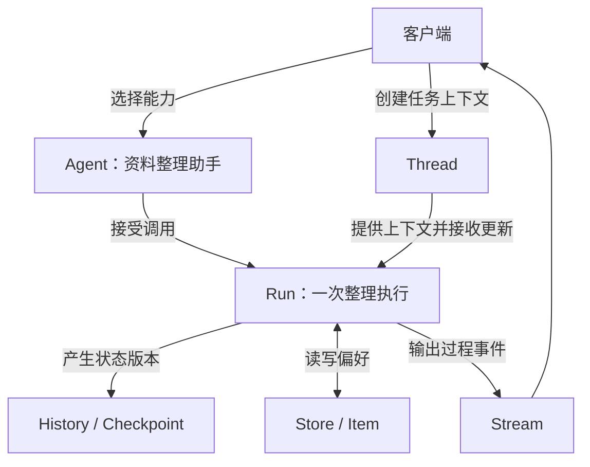

# 从本地 Agent 到智能服务：LangChain Agent Protocol

本地写一个 Agent，通常从一次函数调用开始：传入问题，让模型检索资料、调用工具，最后返回答案。但要让网页或其他应用调用它，事情就多了起来：多轮任务的状态放在哪里？执行时间太长怎么办？用户刷新页面后，怎样知道任务是否还在运行？

LangChain 开源的 Agent Protocol，尝试为这些需求定义一套与框架无关的服务接口。它把 Agent 的执行、会话状态和长期记忆组织成可以通过 API 操作的资源，让客户端有一套相对统一的接入方式。

## 一、本地调用与服务接口之间

假设我们写了一个资料整理助手，能搜索文档并生成报告。本地运行时，开发者可以直接查看变量和日志；接入网页以后，前端需要知道任务标识、执行状态、输出内容，以及下一次追问应该带上什么上下文。

如果每个项目都自行定义这些约定，客户端就得逐个适配。Agent Protocol 的价值，是把这部分共性需求明确下来。统一接口以后，前端可以围绕相同的资源模型组织交互，服务端则保留内部实现的选择。

这里也要区分协议与运行时：协议约定客户端怎样访问能力，数据库、任务队列和故障恢复仍需要服务端实现。LangGraph Platform 实现了该协议的超集，平台提供的扩展能力不能直接当作所有兼容服务的共同能力。

## 二、Agent、Thread、Run：能力、上下文与执行

**Agent 是可调用的智能能力。** 在例子里，就是资料整理助手。客户端可以查询它的名称、描述，以及输入、输出、状态和配置的 Schema，从而了解该怎样调用它。协议中的 Agent 也不要求底层一定使用某一种框架。

**Thread 是跨多次执行保存状态的容器。** 用户先要求“整理数据库选型资料”，随后补充“重点比较 PostgreSQL 和 MySQL”，两次输入可以放进同一个 Thread。后续执行便能接着之前的状态继续工作。

Thread 保存的内容可以超出聊天消息。已找到的文档、报告草稿、待处理的问题，都可以成为开发者定义的状态。消息列表只是其中一种常见形式。

**Run 是对 Agent 的一次执行。** 用户提交整理要求，产生一次 Run；补充比较要求，可以产生另一次 Run。一次 Run 内部可能经历多次模型调用、搜索和工具执行，因此不能把它理解成一次模型请求。

Run 可以在后台运行，客户端之后再查询状态、等待结果或请求取消。需要连续上下文时，把 Run 关联到 Thread；一次性任务也有临时执行的接口，不必保留长期会话。

## 三、Checkpoint 与 History：记录状态的变化

Thread 当前保存着什么，与它此前经历过什么，是两个不同的问题。

**Checkpoint 用来标识执行中的某个状态位置。** 资料整理助手可能先收集文档，再提取要点，最后生成报告。运行时保存的状态记录及其 Checkpoint 标识，让系统可以定位这些过程中的具体位置。

**History 是 Thread 的历史状态记录。** 它回答“这个任务的状态如何一步步变化”，而聊天消息主要回答“用户和助手说过什么”。查询历史时，可以看到不同状态版本；Checkpoint 则帮助定位其中的某个版本。它们也不同于 Run 列表：后者记录发起过哪些执行，一次执行内部仍可能产生多个状态版本。

这些抽象为调试、中断后的继续执行提供了接口基础。不过，能否恢复、从哪里恢复，取决于运行时和持久化实现。保存了 Checkpoint，也不能据此保证已发送的邮件或已写入的外部系统可以自动撤销。

## 四、Store 与 Item：跨会话保留的信息

Thread 的状态围绕一个任务延续，有些信息却需要在新任务中继续使用。例如，用户总是希望报告使用中文，并附上一张对比表。

**Store 提供跨 Thread 的持久化键值存储接口。** 应用可以把这类偏好保存下来，供后续任务读取。哪些信息值得保存、何时读取，仍由业务逻辑决定。

**Item 是 Store 中的一条数据。** 它通过 namespace 和 key 定位，value 保存具体内容。例如下面是一条偏好的示意数据：

```json
{
  "namespace": ["users", "user-42", "preferences"],
  "key": "report-format",
  "value": {"language": "zh-CN", "include_table": true}
}
```

namespace 用于组织存储范围，key 区分范围内的条目。客户端可以通过 `/store/items` 相关接口读写 Item，也可以搜索条目。命名空间本身不等于权限控制，访问边界还要由服务端落实。

两种保存方式的用途由此分开：Checkpoint 和 History 记录任务状态的演变；Store 中的 Item 保存应用希望跨任务复用的信息。

## 五、Stream：把执行过程交给客户端

整理报告可能需要较长时间，网页不能一直只有一个等待图标。**Stream 让客户端在执行过程中持续接收输出**，包括文本增量、工具活动和状态变化等，而无需等到最终答案才更新界面。

协议也定义了以 Thread 为中心的流式事件与命令模型，支持通过 SSE/HTTP 或 WebSocket 观察执行。客户端可以按需订阅内容，例如展示正在生成的文字，或提示当前的工具调用进度。

这里需要分清连接和执行：流连接是客户端接收事件的通道，Run 是服务端的一次执行。断开连接、取消任务、重新订阅是不同操作；重连时能否补齐错过的事件，还要看接口和服务端的事件保留能力。

## 六、把这些概念串起来

资料整理助手的一次交互，可以用下面的关系表示：



用户提交要求后，服务端在 Thread 上启动 Run，读取 Store 里的报告偏好，执行时留下状态记录，并通过 Stream 更新页面。用户继续追问，就沿用同一个 Thread；换一个任务，则可以新建 Thread，继续复用保存的偏好。

这套接口把“能在本地执行的 Agent”变成了客户端可以发现、调用和观察的服务。对接入方而言，统一资源的含义与操作方式，能减少重复设计会话、任务和记忆接口的工作。

## 参考资料

1. [Agent Protocol 官方仓库与设计说明](https://github.com/langchain-ai/agent-protocol)
2. [Agent Protocol OpenAPI 规范](https://github.com/langchain-ai/agent-protocol/blob/main/openapi.json)
3. [Agent Streaming Protocol](https://github.com/langchain-ai/agent-protocol/tree/main/streaming)
4. [官方提交记录](https://github.com/langchain-ai/agent-protocol/commits/main/)：本文以 2026 年 4 月 30 日为文章日期，介绍基础资源模型及当时已合入的流式协议；链接指向的文档可能继续更新。
