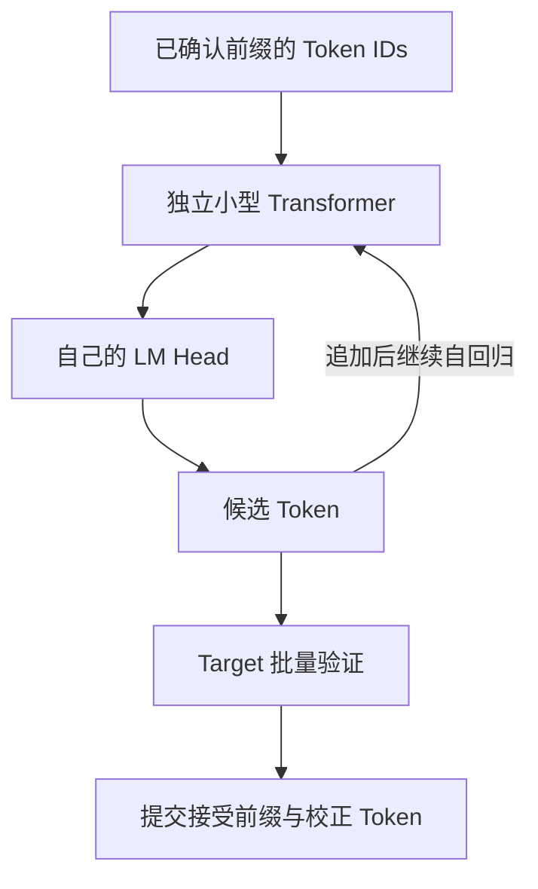
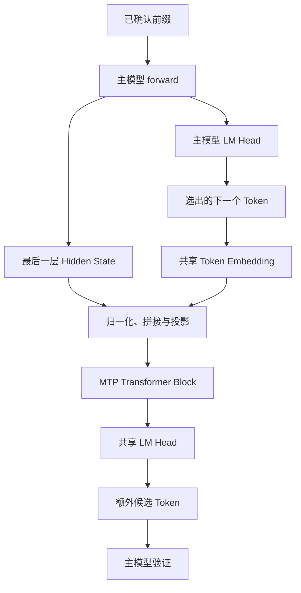
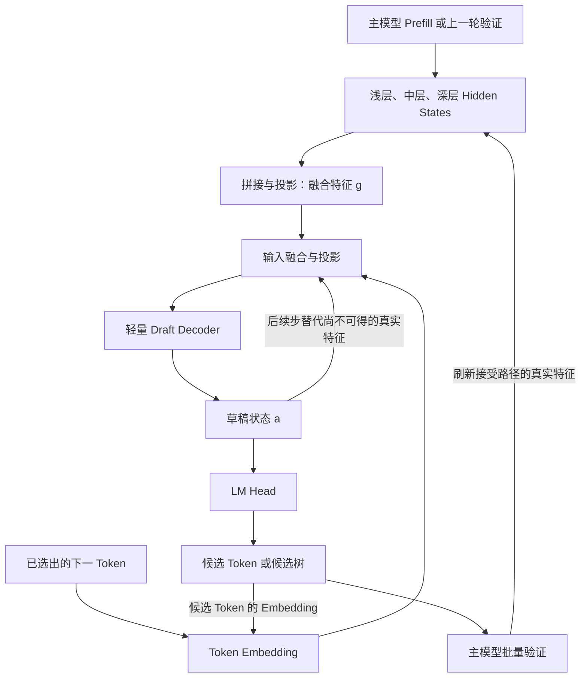

# 投机解码：从 Draft Model 到 MTP、EAGLE-3

之前讨论企业 Agent 的推理优化时，Serving 层提到过投机解码：小模型先猜一段，大模型一次验证，连续猜中的 token 就能一起提交。这里把这个过程展开，再看看传统 Draft Model、DeepSeek 的 MTP 和 EAGLE-3 分别怎样生成草稿，训练时又有什么区别。

这三种方案都需要主模型验证。它们最明显的区别，在于草稿网络能拿到什么信息，以及这些预测能力是怎样训练出来的。

## 一、为什么“先猜再验”可能更快

自回归模型生成下一个 token 时，必须知道前面已经选出的 token：

```text
已有前缀 → 生成 A → 输入 A → 生成 B → 输入 B → 生成 C
```

即使有 KV Cache，生成 A、B、C 仍然需要多次串行调用主模型。小 batch 的 Decode 又常常受显存带宽限制：每次只处理少量 token，却要读取大量模型权重。

但如果 A、B、C 已经由另一个网络猜出来，主模型就可以把它们当作已知输入，在一次 forward 中计算各位置的输出分布：

```text
输入位置：前缀末尾    A       B       C
输出分布：预测 A     预测 B   预测 C   预测下一个
```

每个位置仍然遵守因果 Attention，不能看未来。变化在于输入 token 已知，各位置可以在同一次计算中处理。这和训练时给定整段文本、同时计算多个位置的预测类似。

**并行验证得到的是“沿草稿路径的条件分布”。** 如果 B 被拒绝，C 对应的分布是在错误前缀上算出来的，不能继续使用。

一次多 token 验证也不等于一次单 token Decode 的成本。它增加了计算和 KV 写入，但可能更充分地利用 GPU，并摊薄权重读取与调用开销。只有省下的主模型串行步骤足够多，才能覆盖生成草稿的额外成本。

## 二、用独立 Draft Model 走完一轮

先固定两个模型：`draft` 是较快的小模型，`target` 是原本要用的大模型。以下默认它们使用相同 tokenizer 和词表。

### 1. 生成、验证、提交

假设 draft 连续生成了 4 个候选。这里用 A、B、C、D 表示 token ID，不要求它们对应完整的字或词。

```text
草稿：prefix + A + B + C + D

target 一次 forward 得到：
p1 = P(next | prefix)
p2 = P(next | prefix, A)
p3 = P(next | prefix, A, B)
p4 = P(next | prefix, A, B, C)
p5 = P(next | prefix, A, B, C, D)
```

实现上可以保留前缀末尾的 logits，或把尚未消费的最后一个 token 与草稿一起送入验证；关键是对齐“这个位置的输出预测下一个 token”，不能拿 A 位置的 logits 验证 A。

先看 greedy decoding。按顺序比较候选与 target 的 argmax：

```text
A：一致，接受
B：一致，接受
C：不一致，target 选择 X
D：丢弃

本轮提交：A、B、X
新前缀：prefix + A + B + X
```

C 被拒绝后，D 的验证结果失效。如果 A、B、C、D 全部一致，还可以使用 `p5` 生成一个额外 token，一轮最多提交 5 个。遇到 EOS 或输出长度上限时则提前停止。

### 2. 随机采样为什么也能保持分布

随机采样会按照模型给出的概率选择下一个 token。例如，同一个前缀下，target 选择 A、B 的概率分别是 60%、40%，draft 却可能是 80%、20%；如果直接接受 draft 的结果，最终生成就会偏向小模型的偏好。

“保持分布”就是要求：加入投机解码后，最终选择各个 token 的概率仍与 target 单独采样时一致。它解决的是小模型参与生成后可能改变输出概率的问题，让 draft 的作用限定在加速上。因此，验证时需要校正 draft 与 target 之间的概率差异。

随机采样时，不能只判断候选是不是 target 最喜欢的 token，也不能让两个模型各采一次再比较是否相同。经典 speculative sampling 使用接受与拒绝校正。

记某个位置的 target 分布为 `p`、draft 分布为 `q`。候选 `x` 从 `q` 中采出，以如下概率接受：

$$
\alpha(x)=\min\left(1,\frac{p(x)}{q(x)}\right)
$$

如果被拒绝，从残差分布重新采样：

$$
r(v)=\frac{\max(0,p(v)-q(v))}{\sum_u\max(0,p(u)-q(u))}
$$

直觉是：draft 过度预测的部分需要扣掉，预测不足的部分通过拒绝后的补采补回来。

例如词表只有 A、B：

| Token | draft：q | target：p |
| --- | --- | --- |
| A | 0.8 | 0.6 |
| B | 0.2 | 0.4 |

draft 采到 A 后，以 `0.6 / 0.8 = 0.75` 的概率接受；采到 B 则全部接受。直接接受的概率质量是 A 的 0.6 和 B 的 0.2。剩下 0.2 的拒绝概率，按残差分布全部补到 B，最终恰好得到 target 的 `0.6 / 0.4`。

这保证的是输出序列的概率分布与 target 自己采样一致，不保证同一个随机种子得到逐字相同的文本。实际计算还存在浮点数误差。`p`、`q` 必须对应各自真正使用的采样分布，包括温度、截断和其他处理，不能生成时用了 top-p，验证时却拿未经处理的 softmax 做校正。

### 3. 最小实现流程

下面是链式草稿的教学伪代码，省略了 logits 对齐、缓存同步、EOS 和长度限制：

```python
while not finished:
  candidates, q = draft.generate(prefix, k)
  p = target.verify(prefix, candidates)  # k 个验证分布 + 1 个额外分布
  committed = []

  for i, token in enumerate(candidates):
    if uniform() < min(1, p[i][token] / q[i][token]):
      committed.append(token)
    else:
      residual = normalize(maximum(p[i] - q[i], 0))
      committed.append(sample(residual))
      break
  else:
    committed.append(sample(p[k]))

  prefix.extend(committed)
  synchronize_caches(prefix)
```

验证 forward 会为整段候选生成 KV，最终只能保留接受路径对应的部分。拒绝位置及其后缀的 KV 要丢弃或标记无效；补采 token 还需要在后续 forward 中消费，才能建立它自己的 KV。draft 也必须同步到最终前缀，不能沿着被拒绝的草稿继续生成。

## 三、传统 Draft Model：自己计算上下文

### 训练时

最直接的做法是使用已有小型 LLM，例如与 target 词表兼容的小 Qwen 或 Llama。它按照普通 Next Token Prediction 训练，有自己的 Embedding、Transformer 和 LM Head。

也可以专门蒸馏：让 draft 学习 target 的输出文本或概率分布，以提高两者在目标任务上的一致性。此时通常冻结 target，更新 draft。蒸馏并非投机解码的必要条件，但小模型的通用能力强，并不自动意味着它能猜中某个 target。

### 推理时



draft 不读取 target 的 Hidden State，会独立处理上下文，维护自己的 KV Cache。它既要足够快，又要足够接近 target：太小可能连续接受长度很短，太大又会吃掉省下的时间。

这种方式容易接入已有模型，主要代价是多加载一个模型，以及重复计算和保存上下文。词表兼容也只是起点，领域、语言和对话模板都可能影响接受率。

## 四、DeepSeek MTP：主模型训练时就学会多预测一步

MTP 是 Multi-Token Prediction。下面以 DeepSeek-V3 为例，介绍它的顺序式预测结构。

### 训练时

假设主模型读到 `t_i`，得到最后一层表示 `h_i`，普通 LM Head 负责预测 `t_{i+1}`。第一个 MTP 模块再使用 `h_i` 和真实的 `t_{i+1}` 的 Embedding，学习预测 `t_{i+2}`：

```text
主模型：t_1 ... t_i → h_i → 预测 t_{i+1}
MTP：h_i + Embedding(真实 t_{i+1}) → 预测 t_{i+2}
```

模块会分别归一化这两个向量，拼接后线性投影，再经过额外的 Transformer block 和共享输出头。Embedding 与 LM Head 和主模型共享，投影及额外 block 则有自己的参数。

如果有多个预测深度，下一模块继续结合上一深度的表示与后续 token 的 Embedding，逐级预测，保留因果链。各深度的交叉熵损失作为辅助目标，与主模型的 next-token 损失一起训练。因此 MTP 的训练信号也会影响主模型表示，而非只训练一个外接草稿网络。

DeepSeek-V3 实际采用 `D=1`，即普通 next-token 预测之外，再额外预测一个 token。官方权重说明也只有一个 MTP 模块；但它的 block 包含 MoE，拥有约 11.5B 独有参数，不能把“一层”理解成“参数一定很少”。

### 推理时

训练阶段可以直接拿真实的 `t_{i+1}`；推理阶段还没有标准答案，要先选出这个 token，再把它的 Embedding 输入 MTP：



这个 token 的 Embedding 告诉 MTP：主模型最终选中了哪个结果。尤其在随机采样时，仅有 Hidden State 并不足以知道采样选择。

MTP 预测的额外 token 仍然是草稿，必须经过主模型验证。若运行时支持多步递归草稿，可继续复用模块输出和候选 Embedding；后续输入不再全是真实主模型特征。这种运行时展开需要单独实现与调优，不能由 `D=1` 推导出主模型一次就能准确生成任意长度的候选。

MTP 模块也可以在推理时不用，主模型正常自回归生成即可。它首先是一项模型训练设计，投机解码是其预测能力的一种使用方式。

## 五、EAGLE-3：读取主模型特征，训练专用草稿网络

EAGLE-3 通常冻结 target，单独训练与之适配的草稿网络。主模型权重不需要重新训练，但推理实现必须能提取指定层的特征，并管理草稿网络、缓存和验证过程。

### 推理时：真实特征只在主模型运行后获得

EAGLE-3 从主模型的浅层、中层、深层取出 Hidden States，拼接后投影为融合特征 `g`。再结合已经选出的下一 token 的 Embedding，经过输入投影和轻量 Transformer decoder，输出状态 `a`，通过 LM Head 得到候选。



第一步使用主模型给出的融合特征。继续猜第二、第三步时，新 token 还没经过主模型，拿不到对应的真实特征，因此回灌草稿网络自身的状态 `a`。它是供后续预测使用的内部表示，不要求等于主模型的 Hidden State。

如果每猜一个 token 都重新调用主模型取得真实特征，就又回到了串行 target Decode，失去了投机的意义。

### 训练时：Training-Time Test 在练什么

早期 EAGLE 同时学习特征预测与 token 预测，要求草稿输出逼近主模型下一位置的顶层特征。EAGLE-3 去掉了特征回归约束，直接优化 token 预测。

这样更自由，但也产生一个问题：第一步输入真实融合特征，后续步输入自身状态。如果训练只见过前者，递归时就会遇到不同的输入分布。

Training-Time Test 会在训练过程中执行模拟的草稿步骤，把生成的状态回灌给网络，再训练后续 token 预测：

```text
第 1 步：主模型融合特征 + Token Embedding → a1
第 2 步：回灌 a1 + 对应 Token Embedding    → a2
第 3 步：回灌 a2 + 对应 Token Embedding    → a3
```

训练还需要调整 Attention mask，保证各条模拟路径只看到自己的合法上下文。这个名称中的 Test 指训练时模拟推理路径，并非在用户请求期间更新权重。

训练数据通常由 target 生成响应并提供特征，更新的是草稿网络。Embedding、LM Head 等可以从 target 复用或初始化，具体取决于实现；它们属于参数复用，读取多层 Hidden States 则属于运行时特征复用，两件事需要分别理解。

### 候选树怎样验证

EAGLE-3 延续了 EAGLE-2 的动态候选树：同一位置保留多个分支，再根据草稿置信度展开和裁剪。

```text
已确认前缀
├─ A
│  ├─ B
│  └─ C
└─ D
   └─ E
```

验证时可以把节点打包进一次主模型 forward，但必须使用 tree attention：B 只能看到公共前缀和祖先 A，不能看到兄弟 C 或另一分支 D、E。位置编码也应对应路径深度，而非节点在打包数组里的顺序。

最终提交的是一条连续合法路径。树增加了覆盖主模型选择的机会，也增加了验证计算与缓存开销。前面的链式采样伪代码不能直接套在整棵树上，随机采样还需要与候选构造方式匹配的验证算法。

## 六、放在一起比较

| 对比维度 | 传统 Draft Model | MTP：DeepSeek-V3 | EAGLE-3 |
| --- | --- | --- | --- |
| 草稿依据 | Token IDs，自己计算上下文 | 主模型末层表示、下一 Token Embedding | 主模型多层融合特征、下一 Token Embedding |
| 网络结构 | 独立 LLM | 投影与额外 Transformer block | 特征融合、输入投影与轻量 decoder |
| 网络规模 | 由所选小模型决定 | V3 为一个 MTP block，但含 MoE | 论文使用单层 decoder；总成本还包括投影和输出头 |
| 主模型特征复用 | 不需要 | 需要末层表示 | 需要浅、中、深层表示 |
| 权重复用 | 通常独立 | 共享 Embedding、LM Head | 可复用 Embedding、LM Head 等，依实现而定 |
| 训练方式 | 使用已有模型或专门蒸馏 | 与主模型联合训练 | 冻结主模型，训练专用草稿网络 |
| 训练目标 | Next Token Prediction 或蒸馏目标 | 各预测深度的 token 交叉熵 | token 预测，取消特征回归损失 |
| 多步训练输入 | 常规真实前缀；取决于蒸馏设计 | 顺序模块结合真实后续 Token Embedding | Training-Time Test 回灌自身状态 |
| 推理草稿生成 | 小模型自回归 | 额外预测；运行时可支持递归展开 | 状态递归，可组织动态候选树 |
| 对主模型的要求 | 无需修改权重或导出特征 | 需要适配的 MTP 权重与运行时 | 无需修改权重，但需导出特征和适配运行时 |

DeepSeek 式 MTP 通常是模型原生训练的一部分。传统 Draft Model 和 EAGLE-3 更适合作为已有模型的加速组件，但 EAGLE-3 的草稿权重依赖具体 target 的表示，不能当作通用小模型随意替换 target。

当前 SGLang 已提供这些投机解码路径的支持。不过框架可能复用同一套草稿与验证基础设施，配置名称不一定直接对应论文分类。选型时要确认实际加载了什么草稿权重、读取什么特征，以及验证是否满足需要的采样行为。

## 七、怎样判断值不值得用

用一个简化估算描述单请求收益：

$$
\mathrm{Speedup}\approx
\frac{\bar n\,T_{\mathrm{decode}}}
{T_{\mathrm{draft}}+T_{\mathrm{verify}}+T_{\mathrm{manage}}}
$$

其中 `n̄` 是每轮实际提交的 token 数，包含接受草稿与补采或额外 token；`T_decode` 是基线单 token Decode 耗时。分母包含草稿生成、主模型验证，以及采样、缓存和调度开销。这是估算，不能替代真实并发测试。

例如一轮提交 3 个 token，基线每个耗时 10 ms，投机一轮总共耗时 18 ms，粗略收益是 `30 / 18 ≈ 1.67` 倍。只看接受率就无法得出这个结果。

测量时至少同时记录：

- 草稿长度或候选树节点数、平均接受草稿长度、每轮实际提交长度。
- 草稿与验证分别耗时多少，以及缓存管理和调度开销。
- 相同输入输出长度、采样配置和并发下的 TPOT、吞吐、显存占用与尾延迟。

草稿长度加大，后面的 token 可能越来越难被接受；候选树变宽，也可能让验证成本上涨。并发提高后，基线 Decode 已经能充分利用 GPU，额外草稿未必还能带来同样收益。长输出有更多机会摊薄启动成本，但“长推理”本身也不能保证高接受率。

已有模型且有合适的小模型，可以先测独立 Draft；模型自带 MTP，就先验证原生路径；愿意为特定 target 训练草稿网络，并且运行时能提供所需特征，则可以评估 EAGLE-3。最终要看的，是它们在真实请求上每轮能省掉多少主模型时间。

## 参考资料

1. Yaniv Leviathan 等，[Fast Inference from Transformers via Speculative Decoding](https://proceedings.mlr.press/v202/leviathan23a.html)：接受、拒绝校正及额外 token 的经典算法。
2. Charlie Chen 等，[Accelerating Large Language Model Decoding with Speculative Sampling](https://arxiv.org/abs/2302.01318)：投机采样与目标分布保持。
3. DeepSeek-AI，[DeepSeek-V3 Technical Report](https://arxiv.org/abs/2412.19437)：顺序式 MTP 结构、联合训练目标和推理用途。
4. DeepSeek-AI，[DeepSeek-V3 Weight File Documentation](https://github.com/deepseek-ai/DeepSeek-V3/blob/main/README_WEIGHTS.md)：MTP 模块数量、参数规模与共享权重。
5. Yuhui Li 等，[EAGLE-3: Scaling up Inference Acceleration of Large Language Models via Training-Time Test](https://arxiv.org/abs/2503.01840)：多层特征融合、直接 token 预测和训练时模拟递归。
6. SafeAILab，[EAGLE 官方实现](https://github.com/SafeAILab/EAGLE)：训练入口、草稿权重及模型适配说明。
7. SGLang，[Speculative Decoding](https://docs.sglang.io/docs/advanced_features/speculative_decoding)：当前运行时支持与配置说明。实现细节核对于 2026-10-12，部署时应以所用版本为准。
8. 本站文章：[《企业 Agent 推理优化：先识别任务形状，再选择优化方法》](category.html?category=tech&post=2026-09-18-agent-inference-optimization)。
