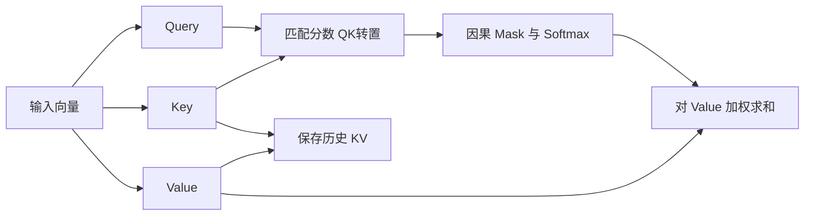

# 注意力的代价及优化：FlashAttention、Linear Attention、Sparse Attention 和 KV Cache Compression

长上下文为什么贵？“Attention 是平方复杂度”只回答了一部分。GPU 要算 Query 和 Key 的匹配，要把数据从显存搬到计算单元，还要为后续生成保存历史状态。即使两个方案的 FLOPs 一样，实际速度也可能不同；即使显存占用降下来了，每一步生成也未必更快。

理解优化之前，先沿着一次注意力计算，把计算量、数据搬运和状态存储分开。后面讨论四类方法：计算实现优化、KV Cache Compression、Linear Attention、Sparse Attention。这是按主要优化机制划分，边界存在交叉，也可以叠加使用。

## 一、一次 Attention 前向到底做了什么

### 1. 从 Q/K/V 到输出

先看单层、单个注意力头，省略 batch。输入是长度为 N 的向量序列 X，经线性投影得到 Q、K、V。设 Query 和 Key 的维度为 d，Value 的维度为 dᵥ：

$$
Q=XW_Q,\quad K=XW_K,\quad V=XW_V
$$

$$
S=\frac{QK^\top}{\sqrt d}+M,\quad P=\operatorname{softmax}(S),\quad O=PV
$$

Q、K 的形状是 N×d，V 是 N×dᵥ；S、P 是 N×N。每一行 Query 与所有允许访问的 Key 匹配，得到权重，再用权重汇总对应 Value。因果 Mask M 把未来位置设为负无穷，使它们的概率为零。这里的 Full Attention 指访问全部因果可见位置，不包含未来。

多头注意力并行执行多组这样的计算，再合并输出。位置编码会影响匹配方式，例如 RoPE 作用于 Q/K；这里不展开它的设计，只在后面解释 MLA 的缓存时补上必要细节。



### 2. 数学步骤怎样变成访存

GPU 的 HBM 显存容量大，片上寄存器和共享内存容量小、访问快。矩阵乘法要将参与计算的数据搬入片上存储，算完再保存结果。不能把整段上下文和所有中间矩阵都长期留在片上。

朴素实现可以理解成下面这条路径：

```text
读取输入和投影权重 → 生成并写入 Q/K/V
读取 Q/K → 计算并写入分数 S
读取 S → Mask、Softmax → 写入概率 P
读取 P/V → 计算并写入输出 O
将历史生成要用的 K/V 保存在缓存中
```

这是解释成本的基线，不是现代框架必须逐项执行的 Kernel 清单。实际实现可以融合操作、复用缓冲区，甚至完全不把 S/P 写进显存。

问题最明显的是 S 和 P。它们的元素数随 N 平方增长，而且后续操作还要读取这些结果。以 N=32768、32 个 Query 头为例，假设显式存储的一个分数矩阵每元素占 2 字节，仅这一张矩阵就需要 64 GiB。这里还没有加概率矩阵、Q/K/V 和模型权重；实际实现的数据类型和内存复用会改变占用。

FlashAttention 通过分块消除完整中间矩阵的存储。

### 3. Prefill 与 Decode 在做不同的工作

Prefill 已知整段输入，可以同时计算所有位置的 Query。每一行仍遵守因果约束，但不需要等前一行计算完成才知道输入 token。单头 QKᵀ 和 PV 的主要成本分别是：

$$
O(N^2d),\qquad O(N^2d_v)
$$

因果约束减少有效计算的常数，增长趋势仍是平方。输入加长一倍，注意力核心计算量大致增至四倍；投影等逐 token 操作则按长度线性增长。

Decode 每次只输入新增位置。历史 token 在因果模型中的状态不会因后面添加 token 而改变，因此它们的 K/V 可以复用。当前只需计算新增 Q/K/V，将新 KV 追加到缓存，再用当前 Query 访问历史。

单步 Decode 的注意力计算随历史长度 N 线性增长，不是平方增长。但是，每生成一个 token，都需要再次读取它所关注的历史 KV。缓存避免了重新计算历史 K/V，没有避免历史数据的读取。

历史 K/V 供后续位置反复查询；Query 在当前输出计算完成后即可释放。

### 4. 缓存到底有多大

设 batch 为 B，层数为 L，KV 头数为 Hₖᵥ，Key、Value 头维度分别为 dₖ、dᵥ，每元素 s 字节：

$$
M_{KV}=BLNH_{kv}(d_k+d_v)s
$$

这是标准逐 token KV 存储的有效载荷，未计分页余量、量化元数据、分布式复制及运行时缓冲。它随长度线性增长。MQA/GQA 的缓存容量取决于 KV 头数，不是 Query 头数。

取 B=1、L=32、N=32768、dₖ=dᵥ=128、BF16 的 s=2：

| 配置 | Query 头数 | KV 头数 | KV 有效载荷 |
| --- | --- | --- | --- |
| MHA | 32 | 32 | 16 GiB |
| GQA | 32 | 8 | 4 GiB |
| MQA | 32 | 1 | 0.5 GiB |

这是人为固定其他参数的对照，不是三个具体模型的实测。batch 扩大到 8，三者分别需要约 128、32、4 GiB。

长 Prefill 因此有两种不同压力：建立线性增长的 KV 存储，以及执行平方增长的注意力计算。到了 Decode，长历史还带来反复读取 KV 的带宽压力。小 batch 时权重读取和并行度也很重要，这些部分共同决定完整模型的耗时。计算、带宽和容量哪一个先成为瓶颈，要看长度、并发、架构和硬件。

### 5. 容量与流量为什么不能混为一谈

16 GiB 的缓存是某一时刻需要保存的数据量，带宽成本则取决于每秒需要读写多少次。如果每个 Decode step 都把各层历史 KV 至少读取一遍，上例 MHA 每步就涉及约 16 GiB 的 KV 有效载荷；每秒生成 20 个 token，仅这一项便对应约 320 GiB/s。这里忽略了历史继续增长，也没有计算权重、激活和额外读写。

这只是解释数量级的理想化估算，不是硬件实测。片上复用、缓存命中、头之间的重复读取、分页布局都会改变物理流量；多 GPU 分片还会引入分布式通信。尤其不能把显卡标称带宽直接除以这个数，就当作完整模型的生成速度。

可以用一个粗略的下界理解两类瓶颈：

$$
T\gtrsim\max\left(\frac{F}{C_{effective}},\frac{D}{BW_{effective}}\right)
$$

F 是执行的运算量，D 是搬运的字节数；有效算力和有效带宽还取决于任务形状。真实时间还包含调度、同步和其他开销。降低 F 而没有降低占主导的 D，时延可能变化不大；降低 D 却让并行度变差，也可能拿不到预期收益。

Prefill 中，一块读入的 Key 可以服务多个 Query，有更多复用机会；单 token Decode 的 Query 很少，读入大段历史后能够完成的运算相对有限。因此同一套注意力数学形式，在两个阶段可能呈现不同瓶颈。增加 batch 又会改变权重摊销与并行度，同时扩大 KV 总量，不能简单归纳成“Prefill 永远算力受限，Decode 永远带宽受限”。

后面的方法可以对应到这个成本账本：Flash 类方法改善搬运与执行效率；KV 压缩缩小状态；线性注意力改变查询历史的方式；稀疏注意力减少被查询的连接。判断收益时还要把它们新增的工作放回账本。

## 二、计算实现优化：减少数据搬运，提高并行度

### 1. FlashAttention：不把完整矩阵写回显存

第一章把 Attention 写成几个大操作，FlashAttention 则把它切成许多小块。取一块 Query，依次处理若干 Key/Value 块，**在片上计算局部分数，同时更新当前输出；处理完成后，只写回必要结果。**

对一行分数，Softmax 的分母需要包含全部位置。假设两块分数分别是 `[0,0]` 和 `[ln 3,ln 3]`，指数分别是 `[1,1]` 和 `[3,3]`。整行分母为 8，概率是 `[1/8,1/8,3/8,3/8]`。如果各块独立做 Softmax，两块都会得到 `[1/2,1/2]`，块与块之间原本 1:3 的权重关系就丢了。

完整读取一行当然可以计算 Softmax，但需要保存分数，或者再次读取数据重算。在线算法让分母和输出随着数据块一起更新。

对已经处理的位置，保存三个量：最大分数 m、以 m 为基准的指数和 l，以及同一基准下的 Value 加权和 u。当前输出为 u/l。新块 B 到来后，更新：

$$
m'=\max(m,\max_{j\in B}s_j),\quad a=\exp(m-m')
$$

$$
l'=a l+\sum_{j\in B}\exp(s_j-m')
$$

$$
u'=a u+\sum_{j\in B}\exp(s_j-m')v_j
$$

缩放来自恒等式 `exp(s−m′)=exp(s−m)exp(m−m′)`。所以旧分母和旧加权和都乘 a，就与新块使用了同一个基准，已经处理过的分数可以丢弃。

沿用前面的例子，第一块处理完有 m=0、l=2、u=v₁+v₂。第二块使 m′=ln 3，a=1/3，因此 l′=2/3+2=8/3，u′=(v₁+v₂)/3+v₃+v₄。最终 u′/l′ 正好是 `(v₁+v₂+3v₃+3v₄)/8`。

```text
m = -∞; l = 0; u = 0
对每个可见 KV 块：
  计算该块分数 s
  new_m = max(m, max(s))
  a = exp(m - new_m)
  p = exp(s - new_m)
  l = a*l + sum(p)
  u = a*u + p @ V_block
  m = new_m
输出 u/l
```

这里按至少包含一个有效位置的块更新；因果掩码完全遮蔽的块跳过。u 是输出维度的向量，每个 Query 只需保留这一向量及两个标量。

这样既能数值稳定地计算全局 Softmax，又不需要把完整 S/P 存入 HBM。节省的是中间矩阵的空间和读写，以及融合带来的执行开销。全部允许的 Query-Key 配对仍要参与计算，因此 Full Attention 的平方级算术量仍然存在。

这里“精确注意力”指没有主动删掉连接或改变注意力算子，浮点运算顺序变化仍可能导致数值差异。后续 FlashAttention 版本进一步调整工作划分和硬件流水线，重点仍是让同样的数学计算更适合 GPU。

### 2. FlashDecoding：一个 Query 也要用好 GPU

Prefill 有很多 Query 行可以并行，单 token Decode 却可能只有很少的 Query。即使历史很长，只按 batch 和头划分任务，也未必有足够多的工作块填满 GPU。

FlashDecoding 沿 Key/Value 的历史长度再切分：不同任务处理不同历史片段，分别算出局部输出和归一化统计，最后通过稳定的 Softmax 归并得到全局结果。

它和在线 Softmax 的思想相通，但主要解决的是 Decode 的工作分配。长历史、小 batch 时更有机会获益；短历史下，拆分和归并的额外开销可能抵消收益。它没有减少历史 KV 的有效内容，也没有把全部读取消除。

### 3. PagedAttention：解决 KV 的分配和共享

缓存大小随着生成增长。如果为每个请求预留最大长度，会浪费空间；要求连续的大块显存，也会带来碎片与搬迁问题。

PagedAttention 将逻辑连续的 KV 序列映射到固定大小的物理块。请求增长时按需分配，通过映射找到实际数据。共享前缀的请求还可以共享缓存块，修改时再按需要复制。

它减少的是分配浪费，并改善缓存共享和服务并发能力。分页需要相应 Kernel 支持间接访问，但它没有把每个 KV 向量变短，也没有改变 Query 对哪些历史位置做注意力。

因此，FlashAttention、FlashDecoding、PagedAttention 放在同一章，是因为都涉及执行与系统实现；三者的优化对象并不相同。

## 三、KV Cache Compression：让历史状态占得更少

这一章讨论通过共享投影与低维表示减少 KV 存储的架构设计。

### 1. MQA 与 GQA：多个 Query 共享 KV

MHA 为每个 Query 头配一组独立 K/V。MQA 让所有 Query 头共享一组 K/V；GQA 则将 Query 头分组，每组共享一组 K/V。

先区分位置和头：位置 t 的隐藏向量 hₜ 已经包含该层输入的上下文信息。MHA 用各头自己的矩阵生成 `qₜⁱ=WQⁱhₜ`、`kₜⁱ=WKⁱhₜ`、`vₜⁱ=WVⁱhₜ`。K/V 由输入与投影矩阵决定，随后才与 Query 匹配。

GQA 将后两组矩阵按组共享，令 g(i) 表示头 i 所属的组：

$$
q_t^i=W_Q^ih_t,\quad k_t^{g(i)}=W_K^{g(i)}h_t,\quad v_t^{g(i)}=W_V^{g(i)}h_t
$$

各头用自己的 q 与同一组历史 k 匹配。举例，两个历史 Key 为 `(1,0)`、`(0,1)`，两个 Query 分别为 `(2,0)`、`(0,2)`。省略缩放后，分数分别为 `[2,0]` 和 `[0,2]`，概率约为 `[0.881,0.119]` 和 `[0.119,0.881]`。共享的 Value 经过不同权重汇总，输出仍然不同。

共享表示能够训练出来，因为模型可以同时学习公共 KV 空间与各头不同的查询方向。MHA 提供更多独立投影，GQA/MQA 用更少的投影表示历史，这是表达能力与存储的架构取舍。

例如 32 个 Query 头、8 个 KV 头，就是每 4 个 Query 头共用一组历史表示。各 Query 头仍有不同的 Query，因此可以得到不同的分数与输出。

缓存容量随 KV 头数下降，Decode 中也有机会让多个 Query 复用同一份读入的数据。但是 Query 头数没有下降，Query-Key 匹配与 Value 汇总的算术量不会直接按同样比例缩小。实际带宽收益还依赖 Kernel 是否真正实现了共享读取。

代价是 KV 表示的自由度减少，需要训练或适配。不能把已经训练好的任意 MHA 模型直接改成共享 KV，就默认能力完全不变。GQA 在容量与表达能力之间提供了折中，Llama 3 系列就是采用 GQA 的开源权重模型实例。

### 2. MLA：保存低维 latent，而非展开后的多头 KV

DeepSeek 的 Multi-head Latent Attention 将输入压入低维共享 latent，再从中构造各头需要的 Key/Value。缓存时保存这个紧凑表示，而不是每个头展开后的全部 KV。

如果实现每一步都重新展开所有历史 KV，缓存虽然小了，却可能引入大量额外计算。MLA 的关键还在计算路径：在合适的线性部分，通过矩阵结合将上投影吸收到 Query 或输出侧，让计算直接围绕 latent 进行。

用列向量写出这条路径。隐藏维度为 D，latent 维度 r，各头内容 Key/Value 维度为 dₖ、dᵥ：

$$
c_j=W_Dh_j,\quad k_j^i=U_K^ic_j,\quad v_j^i=U_V^ic_j
$$

W_D 的形状是 r×D，U_Kⁱ 是 dₖ×r，U_Vⁱ 是 dᵥ×r。它们在训练中共同学习。Decode 查询时，内容分数可以变换为：

$$
(q_t^i)^\top U_K^ic_j=((U_K^i)^\top q_t^i)^\top c_j
$$

因此每个新增 Query 只需先变成 r 维向量，再匹配缓存中的 cⱼ，无需逐个恢复历史 Key。Value 一侧同样利用线性性：

$$
\sum_j p_{tj}^i U_V^ic_j=U_V^i\left(\sum_j p_{tj}^ic_j\right)
$$

先对 latent 求加权和，再对每个头的结果上投影；上投影与后续线性输出投影还可以结合。历史有 N 个位置时，上投影从逐位置执行变成对汇总结果执行。每个 Query 仍有变换与 latent 注意力成本；r 也可能大于普通单头维度，因此缓存节省与 FLOPs 节省需要分别核算。Prefill 有大量 Query，采用展开后的矩阵计算路径也可能更合适。

位置编码使事情更复杂。RoPE 与这些矩阵变换不能任意交换，因此 DeepSeek 的设计将内容与位置相关部分解耦，缓存中还包含独立的位置 Key。若位置 Key 的维度为 d_R，缓存有效载荷为 $BLN(r+d_R)s$。内容分数与位置分数相加后统一归一化；位置分支保持逐位置的位置匹配。

MLA 压缩的是每个位置的特征表示，历史位置数仍随序列增长。DeepSeek-V3 使用 MLA，仍然需要处理长历史；它并没有因此变成固定状态的线性注意力模型。

## 四、Linear Attention：用递归状态替代完整历史

### 1. 从逐位置读取到固定状态

标准 Softmax 的归一化依赖当前 Query 与所有 Key 的分数。线性注意力的一条基本路线，是采用可分解的相似度：

$$
\operatorname{sim}(q,k)=\phi(q)^\top\phi(k)
$$

先把历史 Key/Value 汇总成状态：

$$
S_t=S_{t-1}+\phi(k_t)v_t^\top,\qquad z_t=z_{t-1}+\phi(k_t)
$$

$$
o_t=\frac{\phi(q_t)^\top S_t}{\phi(q_t)^\top z_t}
$$

在适当的特征映射和数值稳定处理下，就不必先生成当前 Query 对所有历史位置的概率。状态 S 的大小由特征维度和 Value 维度决定，不随历史长度增加。

固定维度时，处理 N 个 token 的状态更新总成本随 N 线性增长；每步 Decode 不再扫描完整历史。但状态矩阵本身可能不小，维度增大会增加每一步的计算与存储。

这不是把原始 Softmax 精确地换个结合顺序。改变核函数或使用近似特征映射，通常改变了注意力行为。后面的门控和 Delta 系列也不必遵循上面这个归一化公式，它们更适合从递归记忆机制理解。

### 2. GLA：让旧记忆可以遗忘

简单累加会将越来越多的信息叠在同一状态里。Gated Linear Attention 引入数据相关门控，调节旧状态在不同方向保留多少，再写入新信息。可以抽象地写成：

$$
S_t=G_t\odot S_{t-1}+k_tv_t^\top
$$

这里 G 的形状和广播方式由具体实现决定，只用于表达选择性衰减。它让模型能清除过时信息，缓解无差别累加的问题，同时也意味着被遗忘的信息不能像完整 KV 一样重新读取。

### 3. Gated DeltaNet：根据预测误差更新记忆

DeltaNet 不只是把一个新外积加进去，还会先检查当前状态在这个 Key 上已经记住什么。用一种教学形式表示：

$$
\bar S_t=\alpha_t S_{t-1}
$$

$$
S_t=\bar S_t+\beta_t k_t(v_t-\bar S_t^\top k_t)^\top
$$

括号中是“希望写入的 Value”与“旧记忆读出的 Value”的差。更新量因此针对当前误差，而非不断叠加相同关联。实际算法还包含 Key 归一化等约束。

Gated DeltaNet 将遗忘门控与 Delta 更新结合：既能衰减旧状态，也能修正某个关联。它仍使用有限状态，没有恢复完整历史 KV 的逐位置保存。

### 4. KDA：更细粒度地控制状态衰减

Kimi Delta Attention 扩展 Gated DeltaNet，使用更细粒度的门控控制不同通道的遗忘。直觉上，同一步输入可以让一部分记忆保留、另一部分衰减，而非只依靠统一的衰减程度。

KDA 是具体的状态更新设计，Kimi Linear 则是包含它的混合架构；不能把 Kimi Linear 的全部层都当成 KDA。其有限状态层与全局注意力层承担不同角色，后者仍然带来随上下文增长的缓存。

训练和 Prefill 也不适合简单逐 token 串行运行递归。现代实现往往使用分块算法，在块内利用矩阵计算，再传递块间状态。因此“数学上能递归”与“硬件上跑得快”是两件事，线性注意力同样需要 Kernel 优化。

有限状态把无限增长的历史压入固定容量，减少了长上下文成本，也带来了信息竞争。精确复制、远距离检索等任务可能更依赖逐位置记忆；这正是混合架构保留 Full Attention 的一个动机。

## 五、Sparse Attention：只访问部分历史

线性注意力改变历史信息的表示，稀疏注意力则可以继续保存位置明确的 KV，但只选择一部分连接做计算。核心问题变成：哪些位置值得访问，选择它们又要花多少钱？

### 1. SWA：访问最近的窗口

Sliding Window Attention 让每个位置只关注最近 W 个 token。固定 W 时，Prefill 的注意力核心成本为 O(NWd)，单步 Decode 为 O(Wd)。

如果某层始终只需要这个窗口，超出范围的 KV 可以回收，使该层缓存不再随总长度增长。但混合模型中的全局注意力层仍需保留更长历史。

SWA 的选择成本很低，访问也连续；代价是失去直接读取窗口外任意位置的能力。多层局部传播可以扩大感受野，却不能等同于每层都能精确访问全部历史。Mistral 7B 是采用滑动窗口注意力的代表模型之一。

### 2. NSA：压缩、选择与局部访问配合

Native Sparse Attention 同时使用压缩的历史表示、选出的细粒度块和局部滑动窗口。粗粒度分支提供全局信息，选择分支保留重要细节，局部分支照顾近期上下文。

它不只是在现成 Full Attention 上临时套一个 Mask，还考虑原生训练和块结构的硬件效率。选择连续块往往比收集许多零散 token 更适合显存访问，但也可能让一部分不重要位置随块一起参与计算。


NSA 的压缩分支把连续历史划为块，用可学习的压缩映射产生代表 Key/Value。当前 Query 对这些代表计算注意力，得到粗粒度输出，同时得到各压缩块的权重。选择分支将这些权重映射、汇总到候选选择块，选出高分块，再读取块内原始 KV 做细粒度注意力；局部分支单独读取最近窗口。

例如历史有 16 个位置，选择块大小为 4，候选块为 `[1…4]`、`[5…8]`、`[9…12]`、`[13…16]`。粗粒度评分若为 `[0.1,0.5,0.3,0.1]`，选两个块就读取位置 5…12。这个例子简化了原论文压缩窗口与选择块之间的映射，只用来展示选择后的数据访问。

三个分支分别归一化并产生输出，再通过输入相关门控组合。原始细节用于精确读取，压缩表示负责覆盖全局，窗口提供稳定的近期信息。若压缩步长为 c、选择 k 个大小为 b 的块、窗口为 w，每个 Query 主要访问量约为 `N/c + kb + w`；压缩分支仍随 N 增长，因此固定压缩率下并非严格线性总复杂度。

### 3. DSA：轻量索引器先选 token

DeepSeek Sparse Attention 使用较轻量的 Lightning Indexer 对历史位置打分，再选 Top-k 位置，让主要注意力只读取选中的 KV。它与 MLA 可以配合：压缩表示负责减小每个位置，索引器负责减少当前访问的位置。

但索引器仍然需要工作。如果它为每个 Query 扫描所有历史，那么 Prefill 的索引打分依然可能有平方级成本，只是维度、头数和精度更低。主要注意力从 N 个候选缩到 k 个，不意味着整个模型立即成为严格线性复杂度。

动态选择通常也不能直接删除未选中的历史 KV，因为下一个 Query 可能需要它们。DSA 的访问稀疏，与淘汰缓存的信息永久丢弃，是不同操作。

索引器的典型打分形式为：

$$
I_{t,j}=\sum_h w_{t,h}\operatorname{ReLU}\left((q^I_{t,h})^\top k^I_j\right)
$$

索引 Query、索引 Key 和头权重从相应隐藏表示生成，索引维度和头数远小于主注意力。对 I 的历史维度选 Top-k，得到集合 Tₜ，然后主注意力只在 Tₜ 上计算 Softmax 和 Value 汇总。索引分数用于筛选，主注意力用自己的分数完成加权。

例如 32768 个历史位置选出 2048 个，主注意力的候选数量降为 1/16；索引器仍需完成 32768 次低成本匹配。整个 Prefill 的索引成本近似 O(N²Hᴵdᴵ)，主注意力约 O(Nkd)，外加 Top-k 与 gather。这解释了节省来自昂贵计算的替换，以及为什么索引器随后成为优化对象。

### 4. CSA：先压缩历史，再做稀疏选择

DeepSeek-V4 的 Compressed Sparse Attention 将历史压缩表示与稀疏检索结合。与在原始逐 token 历史上筛选相比，候选集合本身先变小，再从中选择需要访问的内容，同时配合局部窗口保留近期细节。

它同时跨过了两章的边界：减少保存的历史表示，也减少主注意力访问。压缩会合并信息，选择又会省略部分候选，两者的精度代价需要联合考虑。

同一架构中的 HCA 使用更强的历史压缩，侧重在更紧凑的表示上提供全局信息，并非简单增加稀疏率。讨论它们时，应同时看压缩粒度、局部窗口和各层配置，不能只看一个 Top-k 数字。

CSA 的执行可以按两条历史路径理解：近期原始 token 留在局部窗口；更早的 token 经过可学习压缩器变成压缩条目。压缩条目有自己的完成时刻，因果计算只能读取已经完成的条目。索引器在可用压缩条目中筛选，主注意力访问被选压缩 KV 与允许的局部信息。新 token 到来时先更新窗口和压缩器状态，达到压缩边界后再追加压缩缓存。

以压缩率 c 表示每个条目覆盖的原始位置数量，候选规模约为 N/c。CSA 在这些条目中选择 k 个；HCA 使用更高压缩率，在紧凑全局表示上计算注意力。压缩率固定时，全局压缩注意力仍有平方增长项，只是系数显著降低。

### 5. HISA：索引器也需要加速

当主注意力已经稀疏，索引器全量扫描可能成为新的瓶颈。HISA 研究分层索引，以粗到细的候选缩小过程减少细粒度搜索负担。

这里优化的是“怎样找到值得关注的位置”，而非重新定义一种与 SWA 并列的固定连接方式。层级选择也有额外维护和潜在漏选成本，需要看端到端收益，而不是只看最终参与注意力的 token 数量。

HISA 先把索引 Key 按历史块组织，为块建立池化摘要。第一阶段用 Query 对块摘要评分，选出少量候选块；第二阶段只在候选块的原始索引 Key 上进行细粒度评分和 token Top-k。选出的 token 再供主注意力读取。

若 N 个位置每 b 个一块，粗筛选 r 个块，索引匹配数量从 N 变为约 `N/b + rb`。例如 N=32768、b=128、r=16，约需 256 次块匹配与 2048 次 token 匹配，而非 32768 次全量 token 匹配。这里仅比较匹配数量，未计摘要构造、Top-k 与访存；块摘要遗漏重要 token 时，第二阶段无法补回。

稀疏实现还有一个硬件问题：被选位置可能分散在显存各处。理论读取字节数减少，但非连续访问、索引构建和 Top-k 归并仍可能影响速度。稀疏比例只能说明省略了多少连接，不能单独预测时延。

## 六、这些技术可以怎样组合

| 类别 | 主要改变什么 | 主要减少什么 | 仍需注意什么 |
| --- | --- | --- | --- |
| FlashAttention / FlashDecoding | 分块、融合与并行划分 | 中间结果搬运、执行低效 | 不改变全连接注意力的算术增长趋势 |
| PagedAttention | KV 物理布局与分配 | 碎片、预留浪费、重复前缀存储 | 不直接缩短 KV 表示 |
| MQA / GQA / MLA | 每个位置的 KV 表示 | 缓存容量及相关读取 | 通常需要相应架构训练，位置数仍增长 |
| Linear / GLA / Gated DeltaNet / KDA | 历史的递归状态表示 | 随长度增长的逐位置状态与扫描 | 有限状态容量，混合层另算 |
| SWA / NSA / DSA / CSA | 参与计算的位置与粒度 | 主注意力计算与访问 | 索引成本、访存效率与遗漏信息 |

例如 DeepSeek-V3 的 MLA 可以搭配优化的注意力 Kernel；DeepSeek-V3.2 的 DSA 在紧凑历史表示上进一步做稀疏访问；Kimi Linear 将递归状态层与全局注意力层组合。这些实例说明，四类方法不是必须四选一的模型标签。

对某个具体方案，最值得问的是：它省掉了哪个张量、哪些连接或哪次搬运？省下的是常驻容量、每步流量还是算术量？新增的索引、反量化和状态更新又有多贵？回答这些问题，才容易理解为什么长 Prefill 更快的方案，未必在短上下文 Decode 中也有同样优势。

有人把这些改进评价为对 Transformer 的“缝缝补补”，这能描述一部分保留原有骨架的优化，但线性注意力已经明显改变了历史记忆机制。Mamba 等非 Transformer 路线通过状态空间递推避开全注意力的两两计算；它们也要承担有限状态与计算实现的取舍，本文不再展开。

## 参考资料

- [FlashAttention](https://arxiv.org/abs/2205.14135)、[FlashAttention-2](https://arxiv.org/abs/2307.08691)
- [Flash-Decoding：作者介绍](https://crfm.stanford.edu/2023/10/12/flashdecoding.html)
- [PagedAttention / vLLM](https://arxiv.org/abs/2309.06180)
- [Multi-Query Attention](https://arxiv.org/abs/1911.02150)、[Grouped-Query Attention](https://arxiv.org/abs/2305.13245)
- [DeepSeek-V3 Technical Report：MLA](https://arxiv.org/abs/2412.19437)
- [Transformers are RNNs：Linear Attention](https://arxiv.org/abs/2006.16236)
- [Gated Linear Attention](https://arxiv.org/abs/2312.06635)、[Gated Delta Networks](https://arxiv.org/abs/2412.06464)
- [Kimi Linear：KDA 与混合架构](https://arxiv.org/abs/2510.26692)
- [Mistral 7B：SWA](https://arxiv.org/abs/2310.06825)、[Llama 3 模型报告](https://arxiv.org/abs/2407.21783)
- [Native Sparse Attention](https://arxiv.org/abs/2502.11089)
- [DeepSeek-V3.2：DSA](https://github.com/deepseek-ai/DeepSeek-V3.2)
- [DeepSeek-V4：CSA/HCA 的实现文档](https://huggingface.co/docs/transformers/model_doc/deepseek_v4)
- [HISA：分层索引](https://arxiv.org/abs/2603.28458)
- [Mamba](https://arxiv.org/abs/2312.00752)
