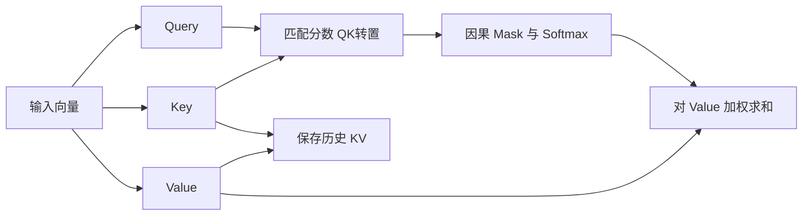
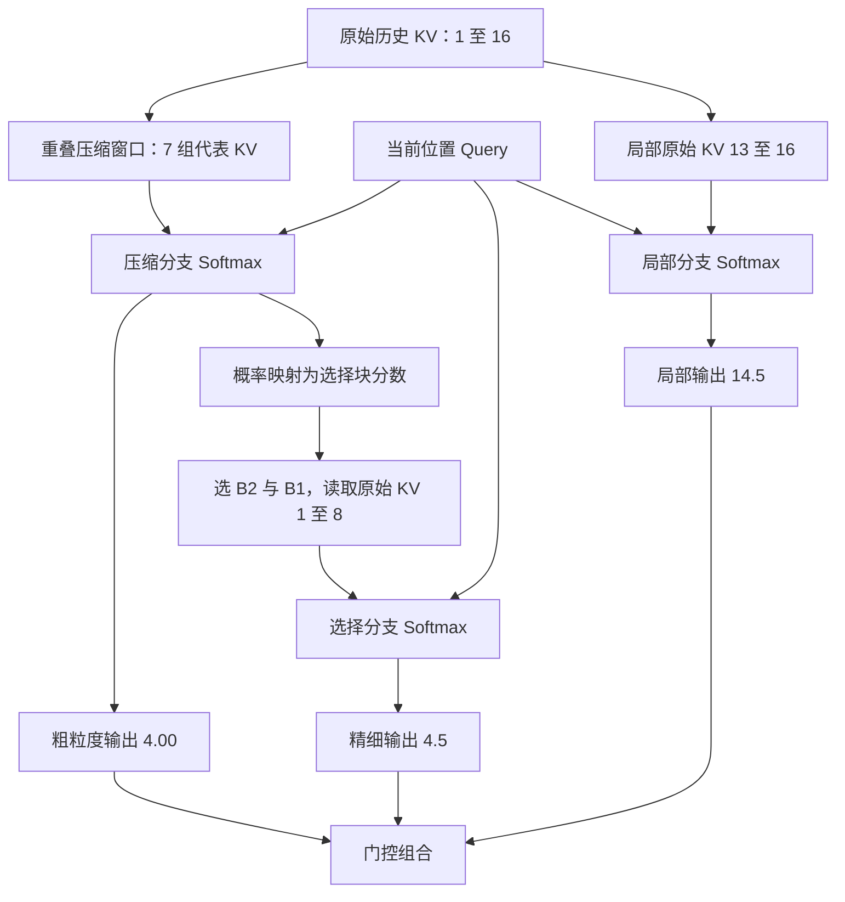

# 注意力的代价及优化：FlashAttention、Linear Attention、Sparse Attention 和 Compressed Attention

长上下文为什么贵？“Attention 是平方复杂度”只回答了一部分。GPU 要算 Query 和 Key 的匹配，要把数据从显存搬到计算单元，还要为后续生成保存历史状态。即使两个方案的 FLOPs 一样，实际速度也可能不同；即使显存占用降下来了，每一步生成也未必更快。

理解优化之前，先沿着一次注意力计算，把计算量、数据搬运和状态存储分开。后面讨论四类方法：计算实现优化、Compressed Attention、Linear Attention、Sparse Attention。这是按主要优化机制划分，边界存在交叉，也可以叠加使用。

## 一、一次 Attention 前向到底做了什么

### 1. 从 Q/K/V 到输出

先看单层、单个注意力头，省略 batch。输入是长度为 N 的向量序列 X，经线性投影得到 Q、K、V。设 Query 和 Key 的维度为 d，Value 的维度为 dᵥ：

$$
Q=XW_Q,\quad K=XW_K,\quad V=XW_V
$$

$$
S=\frac{QK^\top}{\sqrt d}+M,\quad P=\operatorname{softmax}(S),\quad O=PV
$$

Q、K 的形状是 N×d，V 是 N×dᵥ；S、P 是 N×N。每一行 Query 与所有允许访问的 Key 匹配，得到权重，再用权重汇总对应 Value。因果 Mask M 把未来位置设为负无穷，使它们的概率为零。这里的 Full Attention 指访问全部因果可见位置，不包含未来。

多头注意力并行执行多组这样的计算，再合并输出。位置编码会影响匹配方式，例如 RoPE（Rotary Position Embedding，旋转位置编码）作用于 Q/K；这里不展开它的设计，只在后面解释 MLA 的缓存时补上必要细节。



### 2. 数学步骤怎样变成访存

GPU 的 HBM 显存容量大，片上寄存器和共享内存容量小、访问快。矩阵乘法要将参与计算的数据搬入片上存储，算完再保存结果。不能把整段上下文和所有中间矩阵都长期留在片上。

朴素实现可以理解成下面这条路径：

```text
读取输入和投影权重 → 生成并写入 Q/K/V
读取 Q/K → 计算并写入分数 S
读取 S → Mask、Softmax → 写入概率 P
读取 P/V → 计算并写入输出 O
将历史生成要用的 K/V 保存在缓存中
```

这是解释成本的基线，不是现代框架必须逐项执行的 Kernel 清单。实际实现可以融合操作、复用缓冲区，甚至完全不把 S/P 写进显存。

问题最明显的是 S 和 P。它们的元素数随 N 平方增长，而且后续操作还要读取这些结果。以 N=32768、32 个 Query 头为例，假设显式存储的一个分数矩阵每元素占 2 字节，仅这一张矩阵就需要 64 GiB。这里还没有加概率矩阵、Q/K/V 和模型权重；实际实现的数据类型和内存复用会改变占用。

FlashAttention 通过分块消除完整中间矩阵的存储。

### 3. Prefill 与 Decode 在做不同的工作

Prefill 已知整段输入，可以同时计算所有位置的 Query。每一行仍遵守因果约束，但不需要等前一行计算完成才知道输入 token。单头 QKᵀ 和 PV 的主要成本分别是：

$$
O(N^2d),\qquad O(N^2d_v)
$$

因果约束减少有效计算的常数，增长趋势仍是平方。输入加长一倍，注意力核心计算量大致增至四倍；投影等逐 token 操作则按长度线性增长。

Decode 每次只输入新增位置。历史 token 在因果模型中的状态不会因后面添加 token 而改变，因此它们的 K/V 可以复用。当前只需计算新增 Q/K/V，将新 KV 追加到缓存，再用当前 Query 访问历史。

单步 Decode 的注意力计算随历史长度 N 线性增长，不是平方增长。但是，每生成一个 token，都需要再次读取它所关注的历史 KV。缓存避免了重新计算历史 K/V，没有避免历史数据的读取。

历史 K/V 供后续位置反复查询；Query 在当前输出计算完成后即可释放。

### 4. 缓存到底有多大

设 batch 为 B，层数为 L，KV 头数为 Hₖᵥ，Key、Value 头维度分别为 dₖ、dᵥ，每元素 s 字节：

$$
M_{KV}=BLNH_{kv}(d_k+d_v)s
$$

这是标准逐 token KV 存储的有效载荷，未计分页余量、量化元数据、分布式复制及运行时缓冲。它随长度线性增长。MQA/GQA 的缓存容量取决于 KV 头数，不是 Query 头数。

取 B=1、L=32、N=32768、dₖ=dᵥ=128、BF16 的 s=2：

| 配置 | Query 头数 | KV 头数 | KV 有效载荷 |
| --- | --- | --- | --- |
| MHA | 32 | 32 | 16 GiB |
| GQA | 32 | 8 | 4 GiB |
| MQA | 32 | 1 | 0.5 GiB |

这是人为固定其他参数的对照，不是三个具体模型的实测。batch 扩大到 8，三者分别需要约 128、32、4 GiB。

长 Prefill 因此有两种不同压力：建立线性增长的 KV 存储，以及执行平方增长的注意力计算。到了 Decode，长历史还带来反复读取 KV 的带宽压力。小 batch 时权重读取和并行度也很重要，这些部分共同决定完整模型的耗时。计算、带宽和容量哪一个先成为瓶颈，要看长度、并发、架构和硬件。

### 5. 容量与流量为什么不能混为一谈

16 GiB 的缓存是某一时刻需要保存的数据量，带宽成本则取决于每秒需要读写多少次。如果每个 Decode step 都把各层历史 KV 至少读取一遍，上例 MHA 每步就涉及约 16 GiB 的 KV 有效载荷；每秒生成 20 个 token，仅这一项便对应约 320 GiB/s。这里忽略了历史继续增长，也没有计算权重、激活和额外读写。

这只是解释数量级的理想化估算，不是硬件实测。片上复用、缓存命中、头之间的重复读取、分页布局都会改变物理流量；多 GPU 分片还会引入分布式通信。尤其不能把显卡标称带宽直接除以这个数，就当作完整模型的生成速度。

可以用一个粗略的下界理解两类瓶颈：

$$
T\gtrsim\max\left(\frac{F}{C_{effective}},\frac{D}{BW_{effective}}\right)
$$

F 是执行的运算量，D 是搬运的字节数；有效算力和有效带宽还取决于任务形状。真实时间还包含调度、同步和其他开销。降低 F 而没有降低占主导的 D，时延可能变化不大；降低 D 却让并行度变差，也可能拿不到预期收益。

Prefill 中，一块读入的 Key 可以服务多个 Query，有更多复用机会；单 token Decode 的 Query 很少，读入大段历史后能够完成的运算相对有限。因此同一套注意力数学形式，在两个阶段可能呈现不同瓶颈。增加 batch 又会改变权重摊销与并行度，同时扩大 KV 总量，不能简单归纳成“Prefill 永远算力受限，Decode 永远带宽受限”。

后面的方法可以对应到这个成本账本：Flash 类方法改善搬运与执行效率；KV 压缩缩小状态；线性注意力改变查询历史的方式；稀疏注意力减少被查询的连接。判断收益时还要把它们新增的工作放回账本。

## 二、计算实现优化：减少数据搬运，提高并行度

### 1. FlashAttention：不把完整矩阵写回显存

第一章把 Attention 写成几个大操作，FlashAttention 则把它切成许多小块。取一块 Query，依次处理若干 Key/Value 块，**在片上计算局部分数，同时更新当前输出；处理完成后，只写回必要结果。**

对一行分数，Softmax 的分母需要包含全部位置。假设两块分数分别是 `[0,0]` 和 `[ln 3,ln 3]`，指数分别是 `[1,1]` 和 `[3,3]`。整行分母为 8，概率是 `[1/8,1/8,3/8,3/8]`。如果各块独立做 Softmax，两块都会得到 `[1/2,1/2]`，块与块之间原本 1:3 的权重关系就丢了。

完整读取一行当然可以计算 Softmax，但需要保存分数，或者再次读取数据重算。在线算法让分母和输出随着数据块一起更新。

对已经处理的位置，保存三个量：最大分数 m、以 m 为基准的指数和 l，以及同一基准下的 Value 加权和 u。当前输出为 u/l。新块 B 到来后，更新：

$$
m'=\max(m,\max_{j\in B}s_j),\quad a=\exp(m-m')
$$

$$
l'=a l+\sum_{j\in B}\exp(s_j-m')
$$

$$
u'=a u+\sum_{j\in B}\exp(s_j-m')v_j
$$

缩放来自恒等式 `exp(s−m′)=exp(s−m)exp(m−m′)`。所以旧分母和旧加权和都乘 a，就与新块使用了同一个基准，已经处理过的分数可以丢弃。

沿用前面的例子，第一块处理完有 m=0、l=2、u=v₁+v₂。第二块使 m′=ln 3，a=1/3，因此 l′=2/3+2=8/3，u′=(v₁+v₂)/3+v₃+v₄。最终 u′/l′ 正好是 `(v₁+v₂+3v₃+3v₄)/8`。

```text
m = -∞; l = 0; u = 0
对每个可见 KV 块：
  计算该块分数 s
  new_m = max(m, max(s))
  a = exp(m - new_m)
  p = exp(s - new_m)
  l = a*l + sum(p)
  u = a*u + p @ V_block
  m = new_m
输出 u/l
```

这里按至少包含一个有效位置的块更新；因果掩码完全遮蔽的块跳过。u 是输出维度的向量，每个 Query 只需保留这一向量及两个标量。

这样既能数值稳定地计算全局 Softmax，又不需要把完整 S/P 存入 HBM。节省的是中间矩阵的空间和读写，以及融合带来的执行开销。全部允许的 Query-Key 配对仍要参与计算，因此 Full Attention 的平方级算术量仍然存在。

这里“精确注意力”指没有主动删掉连接或改变注意力算子，浮点运算顺序变化仍可能导致数值差异。后续 FlashAttention 版本进一步调整工作划分和硬件流水线，重点仍是让同样的数学计算更适合 GPU。

### 2. FlashDecoding：一个 Query 也要用好 GPU

Prefill 有很多 Query 行可以并行，单 token Decode 却可能只有很少的 Query。即使历史很长，只按 batch 和头划分任务，也未必有足够多的工作块填满 GPU。

FlashDecoding 沿 Key/Value 的历史长度再切分：不同任务处理不同历史片段，分别算出局部输出和归一化统计，最后通过稳定的 Softmax 归并得到全局结果。

它和在线 Softmax 的思想相通，但主要解决的是 Decode 的工作分配。长历史、小 batch 时更有机会获益；短历史下，拆分和归并的额外开销可能抵消收益。它没有减少历史 KV 的有效内容，也没有把全部读取消除。

### 3. PagedAttention：解决 KV 的分配和共享

缓存大小随着生成增长。如果为每个请求预留最大长度，会浪费空间；要求连续的大块显存，也会带来碎片与搬迁问题。

PagedAttention 将逻辑连续的 KV 序列映射到固定大小的物理块。请求增长时按需分配，通过映射找到实际数据。共享前缀的请求还可以共享缓存块，修改时再按需要复制。

它减少的是分配浪费，并改善缓存共享和服务并发能力。分页需要相应 Kernel 支持间接访问，但它没有把每个 KV 向量变短，也没有改变 Query 对哪些历史位置做注意力。

因此，FlashAttention、FlashDecoding、PagedAttention 放在同一章，是因为都涉及执行与系统实现；三者的优化对象并不相同。

## 三、Compressed Attention：让历史状态占得更少

本文用 Compressed Attention 统称通过头共享或低维表示压缩 KV 的注意力机制，包括 MQA、GQA 和 MLA。

### 1. MQA 与 GQA：多个 Query 共享 KV

MHA（Multi-Head Attention，多头注意力）为每个 Query 头配一组独立 K/V。MQA（Multi-Query Attention，多查询注意力）让所有 Query 头共享一组 K/V；GQA（Grouped-Query Attention，分组查询注意力）则将 Query 头分组，每组共享一组 K/V。

先区分位置和头：位置 t 的隐藏向量 hₜ 已经包含该层输入的上下文信息。MHA 用各头自己的矩阵生成 `qₜⁱ=WQⁱhₜ`、`kₜⁱ=WKⁱhₜ`、`vₜⁱ=WVⁱhₜ`。K/V 由输入与投影矩阵决定，随后才与 Query 匹配。

GQA 将后两组矩阵按组共享，令 g(i) 表示头 i 所属的组：

$$
q_t^i=W_Q^ih_t,\quad k_t^{g(i)}=W_K^{g(i)}h_t,\quad v_t^{g(i)}=W_V^{g(i)}h_t
$$

各头用自己的 q 与同一组历史 k 匹配。举例，两个历史 Key 为 `(1,0)`、`(0,1)`，两个 Query 分别为 `(2,0)`、`(0,2)`。省略缩放后，分数分别为 `[2,0]` 和 `[0,2]`，概率约为 `[0.881,0.119]` 和 `[0.119,0.881]`。共享的 Value 经过不同权重汇总，输出仍然不同。

共享表示能够训练出来，因为模型可以同时学习公共 KV 空间与各头不同的查询方向。MHA 提供更多独立投影，GQA/MQA 用更少的投影表示历史，这是表达能力与存储的架构取舍。

例如 32 个 Query 头、8 个 KV 头，就是每 4 个 Query 头共用一组历史表示。各 Query 头仍有不同的 Query，因此可以得到不同的分数与输出。

缓存容量随 KV 头数下降，Decode 中也有机会让多个 Query 复用同一份读入的数据。但是 Query 头数没有下降，Query-Key 匹配与 Value 汇总的算术量不会直接按同样比例缩小。实际带宽收益还依赖 Kernel 是否真正实现了共享读取。

代价是 KV 表示的自由度减少，需要训练或适配。不能把已经训练好的任意 MHA 模型直接改成共享 KV，就默认能力完全不变。GQA 在容量与表达能力之间提供了折中，Llama 3 系列就是采用 GQA 的开源权重模型实例。

### 2. MLA：保存低维 latent，而非展开后的多头 KV

DeepSeek 的 MLA（Multi-head Latent Attention，多头潜在注意力）将输入压入低维共享 latent，再从中构造各头需要的 Key/Value。缓存时保存这个紧凑表示，而不是每个头展开后的全部 KV。

如果实现每一步都重新展开所有历史 KV，缓存虽然小了，却可能引入大量额外计算。MLA 的关键还在计算路径：在合适的线性部分，通过矩阵结合将上投影吸收到 Query 或输出侧，让计算直接围绕 latent 进行。

用列向量写出这条路径。隐藏维度为 D，latent 维度 r，各头内容 Key/Value 维度为 dₖ、dᵥ：

$$
c_j=W_Dh_j,\quad k_j^i=U_K^ic_j,\quad v_j^i=U_V^ic_j
$$

W_D 的形状是 r×D，U_Kⁱ 是 dₖ×r，U_Vⁱ 是 dᵥ×r。它们在训练中共同学习。Decode 查询时，内容分数可以变换为：

$$
(q_t^i)^\top U_K^ic_j=((U_K^i)^\top q_t^i)^\top c_j
$$

因此每个新增 Query 只需先变成 r 维向量，再匹配缓存中的 cⱼ，无需逐个恢复历史 Key。Value 一侧同样利用线性性：

$$
\sum_j p_{tj}^i U_V^ic_j=U_V^i\left(\sum_j p_{tj}^ic_j\right)
$$

先对 latent 求加权和，再对每个头的结果上投影；上投影与后续线性输出投影还可以结合。历史有 N 个位置时，上投影从逐位置执行变成对汇总结果执行。每个 Query 仍有变换与 latent 注意力成本；r 也可能大于普通单头维度，因此缓存节省与 FLOPs 节省需要分别核算。Prefill 有大量 Query，采用展开后的矩阵计算路径也可能更合适。

位置编码使事情更复杂。RoPE 与这些矩阵变换不能任意交换，因此 DeepSeek 的设计将内容与位置相关部分解耦，缓存中还包含独立的位置 Key。若位置 Key 的维度为 d_R，缓存有效载荷为 $BLN(r+d_R)s$。内容分数与位置分数相加后统一归一化；位置分支保持逐位置的位置匹配。

MLA 压缩的是每个位置的特征表示，历史位置数仍随序列增长。DeepSeek-V3 使用 MLA，仍然需要处理长历史；它并没有因此变成固定状态的线性注意力模型。

## 四、Linear Attention：用递归状态替代完整历史

### 1. 从加权平均推到可分解相似度

先只看当前 Query 的一个输出。所有向量都按列向量书写：$q_t,k_j\in\mathbb R^{d_k}$，$v_j,o_t\in\mathbb R^{d_v}$。历史位置为 $j\le t$。选一个非负相似度函数 $\operatorname{sim}$，就可以定义归一化加权平均：

```math
o_t=\frac{\sum_{j\le t}\operatorname{sim}(q_t,k_j)v_j}
{\sum_{j\le t}\operatorname{sim}(q_t,k_j)}.
```

普通 Softmax Attention 对应 $\operatorname{sim}(q,k)=\exp(q^\top k/\sqrt{d_k})$。指数提供正权重，分母把权重和变成 1。为了改用更便宜的计算路径，可以重新选择相似度函数，并训练 Q/K 投影去适应它。

例如，使用 ELU（Exponential Linear Unit，指数线性单元）逐元素定义特征映射 $\phi(x)=\operatorname{ELU}(x)+1$，其中 ELU 的负半轴参数取 1：

```math
\phi(x)_a=\begin{cases}x_a+1,&x_a\ge0,\\ e^{x_a},&x_a<0.\end{cases}
\qquad \operatorname{sim}(q,k)=\phi(q)^\top\phi(k).
```

每个特征都为正，内积也为正。取二维教学例子：$q=(0,0)^\top$，$k_1=(0,0)^\top$，$k_2=(\ln 2,-\ln 2)^\top$，两个标量 Value 为 2、6。映射后的 Query 为 $(1,1)^\top$，两个 Key 为 $(1,1)^\top$、$(1+\ln2,1/2)^\top$。相似度分别为 2 和 $1.5+\ln2\approx2.193$，因此：

```math
o=\frac{2\times2+(1.5+\ln2)\times6}{2+1.5+\ln2}\approx4.092.
```

分母去掉以后，结果会随写入条数和特征大小一起放大，就不再是上述加权平均。实现通常还会对分母做数值保护。

这里有三种不同的数学目标。ELU+1 **替换了核函数**；随机特征等方法可以用有限维特征**近似指数核**；FlashAttention 则仍然计算原来的 **Softmax 算子**。指数核的幂级数包含任意高阶交叉项，在一般连续输入域上，精确的特征展开需要无限维；固定维特征换来了可汇总的状态，也限制了相似度的表示能力。

设映射后的维度为 $m$。下面先用行向量形式展开分子，以便看见结合顺序：

```math
\begin{aligned}
\sum_{j\le t}\bigl(\phi(q_t)^\top\phi(k_j)\bigr)v_j^\top
&=\sum_{j\le t}\phi(q_t)^\top\bigl(\phi(k_j)v_j^\top\bigr)\\
&=\phi(q_t)^\top\left(\sum_{j\le t}\phi(k_j)v_j^\top\right).
\end{aligned}
```

第一步把“标量乘 Value”改写为“Query 乘外积”，第二步把公共 Query 提出来。它依赖相似度的内积分解，以及乘法的结合律、分配律。定义状态与归一化向量：

```math
S_t=\sum_{j\le t}\phi(k_j)v_j^\top\in\mathbb R^{m\times d_v},
\qquad z_t=\sum_{j\le t}\phi(k_j)\in\mathbb R^m.
```

回到列向量输出，得到：

```math
S_t=S_{t-1}+\phi(k_t)v_t^\top,\quad
z_t=z_{t-1}+\phi(k_t),\quad
o_t=\frac{S_t^\top\phi(q_t)}{z_t^\top\phi(q_t)}.
```

初始状态为零。每来一个 token，只更新这两个量；Query 无需再逐个访问过去的 Key。这一变形对选定的可分解核是精确的，核与 Softmax 的差别发生在变形之前。

### 2. 一个矩阵怎样保存 KV 关联

为了看清状态的作用，以下改用 fast-weight 记忆的记号：$k,q$ 直接表示参加外积和读取的特征，维度记为 $d_k$；统一令 $S\in\mathbb R^{d_k\times d_v}$，读取为 $S^\top q$。在上面的核注意力里，这些特征就是 $\phi(k),\phi(q)$，读取后还要除以 $z^\top\phi(q)$。后面的 GLA、Delta 系列则使用自己训练出的特征和归一化层，本文写的是它们的记忆核心 $o=S^\top q$，不再沿用核注意力的分母。

取 $d_k=2,d_v=1$，从零写入两条关联：

```math
k_1=\begin{bmatrix}1\\0\end{bmatrix},\ v_1=2,
\qquad k_2=\begin{bmatrix}0\\1\end{bmatrix},\ v_2=6.
```

```math
S_1=k_1v_1^\top=\begin{bmatrix}2\\0\end{bmatrix},\qquad
S_2=S_1+k_2v_2^\top=\begin{bmatrix}2\\6\end{bmatrix}.
```

第一行存“Key 第一通道激活时写入的 Value 总和”，第二行存第二通道的总和。Query 为 $(1,0)^\top$ 时读出 2，为 $(0,1)^\top$ 时读出 6，为 $(1,1)^\top$ 时读出 8。Value 若有多维，每一行就保存一整个 Value 向量的累计贡献。

一般地，读取可以展开成：

```math
S_t^\top q=\sum_{j\le t}v_j(k_j^\top q).
```

所以状态保留的是关联的叠加。Key 正交时容易分开读；两个 Key 接近时，Query 会同时激活两条关联。例如把第二条 Key 改为 $(1,1)^\top/\sqrt2$，则查询 $q=k_1$ 会读出 $2+6/\sqrt2\approx6.243$，第二条关联产生了串扰。

简单累加还不善于替换旧值。在 $S=(2,6)^\top$ 上再次写入 $k=(1,0)^\top,v=4$，状态变成 $(6,6)^\top$，读取第一条得到 6。新旧 Value 被相加，记忆没有检查“2 应该更新成 4”。即使保留核注意力的分母，重复同一 Key 也会形成多次写入的加权平均，而非自动覆盖。

状态需要 $d_kd_v$ 个元素；归一化核形式另有 $d_k$ 个分母元素。取 $d_k=d_v=128$，单头 S 有 16384 个元素，BF16 为 32 KiB，若状态用 FP32 则为 64 KiB。总占用还要乘层数、头数和 batch。

一次外积更新和一次读取各需 $O(d_kd_v)$ 运算，单步成本不随历史长度增加；处理 N 个位置为 $O(Nd_kd_v)$，另计投影和特征映射。“线性”针对 N，维度翻倍仍可能使状态和运算扩大四倍。推理只需保留当前状态；训练保存激活和计算梯度的成本要另算。

### 3. GLA：逐方向衰减旧关联

GLA（Gated Linear Attention，门控线性注意力）让当前输入控制旧记忆的保留程度。若一段话结束，旧关联可能已过时，GLA 先让当前输入生成遗忘系数，再写入新关联。以常用的 Key 方向门控为例，设输入 $x_t\in\mathbb R^D$，低秩门控投影为 $A\in\mathbb R^{r\times D}$、$B\in\mathbb R^{d_k\times r}$，偏置 $b\in\mathbb R^{d_k}$：

```math
a_t=\sigma(BAx_t+b)^{1/\tau}\in(0,1)^{d_k},\qquad
D_t=\operatorname{Diag}(a_t).
```

幂逐元素计算；GLA 的实验采用对数域温度，$\tau=16$ 时会减慢遗忘。状态更新是：

```math
S_t=D_tS_{t-1}+k_tv_t^\top
=(a_t\mathbf1_{d_v}^\top)\odot S_{t-1}+k_tv_t^\top.
```

$a_t$ 沿 Value 维度广播：第 a 行的全部 Value 通道都乘同一个 $a_{t,a}$。论文也给出 Key 与 Value 两侧都门控的形式，$G_t=a_tb_t^\top$，对应 $\operatorname{Diag}(a_t)S\operatorname{Diag}(b_t)$；这里固定 Value 侧为 1，避免混入另一组门控。

从零展开递推：

```math
S_t=\sum_{j=1}^t\left(\prod_{u=j+1}^t D_u\right)k_jv_j^\top.
```

第 j 步刚写入时没有衰减，以后每一步都会乘上相应门控。例如第 1 步的贡献到第 3 步为 $D_3D_2k_1v_1^\top$。门控来自各时刻输入，因此遗忘速度可以随内容改变。

沿用 $S=(2,6)^\top$，取 $a=(1/2,1/4)^\top$。先衰减成 $(1,1.5)^\top$，再写入 $k=(1,0)^\top,v=4$，得到 $(5,1.5)^\top$。第一通道旧值保留一半，第二通道保留四分之一；新值仍通过外积直接加上。GLA 改善了历史寿命控制，但这一步仍没有检查当前 Key 已经记住什么。门控、外积与读取的主要成本仍为每步 $O(d_kd_v)$。

### 4. DeltaNet 与 Gated DeltaNet：先预测，再修正

把 S 当成一张临时学习的映射表。给定当前 Key，旧状态的预测是 $\hat v=S_{t-1}^\top k_t$。希望它接近当前 Value，可以定义重建损失：

```math
\mathcal L_t(S)=\frac12\lVert S^\top k_t-v_t\rVert_2^2.
```

对状态中的元素 $S_{ab}$ 求导，只有预测的第 b 个分量包含它：

```math
\frac{\partial\mathcal L_t}{\partial S_{ab}}
=k_{t,a}\bigl((S^\top k_t)_b-v_{t,b}\bigr).
```

因此梯度矩阵为 $k_t(S^\top k_t-v_t)^\top$。用标量学习率 $\beta_t$ 做一次下降：

```math
S_t=S_{t-1}+\beta_t k_t(v_t-S_{t-1}^\top k_t)^\top.
```

这是 DeltaNet 的核心。写入的是预测误差，内循环更新对象是 S；产生 Q/K/V 和学习率的网络参数仍通过模型训练学习。

设 Key 已经做 L2 归一化，$\lVert k_t\rVert_2=1$。更新后用同一个 Key 读取：

```math
S_t^\top k_t=\hat v+\beta_t(v_t-\hat v)
=(1-\beta_t)\hat v+\beta_tv_t.
```

$\beta=1$ 时当前关联一步校正到目标，$\beta=1/2$ 时移动一半；常见门控将 $\beta$ 控制在 0 到 1。Key 若未归一化，有效步长还会乘 $\lVert k_t\rVert^2$，所以单位 Key 条件直接影响这一解释。

仍从 $(2,6)^\top$ 写入 $k=(1,0)^\top,v=4$。旧预测为 2，误差为 2。$\beta=1/2$ 得到 $(3,6)^\top$，$\beta=1$ 得到 $(4,6)^\top$；直接累加则得到 $(6,6)^\top$。修正沿 k 方向发生，正交方向保持原值。对于另一个非正交 Key，读取也会随更新变化，Delta 规则没有消除有限状态中的所有串扰。

Gated DeltaNet 再加入整体遗忘。令 $\alpha_t$ 为当前输入生成的标量保留率，计算顺序是：

```math
\bar S_t=\alpha_t S_{t-1},\qquad
\hat v_t=\bar S_t^\top k_t,\qquad e_t=v_t-\hat v_t,
```

```math
S_t=\bar S_t+\beta_t k_te_t^\top
=\alpha_t(I-\beta_tk_tk_t^\top)S_{t-1}+\beta_tk_tv_t^\top.
```

$\alpha$ 控制所有旧关联先保留多少，$\beta$ 控制当前关联向目标修正多少。取 $\alpha=1/2,\beta=1/2$，先得到 $\bar S=(1,3)^\top$，预测 1、误差 3，更新后为 $(2.5,3)^\top$。误差必须在衰减之后计算，才与上式一致。相比简单外积，多了一次状态乘 Key 的预测，主要成本仍为 $O(d_kd_v)$。

### 5. KDA：在 Delta 更新前按方向遗忘

KDA（Kimi Delta Attention）把上述标量 $\alpha_t$ 换成长度为 $d_k$ 的输入相关保留率向量 $a_t$。令 $D_t=\operatorname{Diag}(a_t)$，完整顺序为：

```math
\bar S_t=D_tS_{t-1},\qquad
\hat v_t=\bar S_t^\top k_t,\qquad
e_t=v_t-\hat v_t,\qquad
S_t=\bar S_t+\beta_tk_te_t^\top.
```

合起来是：

```math
S_t=(I-\beta_tk_tk_t^\top)D_tS_{t-1}
+\beta_tk_tv_t^\top,\qquad o_t=S_t^\top q_t.
```

$D_t$ 先作用于旧状态，随后才做 Delta 校正。对角衰减与 $I-\beta kk^\top$ 一般不交换。

先沿用上一节的单位坐标 Key：取 $a=(1/2,1/4)^\top,\beta=1/2$。$S=(2,6)^\top$ 衰减为 $(1,1.5)^\top$；查询 $k=(1,0)^\top$ 预测为 1、误差为 3，写入目标 4 后得到 $(2.5,1.5)^\top$。与标量衰减的 $(2.5,3)^\top$ 相比，第二方向可以更快遗忘。

为了让两个方向都进入预测，再把当前 Key 换成 $k=(1,1)^\top/\sqrt2$，其余参数不变：

| 步骤 | Gated DeltaNet，$\alpha=1/2$ | KDA，$a=(1/2,1/4)^\top$ |
| --- | --- | --- |
| 衰减后状态 | $(1,3)^\top$ | $(1,1.5)^\top$ |
| 预测 $\bar S^\top k$ | $4/\sqrt2\approx2.8284$ | $2.5/\sqrt2\approx1.7678$ |
| 目标减预测 | $4-2\sqrt2\approx1.1716$ | $4-1.25\sqrt2\approx2.2322$ |
| 每行增加 $\beta e/\sqrt2$ | $\sqrt2-1\approx0.4142$ | $\sqrt2-0.625\approx0.7892$ |
| 新状态 | $(1.4142,3.4142)^\top$ | $(1.7892,2.2892)^\top$ |

逐通道遗忘先改变了预测，再改变校正量。它并非只在最终状态上多乘一次向量。

将五种记忆核心放在一起，令 $e=v-\bar S^\top k$：

| 规则 | 先处理旧状态 $\bar S$ | 写入后状态 | 解决的直接问题 |
| --- | --- | --- | --- |
| 累加 | $S$ | $\bar S+kv^\top$ | 汇总所有关联 |
| GLA，Key 方向门控 | $DS$ | $\bar S+kv^\top$ | 不同方向有不同寿命 |
| DeltaNet | $S$ | $\bar S+\beta ke^\top$ | 修正当前 Key 的预测 |
| Gated DeltaNet | $\alpha S$ | $\bar S+\beta ke^\top$ | 整体遗忘后修正 |
| KDA | $DS$ | $\bar S+\beta ke^\top$ | 按方向遗忘后修正 |

这些公式只列记忆核心；具体模型还包含 Q/K 归一化、短卷积、输出归一化和输出门等。Kimi Linear 是包含 KDA 与 MLA 的混合架构，MLA 层的历史缓存仍随上下文增长。

### 6. Prefill 怎样分块计算

递推公式方便 Decode，但 Prefill 已知整段输入，逐 token 启动小矩阵操作会浪费 GPU 并行能力。分块算法把长度 N 切成大小 C 的块：块内计算各位置之间的因果作用，块间只传递状态。

对于最简单的累加规则，设块入口状态为 $S_{\mathrm{in}}$，块内第 r 个输出为：

```math
o_r=S_{\mathrm{in}}^\top q_r+\sum_{i=1}^r v_i(k_i^\top q_r),\qquad
S_{\mathrm{out}}=S_{\mathrm{in}}+\sum_{i=1}^Ck_iv_i^\top.
```

第一项读取块前历史，第二项用块内带因果 Mask 的 Q/K 匹配批量计算。核注意力的分母也按同样的“入口累计量加块内累计量”处理。

对 Delta/KDA，写成 $S_i=A_iS_{i-1}+B_i$，其中 KDA 的 $A_i=(I-\beta_i k_ik_i^\top)D_i$，$B_i=\beta_i k_iv_i^\top$。整个块仍是对入口状态的一个仿射变换：

```math
S_{\mathrm{out}}=(A_C\cdots A_1)S_{\mathrm{in}}
+\sum_{i=1}^C(A_C\cdots A_{i+1})B_i.
```

空乘积为单位矩阵。实际算法利用对角与秩一结构，将块内依赖组织为矩阵运算、三角求解或紧凑 WY 表示，避免逐个构造稠密 A 再相乘。块内结果与跨块状态共同产生输出；分块保持原递推的因果计算，浮点运算顺序可能不同。C 固定时，块数随 N 线性增长，但实际吞吐仍取决于矩阵形状、状态搬运和 Kernel。

## 五、Sparse Attention：只访问部分历史

### 1. 先认清候选、索引和实际 Value

设当前 Query 可用的候选条目为 $\mathcal C_t$，筛选后的集合为 $\mathcal T_t\subseteq\mathcal C_t$。条目可以是原始 token，也可以是压缩条目。对选中条目重新计算主注意力分数 $s_{tj}=q_t^\top k_j/\sqrt{d_k}$，得到：

```math
p_{tj}=\frac{\exp(s_{tj})}{\sum_{u\in\mathcal T_t}\exp(s_{tu})},\quad j\in\mathcal T_t,
\qquad o_t=\sum_{j\in\mathcal T_t}p_{tj}v_j.
```

未选中的条目不进入这个分母。索引分数可以参与选集合，却不会自动成为 $p_{tj}$。CSA/HCA 还加入 attention sink，稍后单独补上它的分母。

下面统一观察位置 16 的 Query，因果可见位置为 1…16，包含当前位置。将原始历史分为四组，仅作示例标记：$B_1=[1…4]$、$B_2=[5…8]$、$B_3=[9…12]$、$B_4=[13…16]$。各方法在这同一段历史上构造自己的缓存，压缩器、参数与最终表示不共用。

| 数据 | 由什么生成 | 在哪里用 | 是否直接当最终 Value |
| --- | --- | --- | --- |
| 原始 $k_j,v_j$ | 位置 j 的输入投影 | SWA、NSA 精细分支 | $v_j$ 是 |
| MLA 的 $c_j,k_j^R$ | 位置 j 的 latent 与位置 Key | DSA/HISA 主注意力 | latent 先汇总，再上投影 |
| NSA 的 $\tilde k_i,\tilde v_i$ | 一个窗口内的原始 K/V | 压缩分支与块选择 | $\tilde v_i$ 是 |
| 索引 Key $k_j^I$ 或压缩索引 Key | 专用小维投影或其压缩器 | 便宜的候选评分 | 否 |
| CSA/HCA 的压缩条目 $u_i$ | 隐藏表示经门控池化 | 压缩历史的主注意力 | 是，同时承担 Key 角色 |

以下访问量都数逻辑条目，省略 batch、层数、投影成本和硬件复用；实际字节量还要乘条目宽度与精度。

### 2. SWA：窗口怎样向前移动

SWA（Sliding Window Attention，滑动窗口注意力）只访问最近一段历史。这里取窗口大小 $W=4$，含当前位置。缓存只保留本层最近四组原始 KV。位置 16 的流程是：生成并写入 $(k_{16},v_{16})$，回收位置 12，再用 $q_{16}$ 读取 13、14、15、16 的 Key；对四个分数做 Softmax，汇总对应四个 Value。

```text
Query     允许读取的原始 KV
  13      10 11 12 13
  14         11 12 13 14
  15            12 13 14 15
  16               13 14 15 16
  17                  14 15 16 17
```

例如四个主分数都是 0，输出就是 $(v_{13}+v_{14}+v_{15}+v_{16})/4$。位置 17 到来时覆盖最旧的槽位，环形缓冲区保持四条容量。窗口内读写连续或容易分段处理，选择本身只需算起止位置。

局部连接也能逐层传播：第二层位置 16 读取第一层 13…16，而第一层位置 13 已经读取上一层 10…13。L 层同样窗口的理论感受野最多覆盖 $1+L(W-1)$ 个位置，信息经过中间表示传递；第 L 层仍没有直接读取所有这些位置的原始 KV。

每个 Query 最多访问 W 条，单步核心成本为 $O(W(d_k+d_v))$，缓存为 $W(d_k+d_v)$ 个元素。整段 Prefill 为 $O(NW(d_k+d_v))$。若其他层使用全局注意力，那些层的缓存要单独保留。

### 3. NSA：先用压缩注意力判断该读哪些原始块

NSA（Native Sparse Attention，原生稀疏注意力）同时保留原始 KV、压缩 KV 与局部窗口索引。压缩分支需要的历史更短，但选择分支随 Query 改变，所以原始 KV 仍要保存。

**压缩缓存怎样生成。** 设压缩窗口长度为 $l$、滑动步长为 $s$，通常 $s<l$，因此相邻窗口重叠。将窗口里的 Key 加上窗口内位置编码，再用可学习的 MLP（Multi-Layer Perceptron，多层感知机）映射成一个 Key；Value 有对应的压缩映射：

```math
\tilde k_i=f_K(k_{is+1},\ldots,k_{is+l};E_K),\qquad
\tilde v_i=f_V(v_{is+1},\ldots,v_{is+l};E_V).
```

这里 $f_K:\mathbb R^{l\times d_k}\to\mathbb R^{d_k}$，$f_V:\mathbb R^{l\times d_v}\to\mathbb R^{d_v}$，$E_K,E_V$ 表示窗口内的位置处理。它使压缩器能区分块内顺序。这里只把它写成函数接口；MLP 会混合窗口信息，并非默认均值池化。窗口全部可见后才生成代表。

教学例子取 $l=4,s=2$，从位置 1 开始，完成的窗口为 `[1…4]`、`[3…6]`、`[5…8]`、`[7…10]`、`[9…12]`、`[11…14]`、`[13…16]`，共 7 个。这个小例子的起点和首尾边界显式按上述窗口定义，省略论文记号中的边界偏移；实际选择还须处理越界窗口与不足整块的位置。

**压缩分支完整走一次。** 当前 Query 与 7 个压缩 Key 做内积。为便于手算，假定缩放后的分数为下列概率的对数：

```math
p^{\mathrm{cmp}}=(0.05,0.10,0.30,0.20,0.15,0.10,0.10).
```

这些数加起来为 1，因此 Softmax 后仍是这组数。再假定 7 个压缩 Value 是标量 $(1,2,3,4,5,6,7)$，得到：

```math
o^{\mathrm{cmp}}=0.05+0.20+0.90+0.80+0.75+0.60+0.70=4.00.
```

这里的 Value 和概率都是教学输入，不是指定某个 MLP 必须输出这些数。

**压缩概率怎样变成选择块分数。** 精细读取按另一种块大小 $b$ 组织，不能直接把压缩窗口编号当成原始块编号。论文在 $s\mid l$ 且 $s\mid b$ 时，用窗口间的空间对应关系聚合概率。按其零基数组记号：

```math
a_j=\sum_{m=0}^{b/s-1}\sum_{n=0}^{l/s-1}
 p^{\mathrm{cmp}}_{(b/s)j+m+n}.
```

设越界项为零，首尾按可见范围截断。本例 $b=4,l=4,s=2$，每个分数变成 $a_j=p_{2j}+2p_{2j+1}+p_{2j+2}$。中间概率的重复来自求和中的多组窗口偏移，$a_j$ 只作排名，不要求和为 1：

| 选择块 | 从压缩概率得到的分数 |
| --- | --- |
| $B_1$，1…4 | $0.05+2(0.10)+0.30=0.55$ |
| $B_2$，5…8 | $0.30+2(0.20)+0.15=0.85$ |
| $B_3$，9…12 | $0.15+2(0.10)+0.10=0.45$ |
| $B_4$，13…16 | $0.10+0+0=0.10$ |

GQA 下还会把同组 Query 头的块分数相加，共用所选块，减少重复加载。这里只演算一个头。Top-2 得到 $B_2,B_1$，读取原始位置 1…8 的 K/V，重新用主分数做一次八位置 Softmax，产生 $o^{\mathrm{slc}}$。例如这八个主分数全为 0，原始标量 $v_j=j$，则 $o^{\mathrm{slc}}=4.5$。压缩概率负责选块，八个最终概率则是新的 $1/8$。

**局部分支与输出。** 令局部窗口 $w=4$，读取原始 13…16，独立归一化。若这四个主分数为 0、$v_j=j$，得到 $o^{\mathrm{win}}=14.5$。输入经 MLP 和 sigmoid 生成三个标量门 $g_t^c\in[0,1]$，组合为：

```math
o_t=g_t^{\mathrm{cmp}}o_t^{\mathrm{cmp}}
+g_t^{\mathrm{slc}}o_t^{\mathrm{slc}}
+g_t^{\mathrm{win}}o_t^{\mathrm{win}}.
```

三组门不要求和为 1。教学取 $(0.2,0.5,0.3)$，输出为 $0.8+2.25+4.35=7.4$。三个分支各有自己的 Softmax 分母，与 CSA 将局部条目和压缩条目拼在一起的方式不同。



本例主注意力分别访问 7、8、4 条，共 19 次逻辑条目访问，比 16 条全注意力还多。小例子用于追踪数据，不代表加速配置。长历史下，选 n 个 b 大小的块时，三路访问量约为 $N/s+nb+w$，重叠读取的物理流量取决于复用。压缩窗口生成和块分数归并也有成本。固定 s 时，压缩分支每个 Query 仍扫描 $N/s$ 个代表，因此整个 Prefill 仍有 $O(N^2/s)$ 的配对项。

### 4. DSA：小索引器选 token，MLA 再读内容

DSA（DeepSeek Sparse Attention）缓存中有两套历史：主注意力的 MLA latent 与位置 Key，以及专用索引 Key。索引器每步扫描后者，主注意力只读所选位置的前者；本次未选中的条目仍可能被下一个 Query 使用。

设隐藏维度为 D，Query latent $c_t^Q\in\mathbb R^{r_q}$，索引头数为 $H_I$，每头索引维度为 $d_I$。索引 Query 由低秩 Query 表示生成，索引 Key 与头权重由对应位置的隐藏表示生成。用省略位置变换的核心形式写为：

```math
q_{t,h}^I=U_h^I c_t^Q,\quad
k_j^I=\operatorname{LN}(W_K^I x_j),\quad
(w_{t,1},\ldots,w_{t,H_I})^\top=W_wx_t.
```

$U_h^I$ 为 $d_I\times r_q$，$W_K^I$ 为 $d_I\times D$，$W_w$ 为 $H_I\times D$。实际实现还对索引 Q/K 做相应 RoPE、旋转与低精度处理；缩放系数可以并入 w。打分为：

```math
I_{tj}=\sum_{h=1}^{H_I}w_{t,h}\operatorname{ReLU}\bigl((q_{t,h}^I)^\top k_j^I\bigr).
```

内积衡量某个索引头的匹配；ReLU（Rectified Linear Unit，修正线性单元）截去该头的负内积；w 调节各头贡献。w 是线性投影结果，不是跨头 Softmax 概率，也不保证非负。

沿用 16 个位置，假定一个索引头、正权重 1，得到：

```text
位置：  1  2  3  4 | 5  6  7  8 | 9 10 11 12 |13 14 15 16
索引分：1  2  0  1 | 3  9  4  8 | 2  7  1  3 | 0  2  6  1
```

Top-4 选出位置 $(6,8,10,15)$。这组分数可由一维正索引 Key 与 $q^I=1$ 实现，后面 HISA 也沿用它。

随后读取这四个位置的 MLA 缓存。对主头 i，吸收 Key 上投影后的内容 Query 为 $\bar q_t^i$，位置 Query 为 $q_t^{R,i}$；主分数包含内容和位置两项，统一乘该模型的缩放系数 $\lambda$：

```math
s_{tj}^i=\lambda\bigl((\bar q_t^i)^\top c_j+(q_t^{R,i})^\top k_j^R\bigr),
\qquad j\in\lbrace6,8,10,15\rbrace.
```

例如主分数恰为 $(0,\ln2,\ln3,\ln4)$，Softmax 为 $(0.1,0.2,0.3,0.4)$。索引排名最高的位置 6，在最终主注意力里反而只有 0.1。若教学性的单维 latent 为 $(2,4,6,8)$、Value 上投影为恒等映射，则输出为 $0.2+0.8+1.8+3.2=6$。一般情形先汇总 $\sum_jp_{tj}^ic_j$，再应用 $U_V^i$ 与后续输出投影。

索引器为什么能预测重要位置？DSA 的训练利用主注意力分布作监督：先在稠密注意力阶段训练索引器，使其归一化评分逼近跨主头汇总的注意力分布，再进入稀疏训练，在选中集合上继续用 KL 散度（Kullback–Leibler Divergence）匹配分布。索引器输入从主模型计算图中分离，索引器由这一辅助损失更新，主模型由语言建模损失更新。Top-k 的离散选择本身不提供普通的连续梯度，这个辅助目标给索引 Q/K 和头权重提供了学习信号。

设主头数 H、MLA latent 宽度 r、位置宽度 $d_R$。单个 Query 的索引成本约为 $O(NH_Id_I)$，另有 Top-k；主注意力匹配和汇总约为 $O(kH(r+d_R))$，另计输出投影、gather。整个 Prefill 的索引项仍为 $O(N^2H_Id_I)$，主注意力项缩成 $O(NkH(r+d_R))$。节省成立的前提是小维、少头、低精度的全量筛选比全量主注意力便宜。

### 5. CSA 与 HCA：压缩器具体怎样工作

CSA（Compressed Sparse Attention，压缩稀疏注意力）与 HCA（Heavily Compressed Attention，高度压缩注意力）都先沿序列压缩历史。DSA 在 16 个原始位置上筛选；CSA 先生成更少的历史条目，再在这些条目上筛选。DeepSeek-V4 的主缓存采用共享 Key/Value 的 MQA 表示，不能直接沿用上一节“读取 V3 的 MLA latent 再恢复 Value”的解释。

**先看一个门控池化器。** 输入 $x_j\in\mathbb R^D$ 产生内容向量 $c_j=W_Cx_j\in\mathbb R^{d_c}$，以及同宽度的池化 logits $z_j=W_Zx_j$。窗口内相对位置 p 另有学习偏置 $b_{p,a}$，a 是通道。对于已完成的窗口 $\mathcal W_i$：

```math
\rho_{j,a}=\frac{\exp(z_{j,a}+b_{p(j),a})}
{\sum_{u\in\mathcal W_i}\exp(z_{u,a}+b_{p(u),a})},\qquad
\tilde u_{i,a}=\sum_{j\in\mathcal W_i}\rho_{j,a}c_{j,a}.
```

Softmax **沿窗口内 token 维度**进行，每个通道分别有一组权重。权重来自历史输入及学习偏置，与当前 Query 无关。它既不是所有通道共用一个标量，也不是跨通道归一化。

一个两 token、两通道的缩小例子：内容为 $(2,10)$、$(6,2)$；logits 加偏置后为 $(0,\ln3)$、$(\ln3,0)$。第一通道权重为 $(1/4,3/4)$，第二通道为 $(3/4,1/4)$，汇总得到 $(5,8)$。接下来执行 RMSNorm（Root Mean Square Layer Normalization，均方根层归一化）和压缩条目的位置变换，才成为可供主注意力读取的 $u_i$。这里 $(5,8)$ 只是池化结果；实际注意力不跳过后续变换。

**CSA 的重叠压缩。** 实际 CSA 取步长 $m=4$，每个输入通过两个独立内容投影和两个 logits 投影产生两套表示。为避免论文与代码对分支 a/b 的命名差异，下面称“当前块分支”和“前块分支”。每次将当前 4 token 的当前块分支，与前面 4 token 的前块分支拼接，沿这 8 个位置逐通道做上述 Softmax 后求和。第一条没有前块，其缺失 logits 设为负无穷。投影矩阵各为 $d_c\times D$，位置偏置每支为 $m\times d_c$。

因此输出步长是 4，通常每条实际覆盖 8 个原始位置：

```text
条目       汇入的原始位置       最早完成时刻（位置从 1 开始）
u1         1…4                 4
u2         1…4 与 5…8          8
u3         5…8 与 9…12         12
u4         9…12 与 13…16       16
```

相邻条目使用不同投影分支来汇入重叠 token，不能把两条简单理解为对同一张 KV 做均值。索引器也有自己独立的小维压缩器，以相同步长与重叠方式生成 $\kappa_i^I$；$\kappa_i^I$ 用来打分，$u_i$ 用来执行主注意力。

**沿生成时间更新缓存。** 教学取局部窗口 $W=4$，实际配置的窗口可更大。压缩条目只在右边界到齐时可见；它编码的位置与它何时可见是两件事，因果判断依据完成边界。

| 新位置处理后 | 最近原始窗口 | 当前未满块 | 额外保留的重叠信息 | 完成的压缩历史 |
| --- | --- | --- | --- | --- |
| 13 | 10…13 | 13 的内容与 logits | 9…12 的前块分支 | $u_1,u_2,u_3$ |
| 14 | 11…14 | 13…14 | 同上 | $u_1,u_2,u_3$ |
| 15 | 12…15 | 13…15 | 同上 | $u_1,u_2,u_3$ |
| 16 | 13…16 | 满 4，生成 $u_4$ 后清空 | 改为 13…16 的前块分支 | $u_1,u_2,u_3,u_4$ |
| 17 | 14…17 | 17 | 13…16 的前块分支 | 同上 |

主压缩器与索引压缩器都要维护相应的内容、logits 和重叠状态。Prefill 即使一次算出 $u_4$，位置 15 的 Query 也必须屏蔽它。官方推理代码允许位置 16 在该条目完成后读取它：按零基位置 t，合法条目数为 $\lfloor(t+1)/m\rfloor$。

**位置 16 的查询流程。** 四个已完成的压缩索引 Key 得分假设为 $(1,9,7,2)$，Top-2 选 $u_2,u_3$。主注意力读取它们，再拼上局部原始条目 13…16，共六个条目。它不会因选中 $u_2$ 就重新取回原始位置 1…8 的全部 KV。

实际实现中共享 KV 条目经过位置变换后同时充当 Key 与 Value。设六个条目的主 logits 为 $\ell_a$，对应 Value 为 $y_a$，当前头的可学习 sink logit 为 $b_{\mathrm{sink}}$：

```math
p_a=\frac{e^{\ell_a}}{\sum_{b=1}^{6}e^{\ell_b}+e^{b_{\mathrm{sink}}}},\qquad
p_{\mathrm{sink}}=\frac{e^{b_{\mathrm{sink}}}}{\sum_{b=1}^{6}e^{\ell_b}+e^{b_{\mathrm{sink}}}},
\qquad o=\sum_{a=1}^{6}p_ay_a.
```

局部与压缩条目共享一个分母；sink 可以看成 Value 为零的额外槽位。若全部 logits 连同 sink 都为 0，六个条目各得 $1/7$，sink 也为 $1/7$。连 sink 在内权重和为 1，实际 Value 的权重和为 $6/7$。输出随后还会做与当前位置相反的旋转来处理 Value 中的位置部分，再进入分组输出投影。

局部条目可能与压缩条目覆盖相同的原始 token，但它们是不同表示、不同候选槽位，保留二者可以同时利用细节和摘要。原始窗口之外的完整 KV 可以回收；压缩条目和索引 Key 则随历史增长。

CSA 每个 Query 主要做约 $N/m$ 次小维索引匹配，再读取 k 个压缩条目和 W 个局部条目。索引成本约 $O((N/m)H_Id_I)$，主注意力约 $O((k+W)Hd_c)$；状态含 $N/m$ 个主条目、同数量的小维索引 Key、局部窗口与有界压缩缓冲。压缩生成另有逐 token 投影和池化成本。固定 m 时，Prefill 的索引仍有 $O(N^2/m)$ 项。

**HCA 的变化。** HCA 取更大的压缩率，实际为 $m'=128$，使用不重叠窗口和一套内容/logits 投影。仍按通道在 token 维度归一化，但不构造稀疏索引器，主注意力读取全部已完成压缩条目，与局部窗口统一计算。

在同一组 16 个位置上，真实 $m'=128$ 尚不能产生任何历史条目，此时只有局部窗口可读。为了演示压缩后的访问，另取明确缩小的 $m'=8$：位置 8 产生覆盖 1…8 的 $u'_1$，位置 16 产生覆盖 9…16 的 $u'_2$；位置 16 直接读取二者及 13…16 的局部条目，无需给两个条目打索引分或选 Top-k。未满的 128-token 窗口在真实实现中同样要留在压缩缓冲里。

| 项目 | CSA | HCA |
| --- | --- | --- |
| 实际压缩步长 | 4，通常覆盖 8 个位置 | 128，覆盖 128 个位置 |
| 重叠状态 | 保留前一个块的分支 | 无 |
| 压缩候选 | 约 $N/4$ | 约 $N/128$ |
| 索引工作 | 扫压缩索引 Key 后选 k 条 | 无 |
| 主注意力条目 | 选中压缩条目 + 局部窗口 | 全部完成的压缩条目 + 局部窗口 |

HCA 单步访问约 $N/m'+W$ 条，Prefill 仍有 $O(N^2/m')$ 的主匹配项。它通过更强压缩降低扫描量；CSA 用较细压缩保留更多候选，再承担索引成本。两者的取舍包括压缩丢失、选择遗漏和访存形状。

### 6. HISA：先筛块，再给块内 token 打分

HISA（Hierarchical Indexed Sparse Attention，分层索引稀疏注意力）用两级检索加速索引器。DSA 例子中，为了找出四个位置，索引器计算了全部 16 个 token 分数。HISA 保留相同的逐 token 索引 Key 与 MLA 缓存，再为每块索引 Key 增加均值摘要。块大小为 b，摘要为：

```math
\bar k_a^I=\frac1{|B_a|}\sum_{j\in B_a}k_j^I.
```

第一阶段沿用 DSA 的 Query 和头权重，只把索引 Key 换成块摘要：

```math
J_{ta}=\sum_hw_{t,h}\operatorname{ReLU}\bigl((q_{t,h}^I)^\top\bar k_a^I\bigr).
```

选出候选块后，第二阶段只在这些块的原始索引 Key 上计算原来的 $I_{tj}$，再做 token Top-k。主注意力仍读取最终选出的 token 的 MLA 缓存，摘要从不充当最终 Value。

先在同一组 16 位置上演算**只按分数选块的教学简化**，暂时去掉论文的强制保留块。由于前面假定一维正 Key、$q^I=w=1$，均值摘要的块分数恰好是各块四个分数的均值：

```math
J=(1,6,3.25,2.25).
```

粗筛选两个块，得到 $B_2,B_3$，细筛只计算位置 5…12 的八个分数，再选四个 token，得到 $(6,8,10,7)$。DSA 的结果为 $(6,8,10,15)$。位置 15 虽然有分数 6，却位于均值较低的 $B_4$，被粗筛漏掉；细筛无法再把它找回来。一般多维、多头情况下，ReLU 与均值不交换，块分数也不能直接等同于 token 分数的均值。

原论文还强制纳入首块与最近两块。本例只有四个块，因此必须保留 $B_1,B_3,B_4$；若再把排名最高的 $B_2$ 纳入，就已覆盖全部 16 个 token。此时要算 4 个摘要分和 16 个细粒度分，没有索引数量收益，最终可以恢复 DSA 的四个位置。短前缀、候选数不足等边界可退化成完整搜索。这也是为何不能用很小的例子宣称层级检索必然更快。

对长历史，设粗筛和强制保留合并后实际保留 r 个不同块，每块最多 b 个 token，那么匹配数量约为：

```math
\left\lceil\frac Nb\right\rceil+rb,
\qquad rb\ge k.
```

例如 $N=32768,b=128,r=16$，需要约 256 个摘要匹配加 2048 个 token 匹配，而 DSA 为 32768 个 token 匹配。r 必须包含强制保留块，不能漏计。索引计算约为 $O((N/b+rb)H_Id_I)$，另有摘要维护、两级 Top-k 和不连续读取；主注意力的 k 个位置成本不变。均值摘要可增量维护，未完成块只汇总已见位置，并遵守因果与序列边界。

HISA 改变的是检索路径。它可能减少昂贵主注意力之前的筛选成本，也增加了块级遗漏的机会。真正的收益需要同时看候选召回、索引开销和最终读取，不能只比较稀疏率。

### 7. 放在一起看：选什么、读什么、保留什么

比较这些方法时，可以沿着一次 Query 的路径区分三个对象：用于筛选的索引表示、选中的位置或条目，以及最终参加加权求和的 Value。

| 方法 | 怎样确定访问范围 | 主注意力最终读取什么 | 窗口外还要保留什么 |
| --- | --- | --- | --- |
| SWA | 固定最近 W 个位置 | 窗口内原始 KV | 本层可以回收更早的 KV |
| NSA | 压缩注意力给原始块评分，选择若干块 | 全局压缩 KV、所选块的原始 KV、局部 KV，三路分别归一化 | 原始历史 KV 与压缩 KV |
| DSA | 轻量索引器扫描逐 token 索引 Key，选 Top-k token | 所选位置的 MLA 缓存 | 逐 token 的 MLA 缓存与索引 Key |
| CSA | 扫描压缩索引 Key，选 Top-k 压缩条目 | 所选压缩 KV 与局部 KV，统一归一化 | 压缩 KV、压缩索引 Key，以及压缩器状态 |
| HCA | 不做 Top-k，读取全部已完成压缩条目 | 全部压缩 KV 与局部 KV，统一归一化 | 压缩 KV 与压缩器状态 |
| HISA 配合稀疏 MLA | 块摘要粗筛，再对候选块内 token 评分、选 Top-k | 所选位置的 MLA 缓存 | 逐 token 的 MLA 缓存、索引 Key 与块摘要 |

**NSA 与 DSA 的区别，在于精细读取的选择粒度。** NSA 用压缩表示判断哪些原始块重要，选中后将块内原始 KV 一起读入；DSA 用专门的索引器直接选择单个 token。NSA 的块访问更连续，也会把块内低分位置一起带入计算；DSA 选择更细，但需要承担全历史索引扫描和分散读取的成本。NSA 还保留独立的全局压缩分支和局部分支，因此不能只用“Block 级 Top-k”概括整层计算。

**DSA、CSA 与 HCA 的区别，要分开看特征压缩和序列压缩。** DSA 保留 MLA 对每个位置的低维表示，历史位置数仍为 N；CSA 与 HCA 将多个位置合成一个条目，减少的是序列轴上的条目数。在本文讨论的 DeepSeek-V4 配置中，CSA 每 4 个 token 产生一条压缩表示，再对压缩条目做 Top-k；HCA 每 128 个 token 产生一条，不做 Top-k，读取全部完成条目。两者在架构中交替配置，并配合最近 token 的局部窗口。4:1、128:1 描述的是历史条目数量的压缩比例；总缓存还包含局部窗口、未完成压缩状态及 CSA 的索引缓存，不能直接把这两个比例当成总显存缩减倍数。

**DSA 与 HISA 的区别，在于怎样找到 Top-k token。** DSA 逐个扫描历史索引 Key；HISA 将搜索改成“Block 粗筛 → Token 精排 → Top-k”，随后交给相同的稀疏 MLA 算子。HISA 可以复用已有索引器，无需额外训练，但粗筛可能提前排除包含高分 token 的块，所以最终集合与 DSA 不保证逐次相同。这里的近似发生在候选检索阶段，主注意力仍对选中集合重新计算分数和归一化。

访问稀疏也不自动缩小缓存。NSA、DSA 和 HISA 本次跳过的原始位置，下一个 Query 仍可能访问，通常需要继续保存；SWA 可以回收窗口外 KV，CSA/HCA 则用压缩条目接替窗口外的原始历史。前一类主要省当前读取和计算，后一类还改变了长期保存的信息。

## 六、这些技术可以怎样组合

| 类别 | 主要改变什么 | 主要减少什么 | 仍需注意什么 |
| --- | --- | --- | --- |
| FlashAttention / FlashDecoding | 分块、融合与并行划分 | 中间结果搬运、执行低效 | 不改变全连接注意力的算术增长趋势 |
| PagedAttention | KV 物理布局与分配 | 碎片、预留浪费、重复前缀存储 | 不直接缩短 KV 表示 |
| MQA / GQA / MLA | 每个位置的 KV 表示 | 缓存容量及相关读取 | 通常需要相应架构训练，位置数仍增长 |
| Linear / GLA / DeltaNet / Gated DeltaNet / KDA | 历史的递归状态表示 | 随长度增长的逐位置状态与扫描 | 有限状态容量，混合层另算 |
| SWA / NSA / DSA | 参与计算的位置与粒度 | 主注意力计算与访问 | 局部传播、原始历史缓存与筛选成本 |
| CSA / HCA | 沿序列压缩历史，CSA 另做选择 | 历史条目数与主注意力访问 | 压缩状态、sink，以及仍随长度增长的项 |
| HISA | 块摘要粗筛后再给 token 打分 | 索引器的全量细粒度匹配 | 强制保留块、短序列退化与粗筛遗漏 |

例如 DeepSeek-V3 的 MLA 可以搭配优化的注意力 Kernel；DeepSeek-V3.2 的 DSA 在紧凑历史表示上进一步做稀疏访问；Kimi Linear 将递归状态层与全局注意力层组合。这些实例说明，四类方法不是必须四选一的模型标签。

对某个具体方案，最值得问的是：它省掉了哪个张量、哪些连接或哪次搬运？省下的是常驻容量、每步流量还是算术量？新增的索引、反量化和状态更新又有多贵？回答这些问题，才容易理解为什么长 Prefill 更快的方案，未必在短上下文 Decode 中也有同样优势。

有人把这些改进评价为对 Transformer 的“缝缝补补”，这能描述一部分保留原有骨架的优化，但线性注意力已经明显改变了历史记忆机制。Mamba 等非 Transformer 路线通过状态空间递推避开全注意力的两两计算；它们也要承担有限状态与计算实现的取舍，本文不再展开。

## 参考资料

- [FlashAttention](https://arxiv.org/abs/2205.14135)、[FlashAttention-2](https://arxiv.org/abs/2307.08691)
- [Flash-Decoding：作者介绍](https://crfm.stanford.edu/2023/10/12/flashdecoding.html)
- [PagedAttention / vLLM](https://arxiv.org/abs/2309.06180)
- [Multi-Query Attention](https://arxiv.org/abs/1911.02150)、[Grouped-Query Attention](https://arxiv.org/abs/2305.13245)
- [DeepSeek-V3 Technical Report：MLA](https://arxiv.org/abs/2412.19437)
- [Transformers are RNNs：Linear Attention](https://arxiv.org/abs/2006.16236)
- [Gated Linear Attention](https://arxiv.org/abs/2312.06635)：第 3 节的状态、门控与分块计算；[作者实现](https://github.com/fla-org/flash-linear-attention/tree/main/fla/layers)
- [DeltaNet 的分块训练](https://arxiv.org/abs/2406.06484)、[Gated Delta Networks](https://arxiv.org/abs/2412.06464)：重建误差更新与标量遗忘
- [Kimi Linear](https://arxiv.org/abs/2510.26692)：第 2、3 节及附录的 KDA 更新与分块算法；[官方实现](https://github.com/MoonshotAI/Kimi-Linear)
- [Mistral 7B：SWA](https://arxiv.org/abs/2310.06825)、[Llama 3 模型报告](https://arxiv.org/abs/2407.21783)
- [Native Sparse Attention](https://arxiv.org/abs/2502.11089)：第 3.3 节的压缩映射、选择块聚合与三分支门控
- [DeepSeek-V3.2-Exp 技术报告](https://github.com/deepseek-ai/DeepSeek-V3.2-Exp/blob/main/DeepSeek_V3_2.pdf)：DSA 索引器与训练；[官方推理代码](https://github.com/deepseek-ai/DeepSeek-V3.2-Exp/blob/main/inference/model.py)中的 Indexer 与 MLA
- [DeepSeek-V4 技术报告](https://arxiv.org/abs/2606.19348)：第 2.3 节的 CSA/HCA；[官方推理实现](https://huggingface.co/deepseek-ai/DeepSeek-V4-Pro/blob/main/inference/model.py)中的 Compressor、Indexer 与 Attention；[Transformers 实现](https://github.com/huggingface/transformers/blob/main/src/transformers/models/deepseek_v4/modeling_deepseek_v4.py)交叉核对缓存与因果掩码
- [HISA](https://arxiv.org/abs/2603.28458)：第 4 节的均值摘要、两级检索、强制保留块与边界处理
- [Mamba](https://arxiv.org/abs/2312.00752)
