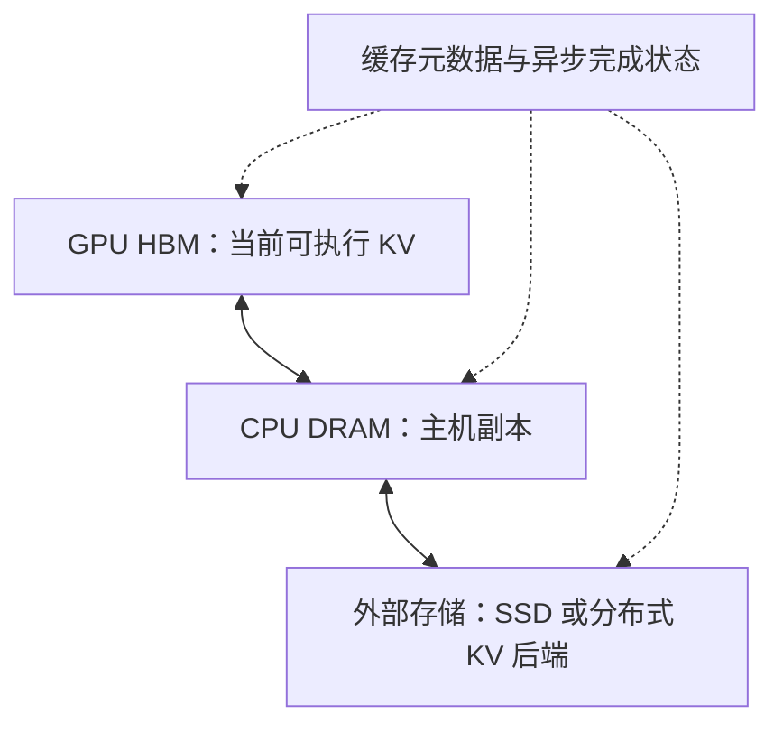
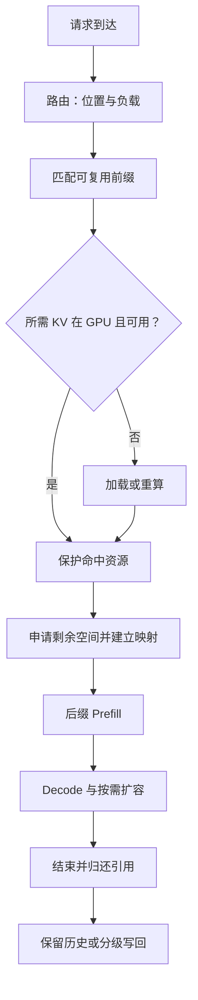

# KV Cache 优化技术体系：从分页管理到跨节点复用

一个请求已经计算过的历史，为什么下一个请求还要重新算？一个模型的权重明明放得下，为什么长上下文请求一多，服务仍然会被显存卡住？把缓存搬到 CPU 后，为什么命中率提高了，首 token 延迟却可能变差？

这些问题对应不同的成本。KV Cache 用存储避免历史状态的重复计算，但存下来的数据仍要分配空间、维护索引、被 Attention 读取，也可能在设备之间搬运。推理引擎需要同时决定哪些状态值得保留、在哪里保留，以及让哪个请求使用它们。

本文沿着六个问题展开：

| 技术 | 解决的核心问题 | 关键实现机制 |
| --- | --- | --- |
| PagedAttention | KV 怎么存？ | 固定大小 Block、Block Table、Memory Pool |
| Prefix Caching | KV 怎么复用？ | 链式哈希、Radix Tree |
| Eviction | KV 不够放怎么办？ | 引用计数、LRU、请求抢占 |
| KV Quantization | 单位 KV 能不能更小？ | 低精度表示、Scale、Attention Kernel |
| HiCache / Offloading | GPU 放不下怎么办？ | 分级存储、异步搬运、预取与写回 |
| Cache-Aware Routing | 多实例如何最大化复用？ | 前缀亲和性、负载估计、跨实例传输 |

## 一、先建立同一个成本模型

### 1. KV 缓存了什么，又省掉了什么

因果 Transformer 中，位置 $t$ 的隐藏状态由前缀 $x_0,\ldots,x_t$ 决定。在模型与计算条件相同时，追加 token 后，已有位置的 K/V 保持相同。因此，每步 Decode 只需计算新增位置的 Q/K/V，再用新的 Query 读取历史 KV。

KV Cache 省掉历史 token 的重复前向计算；Decode 每一步仍要读取历史 KV。重复 Prefill 消耗计算，长历史 Decode 消耗带宽，并发驻留消耗容量。

共享前缀可以省掉对应的 Prefill；量化可能降低每步 Decode 的 KV 读取量；分页可以提高相同容量下可容纳的请求数量。它们作用的位置不同，也可以叠加。

### 2. 每 token 到底需要多少字节

设层数为 $L$，KV 头数为 $H_{kv}$，K/V 的头维度都为 $d$，每元素占 $s$ 字节。标准逐 token Full Attention 的缓存有效载荷为：

$$
m_{token}=2LH_{kv}ds
$$

全文采用一个教学配置：32 层、8 个 KV heads、head dimension 128、BF16。于是：

$$
m_{token}=2\times32\times8\times128\times2
=131072\ \text{bytes}=128\ \text{KiB}
$$

| 上下文长度 | 单请求有效 KV |
| --- | --- |
| 1024 tokens | 128 MiB |
| 8192 tokens | 1 GiB |
| 9216 tokens | 1152 MiB |
| 32768 tokens | 4 GiB |

16 个各自拥有 9216 tokens 的请求，独立保存时需要 18 GiB KV。服务的总显存还包括权重、激活、工作区和运行时预留。

这个公式计算全模型的标准 Full Attention KV。Tensor Parallel 的每卡占用应按实际 KV 分片和复制方式计算；混合模型则分别计算完整历史、窗口历史和递归状态，再求和。

### 3. 有效载荷、分配量和驻留量

有效载荷是实际 token 对应的数据。分配量是分配器为这些数据占用的槽位，包含尾块余量。驻留量还可能包含已结束请求留下的可复用历史。

例如，GPU 启动时预分配 40 GiB KV Pool。请求从池中取块，完成后把块归还池内队列。监控中的池占用保持稳定，池内的有效数据量和可回收块数随请求变化。

共享后的容量按唯一物理块计算。两个请求各有 8 个逻辑块，其中 6 个共享，实际占用为 $6+2+2=10$ 个物理块。

### 4. 同一条成本账怎样贯穿六项优化

对一个新请求，可用下面的简化模型组织思考：

$$
T_{TTFT}\approx T_{queue}+T_{lookup}+T_{load}
+T_{prefill,remaining}+T_{first\ decode}
$$

这个加法先按串行阶段分解 TTFT；计算重叠时，再扣除重叠时间。分页和量化改变容量及访存，前缀复用减少剩余 Prefill，分级存储通过加载换取计算节省，路由同时影响排队和缓存位置。

优化收益可以沿两条路径衡量：省下的计算减去新增管理与搬运成本，以及释放的容量带来的并发增长。

## 二、PagedAttention：KV 怎么存？

### 1. 为什么连续大数组难以管理

最直接的表示是为请求分配形如 `[层, K或V, token, KV头, 维度]` 的连续存储。问题是输出长度未知。按最大长度预留会浪费，按实际长度增长则可能需要重新分配并复制旧数据。

假设每个请求最多支持 32768 tokens，但当前仅有 2048 tokens。如果为最大长度保留独立完整空间，当前有效部分只有预留的十六分之一。即使采用动态连续分配，请求长短交错、完成顺序不同，也可能留下无法满足较大连续申请的空洞。

分页将请求的逻辑空间与物理位置分离。增长时保留已有数据，申请新块并追加映射。

### 2. Block Table 怎样找到一个 token

设每块容纳 $P$ 个 token，位置 $t$ 从 0 开始：

$$
i=\lfloor t/P\rfloor,\qquad o=t\bmod P
$$

$i$ 是逻辑块号，$o$ 是块内偏移。请求的 Block Table 将逻辑块号映射到物理块号：

$$
b=\operatorname{table}_{request}[i]
$$

若用扁平 token 槽解释，物理槽为 $bP+o$。真实 Kernel 还要考虑层、头、K/V 布局和向量化维度，这个表达式只解释分页维度。

为便于手算，取 $P=4$，请求 A 的块表为 `[7, 2, 9]`。位置 6 对应逻辑块 1、偏移 2，映射到物理块 2 的第 2 个槽，也就是扁平槽 10。

```text
A 的逻辑位置：  0 1 2 3 | 4 5 6 7 | 8 9 ...
逻辑块号：         0    |    1    |   2
Block Table：      7    |    2    |   9
物理存储：      block 7 | block 2 | block 9
```

逻辑顺序保持不变，物理位置可以离散。这种间接寻址让分配器只需找到任意空闲块。

### 3. Memory Pool 管的是物理资源

通常先建立可复用的固定块池，再维护空闲块队列。申请操作取出一个块号，释放操作归还块号。这样避免在每次生成时调用通用 GPU 内存分配接口。

```python
# 教学模型：省略异步执行、缓存索引及失败回滚

def append_slot(request):
    if request.length % PAGE_SIZE == 0:
        block = pool.acquire()
        request.block_table.append(block)
    position = request.length
    request.length += 1
    return translate(request.block_table, position)
```

Prefill 通常一次申请多个块，Decode 在跨越块边界时追加块。调度器先预留本次计算所需的空间，再向 GPU 提交工作。

一个块归还池内队列后，原来的 KV 可以继续保留。后续请求命中时直接重新引用；分配器选中它存放新内容时，再清除旧缓存身份。

### 4. Kernel 怎样读取离散 KV

PagedAttention 的关键还包括适配分页存储的 Attention 计算。Kernel 根据 Block Table 找到一个逻辑范围对应的物理块，再读取该块中的 K/V。相同块内部可以安排连续读取，块之间通过索引跳转。

块内数据按 Kernel 布局组织，线程可以连续、向量化地加载；切换块时再读取块表。分页的额外工作主要是元数据读取和地址计算。

这里的页表由框架与 Kernel 显式管理。CPU 上的 KV 由运行时加载到 GPU，完成后再建立可执行的映射。

离散块中的 Attention 仍然要对全部历史位置做同一个 Softmax。对某个 Query，Kernel 可以依逻辑块读取 K，计算该块分数，再维护已读范围的最大分数 $m$、指数和 $l$ 与加权 Value 和 $u$。读到下一块、得到新的最大值 $m'$ 后，将旧累计量乘以 $e^{m-m'}$，再加上新块的贡献：

$$
l'=e^{m-m'}l+\sum_{j\in block}e^{z_j-m'},\qquad
u'=e^{m-m'}u+\sum_{j\in block}e^{z_j-m'}v_j
$$

所有块处理完，输出为 $u/l$。这里 $z_j$ 是缩放后的 QK 分数，$u$ 是向量。这样，页表负责定位物理数据，分块归约负责组合数学结果；逻辑块顺序决定历史位置的读取顺序。

### 5. 共享与 Copy-on-Write

假设 A、B 的前 8 个 tokens 完全相同，页大小为 4。两个完整前缀块可以共享：

```text
A: [7, 2, 9]
B: [7, 2, 5]
ref_count[7] = 2
ref_count[2] = 2
ref_count[9] = 1
ref_count[5] = 1
```

共享的块只读。A 和 B 在各自后缀块中写入，互不影响。

如果分叉发生在一个未满的共享块里，两个请求都想修改该物理块，就需要处理写隔离。一种通用机制是 Copy-on-Write：写之前复制有效槽位，修改自己的映射，再向新块追加。只共享完整块的前缀缓存可以避免许多此类情况，但并行采样或其他分支执行仍可能需要相应机制。

下面把写隔离落实到块表。A 在第 9 个 token 后分出 B，二者暂时共享尾块 9，其中仅偏移 0 有效。B 准备写自己的下一个 token 时：

| 步骤 | A 的块表 | B 的块表 | 尾块状态 |
| --- | --- | --- | --- |
| 分支建立 | [7, 2, 9] | [7, 2, 9] | 块 9 引用数为 2 |
| 为 B 申请块 5 | [7, 2, 9] | [7, 2, 9] | 块 5 尚未发布 |
| 复制有效槽并替换映射 | [7, 2, 9] | [7, 2, 5] | 块 9、5 各有一个引用 |
| B 追加 token | [7, 2, 9] | [7, 2, 5] | 写块 5 的偏移 1 |

复制只覆盖尾块中已有的有效部分。此前两个完整共享块保持不动，分支成本因此局限在尾块。

### 6. 页大小是一项折中

长度为 $N$ 的独占请求需要：

$$
n_{blocks}=\lceil N/P\rceil
$$

尾部浪费为 $P\lceil N/P\rceil-N$ 个 token 槽，最多 $P-1$ 个。若尾部长度近似均匀分布，平均约浪费 $(P-1)/2$ 个槽；这是分布假设下的估算。

块越小，尾部余量和共享粒度通常越细，但块表更长、分配操作更多。块越大，管理开销可能下降，却会扩大尾部浪费和整块传输粒度。Kernel 的支持范围、量化布局和分布式传输对齐也会约束选择。

在教学配置中，16-token 块在每层占 64 KiB，32 层合计 2 MiB。各层可分别保存物理张量，通过统一块编号关联。

### 7. 从申请到释放，走完两个请求

继续取每块 4 tokens。A、B 各有 10 tokens，前 8 tokens 相同。各自独立存储需要 3 块，共 6 块，对应 24 个 token 槽。

共享前两块后，需要 2 个共享块加 2 个独立尾块，共 4 块，对应 16 个 token 槽。其中有效的唯一 token 状态为 $8+2+2=12$ 份，尾块余量共 4 个槽。

按教学配置的 128 KiB/token 计算：独立分配为 3 MiB，共享后为 2 MiB，有效唯一状态为 1.5 MiB。这个例子同时区分了逻辑 token 数、唯一物理数据与分页余量。

若 A 结束，两个共享块仍被 B 引用。A 的尾块变为可回收；若历史索引保留它，它仍可能命中，直到分配器真正覆盖。这个简单过程已经包含分页、共享、引用计数和缓存淘汰的连接点。


## 三、Prefix Caching：KV 怎么复用？

### 1. 为什么必须包含前缀身份

“请解释缓存”前面分别接操作系统和数据库的讨论，会产生各自的隐藏状态。KV 的身份因此包含当前位置之前的整个上下文。

对于第 $t$ 个位置，缓存身份可以概念化为：

$$
KV_t=F_\theta(x_0,\ldots,x_t;\text{position, configuration})
$$

相同模型、相同有效 token 前缀及兼容的计算条件，才提供复用基础。Tokenizer、Chat Template 会影响 token；LoRA、位置编码设置、多模态输入等也可能改变计算。缓存键包含这些身份，或由独立命名空间隔离各类配置。

前缀从输入开头连续匹配，为每个复用位置提供相同的因果上下文。

### 2. 链式哈希怎样表达完整历史

把输入划成完整 token 块 $X_0,X_1,\ldots$，令：

$$
h_i=H(h_{i-1},X_i,e_i)
$$

$h_{-1}$ 是约定的起始身份，$e_i$ 表示相关附加信息。当前块的哈希包含父哈希，父哈希递归代表更早的前缀。

假设 A 为 `[a b c d][e f g h][x y]`，B 为 `[a b c d][e f g h][u v]`。前两块得到相同身份，第三段不同。索引可表达为：

```text
h0 -> physical block 7
h1 -> physical block 2
```

```python
# 教学模型；实际实现需处理哈希碰撞、模型身份与并发保护

def find_prefix(full_blocks, namespace):
    parent = namespace
    matched = []
    for tokens in full_blocks:
        key = hash_block(parent, tokens)
        block = index.lookup(key)
        if block is None:
            break
        matched.append(block)
        parent = key
    return matched
```

遍历 $k$ 个块需要约 $O(k)$ 次哈希查找，每次查找的平均成本为常数。生成块身份还需要读取 token 内容；已有身份可以缓存供后续使用。

假设前两块命中、第三块缺失、第四块有索引。即使第四块的哈希带有正确的完整前缀身份，继续计算第三块仍需要已有状态；简单最长前缀复用路径会在第三块停止，后面交给常规计算。

### 3. Radix Tree 如何保存同一组请求

普通 Trie 每条边表示一个 token。Radix Tree 将连续单分支路径压缩到一条边，减少节点数量。

加入 A=`a b c d e f g h x y`，最初可以只有一条长边。再加入 B=`a b c d e f g h u v`，在第 8 个 token 后分叉：

```text
root
 └─ [a b c d e f g h]
     ├─ [x y]   A
     └─ [u v]   B
```

加入 C=`a b c d m n`，需要把共享边拆开：

```text
root
 └─ [a b c d]
     ├─ [e f g h]
     │   ├─ [x y]
     │   └─ [u v]
     └─ [m n]
```

查找时比较边上的 token 序列；部分匹配时，插入操作将边拆成共同前缀与剩余部分。节点保存 token 区间及 KV 位置，实际 KV 存放在物理池中。

拆边时，将原有 KV 位置区间分成两段，分别交给两个节点。这里变化的是索引和区间归属，原有数据留在物理池中。

现在查找 D=`a b c d e f g h u w`。先完整匹配根下的 `[a b c d]`，再完整匹配 `[e f g h]`，最后在 `[u v]` 上只匹配 `u`。树在 token 层面找到了 9-token 公共前缀。

若物理复用以 4-token 完整块为单位，就先使用前 8 个 tokens 的两个块，从 `u w` 开始计算。树描述内容的共同路径，物理块决定实际共享的边界。插入 D 时，将边 `[u v]` 拆成 `[u]`，再建立 `[v]` 与 `[w]` 两个分支；这一步调整索引关系，已有完整块继续复用。

链式哈希把前缀关系编码在键中；Radix Tree 将前缀分叉保存为显式路径，便于沿路径维护引用与选择可淘汰叶节点。

树匹配读取边标签中的 token，哈希方案计算块身份并查询索引。实际成本由比较长度、身份生成量和索引访存共同决定。

vLLM APC 的设计文档可用于理解链式哈希和完整块缓存。SGLang RadixAttention 的论文与 Radix Cache 实现可用于理解压缩树、共享路径及调度配合。

### 4. 命中 KV 后还要做什么

匹配出前缀后，运行时必须先保护这些物理块，再把映射接到新请求上。随后仅计算未命中的后缀，并让后缀 Query 访问缓存前缀和当前后缀产生的 KV。

某些执行路径会重新计算最后一个输入位置，取得对应隐藏状态并生成 logits，随后采样下一个 token。因此，记录实际跳过的计算长度时，要扣除该位置。

Decode 时，每个请求用自己的 Query 读取共享 KV，分别计算 Attention 输出和采样结果。共享节省前缀建立成本与物理存储；读取带宽的进一步节省取决于 Kernel 和批处理方式。

## 四、Eviction：KV 不够放怎么办？

### 1. 请求结束后，块可以同时空闲又有缓存价值

块 7 被两个请求引用时，引用计数为 2。一个请求结束后，计数降为 1，剩余请求继续使用它；最后一个请求结束后，计数归零，块进入可回收集合，并保留原有内容供后续命中。

```text
正在使用：ref_count > 0
可回收且内容有效：ref_count = 0，仍有缓存身份
可回收且无缓存身份：ref_count = 0，可直接用于新内容
```

请求释放引用后，缓存索引可持续指向原有内容，直到物理块被覆盖。空闲容量由此也承担历史缓存的作用。

命中零引用块时，运行时将查找、移出可回收集合和增加引用作为一个受保护的操作，随后交给 GPU 使用。

### 2. LRU 队列怎样运转

教学实现维护一个双向链表：队头最早可回收，队尾最近使用。零引用块进入队列；命中时移除；请求释放最后一个引用时再进入队尾。需要新块时优先从队头拿。

```python
# 教学模型：真实代码需保证索引与块状态同步更新

def recycle_one():
    block = reclaimable.pop_front()
    assert block.ref_count == 0
    if block.cache_key is not None:
        index.remove_mapping(block.cache_key, block)
    block.cache_key = None
    return block
```

删除映射时同时核对缓存键与物理块，精确移除被覆盖的副本。随后清除块身份并写入新内容，使索引始终对应实际数据。

vLLM V1 通过引用计数保护活跃块，通过空闲队列组织可回收块，并在重新分配时清除旧缓存身份。下面按队列中的实际操作推演。

用三块物理页走一遍队列。队头在左侧，表中的索引只列出发生变化的部分：

| 操作 | 引用计数 | 可回收队列 | 索引变化 |
| --- | --- | --- | --- |
| A 使用块 7、2，块 9 空闲 | 7:1，2:1，9:0 | [9] | h0→7，h1→2 |
| B 命中 A 的两块 | 7:2，2:2，9:0 | [9] | 保持 |
| A 结束 | 7:1，2:1，9:0 | [9] | 保持 |
| B 结束，依次释放 7、2 | 全部为 0 | [9,7,2] | 保持 |
| C 再次命中块 7 | 7:1，其余为 0 | [9,2] | 保持 |
| 新内容先后申请两块 | 7:1，其余重新引用 | [] | 覆盖块 2 前删除 h1→2 |

块 7 因命中离开队列，块 2 则最终被覆盖。缓存身份的寿命可以长于请求，但结束于物理内容被重新使用的那一刻。

### 3. 树为什么从叶子淘汰

在前缀树中，活跃请求引用一条路径，路径上的状态都需要保护。一个共享祖先可能服务多个后代，删除它会破坏这些路径的可用性。

通常从未受保护的叶节点选择候选。删除叶子后，父节点可能变成新的叶子，再进入候选集合。这使删除过程保持有效的前缀结构。

SGLang 树节点的锁引用保护正在使用的路径，底层物理池管理可以回收的存储槽。两者分别处理索引路径与物理资源。

### 4. 历史缓存淘汰和请求抢占

如果所有空闲历史都回收完，剩下的块仍不足以继续 Decode，系统面临的是活跃请求之间的容量竞争。

Preemption 需要选择某个请求暂时让出资源。可以丢弃其状态，恢复时重新计算；也可以将状态卸载到其他层，再加载回来。究竟支持什么路径取决于框架版本和执行模式。

重算付出 GPU 计算和排队成本，但避免存储传输。卸载需要搬出及搬回数据，还要保存请求进度、采样状态和相关元数据。恢复时，调度器根据保存的进度重新接续执行。

过量准入可能让请求反复经历抢占和重算。调度器通过控制驻留请求与预留空间，让已接纳请求持续推进；完成率和尾延迟反映这一效果。

### 5. LRU 为什么会被一次性流量污染

假设系统长期反复使用一个 8000-token 前缀，突然进入大量互不共享的长输入。这批请求刚刚使用过的块都很“新”，LRU 可能把上次访问较早的热点前缀挤出去。

LRU 按最近访问顺序保留缓存。若希望同时考虑未来复用与重算成本，可以引入价值密度：

$$
V\approx\frac{\Pr(\text{reuse})\times\text{saved compute cost}}
{\text{occupied bytes}}
$$

工程策略可以用访问频次估计复用机会，用会话与优先级调整保留顺序，并为保护容量设置预算。会话超时后，相关缓存重新参与普通淘汰。

评估时同时记录复用 token 数、节省的重算时间和请求延迟，用端到端结果衡量淘汰策略的收益。

## 五、KV Quantization：单位 KV 能不能更小？

### 1. 位数降低怎样变成容量收益

BF16 每元素 16 bits。若同样数量的元素改用 8 bits，原始载荷减半。在教学配置中，8192 tokens 的 1 GiB KV 理论上变成约 512 MiB，再加 Scale、对齐与元数据。

FP8 和 INT8 都占一字节，但数值表示不同。INT8 用整数格点配合缩放，FP8 本身包含符号、指数和尾数。FP8 的指数使相邻可表示数之间的距离随数值范围变化。

| 格式 | 原始位宽 | 相对 BF16 的有效载荷 |
| --- | --- | --- |
| BF16 / FP16 | 16 | 100% |
| FP8 / INT8 | 8 | 50% |
| FP4 / INT4 | 4 | 25% |

低比特格式是否能用于某个模型，要看设备、后端、Scale 方案和 Kernel。

### 2. Scale 怎样连接浮点值与整数

先用对称 INT8 解释。设 Scale 为 $s>0$：

$$
q=\operatorname{clip}(\operatorname{round}(x/s),-127,127),
\qquad \hat{x}=sq
$$

例如取 $s=0.1$，$x=[0.12,-0.27,1.06]$，得到 $q=[1,-3,11]$，反量化结果为 $[0.1,-0.3,1.1]$。绝对误差分别为 $[0.02,0.03,0.04]$。

未发生裁剪时，最近舍入误差一般受半个步长约束。若 $x=20$，它超出此 Scale 的表示范围，裁剪误差就可能远大于半个步长。

Scale 太大，小值分辨率差；Scale 太小，大值容易饱和。动态范围选择因此影响精度。FP8 常见形式可概念化为 $q=\operatorname{FP8}(x/s)$、$\hat{x}=sq$，其舍入误差随浮点区间的间距变化。

### 3. 为什么细粒度 Scale 更贵

全张量共用一个 Scale 简单，却容易受极端值影响。按头、通道或小组选择 Scale，可以更贴近局部数值分布，但需要更多元数据和索引。

若每 $g$ 个元素共用一个 $a$ 字节 Scale，量化载荷每元素占 $b$ 字节，则忽略对齐时：

$$
\text{bytes per element}=b+\frac{a}{g}
$$

以 4-bit 数据、FP32 Scale、每组 32 个元素为例，有效成本为 $0.5+4/32=0.625$ 字节，相对 BF16 是 31.25%，（纯载荷占 25%，Scale 另占 6.25%）。若还需要零点、填充或其他元数据，占用继续增加。

细粒度 Scale 也增加读取和索引操作。Kernel 需要在正确位置加载 Scale，并把它应用到相应数据；它与线程布局和数据打包方式必须协同设计。

Scale 还决定一次读取包含哪些数据。假设一个头有 128 个元素，按 32 元素分组，则每个头保存四个 Scale。线程读到第 70 个元素时，使用第 2 组的 Scale（组号从 0 开始）。Kernel 用元素下标计算组号，再读取对应 Scale，恢复该元素的近似值。

读取可以有两条路径：

```text
完整展开：压缩 KV → 读取并转换 → BF16 临时张量 → 再读入 Attention
融合读取：压缩 KV → 片上转换当前 tile → 直接参与 Attention
```

前一路径每个元素额外写入、再读出 2 字节 BF16 数据；后一路径把转换结果限制在当前计算 tile 内。节省来自避免完整中间张量的显存往返。

### 4. K 和 V 的误差怎样影响输出

对单个 Query，设真实分数为 $z=QK^\top/\sqrt d$，量化后 $\hat K=K+\Delta K$：

$$
\Delta z=Q\Delta K^\top/\sqrt d
$$

K 的误差先改变分数，再经 Softmax 改变权重。V 的误差则直接影响加权求和。若 $\hat P=P+\Delta P$、$\hat V=V+\Delta V$：

$$
\hat O-O=P\Delta V+\Delta P V+\Delta P\Delta V
$$

K 的误差通过注意力权重传播，V 的误差通过加权内容传播。质量评估应在目标任务和上下文长度上测量最终输出，以覆盖后续层的误差传播。

### 5. Kernel 决定容量收益是否变成速度

一种直接路径是先将所有压缩 KV 展开成 BF16，再交给原有 Attention。它增加了临时显存和读写，可能抵消节省。

融合路径在读取 tile 后，在寄存器或共享内存中完成转换，直接交给 Attention 使用。每个 tile 消费完即可复用片上空间。

可以将耗时粗略写成：

$$
T\approx T_{read\ compressed}+T_{scale/convert}+T_{attention}
$$

量化的延迟收益约为减少的访存时间减去新增转换与调度成本。整体加速还取决于 KV 读取在总耗时中的占比。

## 六、HiCache / Offloading：GPU 放不下怎么办？

### 1. 缓存命中要带上位置

“前缀已缓存”至少可能指它在 GPU、CPU 或外部存储。它们对 TTFT 的价值不同。CPU 缓存容量更大，但必须经设备链路加载；外部存储还增加存储或网络 I/O。



分级缓存由运行时维护数据位置、版本、完整性和传输完成状态。

SGLang HiCache 将 RadixAttention 的复用延伸到主机和可选外部存储。vLLM 的相关能力涉及 Offloading 与 Connector 机制；不同 Connector 的存储职责、传输协议和调度支持不完全相同。

历史前缀下沉服务于未来请求：请求结束后，GPU 的可回收历史可以在 CPU 留下副本。GPU 空间被覆盖后，CPU 副本仍可能被重新加载。

活跃请求卸载服务于恢复同一个请求：除了 KV，还需要保存请求执行进度及其他状态。它通常与抢占策略紧密相关。

历史缓存下沉保存可复用前缀；活跃请求卸载则围绕请求恢复组织 KV、执行进度和其他状态。

### 2. 一次写回怎样保证正确

以 GPU 到 CPU 为例：先分配主机槽位，保护源 GPU 块，提交异步复制，再等待完成通知。只有复制完成后，才能将主机副本标为可加载；源块的计算与复制引用全部释放后，才进入可覆盖状态。

```text
分配目标 → 保护源块 → 提交复制 → 收到完成事件
         → 发布目标可用状态 → 解除相应保护
```

如果提交复制就立刻标记“CPU 已有缓存”，新请求可能读到尚未完成的数据。如果先释放 GPU 源块，复制也可能读到被其他请求覆盖的新内容。

异步传输延长了源块与目标槽的保护期。引用计数、传输引用、事件和异常清理都需要配合。

以缓存键 h1 为例，写回和重新加载中的状态可以记录为：

| 时刻 | GPU 块 | CPU 槽 | h1 的可用位置 |
| --- | --- | --- | --- |
| 提交写回 | 2，受传输引用保护 | 12，复制中 | GPU |
| 写回完成 | 2，可回收 | 12，完整 | GPU、CPU |
| GPU 块被覆盖 | 2，属于新内容 | 12，完整 | CPU |
| 新请求提交加载 | 5，复制中 | 12，受读取保护 | CPU |
| 加载完成 | 5，完整 | 12，完整 | GPU、CPU |

请求随后把逻辑块指向块 5。物理位置已经改变，前缀身份 h1 保持不变；这也是缓存索引与物理分配需要分开的原因。

### 3. 写穿、延迟写回与污染

Write-through 可以较早建立下层副本，降低后续淘汰时等待复制的风险，但会为可能再也不用的数据支付传输成本。

延迟写回将复制推迟到回收时，GPU 块释放因此要等待复制完成。选择性写回则按复用统计挑选保留对象，例如优先写回访问次数较高的前缀。

写回以已完成的数据段为单位。假设尾块只写好了两个槽，复制任务记录这两个有效槽；后续追加的槽由下一次写回处理。这样，索引中的有效长度与实际完成的副本保持一致。

### 4. 加载和重算怎样比较

设需要恢复的数据量为 $D$，有效链路带宽为 $B$，启动、排队及元数据耗时为 $\alpha$：

$$
T_{load}\approx\alpha+D/B
$$

教学配置中 8192 tokens 的 BF16 KV 为 1 GiB。假设有效带宽是 32 GiB/s，单纯传输下界约为 31.25 ms。

若重算这段前缀只需 20 ms，按串行执行计算，串行加载可能更慢；若重算需 150 ms，加载更可能划算。两组重算时间为演示参数。

重算时间由输入长度、批大小、Attention 计算和当前负载共同决定。若系统计算繁忙，卸载可能释放算力服务其他请求，即使单请求收益有限，整体吞吐也可能改善。

### 5. 预取何时隐藏传输

已知请求将使用某个前缀时，可提前加载。若有 $T_{overlap}$ 的其他工作能与传输有效重叠，暴露给关键路径的传输延迟可粗略估计为：

$$
T_{exposed}\approx\max(0,T_{load}-T_{overlap})
$$

两类工作能并行使用计算与传输资源时，重叠时间才可从关键路径中扣除。比如加载 30 ms、可重叠计算 20 ms，剩余等待约为 10 ms。

```text
时间 →
CPU/网络： [加载前缀 A-----------]
GPU：      [其他请求的计算------][A 的后缀 Prefill]
```

预取太晚会等待，太早则占用 GPU 槽位，还可能因请求取消而浪费流量。需要限制在途字节、预留空间并允许取消已失效的预取任务并回收目标槽位。

远程查找涉及元数据；读取可能包含多次小 I/O；设备布局可能需要转换；多 GPU 分片恢复还要确保各分片就绪。批量搬运能摊薄固定开销，却会扩大等待与过度读取。

网络和 SSD 的固定 I/O 开销可以通过批量传输摊薄：运行时将多个物理页合并为一次传输，索引仍保留页级映射。

历史缓存加载失败后，释放目标槽位，重新计算前缀。活跃请求的恢复方案则依据所保存的输入、执行进度及相关状态确定。

## 七、Cache-Aware Routing：多实例如何最大化复用？

### 1. 路由选择的是服务实例

这里的路由对象是能够独立服务请求的 worker 或副本。一个实例内部可以用 Tensor Parallel，让多张 GPU 共同执行同一个请求。

普通负载均衡希望均匀分发工作；缓存亲和路由还要考虑请求在不同实例上的剩余计算量。同一个输入，在有长前缀缓存的实例上可能只剩很短的后缀。

### 2. 估算各实例的完成时间

对候选实例 $j$，可建立一个教学评分：

$$
\hat T_j=\hat T_{queue,j}+\hat T_{lookup,j}
+\hat T_{load,j}+\hat T_{prefill,j}+\hat T_{first\ decode,j}
$$

下面用这个简化成本模型计算三个候选实例，时间均为演示参数：

| 候选 | 排队 | 加载 | 剩余 Prefill | 简化小计 |
| --- | --- | --- | --- | --- |
| A：长前缀已在 GPU | 80 ms | 0 | 10 ms | 90 ms |
| B：无缓存 | 0 | 0 | 50 ms | 50 ms |
| C：长前缀在 CPU | 10 ms | 20 ms | 10 ms | 40 ms |

忽略三者相同的其他耗时，C 最好。若 C 的加载突然需要 70 ms，B 会更好。A 的等待时间抵消了它的前缀计算收益。

排队时间由队列中请求的工作量决定。两个短 Decode 与两个长 Prefill 即使请求数相同，也可能有明显不同的等待时间。估计时还要考虑批处理和可用缓存容量。

### 3. 请求移过去，还是 KV 搬过来

缓存亲和路由把请求送到已有 KV 的实例，在原地使用历史。跨实例缓存共享则把 KV 送到新实例，付出传输和协调成本，换取更灵活的负载分布。

二者可以结合：先寻找本地命中且负载合适的节点，若热点过载，再考虑转移请求并加载远程 KV，或直接重算。

目录给出源实例后，目标实例申请槽位，传输层复制对应分片，完成通知再将这些槽位交给调度器使用。

### 4. 路由器怎样知道缓存在哪

一种方式是维护各实例前缀状态的近似视图，通过请求历史或缓存事件更新。另一种方式是让实例提供更直接的缓存元数据。视图的新鲜度与维护成本存在取舍。

如果路由器认为一个前缀存在，但实例已经淘汰它，实际执行必须允许回退到重算或下层加载。服务端的真实查找决定最终执行路径。

元数据越精细，事件与存储成本越高。全量传播每个 token 的状态可能不划算，因此系统会采用块、前缀摘要或树结构表示，并接受一定误差。

SGLang Model Gateway 提供缓存感知策略，将亲和性与负载约束结合。vLLM 的 KV 事件和 Connector 可以参与更广泛的路由与缓存系统，但事件接口、外部路由器和数据传输是不同组件的职责。

如果所有请求都带同一个系统提示词，并且永远送向最初缓存它的实例，这个实例会过载，其他实例可能空闲。

复制热点前缀到多个实例增加存储与预热成本，却能扩大服务能力。路由器可以在热点实例排队较长时，将部分请求送到其他实例，支付预热成本以缩短等待。

热点前缀可以复制到多个实例，扩大可服务能力。复制是否划算，取决于热点持续时间和预期新增请求数。

### 5. 跨实例传输怎样接上执行

源与目标必须对 KV 含义有一致认识：模型权重和适配器、token 前缀、位置编码、dtype、Scale、层布局及并行分片等都需要兼容。

同样是 BF16 KV，不同 Tensor Parallel 配置也可能需要重新分片。量化 Scale 在哪里、页如何组织、哪些层有窗口状态，也会影响目标能否直接使用。

传输协议携带缓存身份、布局和分片信息。目标确认兼容后申请空间，各必需分片加载完成后，再执行依赖它们的计算。

### 6. PD 分离与历史缓存复用有什么联系

PD 分离让 Prefill 实例完成输入计算，再将 KV 交给 Decode 实例。即使从未复用历史请求，它也需要跨实例 KV 传输。

历史缓存复用解决的是避免重复计算，PD 分离解决的是两阶段资源组织。两者可以结合，但优化目标和数据流不同。

PD 分离的 TTFT 包括 Prefill 排队与计算、KV 传输以及 Decode 排队。评估时沿这条完整路径计时。

## 八、把六项技术放回同一个请求生命周期

### 1. 一次带共享前缀的请求

设 A 已经结束，留下两块前缀；B 与它共享这两块，但后缀不同。

路由器先根据前缀位置与负载选择实例。实例做真实匹配，保护命中的块。如果只有 CPU 副本，就先申请目标 GPU 槽位并完成加载。调度器确认剩余 Prefill 和后续生成有足够资源，再建立 B 的块表。

B 跳过可复用的前缀计算，为后缀生成新的 KV。若使用量化，写入路径保存压缩表示及相应 Scale，Attention 读取时按后端要求转换或直接使用。

Decode 继续增长，跨块边界时申请新块。空间紧张时先回收无人引用的历史；仍不足时由调度器决定等待、限制准入或抢占。B 结束后，引用归还，完整前缀又成为未来的复用候选。



## 九、怎样判断优化是否有效

### 1. 同时测量中间指标和用户指标

| 层面 | 建议观察 |
| --- | --- |
| 空间 | 唯一物理块数、有效 token、尾块余量、池内可回收容量 |
| 复用 | 请求命中率、复用 token 数、实际跳过的 Prefill tokens |
| 搬运 | 上传下载字节、加载等待、在途请求和传输队列 |
| 调度 | 准入等待、抢占次数、重算量、请求完成率 |
| 用户体验 | TTFT、ITL、端到端延迟、吞吐、尾延迟与 SLO 达标率 |

请求命中率统计发生复用的请求比例，Token 命中率统计输入侧的复用规模。计算收益还取决于省掉的那段 Prefill 在对应长度和批处理条件下的执行时间。

$$
H_{request}=\frac{\text{命中过前缀的请求数}}{\text{请求总数}}
$$

$$
H_{token}=\frac{\text{实际复用的输入前缀 tokens}}{\text{输入 tokens 总数}}
$$

统计时应明确 GPU 命中、CPU 命中和外部命中的层级，以及是否把查到但最终未使用的结果排除。

### 2. 设计能隔离原因的对照

先固定模型、设备、精度、输入输出长度分布和请求到达过程，再分别比较冷缓存与暖缓存。开启量化时补充质量验证，开启分层时记录搬运，开启路由时记录各实例负载。

仅用闭环客户端的总吞吐比较可能掩盖排队：客户端等待更久，会减少后续提交。应根据目标业务选择并说明负载生成方式，在相同提供负载下比较延迟与达标率。

建议包含四种工作负载：无共享随机前缀、稳定热点前缀、多轮会话，以及一次性长输入冲击。它们分别检验额外管理开销、复用收益、会话局部性和缓存污染。

KV Cache 优化最终落在这些具体动作上：映射一个槽位、确认一段前缀身份、保护一块仍被使用的数据、等待一次复制完成，以及选择在哪里执行下一次计算。理解这些动作及其成本，才能判断一项新功能改善的是容量、计算还是搬运，并决定它是否适合自己的服务负载。

## 参考资料

1. [PagedAttention：Efficient Memory Management for Large Language Model Serving](https://arxiv.org/abs/2309.06180)：分页、共享、写隔离与服务系统设计。
2. [SGLang: Efficient Execution of Structured Language Model Programs](https://arxiv.org/abs/2312.07104)：RadixAttention、树结构复用及缓存感知执行。
3. [vLLM Automatic Prefix Caching 设计](https://docs.vllm.ai/en/latest/design/prefix_caching/)：链式哈希、块元数据与生命周期。
4. [vLLM 量化 KV Cache](https://docs.vllm.ai/en/latest/features/quantization/quantized_kvcache/)：量化格式、Scale 与后端约束。
5. [SGLang HiCache 设计](https://docs.sglang.io/docs/advanced_features/hicache_design)：分级缓存架构、I/O 与存储后端。
6. [vLLM Block Pool 源码入口](https://github.com/vllm-project/vllm/blob/main/vllm/v1/core/block_pool.py)：结合缓存设计文档阅读块管理。
7. [SGLang 内存与缓存实现目录](https://github.com/sgl-project/sglang/tree/main/python/sglang/srt/mem_cache)：Radix Cache、内存池与分级缓存实现入口。
8. [SGLang Model Gateway](https://docs.sglang.io/docs/advanced_features/sgl_model_gateway)：路由策略与多实例服务入口。
9. [vLLM Hybrid KV Cache Manager](https://docs.vllm.ai/en/latest/design/hybrid_kv_cache_manager/)：不同 Attention 类型的状态分组与缓存管理。
10. [vLLM 分离式 Prefill](https://docs.vllm.ai/en/latest/features/disagg_prefill/)：Prefill / Decode 分离及 KV 传输机制。
