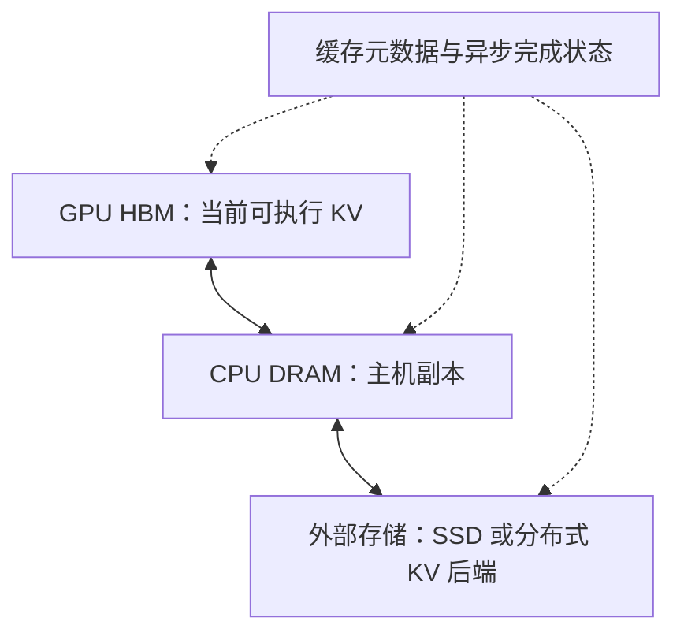
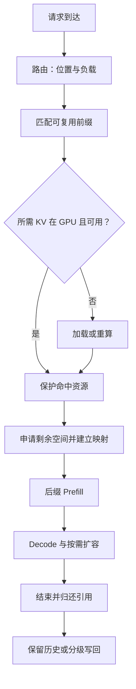

# KV Cache 优化技术体系：从分页管理到跨节点复用

一个请求已经计算过的历史，为什么下一个请求还要重新算？一个模型的权重明明放得下，为什么长上下文请求一多，服务仍然会被显存卡住？把缓存搬到 CPU 后，为什么命中率提高了，首 token 延迟却可能变差？

这些问题对应不同的成本。KV Cache 用存储避免历史状态的重复计算，但存下来的数据仍要分配空间、维护索引、被 Attention 读取，也可能在设备之间搬运。推理引擎需要同时决定哪些状态值得保留、在哪里保留，以及让哪个请求使用它们。

本文沿着六个问题展开：

| 技术 | 解决的核心问题 | 关键实现机制 |
| --- | --- | --- |
| 01. PagedAttention | KV 怎么存？ | 固定大小 Block、Block Table、Memory Pool |
| 02. Prefix Caching | KV 怎么复用？ | 链式哈希、Radix Tree |
| 03. Eviction | KV 不够放怎么办？ | 引用计数、LRU、请求抢占 |
| 04. KV Quantization | 单位 KV 能不能更小？ | 低精度表示、Scale、Attention Kernel |
| 05. HiCache / Offloading | GPU 放不下怎么办？ | 分级存储、异步搬运、预取与写回 |
| 06. Cache-Aware Routing | 多实例如何最大化复用？ | 前缀亲和性、负载估计、跨实例传输 |

假定读者知道 Transformer 和 KV Cache，并熟悉数组、哈希表、树以及操作系统的基本概念。文中的伪代码用于解释机制，不是可以直接替换框架代码的实现。框架资料核验于 2026 年 11 月 6 日；文末的 latest 和 main 链接会继续变化，具体部署应以所用版本为准。

## 一、先建立同一个成本模型

### 1. KV 缓存了什么，又省掉了什么

因果 Transformer 中，某个位置的隐藏状态只依赖它自己及之前的位置。追加后续 token，不会改变已有位置在相同模型和计算条件下的 K/V。因此，每步 Decode 只需为新增位置计算 Q/K/V，再让新的 Query 访问已有 KV。

这避免了重新执行历史 token 的网络前向，却没有避免历史 KV 的读取。长输入的重复 Prefill、长历史的 Decode 访存和并发请求的容量压力，是三个不同的瓶颈。

共享前缀可以省掉对应的 Prefill；量化可能降低每步 Decode 的 KV 读取量；分页可以提高相同容量下可容纳的请求数量。它们作用的位置不同，也可以叠加。

### 2. 每 token 到底需要多少字节

设层数为 $L$，KV 头数为 $H_{kv}$，K/V 的头维度都为 $d$，每元素占 $s$ 字节。标准逐 token Full Attention 的缓存有效载荷为：

$$
m_{token}=2LH_{kv}ds
$$

全文采用一个教学配置：32 层、8 个 KV heads、head dimension 128、BF16。于是：

$$
m_{token}=2\times32\times8\times128\times2
=131072\ \text{bytes}=128\ \text{KiB}
$$

| 上下文长度 | 单请求有效 KV |
| --- | --- |
| 1024 tokens | 128 MiB |
| 8192 tokens | 1 GiB |
| 9216 tokens | 1152 MiB |
| 32768 tokens | 4 GiB |

16 个各自拥有 9216 tokens 的请求，未共享时需要 18 GiB。这还没有计入权重、激活、工作区和运行时预留。

这是全模型的逻辑有效载荷。Tensor Parallel 下每卡占用取决于 KV 如何切分或复制，不能无条件除以卡数。MLA、滑动窗口和递归状态层也不直接套用这个公式。混合模型应逐类累加状态需求。

### 3. 有效载荷、分配量和驻留量

有效载荷是实际 token 对应的数据。分配量是分配器为这些数据占用的槽位，包含尾块余量。驻留量还可能包含已结束请求留下的可复用历史。

GPU 启动时预分配了 40 GiB 的 KV Pool，并不表示当前请求有 40 GiB 的有效 KV；显存监控看到的池占用，也未必随着请求完成下降。框架可能只是把块归还池内空闲队列。

后面计算共享收益时，必须数唯一物理块。两个请求各有 8 个逻辑块，其中 6 个指向相同物理块，实际只需要 $6+2+2=10$ 个物理块，而非 16 个。

### 4. 同一条成本账怎样贯穿六项优化

对一个新请求，可用下面的简化模型组织思考：

$$
T_{TTFT}\approx T_{queue}+T_{lookup}+T_{load}
+T_{prefill,remaining}+T_{first\ decode}
$$

实际执行中部分阶段可重叠，这个加法用于分解成本，不是精确预测器。分页和量化主要改变容量及访存，前缀复用减少剩余 Prefill，分级存储增加可用历史但引入加载，路由同时影响队列和命中位置。

因此，命中率增加只是中间结果。真正要检查的是省掉的工作是否大于新增工作，以及系统有没有因此接纳更多请求。

## 二、01. PagedAttention：KV 怎么存？

### 1. 为什么连续大数组难以管理

最直接的表示是为请求分配形如 `[层, K或V, token, KV头, 维度]` 的连续存储。问题是输出长度未知。按最大长度预留会浪费，按实际长度增长则可能需要重新分配并复制旧数据。

假设每个请求最多支持 32768 tokens，但当前仅有 2048 tokens。如果为最大长度保留独立完整空间，当前有效部分只有预留的十六分之一。即使采用动态连续分配，请求长短交错、完成顺序不同，也可能留下无法满足较大连续申请的空洞。

分页将“请求需要多少逻辑空间”和“物理空间在哪”分离。请求增长只需增加映射，不必搬迁全部历史。

### 2. Block Table 怎样找到一个 token

设每块容纳 $P$ 个 token，位置 $t$ 从 0 开始：

$$
i=\lfloor t/P\rfloor,\qquad o=t\bmod P
$$

$i$ 是逻辑块号，$o$ 是块内偏移。请求的 Block Table 将逻辑块号映射到物理块号：

$$
b=\operatorname{table}_{request}[i]
$$

若用扁平 token 槽解释，物理槽为 $bP+o$。真实 Kernel 还要考虑层、头、K/V 布局和向量化维度，这个表达式只解释分页维度。

为便于手算，取 $P=4$，请求 A 的块表为 `[7, 2, 9]`。位置 6 对应逻辑块 1、偏移 2，映射到物理块 2 的第 2 个槽，也就是扁平槽 10。

```text
A 的逻辑位置：  0 1 2 3 | 4 5 6 7 | 8 9 ...
逻辑块号：         0    |    1    |   2
Block Table：      7    |    2    |   9
物理存储：      block 7 | block 2 | block 9
```

逻辑顺序保持不变，物理位置可以离散。这种间接寻址让分配器只需找到任意空闲块。

### 3. Memory Pool 管的是物理资源

通常先建立可复用的固定块池，再维护空闲块队列。申请操作取出一个块号，释放操作归还块号。这样避免在每次生成时调用通用 GPU 内存分配接口。

```python
# 教学模型：省略异步执行、缓存索引及失败回滚

def append_slot(request):
    if request.length % PAGE_SIZE == 0:
        block = pool.acquire()
        request.block_table.append(block)
    position = request.length
    request.length += 1
    return translate(request.block_table, position)
```

Prefill 往往一次申请多个块，Decode 通常在跨越块边界时追加块。真实调度器需要在发出 GPU 工作前预留足够空间，不能等 Kernel 已经开始写入才发现没有空闲块。

块池中的“空闲”有两种含义：没有请求引用，以及没有有价值内容。前者不一定意味着后者，第三章会用这个区别解释历史缓存。

### 4. Kernel 怎样读取离散 KV

PagedAttention 的关键还包括适配分页存储的 Attention 计算。Kernel 根据 Block Table 找到一个逻辑范围对应的物理块，再读取该块中的 K/V。相同块内部可以安排连续读取，块之间通过索引跳转。

分页并不要求把每个 token 都变成随机访存。块内数据布局、线程映射和向量化加载仍然决定合并访存效果。Block Table 增加了元数据读取和地址计算，但避免了为了连续存储而搬迁整个序列。

操作系统分页提供了有用类比，不过这里的映射通常由框架与 Kernel 显式管理；不能假定 GPU 硬件会自动处理缺页并从 CPU 装入所需 KV。分级加载需要后面的运行时协议。

### 5. 共享与 Copy-on-Write

假设 A、B 的前 8 个 tokens 完全相同，页大小为 4。两个完整前缀块可以共享：

```text
A: [7, 2, 9]
B: [7, 2, 5]
ref_count[7] = 2
ref_count[2] = 2
ref_count[9] = 1
ref_count[5] = 1
```

共享的块只读。A 和 B 在各自后缀块中写入，互不影响。

如果分叉发生在一个未满的共享块里，两个请求都想修改该物理块，就需要处理写隔离。一种通用机制是 Copy-on-Write：写之前复制有效槽位，修改自己的映射，再向新块追加。只共享完整块的前缀缓存可以避免许多此类情况，但并行采样或其他分支执行仍可能需要相应机制。

Copy-on-Write 的目的在于保持语义正确。不能把“分页架构支持这种机制”直接理解为每种框架、每个请求路径都会复制尾块。

### 6. 页大小是一项折中

长度为 $N$ 的独占请求需要：

$$
n_{blocks}=\lceil N/P\rceil
$$

尾部浪费为 $P\lceil N/P\rceil-N$ 个 token 槽，最多 $P-1$ 个。若尾部长度近似均匀分布，平均约浪费 $(P-1)/2$ 个槽；这是分布假设下的估算。

块越小，尾部余量和共享粒度通常越细，但块表更长、分配操作更多。块越大，管理开销可能下降，却会扩大尾部浪费和整块传输粒度。Kernel 的支持范围、量化布局和分布式传输对齐也会约束选择。

在教学配置中，16-token 块跨全部 32 层的有效载荷为 2 MiB；这并不意味着运行时一定用一个连续 2 MiB 对象表示它。各层可以拥有自己的物理张量，并共享逻辑块编号。

vLLM 的 PagedAttention 论文解释了分页、共享及写隔离的设计。阅读当前实现时，应继续观察 Block Pool、请求块表和 Attention Backend 的交界；SGLang 的 Memory Pool 与请求到 token 的映射承担相近职责，具体布局不必与 vLLM 相同。

## 三、02. Prefix Caching：KV 怎么复用？

### 1. 为什么必须包含前缀身份

两个请求的文本片段都出现“请解释缓存”，不代表这几个 token 的 KV 相同。它们前面若分别讨论操作系统和数据库，隐藏状态会不同。

对于第 $t$ 个位置，缓存身份可以概念化为：

$$
KV_t=F_\theta(x_0,\ldots,x_t;\text{position, configuration})
$$

相同模型、相同有效 token 前缀及兼容的计算条件，才提供复用基础。Tokenizer、Chat Template 会影响 token；LoRA、位置编码设置、多模态输入等也可能改变计算。缓存键必须覆盖相关身份，或者通过隔离的缓存命名空间保证它们不混用。

从任意位置搜索相同片段，再拼接对应 KV，通常不满足这个条件。最自然的复用单位是从开头连续匹配的前缀。

### 2. 链式哈希怎样表达完整历史

把输入划成完整 token 块 $X_0,X_1,\ldots$，令：

$$
h_i=H(h_{i-1},X_i,e_i)
$$

$h_{-1}$ 是约定的起始身份，$e_i$ 表示相关附加信息。当前块的哈希包含父哈希，父哈希递归代表更早的前缀。

假设 A 为 `[a b c d][e f g h][x y]`，B 为 `[a b c d][e f g h][u v]`。前两块得到相同身份，第三段不同。索引可表达为：

```text
h0 -> physical block 7
h1 -> physical block 2
```

```python
# 教学模型；实际实现需处理哈希碰撞、模型身份与并发保护

def find_prefix(full_blocks, namespace):
    parent = namespace
    matched = []
    for tokens in full_blocks:
        key = hash_block(parent, tokens)
        block = index.lookup(key)
        if block is None:
            break
        matched.append(block)
        parent = key
    return matched
```

平均常数时间的哈希查找不意味着整个请求只需要 $O(1)$。遍历 $k$ 个块约需 $O(k)$ 次查找，计算这些块的身份也需要读取 token 内容。实际系统可以缓存已有身份，避免重复构造。

哈希碰撞处理与安全隔离同样重要。跨租户共享应考虑身份隔离及缓存命中的侧信道，不能只把一个快速非加密哈希当作完整安全边界。

### 3. 为什么中间缺失时通常停止

假设前两块命中、第三块缺失、第四块有索引。即使第四块的哈希带有正确的完整前缀身份，继续计算第三块仍需要已有状态；简单最长前缀复用路径会在第三块停止，后面交给常规计算。

更复杂的分层系统可以尝试补齐缺失块或结合外部缓存，但这需要额外恢复逻辑。教学模型采用连续前缀匹配，避免把“某个块存在”与“已有可执行的完整历史”混为一谈。

### 4. Radix Tree 如何保存同一组请求

普通 Trie 每条边表示一个 token。Radix Tree 将没有分叉的连续路径压缩到一条边，减少节点数量。

加入 A=`a b c d e f g h x y`，最初可以只有一条长边。再加入 B=`a b c d e f g h u v`，在第 8 个 token 后分叉：

```text
root
 └─ [a b c d e f g h]
     ├─ [x y]   A
     └─ [u v]   B
```

加入 C=`a b c d m n`，需要把共享边拆开：

```text
root
 └─ [a b c d]
     ├─ [e f g h]
     │   ├─ [x y]
     │   └─ [u v]
     └─ [m n]
```

查找时比较边上的 token 序列；部分匹配时，插入操作将边拆成共同前缀与剩余部分。节点保存的是索引和相应 KV 位置关系，KV 大张量不必嵌在树节点对象中。

边标签的拆分也不等于复制全部 KV。可以拆分元数据区间，让两个节点引用原有存储的不同部分。物理页对齐限制仍由实现决定。

### 5. 哈希表与前缀树分别省了什么

链式哈希把前缀关系编码在键中，不一定维护显式父子树。Radix Tree 直接表示分叉，因此更容易沿路径维护锁引用、会话归属和可淘汰叶节点。

两者都能复用部分请求前缀。能复用到哪一个 token，还受物理页大小、状态类型及实现约束影响。不能仅凭“树能表示任意长度前缀”就认为物理缓存能以任意 token 边界零成本共享。

树匹配的成本与比较过的 token 数相关；哈希方法的成本包括身份生成和块查找。哪种更快取决于工作负载、内存布局和实现，不宜仅根据数据结构名称判断。

vLLM APC 的设计文档可用于理解链式哈希和完整块缓存。SGLang RadixAttention 的论文与 Radix Cache 实现可用于理解压缩树、共享路径及调度配合。

### 6. 命中 KV 后还要做什么

匹配出前缀后，运行时必须先保护这些物理块，再把映射接到新请求上。随后仅计算未命中的后缀，并让后缀 Query 访问缓存前缀和当前后缀产生的 KV。

如果输入所有 KV 均已缓存，也未必能直接输出下一个 token。KV 不是每个位置的完整隐藏状态和 logits；某些执行路径会重新计算最后一个输入位置以得到采样所需输出。因此，命中的 KV tokens、跳过的计算 tokens 和报告的命中统计可能存在细微差别。

共享也不会使 Decode 免费。每个独立请求仍有自己的 Query 和采样过程，Attention 通常仍需读取共享历史。缓存共享节省物理容量和前缀建立成本，是否进一步减少实际 HBM 读取还取决于 Kernel 与批处理复用。

## 四、03. Eviction：KV 不够放怎么办？

### 1. 请求结束后，块可以同时空闲又有缓存价值

考虑块 7 正被两个请求引用。它的引用计数从 2 降为 1 时，不能交给其他请求覆盖；从 1 降为 0 时，可以进入可回收集合，但内容仍可保留供未来请求命中。

```text
正在使用：ref_count > 0
可回收且内容有效：ref_count = 0，仍有缓存身份
可回收且无缓存身份：ref_count = 0，可直接用于新内容
```

这三种状态解释了为什么“释放请求”不一定马上删除缓存索引。保留内容直到真正需要复用物理空间，可以利用本来闲置的显存。

一旦一个零引用块被命中，就要把它从可回收集合取出并增加引用，防止它在 GPU 读取期间被覆盖。查找与保护之间不能留下可被并发回收的空隙。

### 2. LRU 队列怎样运转

教学实现维护一个双向链表：队头最早可回收，队尾最近使用。零引用块进入队列；命中时移除；请求释放最后一个引用时再进入队尾。需要新块时优先从队头拿。

```python
# 教学模型：真实代码需保证索引与块状态同步更新

def recycle_one():
    block = reclaimable.pop_front()
    assert block.ref_count == 0
    if block.cache_key is not None:
        index.remove_mapping(block.cache_key, block)
    block.cache_key = None
    return block
```

删除映射应检查物理块身份，不能仅按哈希粗暴删除；索引实现可能允许同身份存在多个物理副本。块一旦被赋予新内容，旧身份必须失效，否则后续请求会读到错误 KV。

vLLM V1 的设计展示了引用计数、空闲队列与延迟失效的关系。严格的访问时间 LRU 与按队列顺序回收并非在所有边界上完全一致，理解时应跟随实际队列操作，而不是只记住“使用 LRU”。

### 3. 树为什么从叶子淘汰

在前缀树中，活跃请求引用一条路径，路径上的状态都需要保护。一个共享祖先可能服务多个后代，删除它会破坏这些路径的可用性。

通常从未受保护的叶节点选择候选。删除叶子后，父节点可能变成新的叶子，再进入候选集合。这使删除过程保持有效的前缀结构。

SGLang 的树节点引用或锁计数不应机械等同于每个物理页的引用计数。两者保护的是不同粒度的资源：树结构表达哪些路径在用，底层池管理哪些存储槽可以回收。

### 4. 历史缓存淘汰和请求抢占

如果所有空闲历史都回收完，剩下的块仍不足以继续 Decode，系统面临的是活跃请求之间的容量竞争。

Preemption 需要选择某个请求暂时让出资源。可以丢弃其状态，恢复时重新计算；也可以将状态卸载到其他层，再加载回来。究竟支持什么路径取决于框架版本和执行模式。

重算付出 GPU 计算和排队成本，但避免存储传输。卸载需要搬出及搬回数据，还要保存请求进度、采样状态和相关元数据。暂停一个请求不是只把它的页表从一个数组移走。

若调度器不断接纳超过稳定容量的请求，就可能出现反复抢占、重算和再次抢占。局部释放成功并不代表系统整体进展良好，必须观察完成率和尾延迟。

### 5. LRU 为什么会被一次性流量污染

假设系统长期反复使用一个 8000-token 前缀，突然进入大量互不共享的长输入。这批请求刚刚使用过的块都很“新”，LRU 可能把暂时没有被访问的热点前缀挤出去。

LRU 利用时间局部性，没有直接估计未来复用次数，也没有衡量每字节节省的重算成本。可以用一个概念性的价值密度帮助理解其他策略：

$$
V\approx\frac{\Pr(\text{reuse})\times\text{saved compute cost}}
{\text{occupied bytes}}
$$

概率和收益都难以准确预测，所以工程策略还会结合会话、优先级、访问频次和保护预算。会话软保护也需要让位于整体容量约束，否则大量“活跃但不再返回”的会话可能占满缓存。

评估淘汰策略时应同时看命中 token 数、重算时间和请求服务质量。保留最长前缀或最高命中率，并不必然让最多用户更快完成。

## 五、04. KV Quantization：单位 KV 能不能更小？

### 1. 位数降低怎样变成容量收益

BF16 每元素 16 bits。若同样数量的元素改用 8 bits，原始载荷减半。在教学配置中，8192 tokens 的 1 GiB KV 理论上变成约 512 MiB，再加 Scale、对齐与元数据。

FP8 和 INT8 都占一字节，但数值表示不同。INT8 用整数格点配合缩放，FP8 本身包含符号、指数和尾数。不能把 FP8 描述为“有 256 个均匀量化级别的整数”。

| 格式 | 原始位宽 | 相对 BF16 的有效载荷 |
| --- | --- | --- |
| BF16 / FP16 | 16 | 100% |
| FP8 / INT8 | 8 | 50% |
| FP4 / INT4 | 4 | 25% |

低比特格式是否能用于某个模型，要看设备、后端、Scale 方案和 Kernel。表中的比例是存储算术，不是支持矩阵或性能承诺。

### 2. Scale 怎样连接浮点值与整数

先用对称 INT8 解释。设 Scale 为 $s>0$：

$$
q=\operatorname{clip}(\operatorname{round}(x/s),-127,127),
\qquad \hat{x}=sq
$$

例如取 $s=0.1$，$x=[0.12,-0.27,1.06]$，得到 $q=[1,-3,11]$，反量化结果为 $[0.1,-0.3,1.1]$。绝对误差分别为 $[0.02,0.03,0.04]$。

未发生裁剪时，最近舍入误差一般受半个步长约束。若 $x=20$，它超出此 Scale 的表示范围，裁剪误差就可能远大于半个步长。

Scale 太大，小值分辨率差；Scale 太小，大值容易饱和。动态范围选择因此影响精度。FP8 常见形式可概念化为 $q=\operatorname{FP8}(x/s)$、$\hat{x}=sq$，但误差随浮点区间变化，不再具有整数均匀格点的同一种误差界。

### 3. 为什么细粒度 Scale 更贵

全张量共用一个 Scale 简单，却容易受极端值影响。按头、通道或小组选择 Scale，可以更贴近局部数值分布，但需要更多元数据和索引。

若每 $g$ 个元素共用一个 $a$ 字节 Scale，量化载荷每元素占 $b$ 字节，则忽略对齐时：

$$
\text{bytes per element}=b+\frac{a}{g}
$$

以 4-bit 数据、FP32 Scale、每组 32 个元素为例，有效成本为 $0.5+4/32=0.625$ 字节，相对 BF16 是 31.25%，而非纯载荷的 25%。若还需要零点、填充或其他元数据，占用继续增加。

细粒度不仅增加存储。Kernel 需要在正确位置加载 Scale，并把它应用到相应数据；它与线程布局和数据打包方式必须协同设计。

### 4. K 和 V 的误差怎样影响输出

对单个 Query，设真实分数为 $z=QK^\top/\sqrt d$，量化后 $\hat K=K+\Delta K$：

$$
\Delta z=Q\Delta K^\top/\sqrt d
$$

K 的误差先改变分数，再经 Softmax 改变权重。V 的误差则直接影响加权求和。若 $\hat P=P+\Delta P$、$\hat V=V+\Delta V$：

$$
\hat O-O=P\Delta V+\Delta P V+\Delta P\Delta V
$$

这说明两种误差进入计算的位置不同。某个任务上的总体质量变化，还取决于模型、上下文长度、误差分布及后续层传播，不能仅凭元素平均误差下结论。

质量验证应包含目标业务任务、长上下文和容易受数值变化影响的输出；无需要求不同精度采样逐 token 完全一致，但必须定义可接受的质量指标。

### 5. Kernel 决定容量收益是否变成速度

一种直接路径是先将所有压缩 KV 展开成 BF16，再交给原有 Attention。它增加了临时显存和读写，可能抵消节省。

更合理的路径是在分块读取后，在寄存器或片上存储中完成必要转换，再参与计算，不把完整展开结果写回 HBM。部分硬件和后端也能利用专用低精度计算能力，但不能据此推断所有 KV 量化都使用原生低精度矩阵乘法。

可以将耗时粗略写成：

$$
T\approx T_{read\ compressed}+T_{scale/convert}+T_{attention}
$$

只有减少的访存时间超过新增转换及调度成本，延迟才可能下降。若瓶颈在权重加载、通信或计算，KV 字节减半也不会让整体快一倍。

vLLM 和 SGLang 均提供量化 KV 的相关能力。阅读文档时，应把 dtype、Scale 来源、粒度、Attention Backend 与设备支持一起核对；某个后端提供的能力不能外推为框架所有路径均支持。

## 六、05. HiCache / Offloading：GPU 放不下怎么办？

### 1. 缓存命中要带上位置

“前缀已缓存”至少可能指它在 GPU、CPU 或外部存储。它们对 TTFT 的价值不同。CPU 缓存容量更大，但必须经设备链路加载；外部存储还增加存储或网络 I/O。



这里的层级是服务系统的软件架构，不是硬件自动保持一致的 CPU Cache。它需要自己维护位置、版本、完整性和传输完成状态。

SGLang HiCache 将 RadixAttention 的复用延伸到主机和可选外部存储。vLLM 的相关能力涉及 Offloading 与 Connector 机制；不同 Connector 的存储职责、传输协议和调度支持不完全相同。

### 2. 历史前缀下沉和活跃请求卸载

历史前缀下沉服务于未来请求：请求结束后，GPU 的可回收历史可以在 CPU 留下副本。GPU 空间被覆盖后，CPU 副本仍可能被重新加载。

活跃请求卸载服务于恢复同一个请求：除了 KV，还需要保存请求执行进度及其他状态。它通常与抢占策略紧密相关。

两者都搬 KV，但生命周期和正确性要求不同。把历史前缀存在 SSD，并不自动意味着引擎可以在任意时刻把一个 Decode 请求完整迁移到 SSD 并无缝恢复。

### 3. 一次写回怎样保证正确

以 GPU 到 CPU 为例：先分配主机槽位，保护源 GPU 块，提交异步复制，再等待完成通知。只有复制完成后，才能将主机副本标为可加载；只有源数据不再被读写或复制使用后，才能允许它被覆盖。

```text
分配目标 → 保护源块 → 提交复制 → 收到完成事件
         → 发布目标可用状态 → 解除相应保护
```

如果提交复制就立刻标记“CPU 已有缓存”，新请求可能读到尚未完成的数据。如果先释放 GPU 源块，复制也可能读到被其他请求覆盖的新内容。

异步传输因而不仅是性能问题，也改变对象的有效生命周期。引用计数、传输引用、事件和异常清理都需要配合。

### 4. 写穿、延迟写回与污染

Write-through 可以较早建立下层副本，降低后续淘汰时等待复制的风险，但会为可能再也不用的数据支付传输成本。

延迟写回或选择性写回减少无效流量，却可能在需要回收 GPU 时突然产生复制压力。准入策略可以只保留达到一定复用价值的前缀，但需要额外统计和判断。

KV 的已完成前缀通常只读，便于维护副本；正在追加的尾部尚未完整，不能未经协议就作为稳定缓存发布。设计时要明确哪些数据段已经完成、哪些状态仍在变化。

### 5. 加载和重算怎样比较

设需要恢复的数据量为 $D$，有效链路带宽为 $B$，启动、排队及元数据耗时为 $\alpha$：

$$
T_{load}\approx\alpha+D/B
$$

教学配置中 8192 tokens 的 BF16 KV 为 1 GiB。假设有效带宽是 32 GiB/s，单纯传输下界约为 31.25 ms。这里刻意使用有效带宽和 GiB 单位，没有把链路标称值直接当作应用吞吐。

若重算这段前缀只需 20 ms，且没有其他收益，串行加载可能更慢；若重算需 150 ms，加载更可能划算。两组时间是假设算例，不是任何设备或模型的实测。

重算时间也不是固定的每 token 常数：它受输入长度、批大小、Attention 计算、模型结构和当前负载影响。若系统计算繁忙，卸载可能释放算力服务其他请求，即使单请求收益有限，整体吞吐也可能改善。

### 6. 预取何时隐藏传输

已知请求将使用某个前缀时，可提前加载。若有 $T_{overlap}$ 的其他工作能与传输有效重叠，暴露给关键路径的传输延迟可粗略估计为：

$$
T_{exposed}\approx\max(0,T_{load}-T_{overlap})
$$

这个估算要求两类工作没有严重争用同一链路或 GPU 资源。异步 API 只代表调用方不阻塞，不代表数据已经免费到达。

```text
时间 →
CPU/网络： [加载前缀 A-----------]
GPU：      [其他请求的计算------][A 的后缀 Prefill]
```

预取太晚会等待，太早则占用 GPU 槽位，还可能因请求取消而浪费流量。需要限制在途字节、预留空间并允许取消或丢弃不再有用的结果。

### 7. 外部缓存命中还有哪些代价

远程查找涉及元数据；读取可能包含多次小 I/O；设备布局可能需要转换；多 GPU 分片恢复还要确保各分片就绪。批量搬运能摊薄固定开销，却会扩大等待与过度读取。

分页粒度适合本地管理，不代表同一大小一定最适合网络和 SSD。系统可以将多个页合并传输，同时保留更细的逻辑索引。

下层存储失败时，历史前缀通常可以退回重算路径，但必须先释放未完成加载占用的资源。对活跃请求状态而言，还要确认是否存在足够信息重建，不能默认所有数据丢失都能无代价恢复。

## 七、06. Cache-Aware Routing：多实例如何最大化复用？

### 1. 路由选择的是服务实例

Tensor Parallel 的多张 GPU 共同执行同一个模型实例，通常不是让每个请求任选其中一张卡。这里讨论多个能够服务请求的 worker 或副本，每个可能由多张 GPU 组成。

普通负载均衡希望均匀分发工作；缓存亲和路由还要考虑请求在不同实例上的剩余计算量。同一个输入，在有长前缀缓存的实例上可能只剩很短的后缀。

### 2. 用完成时间比较，而非只比命中长度

对候选实例 $j$，可建立一个教学评分：

$$
\hat T_j=\hat T_{queue,j}+\hat T_{lookup,j}
+\hat T_{load,j}+\hat T_{prefill,j}+\hat T_{first\ decode,j}
$$

这不是宣称某个框架使用同一个公式，而是把路由应考虑的成本列出来。考虑一个请求：

| 候选 | 排队 | 加载 | 剩余 Prefill | 简化小计 |
| --- | --- | --- | --- | --- |
| A：长前缀已在 GPU | 80 ms | 0 | 10 ms | 90 ms |
| B：无缓存 | 0 | 0 | 50 ms | 50 ms |
| C：长前缀在 CPU | 10 ms | 20 ms | 10 ms | 40 ms |

忽略三者相同的其他耗时，C 最好。若 C 的加载突然需要 70 ms，B 会更好。命中最长的 A 没有胜出，因为队列成本超过计算节省。

队列长度也不是队列时间。两个排队请求可能是短 Decode，也可能是超长 Prefill；当前批处理、剩余 token 和缓存容量都会影响等待。

### 3. 请求移过去，还是 KV 搬过来

缓存亲和路由把请求送到已有 KV 的实例，通常不必移动大块历史。跨实例缓存共享则把 KV 送到新实例，付出传输和协调成本，换取更灵活的负载分布。

二者可以结合：先寻找本地命中且负载合适的节点，若热点过载，再考虑转移请求并加载远程 KV，或直接重算。

不能仅通过在各实例之间共享一个哈希目录就实现跨节点复用。目录回答“可能在哪”，数据通路还要解决传输、分片、目标分配和完成同步。

### 4. 路由器怎样知道缓存在哪

一种方式是维护各实例前缀状态的近似视图，通过请求历史或缓存事件更新。另一种方式是让实例提供更直接的缓存元数据。视图的新鲜度与维护成本存在取舍。

如果路由器认为一个前缀存在，但实例已经淘汰它，实际执行必须允许回退到重算或下层加载。路由预测不能替代服务端的真实查找。

元数据越精细，事件与存储成本越高。全量传播每个 token 的状态可能不划算，因此系统会采用块、前缀摘要或树结构表示，并接受一定误差。

SGLang Model Gateway 提供缓存感知策略，将亲和性与负载约束结合。vLLM 的 KV 事件和 Connector 可以参与更广泛的路由与缓存系统，但事件接口、外部路由器和数据传输是不同组件的职责。

### 5. 热点为什么会让局部最优失效

如果所有请求都带同一个系统提示词，并且永远送向最初缓存它的实例，这个实例会过载，其他实例可能空闲。

复制热点前缀到多个实例增加存储与预热成本，却能扩大服务能力。路由需要允许缓存亲和性被负载条件打破，否则高命中率可能伴随很差的尾延迟。

从系统角度看，缓存位置不是只能被动接受的事实，也可以通过复制和放置改变。但复制决策需要估计热点持续时间；短暂热点可能在复制完成前已经消失。

### 6. 跨实例 KV 不是普通可移植文件

源与目标必须对 KV 含义有一致认识：模型权重和适配器、token 前缀、位置编码、dtype、Scale、层布局及并行分片等都需要兼容。

同样是 BF16 KV，不同 Tensor Parallel 配置也可能需要重新分片。量化 Scale 在哪里、页如何组织、哪些层有窗口状态，也会影响目标能否直接使用。

因此，传输协议需要的不只是 token 数与裸字节。它必须有足够的身份和布局信息，拒绝不兼容结果，并保证所有必需数据到齐后再发起依赖它们的计算。

### 7. PD 分离与历史缓存复用有什么联系

PD 分离让 Prefill 实例完成输入计算，再将 KV 交给 Decode 实例。即使从未复用历史请求，它也需要跨实例 KV 传输。

历史缓存复用解决的是避免重复计算，PD 分离解决的是两阶段资源组织。两者可以结合，但优化目标和数据流不同。

若 Prefill 更快完成，却产生了更长的 KV 传输和 Decode 排队，用户 TTFT 仍可能恶化。测量时必须覆盖完整路径，不能只报告 Prefill worker 的内部耗时。

## 八、把六项技术放回同一个请求生命周期

### 1. 一次带共享前缀的请求

设 A 已经结束，留下两块前缀；B 与它共享这两块，但后缀不同。

路由器先根据前缀位置与负载选择实例。实例做真实匹配，保护命中的块。如果只有 CPU 副本，就先申请目标 GPU 槽位并完成加载。调度器确认剩余 Prefill 和后续生成有足够资源，再建立 B 的块表。

B 跳过可复用的前缀计算，为后缀生成新的 KV。若使用量化，写入路径保存压缩表示及相应 Scale，Attention 读取时按后端要求转换或直接使用。

Decode 继续增长，跨块边界时申请新块。空间紧张时先回收无人引用的历史；仍不足时由调度器决定等待、限制准入或抢占。B 结束后，引用归还，完整前缀又成为未来的复用候选。



### 2. 哪个组件负责什么

| 组件 | 主要责任 |
| --- | --- |
| 缓存索引 | 根据前缀身份定位已有状态 |
| 块池与状态管理 | 分配物理槽、维护引用及可回收资源 |
| Attention Kernel | 根据映射读取 KV，处理相应数据格式 |
| 调度器 | 控制准入、执行顺序、资源预留及请求抢占 |
| 分级缓存运行时 | 搬运、预取、写回和异步完成管理 |
| 路由器 | 结合缓存位置与负载选择实例 |

它们必须共享一致的资源事实。例如路由器的估计可以过期，但 Kernel 不能读取尚未加载完成的页；缓存索引可以保留零引用历史，但分配器覆盖它之前必须使旧身份失效。

### 3. 混合模型为什么增加复杂度

Full Attention 需要完整历史，Sliding Window 只需要窗口范围，递归结构保存的可能是固定大小状态。它们在容量、复用边界与恢复方式上不同。

一个请求在某类层命中，并不代表其他层也具备完整可用状态。整体可复用长度需要满足所有参与计算的状态要求，分配策略也不能简单要求每层永远分配相同数量的完整历史页。

这正是 Hybrid KV Cache Manager 等系统设计关注的内容。本文的全注意力分页模型提供理解基础，不能未经扩展就替代混合模型的真实状态管理。

## 九、怎样判断优化是否有效

### 1. 同时测量中间指标和用户指标

| 层面 | 建议观察 |
| --- | --- |
| 空间 | 唯一物理块数、有效 token、尾块余量、池内可回收容量 |
| 复用 | 请求命中率、复用 token 数、实际跳过的 Prefill tokens |
| 搬运 | 上传下载字节、加载等待、在途请求和传输队列 |
| 调度 | 准入等待、抢占次数、重算量、请求完成率 |
| 用户体验 | TTFT、ITL、端到端延迟、吞吐、尾延迟与 SLO 达标率 |

请求命中率定义为至少复用过前缀的请求比例，不能说明复用了多少。Token 命中率更接近输入侧复用规模，但也不能直接等同于计算节省比例，因为 Prefill 成本不一定随 token 数线性变化。

$$
H_{request}=\frac{\text{命中过前缀的请求数}}{\text{请求总数}}
$$

$$
H_{token}=\frac{\text{实际复用的输入前缀 tokens}}{\text{输入 tokens 总数}}
$$

统计时应明确 GPU 命中、CPU 命中和外部命中的层级，以及是否把查到但最终未使用的结果排除。

### 2. 设计能隔离原因的对照

先固定模型、设备、精度、输入输出长度分布和请求到达过程，再分别比较冷缓存与暖缓存。开启量化时补充质量验证，开启分层时记录搬运，开启路由时记录各实例负载。

仅用闭环客户端的总吞吐比较可能掩盖排队：客户端等待更久，会减少后续提交。应根据目标业务选择并说明负载生成方式，在相同提供负载下比较延迟与达标率。

建议包含四种工作负载：无共享随机前缀、稳定热点前缀、多轮会话，以及一次性长输入冲击。它们分别检验额外管理开销、复用收益、会话局部性和缓存污染。

无需预设每种优化都应该加速所有负载。最有信息量的结果，是能解释收益出现在哪个瓶颈，以及在哪些条件下被新增成本抵消。

### 3. 一个可手工核对的共享算例

继续取每块 4 tokens。A、B 各有 10 tokens，前 8 tokens 相同。各自独立存储需要 3 块，共 6 块，对应 24 个 token 槽。

共享前两块后，需要 2 个共享块加 2 个独立尾块，共 4 块，对应 16 个 token 槽。其中有效的唯一 token 状态为 $8+2+2=12$ 份，尾块余量共 4 个槽。

按教学配置的 128 KiB/token 计算：独立分配为 3 MiB，共享后为 2 MiB，有效唯一状态为 1.5 MiB。这个例子同时区分了逻辑 token 数、唯一物理数据与分页余量。

若 A 结束，两个共享块仍被 B 引用。A 的尾块变为可回收；若历史索引保留它，它仍可能命中，直到分配器真正覆盖。这个简单过程已经包含分页、共享、引用计数和缓存淘汰的连接点。

KV Cache 优化最终落在这些具体动作上：映射一个槽位、确认一段前缀身份、保护一块仍被使用的数据、等待一次复制完成，以及选择在哪里执行下一次计算。理解这些动作及其成本，才能判断一项新功能改善的是容量、计算还是搬运，并决定它是否适合自己的服务负载。

## 参考资料

1. [PagedAttention：Efficient Memory Management for Large Language Model Serving](https://arxiv.org/abs/2309.06180)：分页、共享、写隔离与服务系统设计。
2. [SGLang: Efficient Execution of Structured Language Model Programs](https://arxiv.org/abs/2312.07104)：RadixAttention、树结构复用及缓存感知执行。
3. [vLLM Automatic Prefix Caching 设计](https://docs.vllm.ai/en/latest/design/prefix_caching/)：链式哈希、块元数据与生命周期。
4. [vLLM 量化 KV Cache](https://docs.vllm.ai/en/latest/features/quantization/quantized_kvcache/)：量化格式、Scale 与后端约束。
5. [SGLang HiCache 设计](https://docs.sglang.io/docs/advanced_features/hicache_design)：分级缓存架构、I/O 与存储后端。
6. [vLLM Block Pool 源码入口](https://github.com/vllm-project/vllm/blob/main/vllm/v1/core/block_pool.py)：结合缓存设计文档阅读块管理。
7. [SGLang 内存与缓存实现目录](https://github.com/sgl-project/sglang/tree/main/python/sglang/srt/mem_cache)：Radix Cache、内存池与分级缓存实现入口。
8. [SGLang Model Gateway](https://docs.sglang.io/docs/advanced_features/sgl_model_gateway)：路由策略与多实例服务入口。
9. [vLLM Hybrid KV Cache Manager](https://docs.vllm.ai/en/latest/design/hybrid_kv_cache_manager/)：不同 Attention 类型的状态分组与缓存管理。
10. [vLLM 分离式 Prefill](https://docs.vllm.ai/en/latest/features/disagg_prefill/)：Prefill / Decode 分离及 KV 传输机制。
