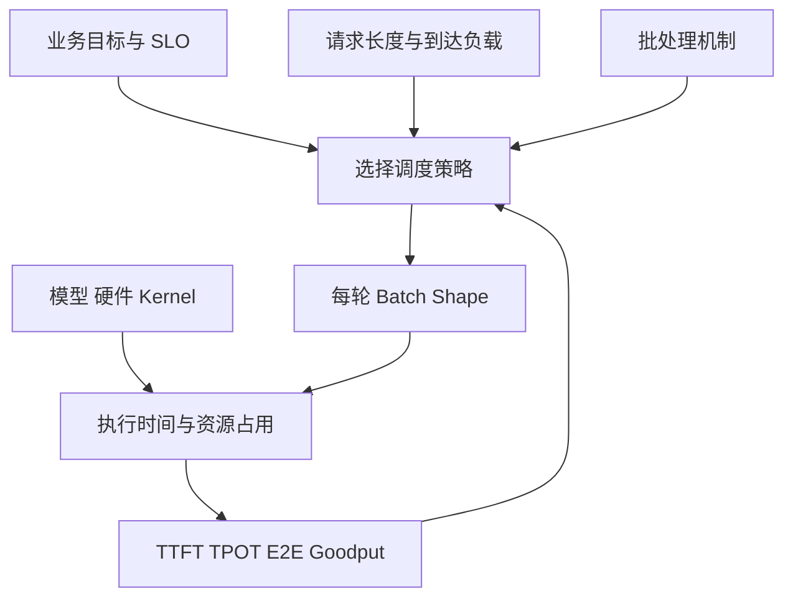
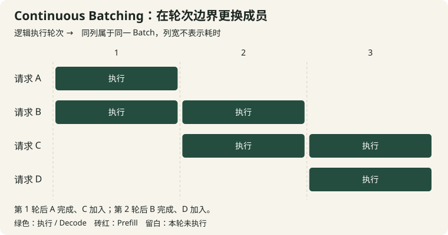
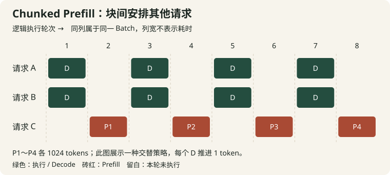
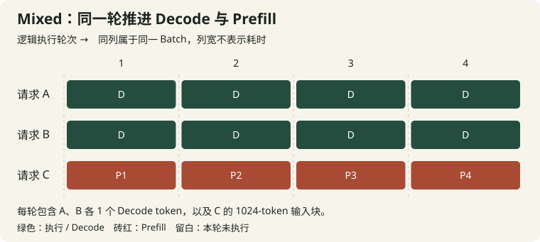
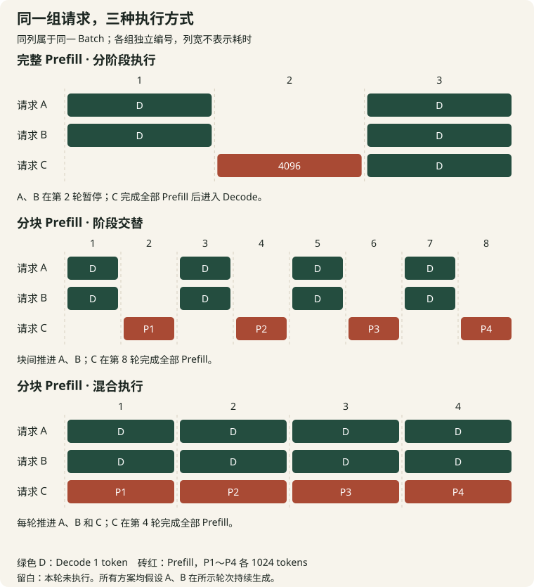

# 大模型推理批处理调度：请求形状、批处理机制、调度策略和优化目标

同一套推理引擎，离线压测时 GPU 利用率很高，接入在线业务后却可能出现首 token 等待过久、流式输出停顿，或者短请求迟迟完成不了。排查这些问题时，很容易直接调整 Batch Size、打开 Chunked Prefill，再比较吞吐有没有提高。但在改参数之前，先要回答：这项业务希望哪个结果变好？

推荐链路可能要求结果在规定时间内返回，超时结果即使最终生成正确，也已经错过使用窗口。流式助手关注用户多久能看到有效反馈，以及后续内容能否连续输出。结构化抽取需要完整 JSON 才能进入下游，单个首 token 提前返回带来的业务收益有限。离线数据生产则可能更关注单位成本能完成多少工作。

这些目标会把同一组请求引向不同的调度选择。本文采用下面的分析顺序：**先确定优化目标，同时刻画请求形状和到达负载，再选择执行机制与调度策略，最后用相同负载验证结果。**

请求形状描述需要处理什么；批处理机制提供组织计算的能力；调度策略决定每轮资源分配；优化目标决定怎样评价这次分配。四者共同决定服务表现。

## 一、先确定什么结果算好

### 1. 从业务消费结果的方式定义目标

设推荐链路留给模型的预算为 100 ms。一次推理花了 80 ms，结果可以进入排序；花了 150 ms，即使服务器完成了请求，调用方也可能已经采用降级结果。这里最有价值的目标是：在给定资源下，尽可能多地完成符合时限的有效请求。

100 ms 是教学示例，实际预算需要从整个业务链路分配。网络、特征准备、模型调用、后处理和结果合并都要消耗时间。如果只把模型 GPU 执行控制在 100 ms，而队列里已经等了 200 ms，业务仍然超时。

Agent 场景也要看消费方式。用户可见的流式回答，首段有效内容越早出现，越早给出反馈。工具调用通常要等参数完整、格式校验通过，工具才开始工作；此时应观察从模型请求发出到工具可启动的耗时。多步 Agent 还要考虑串行依赖：前一步节省的完成时间，可能直接缩短后面所有步骤的启动时间。

实时交互同样包含不同目标。流式文字对话关心启动和输出节奏；只有完整答案可用的交互任务关心 E2E；语音系统还可能关心首段音频和播放缓冲。指标的选择应落到具体消费者和时间边界。

### 2. TTFT、TPOT、ITL 和 E2E

设请求到达观测边界的时间为 $a_i$，首个输出 token 被观测到的时间为 $F_i$，最后一个输出 token 被观测到的时间为 $C_i$，实际输出长度为 $O_i$。定义：

$$
T_{\mathrm{TTFT},i}=F_i-a_i,\qquad
T_{\mathrm{E2E},i}=C_i-a_i
$$

当 $O_i>1$ 时，用输出 token 间隔的平均值定义 TPOT：

$$
T_{\mathrm{TPOT},i}=\frac{C_i-F_i}{O_i-1}
$$

于是，对于同一请求、同一组观测时间戳：

$$
T_{\mathrm{E2E},i}=T_{\mathrm{TTFT},i}+(O_i-1)T_{\mathrm{TPOT},i}
$$

如果请求输出 20 tokens，TTFT 为 200 ms，TPOT 为 5 ms，E2E 就是 295 ms。TTFT 减少 50 ms，完成时间也提前 50 ms；TPOT 从 5 ms 降到 4 ms，完成时间提前 19 ms。换成 2000 tokens，TPOT 减少 1 ms，累计节省约 2 秒。这解释了输入输出比例为什么会改变调优重点。

ITL 记录相邻输出 token 的实际时间差。一个请求前半段输出连续，中途被长 Prefill 打断，后半段重新连续输出，平均 TPOT 可能仍处在可接受范围，但用户会感受到明显停顿。对于流式任务，应同时看间隔分布、长停顿次数及其持续时间。

上述定义要求时间边界一致。服务端首 token 生成、服务端发送、客户端收到，属于不同事件。网络缓冲可能把多个 token 合并成一个响应块；客户端块间隔因此包含传输与缓冲行为。输出只有一个 token 时，TPOT 分母为零，应作为无后续间隔单独处理。错误、取消、零输出请求也要有独立统计口径。

单请求恒等式可以用于逐条计算；P95 TTFT、P95 TPOT 和 P95 E2E 则来自各自排序后的样本。它们对应的请求可能不同，应分别统计。输出长度差异较大时，也应按长度分桶，观察哪一类请求贡献了尾延迟。

### 3. 吞吐量要明确分子

Request Throughput 是单位时间完成的请求数。Output Token Throughput 是单位时间生成的输出 token 数。Input Token Throughput 则衡量输入处理量。比较两个配置时，应保持工作负载和统计口径一致。

每秒完成 100 个短 JSON 请求与每秒完成 10 个长文本生成请求，对业务的意义不同。输入 token 与输出 token 的计算路径也不同。把两者简单相加，可以描述某个固定数据集的处理量，但很难单独解释调度器在哪个阶段变快。

吞吐测量还要区分提交与完成。客户端持续提交每秒 100 个请求，服务器每秒只完成 80 个，剩余队列就在增长。提交速率反映输入压力，完成速率反映系统处理能力。只看压测工具的发送速度，会把积压误认为服务能力。

### 4. SLO 和 Goodput

SLO 是服务希望满足的目标，例如某类请求 99% 在 500 ms 内完成，或流式请求同时满足 TTFT 与输出间隔要求。SLA 通常涉及对外约定；本文在讨论技术优化时使用 SLO。

对具有逐请求时限的服务，可以定义：

$$
\mathrm{Goodput}=\frac{\text{在观测窗口内完成且满足 SLO 的有效请求数}}{\text{观测窗口长度}}
$$

系统 A 每秒完成 100 个请求，其中 70 个合格；系统 B 每秒完成 90 个，其中 88 个合格。依照这个定义，B 提供了更高的有效完成速率。评价时还应报告输入流量、拒绝率与失败率：主动丢弃大部分请求，可能让剩下请求的达标比例很好看，但业务获得的有效结果仍然很少。

对于同时约束 TTFT 和 TPOT 的任务，一条请求应在两项条件都满足时计入 Goodput。对于按窗口定义的分位数 SLO，则要另外报告窗口是否达标，清楚区分逐请求判定与窗口级判定。

优化目标可以写成最大化 Goodput，也可以是满足 SLO 的前提下最小化 GPU 成本，或者直接最小化平均 E2E。目标一旦明确，实验才有取舍标准。通用推理引擎通常提供兼顾处理能力与响应时间的默认配置；其阶段优先级、准入规则和默认预算随版本、模型及硬件变化，应将默认配置视为基线，再针对业务比较。

## 二、请求形状与到达负载

### 1. 用输入和输出建立第一层分类

把请求写成：

$$
R_i=(a_i,I_i,O_i)
$$

其中 $I_i$ 是输入长度，$O_i$ 是实际输出长度。本文持续使用三类教学负载：

| 类型 | 输入 / 输出 tokens | 主要计算过程 | 首先观察什么 |
| --- | --- | --- | --- |
| A：长输入短输出 | 2000 / 20 | 较多输入处理，较少生成轮次 | 排队与 Prefill 在 E2E 中的占比 |
| B：短输入长输出 | 200 / 1000 | 输入较短，持续多轮 Decode | TPOT、运行批大小、KV 增长 |
| C：长输入长输出 | 4000 / 1000 | 输入与生成阶段都有较多工作 | 阶段干扰、容量与公平性 |

这里的“长”“短”是相对关系。2000 tokens 对某些模型属于普通输入，对极低时延任务却已经产生显著计算成本。更可靠的做法是测量具体模型在不同长度下的执行时间，再判断阶段占比。

对于 A 类任务，如果 Prefill 队列等待 300 ms、计算 40 ms、后续 Decode 100 ms，优化每轮 Decode 仍然有价值，但最大的时间项在队列。对于 B 类任务，几百到几千轮生成累积的间隔更容易主导完成时间。C 类任务既要快速进入生成，也要长时间占用运行资源，通常更考验调度与容量管理。

### 2. 分布比平均值提供更多信息

两组流量的平均输入长度都为 2000 tokens。一组全部是 2000；另一组大部分很短，少部分达到数万。后一组更容易出现长 Prefill 与短请求竞争的问题。平均长度掩盖了调度最需要处理的差异。

至少记录输入与输出的分位数、最大值，以及它们的联合分布。输入长的请求可能输出短，也可能同时输出长。将二者分别随机采样，会破坏真实业务中的相关性，生成一种不同于线上流量的压力。

还要保留任务类型、租户、优先级、前缀和到达时间等信息。只有这样，才能分析某项优化是否仅改善了占多数的短请求，以及长请求是否承受了过多等待。对多轮对话，应按每一次调用的实际上下文计量，包含本轮可见的全部历史。

调度时通常可以知道输入长度，却只能估计最终输出长度。`max_tokens` 一类参数给出生成上限，实际请求可能提前遇到结束条件。采用短任务优先策略时，应区分已知量、预测量和上限，分别记录预测误差。

### 3. 到达率、并发和运行批大小

到达率 $\lambda$ 的单位通常是 requests/s，描述单位时间有多少请求进入系统。在途请求数包含等待、执行和其他尚未结束的请求。运行批大小则描述某一轮实际参与执行的序列数量。

同样是 20 requests/s，如果平均 E2E 为 100 ms，稳定状态下平均在途约为 2；如果平均 E2E 为 1 s，平均在途约为 20。并发受服务时间影响，因此“到达率为 20”和“固定 20 并发”对应不同负载生成方式。

运行批也只是系统内请求的一部分。监控看到 Decode Batch 为 8，队列可能还有几百条请求等待 Prefill。反过来，在途请求多也可能包含客户端连接、网络发送或者已取消但尚未清理的状态。指标需要与实际生命周期对应。

### 4. 从稀疏到过载

低到达率下，请求到达时 GPU 经常空闲。此时最直接的收益来自缩短单请求路径：尽快发起计算，减少调度、通信和启动开销。主动等其他请求到齐，会把原本不存在的排队加入 TTFT。

负载增加后，多个请求自然重叠。运行中的请求可以在下一轮合批，新增请求也会进入待选队列。此时批处理通常有助于提高单位时间的完成能力，而队列长度开始对性能变得敏感。

接近饱和时，短暂突发、长度波动或某次较慢执行都可能形成积压。即使平均输入速率低于长期处理能力，尾延迟仍可能升高。容量规划应留出对波动的余量，并观察突发结束后队列需要多久恢复。

长期过载意味着输入工作量持续超过可处理能力。调度可以决定积压由谁承担，也可以通过更有效的组批提高容量；当所有可行优化后仍然超载，就需要准入、降级、限流或扩容。让队列无限增长只会把资源不足转化为越来越晚的完成时间。

同一平均到达率也可以有完全不同的时间分布。均匀每 50 ms 来一条，与每秒开始同时来 20 条，对批次形成和尾延迟的影响不同。实验应保留突发结构，至少分别测量平稳输入和突发输入。

### 5. 前缀命中改变有效请求形状

输入 2000 tokens，其中 1800 tokens 的 KV 已可复用，与完全冷启动的 2000-token 请求，新增 Prefill 工作量不同。缓存命中也涉及匹配、读取和可能的搬运成本，因此需要同时记录命中长度与有效延迟收益。

共享前缀减少了重复计算与部分物理存储，后续 Decode 仍然要针对各自 Query 访问所需历史。分析时可以把逻辑输入长度、复用长度、实际新增计算长度分开。缓存原理可结合本站已有的 KV Cache 文章阅读；本文主要关注复用怎样改变请求排序和资源竞争。

## 三、GPU 为什么需要批处理

### 1. Prefill 的并行来自输入位置

对标准因果 Transformer，Prefill 一次处理输入中的多个位置。线性投影和前馈网络可以将这些位置组织为较大的矩阵乘法。Attention 则按因果依赖计算各位置对历史的访问。输入够长时，模型层通常具有较好的并行规模。

因此，一个长 Prefill 本身就可能占满大量计算资源。再加入更多 Prefill，收益取决于原先是否已经饱和，以及矩阵形状、Attention 实现、工作区和通信成本。输入 token 数相同、长度分布不同，Attention 工作量也可能不同；一个 8000-token 序列与八个 1000-token 序列具有不同的历史访问结构。

首个输出通常在完成输入处理后得到。具体实现可能为采样、logits 或调度拆分不同步骤，因此用户可见 TTFT 还包括队列、分词、采样、输出处理与传输。把 Prefill Kernel 时间当成完整 TTFT，会漏掉这些成本。

### 2. Decode 的并行主要来自多个序列

使用 KV Cache 时，每条普通自回归请求每轮通常处理一个新位置，再生成下一个 token。单请求在投影和前馈层提供的矩阵行数很少，设备容易花大量时间读取权重。增加同时执行的请求，可以让一次权重使用服务更多 token。

用一个理想化例子说明：假设某模型一轮需要访问约 60 GB 权重。单条 Decode 请求运行一轮，生成一个 token；16 条请求一起运行，权重相关工作可以在较大的计算中共同摊销，同时推进 16 条请求。这里的 60 GB 只表示教学量级，实际访问还受缓存、量化、分片、专家路由和 Kernel 实现影响。

每个请求还要读取自己的历史 KV。上下文越长，这部分成本越明显；运行请求越多，总 KV 访问和容量压力也越大。随着 Batch 增长，设备可能从权重带宽占主导，转向计算、KV 带宽或通信占主导，吞吐收益也随之变化。

MoE 还要考虑路由分布和专家之间的负载。不同请求命中不同专家时，活跃专家数量、权重访问、跨卡通信和负载均衡都会改变。Dense 模型的小批经验需要在实际 MoE 路径重新验证。

### 3. 一个可计算的吞吐与间隔例子

假设纯 Decode，所有请求上下文条件相同，每轮耗时采用教学模型：

$$
t(B)=4+0.6B\quad\text{ms}
$$

其中 $B$ 是本轮序列数。每条请求一轮生成一个 token，则总输出速率为：

$$
q(B)=\frac{1000B}{4+0.6B}\quad\text{tokens/s}
$$

| Decode Batch | 单轮耗时 | 批内请求的生成间隔 | 总输出速率 |
| --- | --- | --- | --- |
| 1 | 4.6 ms | 4.6 ms | 约 217 tokens/s |
| 8 | 8.8 ms | 8.8 ms | 约 909 tokens/s |
| 16 | 13.6 ms | 13.6 ms | 约 1176 tokens/s |
| 32 | 23.2 ms | 23.2 ms | 约 1379 tokens/s |

这是无 Prefill、无排队、无投机解码的示意模型。它说明总速率与单请求生成间隔可以朝不同方向变化。如果 TPOT 目标为 10 ms，表中 Batch 8 是可测试起点；如果服务追求离线输出速率，可能愿意采用更大的批次。

平均 E2E 还要加入等待。较小批次虽然每轮更快，却可能让很多请求长时间留在队列；较大批次虽然推进一轮更慢，却可以同时服务更多请求。比较时应将整个到达轨迹执行完，逐条记录完成时间。

### 4. Kernel 与 Scheduler 各自改变什么

Kernel 优化改变给定 Batch Shape 的执行成本，例如融合算子、减少 HBM 访问、优化 Attention、采用合适的量化实现。Scheduler 优化则决定这轮有哪些请求、各推进多少 token，以及哪些状态继续驻留。

二者存在反馈。同样数量的 token，某些形状可以命中高效的 CUDA Graph 或 Kernel 路径，另一些形状需要额外开销。调度器若只按 token 数估计耗时，就可能把两种成本不同的批次看成一样。

工程上可以先测一张执行成本表：在不同 Prefill token 数、Decode 序列数、上下文分布下记录耗时。成本表用于解释调度结果，也可以成为预测模型的输入。模型、精度、并行方式或底层实现改变后，应重新校准。

## 四、批处理机制提供哪些执行能力

### 1. Static Batching

静态批次在执行期间保持相对固定的成员。对于生成长度不同的请求，短请求先结束后，其位置可能空闲、被 Mask，或者等待整个批次完成才进入下一组。实现可以减少部分无效计算，但批次整体换人的时机会限制资源复用。

例如 A 输出 10 tokens，B 输出 1000 tokens。二者同时进入一个固定批次，A 很快结束；如果新请求要等 B 也结束才能加入，后续时间里只能由 B 继续推进。这里浪费的是把空出的运行能力交给新请求的机会。

静态批处理适合输入输出形状较一致、任务可离线收集的场景，也便于建立执行基线。在线请求到达和结束时间差异较大时，动态成员管理通常更有价值。

### 2. Continuous Batching

Continuous Batching 将成员调整推进到迭代边界：请求结束后退出，新请求在满足计算和内存条件时加入。Orca 的 iteration-level scheduling 是理解这一机制的重要来源，本文使用其“每次迭代重新安排执行成员”的基本视角。

一个批次可以经历 A、B 同时运行，A 完成后 B、C 运行，随后 B 完成、C、D 运行。每条请求有自己的生命周期，GPU 持续从当前可执行工作中构造下一轮。

每列表示一轮的批次成员，列宽不表示耗时。这里假设 C、D 加入时已满足执行条件；仍在运行的请求继续参与后续轮次。

这个机制提供动态组批能力。它仍然需要策略决定新请求准入时间、等待队列顺序、Prefill 与 Decode 的关系，以及内存紧张时的处理方式。FCFS、优先级或短任务预测都可以建立在这一能力上。

“Continuous”也有明确的执行边界。GPU 已经提交的一轮计算通常要按引擎支持的边界完成，后来到达的请求在后续调度机会加入。即使调度器立即响应新请求，也可能需要等待当前批次结束。

### 3. Chunked Prefill

假设请求 C 有 4096 个待计算输入 tokens。完整处理会形成一个较长执行段。若拆成 4 个 1024-token Chunk，调度器就可以在块与块之间重新安排其他工作。每个后续 Chunk 使用此前已建立的历史 KV，并计算当前部分。

色块表示逻辑工作，列宽不表示耗时。每个后续块继续使用此前建立的历史 KV；块间的调度机会允许安排其他请求，具体安排由策略决定。

分块让单次占用时间更可控，也允许长输入逐步进入系统。较小 Chunk 增加调度机会，同时增加执行轮次、调度与启动开销，并可能改变矩阵效率。后续 Chunk 的历史更长，因此四个同样 token 数的 Chunk 也可能有不同耗时。

TTFT 取决于整个输入何时处理完成。一个孤立请求本来可以一次高效完成 Prefill，拆分后还插入多轮等待，其首 token 可能更晚；而在混合负载中，分块可能改善其他请求的响应。选择 Chunk 大小需要确定保护的是谁的哪个指标。

### 4. Mixed Prefill + Decode

混合执行把 Prefill tokens 与运行中请求的 Decode tokens 放在同一逻辑批次中。投影和前馈部分可以利用更丰富的 token 规模；Attention 则需要按各自序列和阶段处理不同历史访问。

每列表示一次逻辑 Forward，包含同一批次的 Decode 与 Prefill 工作。列宽不表示耗时，同列对齐表达批次组成。

这里的一次逻辑 Forward 可以包含多个内部 Kernel、不同 Attention 路径及相关通信。混合带来的收益应从完整迭代耗时和请求结果评估。一个批次里塞入更多 Prefill，可能改善总体执行效率，也可能延长所有参与 Decode 请求的这次间隔。

Sarathi-Serve 将分块 Prefill 与保护 Decode 推进的调度结合，用来研究处理能力与生成延迟的取舍。本文借用的是这种设计思路；具体性能需要在自己的模型、设备和负载上测量。

### 5. 用同一组请求逐轮比较

设 A、B 已进入 Decode，C 新到达，需要 4096 tokens Prefill。下图按请求分行、按逻辑迭代分列，P1 至 P4 是 C 的四个输入块。各组轮次独立编号，列宽不表示执行耗时；具体耗时由实际 Batch Shape 决定。

第一种方式中，A、B 在 C 完整 Prefill 期间停顿。第二种允许块间推进 Decode，但 C 的输入完成时间包含插入的 Decode。第三种每轮推进所有参与者，而混合轮次可能比纯 Decode 更长。三种方案分别提供不同的时间分配，需根据 TTFT、ITL 和完成时间判断。

### 6. 低到达率下怎样尽快服务

假设一条请求到达时 GPU 空闲，下一条什么时候到达未知。若为了达到 Batch 8 而主动等待，当前请求就要承担等待成本。低流量下等待很久也可能凑不齐足够成员。采用立即调度，让后续请求在未来的迭代边界加入，通常更符合低时延目标。

等待需要分类。第一类是人为配置的凑批窗口；第二类是已经执行的 GPU 计算尚未结束；第三类是 Token Budget、序列槽位或 KV 不足导致的准入等待；还有上游路由、分词或网络造成的等待。只有第一类可以直接通过取消凑批行为解决，其他类型需要定位各自瓶颈。

高负载时队列中本来就有足够请求，较大批次可能自然形成。此时即便把主动等待窗口降到零，也未必减少实际批大小。调优应同时观察等待原因、实际组批结果和完成表现。

某些系统会设置短暂合并窗口，以降低启动成本或配合特定执行路径。这应作为显式策略测试：记录窗口带来的排队增量、批次收益与 SLO 变化。对稀疏在线流量，采用尽快执行作为基线更容易解释。

## 五、调度器怎样使用这些能力

### 1. 四类决策及其先后关系

准入决定哪些请求可以占用活跃状态与 KV；排序决定候选请求的先后；组批决定本轮各请求推进的 token 数；抢占决定容量不足时哪些请求暂停、回收或迁移。它们共同构成实际调度行为。

一个请求即使在排序中排第一，也可能因 KV 不足而无法准入。一个已经准入的请求，可能在当前轮因预算不足而暂缓执行。分析策略时，应把等待发生在哪个环节记录清楚，才能理解“优先级高却仍然慢”的原因。

还要观察调度器自身的成本。如果 CPU 端扫描、排序、缓存匹配与批次构造花费过多时间，GPU 可能在轮次之间空闲。更复杂的策略需要把预测和决策成本计入收益，尤其在单轮执行很短时。

### 2. Prefill First：先推进新请求输入

假设 A、B 正在 Decode，C 尚有 8000 tokens 输入，D 尚有 1000 tokens 输入，本轮新 token 预算为 4096。Prefill First 可以把整轮预算交给 C 的输入处理。

这样能够推进等待输入的工作，也可能利用较大的矩阵计算提高效率。代价由 A、B 的生成间隔承担。如果 C 的单轮块很大，A、B 的输出会停顿更久。

新请求内部的顺序仍然重要。先处理 C 还是 D，会影响首 token 完成分布。若 D 可以在较短时间内完成全部输入，优先 D 可能更快给出一个新请求的首 token；若 C 更早到达且已等待很久，公平策略可能仍然优先 C。

因此，阶段优先级确定的是一类工作的机会，请求排序确定的是这类工作中的分配。二者需要分别描述。

### 3. Decode First：先保障运行请求进度

在支持混合执行的教学模型中，可以先给 A、B 各分配一个 Decode token，再把剩下的 4094 token 预算用于 Prefill。这样，已运行请求每轮都有推进机会，新输入使用剩余资源。

这里的 token 预算只表示计数约束。两个长上下文 Decode token 与两个短上下文 Decode token 的实际成本不同。若 Decode Batch 本身很重，即使只消耗少量新 token 名额，也可能已经占用大量时间或带宽。

Decode First 有利于输出连续性和运行请求的完成进度。若准入的长输出请求很多，它们持续驻留，也可能让新请求等待更久。应联合控制活跃请求数量、Prefill 份额和最长等待时间。

vLLM v0.22.1 的优化文档将分块 Prefill 下优先处理 Decode、再使用剩余预算处理 Prefill 作为调优背景，并讨论 token 预算对指标的影响。这里将其作为有版本边界的实现实例；部署时还要结合实际调度器代码与模型路径确认。

### 4. FCFS：按到达顺序分配机会

FCFS 简单、可解释，对输出长度预测的依赖较少。它可以控制等待队列顺序，也可以参与迭代级的资源分配。在动态批处理中，先到请求与后来请求可以同时执行。

设 C 输入很长，D 很短。如果一次只让队首 C 占用全部 Prefill 预算，D 的首 token 会被推迟。分块可以让调度器更频繁地检查 D，但具体是否给 D 机会，仍由排序和组批规则决定。

Head-of-Line Blocking 还可能来自内存：队首请求需要很多 KV，后面的短请求实际可以装下。调度器可以坚持队首，也可以跳过暂时无法准入的请求。后者提升局部利用效率，却改变了严格到达顺序，需要配合等待时长控制公平性。

当请求形状接近、长度估计误差较大，FCFS 往往是很有价值的基线。对比其他策略时，应观察收益究竟来自更好的排序，还是来自不同的预算、缓存行为或准入上限。

### 5. SJF 与 SRPT：让短工作尽早完成

SJF 优先预计工作量小的任务。SRPT 优先预计剩余处理时间短的任务，并允许在合适的执行边界调整服务对象。工作量应按计算成本估计；输入 token 与输出 token 对时间的贡献不同，直接把两者相加会遗漏这种差异。

先用一个单处理器算例说明完成顺序。A、B 同时到达，分别需要 100 ms 和 10 ms，依次执行且无切换成本。先 A 后 B，完成时间为 100、110 ms，平均 105 ms；先 B 后 A，完成时间为 10、110 ms，平均 60 ms。短任务提前完成使平均值下降。

GPU 合批增加了另一项选择：同时服务二者。二者合并后的总成本可能小于单独执行之和，还可能与其他请求共同推进。因此，经典单处理器结论只能作为理解排序收益的参照，实际策略需要结合批处理成本与显存约束。

输出预测误差会改变排序。一个预计只生成 20 tokens 的请求，实际生成 2000 tokens，可能持续获得短任务待遇。可以根据已生成长度更新剩余时间估计，对预测偏差设置回退规则，并记录各长度组的等待和完成分布。

长请求在持续短请求流量中可能等待很久。Aging 可以随等待时间提高其优先级；保留最低服务份额、设置最长等待阈值也能提供进展保障。优化平均 E2E 时，应同时观察长请求分桶结果，明确公平性代价。

### 6. SLO-aware：根据截止时间和可完成性分配资源

假设 A 距离截止时间还有 100 ms，预计剩余处理为 80 ms；B 还有 1000 ms，预计剩余处理为 20 ms。按剩余时间排序可能先 B，按截止时间排序则可能先 A。选择取决于目标是平均完成时间还是达标数量。

可以用 Slack 描述时间余量：截止时间减去当前时间，再减去预计剩余处理时间。Slack 越小，请求越紧迫。不过预测需要包含排队、执行、潜在抢占和输出长度误差，并随运行状态更新。

当某请求已经严重超时，即使立刻分配资源也很难完成，继续优先它可能让更多可达标请求失去机会。系统需要明确业务处置：允许迟到结果的任务可以降级为后台完成；时限后结果失效的任务可以取消并释放状态；必须完成的任务则保留相应保障。

多个业务共享设备时，截止时间还要结合租户配额和优先级。仅按最短截止时间排序，可能让持续发送紧急请求的租户占据大量资源。准入规则应明确哪些承诺已经接受、哪些流量可以拒绝，并通过日志解释决定。

### 7. KV 容量、抢占与恢复成本

请求进入 Decode 后，生成越长，KV 往往继续增长。准入过于积极，当前轮可能能运行，后续却因容量不足触发抢占。准入过于保守，又可能留出很多暂时用不到的空间，让 GPU 缺少可批处理请求。

抢占方式会改变代价。保留 KV 但暂缓执行节省的是计算机会；将 KV 移到其他层级需要传输与恢复；释放 KV 后恢复需要重算已有前缀。每一种方式都应将恢复时间、额外带宽和状态管理纳入成本。

如果一个请求反复被抢占和重算，总有效进度可能很低。监控应记录抢占次数、重算 token、恢复耗时，以及由此延长的 E2E。仅看 GPU 忙碌程度，会把重复工作也视为有效利用。

### 8. 策略可以组合

| 决策维度 | 示例选项 | 主要回答的问题 |
| --- | --- | --- |
| 候选排序 | FCFS、短任务估计、截止时间、缓存亲和性 | 哪些请求先获得机会 |
| 阶段分配 | Prefill First、Decode First、自适应份额 | 新输入与持续生成怎样分配资源 |
| 组批粒度 | 完整 Prefill、固定块、自适应块、混合执行 | 每轮推进多少工作 |
| 容量管理 | 保守准入、预测准入、抢占与回收 | 哪些状态可以持续驻留 |

FCFS 加 Decode First 可以保障到达顺序下的准入，并优先推进运行请求；短任务排序加混合执行可以尝试降低平均完成时间；SLO-aware 加自适应 Chunk 可以根据输出间隔预算决定这一轮允许多少 Prefill。描述系统时应把这些维度展开，方便定位实验中真正改变的行为。

## 六、从目标和负载选择方案

下表把前面的分析落到实践起点。每行的瓶颈都需要通过观测确认；输入输出形状只能提供优先排查方向。

| 请求形状与负载 | 主要瓶颈 | 值得尝试的批处理机制 | 调度策略倾向 | 重点指标 |
| --- | --- | --- | --- | --- |
| 长输入、短输出，低到达率 | 单次 Prefill、启动和调度开销 | Continuous Batching，比较完整 Prefill 与较大 Chunk | 尽快执行，减少主动凑批等待 | E2E、TTFT、单请求执行时间 |
| 长输入、短输出，高到达率 | Prefill 竞争、排队、准入 | Continuous + Chunked，比较不同输入预算 | FCFS 基线，按成本估计尝试短任务优先，控制等待 | 平均及 P95/P99 E2E、Goodput |
| 短输入、长输出，高并发 | Decode 权重与 KV 访问、驻留容量 | Continuous Batching，必要时混合少量 Prefill | Decode First，限制运行规模并保留新请求进展 | TPOT、ITL、输出吞吐、TTFT |
| 长输入、长输出，混合负载 | 阶段干扰、KV 容量、长期竞争 | Chunked + Mixed，必要时评估阶段隔离 | 自适应阶段份额与 Chunk，结合准入 | TTFT、TPOT、E2E、Goodput |
| 请求长度差异显著 | 队首阻塞、资源占用差异 | Continuous + Chunked | SJF/SRPT 近似、Aging、最长等待保障 | 平均 E2E、长度分桶尾延迟、公平性 |
| 严格在线 SLO，含突发流量 | 队列积压、尾延迟、容量不足 | 动态组批，必要时资源隔离 | SLO-aware、Admission Control、超时取消 | 达标率、Goodput、拒绝率、P95/P99 |

### 1. 长输入短输出：先分解完成时间

以 2000/20 为例，先记录队列、输入处理和生成阶段时间。如果低流量下输入处理占主导，就研究前缀复用、Prefill 执行效率、并行通信和调度启动开销。没有其他任务竞争时，较大的输入块可能减少重复启动成本。

高流量下，观察排队是否随到达率迅速增加。输入预算过小可能限制每轮工作量；预算过大可能形成长执行段，影响其他请求。应在固定到达轨迹下比较预算，并同时记录完成吞吐和尾延迟。

输出短也意味着请求进入生成后可能很快释放 KV。让一些接近完成的请求及时结束，能够腾出准入空间。具体收益取决于输入阶段和生成阶段的成本比例，需要结合完成顺序观察。

### 2. 短输入长输出：控制运行规模

运行批增大通常提供更多 Decode 摊销机会，同时提高每轮 KV 读取和总驻留。可以先测不同运行规模下的生成间隔与输出速率，再找到满足业务间隔目标的区间。

新请求仍然需要进入系统。Decode First 若配合过高的运行上限，可能使新请求长期等待；过低上限又可能损失处理能力。实验应同时观察运行请求与等待请求，避免只报告已进入 Decode 的样本。

长输出具有持续占用特征。长度上限、取消传播、客户端断开后的清理都会影响真实容量。及时释放已失去消费者的请求，可以减少无效计算，也让等待请求更快获得机会。

### 3. 混合负载：按不同人群评价

平均 TTFT 下降可能主要来自大量短输入，少数长输入却更晚完成。平均 TPOT 改善也可能来自限制了大批次准入，等待中的新请求因此变慢。混合负载应按形状、任务和优先级分桶，再报告整体结果。

缓存感知排序可能减少输入重算，却让缓存冷请求等待更久。应记录节省的计算、各组时延和等待上限。如果业务对不同请求有不同承诺，可以把承诺直接纳入调度与准入。

阶段隔离可以进一步减少干扰，例如将 Prefill 与 Decode 放到不同资源池。它也引入 KV 传输、路由和池间负载不均衡。只有当干扰收益足以覆盖这些成本时才值得采用，本文将其作为扩展实验方向。

## 七、平均 E2E 的数学模型

### 1. 从每条请求的完成时间开始

设策略为 $\pi$，请求到达时间为 $a_i$，完成时间为 $C_i$。对固定的一组请求，可以写出目标：

$$
\min_{\pi}\frac{1}{N}\sum_{i=1}^{N}(C_i-a_i)
$$

如果业务有权重，则可以采用加权完成时间；如果业务关注 SLO，则应改为对应的达标目标与资源约束。数学形式应忠实表达业务评价，避免测平均 E2E、实际却按最大吞吐选配置。

固定请求集适合离线比较。在线系统还需要说明观测窗口、初始队列、窗口末尾尚未完成的请求，以及策略是否会拒绝任务。只统计窗口内完成的请求，可能遗漏被策略延后的长请求。可以让固定轨迹运行结束后继续排空，或对未完成样本明确报告。

### 2. 每轮选择哪些请求、推进多少 token

在第 $k$ 轮，令 $n_{ik}$ 表示分给请求 $i$ 的新计算位置数。本轮决策可抽象为：

$$
\pi_k=\{(i,n_{ik})\}
$$

常见约束包括：

$$
\sum_i n_{ik}\le B_{\mathrm{token}},\qquad
|S_k|\le B_{\mathrm{seq}},\qquad
M_{\mathrm{KV},k}+M_{\mathrm{other},k}\le M_{\mathrm{available}}
$$

$S_k$ 表示本轮参与执行的序列集合；活跃但暂未执行的请求还可能占用 KV 与状态槽位。具体引擎对运行上限、批次上限与槽位的定义应分别映射。显存约束也要包括权重、工作区、激活和运行时预留，若使用预分配 KV Pool，则按池内可用容量判断准入。

普通自回归 Decode 通常每轮推进一个位置；Prefill 可以推进多个。后续计算依赖已有输入与历史状态，无法任意打乱顺序。投机解码可能在一次验证中处理多个位置，需相应扩展模型，本文的基本推演采用普通自回归路径。

### 3. 执行时间由整个形状决定

用下面的抽象函数描述一轮成本：

$$
\tau_k=f(P_k,D_k,\mathcal{L}_k,\mathcal{M},\mathcal{H})
$$

其中 $P_k$ 是新增 Prefill token 数，$D_k$ 是 Decode 序列数，$\mathcal{L}_k$ 是上下文和请求长度分布，$\mathcal{M}$ 表示模型与精度，$\mathcal{H}$ 表示硬件、并行方式和执行实现。

同样 4096 个新 tokens，可以来自一个长 Prefill、多个短 Prefill，或少量输入加大量 Decode。它们访问历史的方式、矩阵形状和缓存使用不同，因此需要不同成本估计。Token Budget 是便于控制的资源代理，执行时间还要通过测量校准。

如果每轮再加调度成本 $s_k$，下一轮开始时间约为当前时间加 $\tau_k+s_k$；若 CPU 与 GPU 部分重叠，实际应按依赖关系计算关键路径。某请求在哪轮完成，决定它累计经历了多少执行与等待。

### 4. 在批处理收益与尽早完成之间取舍

假设两条请求单独执行的剩余工作分别为 10 ms 和 100 ms，合批推进可能摊销部分权重读取。先完成短请求有利于平均值，同时执行又可能减少总 GPU 时间。调度器要比较的是不同推进方式导致的最终完成时间，同时计入后续排队与资源释放。

对于显存紧张的系统，完成短请求还可能释放大量 KV，继而让新请求进入。这个间接收益取决于请求已经积累的上下文、共享块引用和回收方式。一个输出即将结束但上下文很长的请求，可能具有较高的容量释放价值。

因此，剩余 token 数、预计剩余时间、可释放显存和截止时间都可以成为策略特征。它们反映不同目标，最终需要通过统一的业务指标比较。复杂特征增加的预测与管理开销也必须计入。

### 5. Little’s Law 连接并发与完成时间

稳定系统中，采用一致的观测边界，可以使用：

$$
\bar N=\lambda\bar T
$$

$\bar N$ 是平均系统内请求数，$\lambda$ 是实际流过该系统的请求速率，$\bar T$ 是平均停留时间。若两个系统都稳定完成 100 requests/s，平均在途从 50 降为 20，对应平均停留从 500 ms 降为 200 ms。

这为实验提供了一致性检查。吞吐和平均 E2E 相同，长期平均在途却差很多，首先检查边界、窗口及统计对象。若只统计引擎运行队列，却用客户端端到端耗时代入，二者覆盖的系统不同。

有拒绝、取消和失败时，需要明确流入流出及各类请求的停留时间。持续过载、队列仍在增长的窗口，应先报告非稳态积压情况。公式适合连接长期平均量，尾延迟仍要通过请求样本分布观察。

## 八、如何设计有效的优化实验

### 1. 写出实验要回答的问题

一个可操作的问题是：“在给定模型、硬件和请求轨迹下，能否在 P95 E2E 低于业务阈值时提高有效完成速率？”另一个是：“低流量下，减少输入分块能否缩短 2000/20 请求的完成时间？”问题越具体，越容易选择测量与对照。

先保存默认配置作为基线，包括模型版本、权重精度、Tokenizer、引擎版本、并行方式、GPU、驱动和相关环境。对于双 H20、TP=2、Qwen MoE 之类部署，还应写清具体模型、专家并行与通信设置；这些信息决定成本结构。本文中的硬件场景仅是实验背景示例。

约束也要固定，例如可用 GPU 数、显存预算、输出质量和最大上下文。采用更低精度或更短输出可能提高速率，但同时改变了任务。将这些变化单独列为实验因素，才能解释收益来源。

### 2. 先建立可解释的时间线

建议为请求记录接收、进入等待、准入、首轮执行、输入完成、首 token、最终完成等事件，并将抢占、恢复与取消关联到同一请求。时间线可以分解排队和执行，但各段应按真实依赖定义，避免重叠区间被重复相加。

对于执行轮次，记录 Prefill tokens、Decode 序列数、上下文分布、GPU 耗时和调度耗时。对于资源，记录 KV 已用与可回收容量、活跃槽位、抢占次数与重算量。对于业务，记录成功、错误、拒绝、取消、超时与 SLO 判定。

采样日志可以控制开销，但应校准采样是否遗漏尾部请求。开启详细追踪也可能改变性能，正式对照需要使用一致的追踪设置，并测量其附加成本。

| 观测项 | 主要用途 |
| --- | --- |
| 到达率、完成率、等待队列长度 | 判断输入压力和积压趋势 |
| Queue Wait、Prefill、生成阶段时间 | 找到 E2E 的主要时间项 |
| P50/P95/P99 TTFT 与 E2E | 区分常见体验和尾部体验 |
| TPOT、ITL 分布与长停顿 | 识别 Decode 干扰 |
| 运行序列数、输入 token 预算实际使用量 | 解释实际组批结果 |
| KV 使用、抢占、恢复与重算 | 识别容量与无效工作 |
| Goodput、拒绝率、失败率 | 评价可用业务产出 |

### 3. 固定并发与固定到达率分别测什么

固定并发压测保持一定数量的在途请求。一个请求完成后再补一个，属于闭环负载。它适合测不同运行规模下的处理能力，也适合比较 Batch Shape 与执行效率。服务变慢时，新请求补入也变慢，输入压力会随系统响应调整。

固定到达率压测按预定时间发送请求，属于开放到达方式。即使前面的请求还未完成，后续也继续按计划到达，更适合观察排队、过载和在线时延。需要确保压测端自身可以按时发出请求，并记录计划发送与实际发送之间的偏差。

若配置了最大并发，达到上限后暂停发送，负载就会受到额外约束。应明确这是客户端背压，并记录等待发生在客户端还是服务端。否则，一个看似稳定的固定到达率实验，可能实际已经转为闭环。

两类实验可以互补：先用固定并发探索执行成本，再用固定到达轨迹验证业务指标。报告时分别给出模式、发送规则和客户端限制。

### 4. 请求轨迹与缓存条件

基础矩阵至少包含 2000/20、200/1000、4000/1000 及三类混合。每类分别测试稀疏、正常、接近饱和和突发输入。接近饱和的区间通过基线测量确定，针对具体模型选择 requests/s。

重复使用相同的到达时间、输入内容、长度与任务标签，便于将差异归因于配置。对实际生成任务，输出会因采样和终止而变化，应保存实际长度分布，并尽量控制随机条件。固定输出长度的合成负载适合隔离机制，真实任务则用于验证代表性。

缓存分为冷缓存、受控暖缓存与真实重放条件。每次都使用相同前缀的随机请求，可能无意间形成高命中负载；每次清空缓存，又可能偏离生产。应明确实验要测哪一种状态，记录实际命中，将实际命中与输入文件一并保存。

预热覆盖模型加载、内存分配、Kernel 初始化与图捕获等路径。预热结束后再开始稳定统计，突发和冷启动则作为单独实验。正式窗口长度要足以覆盖请求完成与队列恢复，特别是长输出和长尾请求。

### 5. 按控制量组织参数实验

SGLang 的源码将等待队列策略与 Prefill 准入、预算处理放在相关调度组件中。阅读时应结合部署版本定位实际路径。本文参考的是写作时的主分支文件，复现实验应保存自身使用的 commit，而具体默认值由部署帮助信息和配置确定。

| 控制量 | 可查找的参数或实现名称 | 实验中确认什么 |
| --- | --- | --- |
| 运行请求上限 | SGLang `max_running_requests` | 是否限制准入、运行槽位或实际 Decode 规模 |
| 输入组批预算 | `max_prefill_tokens` 等 | 当前模式中的生效路径及与分块预算的关系 |
| 输入分块粒度 | `chunked_prefill_size` | 单轮组块规则、对齐与共享预算方式 |
| 等待队列排序 | `schedule_policy` | 控制哪个队列、可用策略及缓存依赖 |
| 准入估计 | `schedule_conservativeness` 相关路径 | 输出估计和内存预留怎样影响准入 |
| 混合执行 | `enable_mixed_chunk` 相关路径 | 当前模型与执行模式是否实际采用混合批次 |
| 每轮总 token 预算 | vLLM `max_num_batched_tokens` | Prefill 与 Decode 如何共同消费预算 |

这张表用于定位控制量。SGLang 的输入预算和分块预算之间可能存在特定模式下的优先关系，源码与启动日志应一起检查。一次实验改变某参数后，首先确认实际 Batch Shape 是否变化；配置值改变但执行行为相同，结果自然可能接近。

先逐个改变参数理解方向，再围绕有收益的组合做小规模联合搜索。至少记录运行上限、Chunk、混合开关与准入规则之间的相互作用。不同配置若改变了有效容量，后续还要在相同业务到达率下重新比较。

### 6. 根据观测决定下一步

低流量下队列很短、Prefill 占主要时间，优先研究输入执行、缓存与固定开销。此时增加凑批等待会直接进入 TTFT，应有明确的吞吐收益才考虑保留。

高流量下执行时间变化不大、队列快速增长，说明主要问题是容量与排队。研究更有效的组批、减少重复计算、准入和扩容，并找到满足 SLO 的最大稳定输入区间。

如果 ITL 尖峰与大 Prefill 轮次对应，可以减少输入块或调整混合比例，观察 TTFT 与 Goodput 的变化。如果抢占频繁，先检查准入预测和 KV 余量，再比较限制活跃规模后是否减少重算。每次调整都应有一个可由日志检验的机制解释。

### 7. 如何判断实验结果可以用于上线

每个配置报告相同到达率下的完成吞吐、平均和尾部时延、Goodput、失败与拒绝，以及队列是否稳定。还要报告各长度组和任务组，避免整体均值掩盖受损人群。

对重要候选配置重复实验，交换运行顺序，检查后台负载、温度和缓存状态等干扰。长尾样本不足时，补充观测量并报告不确定性；极少样本下的 P99 容易受单个请求影响。

上线前用生产代表性流量进行小范围验证，保持可回退配置，观察请求形状和负载是否偏离实验条件。模型升级、精度变化、上下文增长、缓存结构变化，都可能让原来的预算失去适用性。

最终应留下可以复现的选择依据：业务承诺是什么，请求怎样到达，哪种成本限制了系统，策略怎样改变了批次与完成顺序，以及这些变化带来了多少有效结果。后续流量变化时，沿着同样的观测链重新测量，就能判断应该调整哪一层。

## 参考资料

1. [Orca: A Distributed Serving System for Transformer-Based Generative Models，OSDI 2022](https://www.usenix.org/conference/osdi22/presentation/yu)：迭代级调度与动态成员管理的基本机制。
2. [Taming Throughput-Latency Tradeoff in LLM Inference with Sarathi-Serve，arXiv v3](https://arxiv.org/html/2403.02310v3)：分块输入、混合执行与生成延迟之间的设计关系。
3. [vLLM v0.22.1：Optimization and Tuning](https://docs.vllm.ai/en/v0.22.1/configuration/optimization/)：有版本边界的分块输入与 token 预算调优实例。
4. [SGLang：schedule_policy.py](https://github.com/sgl-project/sglang/blob/main/python/sglang/srt/managers/schedule_policy.py)：等待队列排序与 Prefill 预算、准入实现。链接指向可变化的主分支，实验应记录部署 commit。
5. [Little’s Law，MIT 排队模型课程材料](https://web.mit.edu/1.041/spring2023/lectures/L8-queuing-models-2023sp.pdf)：系统内平均数量、流率与平均停留时间的关系；使用时需保持统计边界一致。
