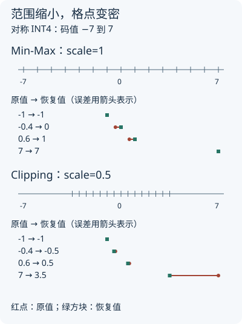
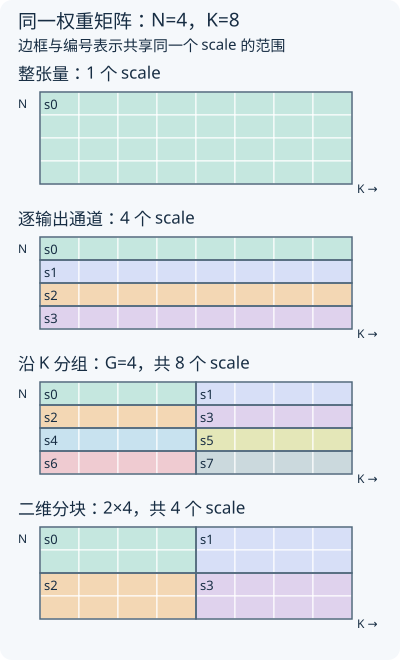
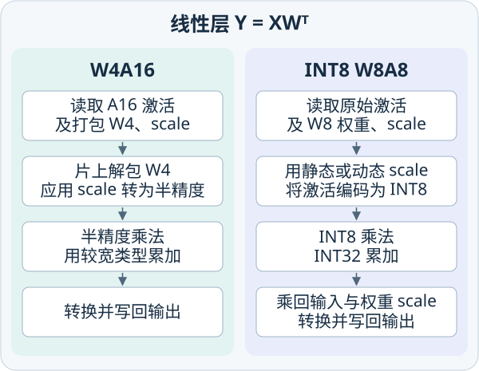
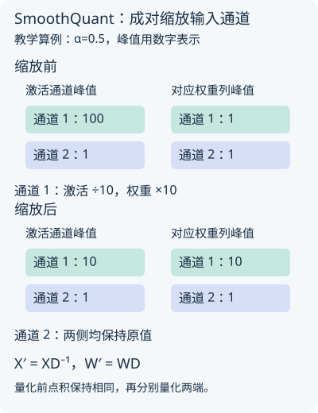

# 大模型推理量化：数值表示、量化误差与 GPU 执行

量化用较少的二进制位近似表示模型中的数值。对相同形状的矩阵乘法，主乘加次数保持相同；如果硬件提供适用的低精度矩阵指令，更高的指令吞吐可以缩短计算时间。权重位宽降低后，模型占用的显存更少，读取同一份参数需要搬运的字节也更少。这三方面收益分别影响计算速度、可容纳的模型与并发规模，以及参数读取时间，最终共同影响请求时延和部署成本。

收益的大小取决于执行方式。低精度权重可以先恢复成半精度再参与乘法，也可以与低精度激活一起进入原生低精度指令。两条路径节省的工作不同，在线转换数值还会增加开销。本文只讨论权重与激活量化，从一个线性层算清计算量、存储和读取量，再推导数值误差、典型算法与 GPU 数据流，最后判断不同推理负载下的实际收益。文中的性能数字均为明确假设下的教学计算，部署结论需要由目标环境的测量确认。

## 一、从一个线性层看量化的收益

### 1. 线性层的矩阵形状与乘加次数

设输入 $X$ 的形状为 $M\times K$，权重 $W$ 的形状为 $N\times K$，忽略 bias，则输出 $Y=XW^T$ 的形状为 $M\times N$。每行输入对应一个 token 位置。每个输出元素是长度为 $K$ 的点积，整层有 $MKN$ 次乘加。按一次乘加记两次操作的惯例，主计算量是 $2MKN$。对 INT8 路径，这里的单位可写成 ops；与浮点路径比较时，二者采用相同的乘加计数口径。

### 2. 权重显存占用与单次参数读取量

取 $K=N=4096$，输入行数 $M$ 随负载变化。$M=1$ 时主计算量是 33,554,432 次操作，$M=512$ 时是 17,179,869,184 次操作。改变数值位宽后，这两个主计算量保持相同。

这个权重矩阵有 16,777,216 个权重。BF16 是一种 16 bit 浮点格式，每个元素占 2 字节，整层权重占 32 MiB；INT4 是 4 bit 整数，每两个装进 1 字节。MiB 表示 $2^{20}$ 字节。沿每个输出通道的输入维度按 128 个元素分组，整层共有 131,072 组，每组的 FP16（16 bit 半精度浮点）scale（缩放因子）占 2 字节。因此 INT4 载荷是 8 MiB，scale 是 0.25 MiB。这个例子采用对称量化，维度恰好对齐。部署时还要按实际布局计入 zero point（表示实数零的整数码）、对齐填充以及加载时的重排缓冲区。

HBM（High Bandwidth Memory，高带宽显存）是 GPU 存放模型参数等数据的主要设备内存。如果整层权重恰好从 HBM 读一次，读入的字节数就等于上面算出的权重容量。同一块权重被多个线程块请求时，后续读取可能命中 L2，也可能再次访问 HBM。还要看反量化在哪里做。若一个 GPU kernel（在设备上执行计算任务的程序）先把权重反量化，即恢复成近似的 BF16 数值并写回显存，之后 GEMM（General Matrix Multiplication，通用矩阵乘法）再读取，就多了一次展开矩阵的写入和一次读取。

### 3. 低精度指令吞吐与转换开销

GEMM 是线性层的核心计算。常见的 W4A16（4 bit 权重、16 bit 激活）kernel 把权重 tile（矩阵中的一个计算分块）从 INT4 转成半精度，再做半精度乘法。W8A8（8 bit 权重、8 bit 激活）若走原生 INT8 或 FP8 GEMM，权重和激活都能以低精度参与乘法，通常用更宽的类型累加。比较计算时间时，要先确认 GPU 对这条指令路径的吞吐，再看实际矩阵形状能把吞吐用到什么程度。在线量化激活、转换结果和解包也都需要执行指令。

### 4. 从单层收益推到并发容量与部署成本

显存预算影响一个模型能否驻留在单卡、是否需要切分，以及部署能留给工作区和请求状态多少空间。比如量化使模型从两卡切分变成单卡驻留，端到端时延有可能下降，其中一部分来自少了跨卡通信。即使单个线性层的 kernel 时间没变，部署成本也可能已经变化。反过来，若测试量化模型时顺便增大了并发，测到的吞吐增量也包含容量释放后调度策略的变化。

因此可以做两组对照。先固定设备数与请求形状，测同一执行条件下单轮和整次请求的变化。再允许各方案在同样的显存和服务时延预算下选择合适的并发规模，衡量部署收益。第一组用于定位原因，第二组用于决定部署方式。后面讨论 Roofline 时会先固定形状，等理解了一步执行之后，再改变负载。

## 二、量化的数学基础与数值表示

### 1. 用 Scale 和 Zero Point 建立整数刻度

整数编码只能取有限个值。把实数间隔设为 $s>0$，再用整数 $z$ 表示实数零，可以写出一对编码与近似恢复公式：

```math
q = \operatorname{clip}(\operatorname{round}(x/s)+z, q_{\min}, q_{\max}),
\qquad \hat x=s(q-z).
```

$s$ 是相邻刻度之间的距离，$z$ 是 zero point。舍入规则决定余数恰在中间时往哪边走，clip 把越界值压到端点。解码所得的 $\hat x$ 是有限格点之一。对于区间内的数，按最近邻舍入时绝对误差至多半个刻度。超出表示区间时，误差还包含输入到端点的距离。

这里的 round 是舍入，clip 是截断到端点，也常称饱和处理。若使用最近偶数舍入，恰在两个整数中间的值会落到其中的偶数；其他实现可能采用不同的中点规则。比较离线量化结果与 GPU 输出时，舍入规则也属于数值协议。对区间内部，误差来自映射到相邻格点；对区间外部，误差还随越界距离增大。两者分别对应舍入误差与截断误差。

有符号 INT8 的编码范围是 -128 到 127，INT4 是 -8 到 7。为了便于对称缩放，可以主动选择 -127 到 127 或 -7 到 7，令 $z=0$，再用绝对值最大值除以正端点得到 $s$。另外也有用 0 到 15 存放 INT4 码值、通过偏移表达负数的实现。说一个张量是 INT4 只给出了位宽，正确读它还需要约定编码范围、打包方式与 scale。

非对称量化适用于一组数据的正负范围很不均衡的情况。先选实数范围 $[a,b]$，通常将零纳入范围，再用 $(b-a)/(q_{\max}-q_{\min})$ 计算 scale，并把 $q_{\min}-a/s$ 舍入到可用整数作为 zero point。这样能把更多格点分给数据所在的一侧。由于 zero point 要取整数，对齐实数零会略微挪动重建区间的边界。对于全零组，编码器可以约定正的 scale 并将所有值编码成 $z$，让恢复值为零，同时避开除零。

### 2. 用四个数手算 Min-Max 和 Clipping

Min-Max 先扫描待量化的一组数，取得最小值与最大值，并据此确定编码范围。非对称方案通常用包含零的 $[a,b]$；对称方案则用 $[-r,r]$，其中 $r=\max(|a|,|b|)$。离线量化权重时可以直接扫描权重，静态量化激活时则扫描校准前向得到的激活。极少量的大值也参与最大值计算，因此会增大整组 scale，使接近零的大量数值共享更粗的间隔。Clipping 主动缩小范围，用端点误差交换区间内部更细的分辨率。

取一组激活 $[-1,-0.4,0.6,7]$，用有符号对称 INT4 的 -7 到 7 共 15 个码。先按绝对最大值 7 设 scale 为 1，编码得到 $[-1,0,1,7]$。解码结果和码值相同，平方误差之和为 $0.4^2+0.4^2=0.32$。大值 7 完整保留下来，小值 -0.4 消失了，0.6 被推到 1。

把上限截到 3.5，scale 变成 0.5，编码得到 $[-2,-1,1,7]$，恢复值为 $[-1,-0.5,0.5,3.5]$。前三个数的误差变小，最后一个数的平方误差变成 12.25，总和为 12.27。若这个向量与权重 $[1,1,1,0]$ 做点积，原始输出为 -0.8，两种恢复结果分别给出 0 和 -1。若权重换成 $[0,0,0,1]$，原始输出为 7，两种恢复结果就分别给出 7 和 3.5。



Clipping 改变了误差落在哪些分量上。第一个点积只用前三个分量，截断后输出误差从 0.8 降到 0.2。第二个点积只用最后一个分量，误差从 0 升到 3.5。同一个阈值，按张量平方误差挑选和按层输出误差挑选，可能得到不同结果。校准是用代表性样本运行模型、收集激活统计并选择量化参数的过程。校准时可以用百分位给出候选范围，也可以扫描阈值，直接比较选定的误差指标。阈值定下来后，再用独立样本检查哪些输入会频繁饱和。

### 3. 张量、通道和分组如何共享 Scale

| 粒度 | 在线性层中的常见含义 | scale 数量示例 |
| --- | --- | --- |
| Per-tensor | 整个权重或激活张量共享一份 scale | 1 |
| 权重 per-output-channel | 同一输出通道的 $K$ 个权重共享 | $N$ |
| 激活 per-token | 同一 token 的 $K$ 个输入分量共享 | $M$ |
| 权重 per-group | 每个输出通道沿 $K$ 轴切成长度 $G$ 的组 | $N\lceil K/G\rceil$ |
| 矩形分块 | 相邻的若干行和列组成二维 tile，共享一份 scale | 由两个轴的块尺寸共同决定 |



更小的组允许每组自己使用完整的整数范围。把异常值与普通值分到不同组之后，普通组的 scale 可以缩小。但细粒度量化也更频繁地读取 scale。若每 128 个 INT4 元素存一个 FP16 scale，平均开销为 $16/128=0.125$ bit 每元素。若每 32 个元素存一个，开销为 0.5 bit。实际打包还有行尾补齐与对齐成本。一组的量化误差降低之后，仍需考察整个算子能否以这个粒度高效取数。

粒度也决定 scale 何时能乘回去。如果权重每个输出通道有一个 scale，激活每个 token 有一个 scale，那么一次点积中两个 scale 都是常数，可以在点积完成后统一乘。如果它们随着归约轴 $K$ 的位置变化，每个分组的部分和带着各自的单位，恢复时要让 scale 和对应的部分和匹配。这个差别会在内核中改变数据布局、累加方式和 scale 读取节奏。

### 4. 整数与浮点的位编码和数值间隔

二进制位本身只规定码字数量，数值类型决定码字如何解释。例如二进制补码 INT4 的 `1111` 表示 -1，而无符号 INT4 的同一组位表示 15。FP16 将 16 位分为 1 位符号、5 位指数、10 位显式尾数；BF16 则分为 1、8、7 位。对正规浮点数，数值可写成 $(-1)^\sigma 2^{e-\mathrm{bias}}(1+f)$，其中 $\sigma$ 是符号位，$e$ 是指数编码，$f$ 是尾数的小数部分。非正规数与特殊值使用各格式另外约定的编码。

BF16 的指数范围比 FP16 宽，尾数分辨率较低；两者存储均为每元素 2 字节。缩成 FP8 时，指数与尾数还要进一步取舍。固定指数区间内，浮点格点近似等间距，跨到更大指数区间后间距按倍数增长。因此浮点量化也会舍入，大幅值处的绝对误差通常更大；选择格式时要同时检查最大可表示值和常见幅值附近的间隔。

INT4 的整数码按固定间隔排开。FP4 的 E2M1 给符号、指数和尾数分配 1、2、1 位，其非负有限值为 0、0.5、1、1.5、2、3、4、6。靠近零的格点较密，高值一侧的间隔更大。FP8 E4M3 有 4 位指数和 3 位尾数，格点更多，还能在不同数量级使用不同步长。以常见的 E4M3FN 编码为例，最大有限绝对值为 448。具体格式变体的特殊值编码有差异，读取时用完整的类型名来定位规则。

浮点元素本来就有指数，整个张量或一个块仍可以再共享 scale。做法是先用 scale 把这一组的分布移进低精度浮点可用范围，再映射到该浮点格式的格点。小组的最大值通常比大组的最大值低，缩放时可以为组内常见值留出更多有效分辨率。格式比较要同时看内部的指数与尾数，以及外部 scale 放在哪个轴、以什么精度存储。相同的元素码进入不同的缩放方案，会还原成不同的数值。

## 三、权重与激活如何参与低精度计算

W 表示权重（Weight），A 表示激活（Activation），后面的数字表示该张量的元素位宽。激活是运行模型时由输入和前序计算产生的中间数值，在线性层中对应 $X$；权重对应训练后固定的 $W$。W4A16 常表示 INT4 权重配合 FP16 或 BF16 激活，W8A8 则还需注明两个 8 bit 类型究竟是 INT8 还是 FP8。位宽名称描述输入张量，累加和输出精度需要单独记录。

下图是两条典型执行路径的教学示意，箭头表示处理顺序。右侧采用对称 INT8 量化，且每个点积内的激活 scale 和权重 scale 各自固定，因此可以在累加后统一恢复尺度。实际引擎可以把其中若干步骤融合到同一个 kernel。



### 1. W4A16 的读取、反量化与半精度乘法

模型转换时，把权重分组计算 scale，再将两个 4 bit 码打包到一个字节。推理时，激活仍以 BF16 或 FP16 进入算子。一个典型的融合 kernel 按 tile 加载打包权重和 scale，在片上解包、转换并应用 scale，把半精度片段交给矩阵乘法。再将较宽的累加结果做输出转换，有些实现也在同一算子里加上 bias。

这里的 A16 指这条线性层路径使用 16 bit 激活。权重在存储时是 W4，在这类算子的矩阵指令入口已经变成半精度。收益来自 HBM 与片上层级之间搬运的权重变紧凑，以及展开后的权重在片上立即参与乘法。假如把权重全量展开，再作为普通 GEMM 的输入，展开矩阵的写回和回读会抵消一部分收益，还会增加临时显存。将展开限制在工作 tile 内，可以省掉整个展开张量的物化。

### 2. INT8 W8A8 的整数点积与尺度恢复

取一个对称量化的例子，权重每个输出通道有 scale $s^W_j$，激活每个 token 有 scale $s^X_i$。一次点积可写成：

```math
\hat Y_{ij} = s^X_i s^W_j \sum_k q^X_{ik}q^W_{jk}.
```

每项是两个 INT8 值的乘积，累加器用更宽的 INT32 承载结果，输出阶段将整数和转换成浮点并乘回 scale。所得结果可以保留为 BF16，再交给后续算子，也可以按下一段的量化约定重新编码。乘法输入、累加器与输出是三个独立的类型选择。

例如，某个 token 的两个激活码是 4 和 -2，scale 为 0.25。某个输出通道的两个权重码是 3 和 1，scale 为 0.5。整数点积得到 10，写回前乘上两个 scale，结果是 1.25。把这两个向量分别恢复成浮点，再做点积，也会得到 1.25。这就是为什么这个例子可以把恢复尺度的工作从每次乘法移到最后一次写回。

用 INT32 累加可以容纳较长点积，但累加范围仍然有限。采用 $[-127,127]$ 编码时，一项乘积的绝对值至多 16,129；长度为 4096 的点积，即使所有乘积同号，其绝对值上界也只有 66,064,384，落在有符号 INT32 范围内。更长归约、其他编码范围或额外整数偏置需要重新检查上界。FP8 GEMM 通常采用浮点累加路径，具体累加精度和中途提升部分和的频率由指令及 kernel 决定。

若两个输入使用非零 zero point，整数内积实际对应的是 $(q^X-z^X)(q^W-z^W)$ 的和。展开后，除了整数码之间的内积，还需要处理权重码的和、激活码的和以及常数项。权重侧能提前算出的统计量可以随模型存放，输入侧的统计要由运行时提供。选择对称量化时这些修正项归零，算子实现也更直接。

若 scale 沿 $K$ 轴分组，则对称量化的恢复公式变为：

```math
\hat Y_{ij}=\sum_g s^X_{ig}s^W_{jg}\sum_{k\in g}q^X_{ik}q^W_{jk}.
```

例如两个组的整数部分和都是 10，scale 乘积分别为 0.1 和 0.3，则恢复后为 1 加 3。下一行输入的两组 scale 可能又不同。实现可在各组贡献汇总时应用 scale，也可使用支持特定块缩放布局的矩阵指令。形式上能写成一个求和，工程上还得考虑部分和怎样留在寄存器、scale 怎样进入流水线，以及归约尾部怎样处理。

### 3. 静态与动态激活量化

静态方案在部署前跑一批校准样本，为激活选好 scale 或阈值。在线拿到新的激活后，直接照这个尺度编码，省去逐次统计范围的步骤。如果线上激活经常超出校准范围，超出的值就会被压在编码的端点。

动态方案用当前输入决定尺度。以 per-token 量化为例，先求这一行激活的绝对最大值，据此计算 scale，再逐元素归一化和编码。每个 token 因此可以按自己的幅值使用可用的格点。相较于静态方案，在线多了统计范围和计算 scale 的工作。输入行较短时，可以在一个 kernel 里完成归约和编码，有时还能和生成激活的算子融合。如果量化单独启动，低精度激活就可能先写回显存，再由 GEMM 读入。对小矩阵来说，额外的启动和读写可能抵消低精度乘法省下的时间。

权重在推理期间固定，可以离线做更昂贵的处理，包括用数据找出敏感通道、逐列补偿误差、重排和 pack。激活随输入变化，离线阶段能定的是变换、阈值和支持的数据流。把这两种张量分开看，再分别记录推理时的统计、写入和读取，就能定位 W8A8 比 W4A16 多出来的步骤，也能知道相应的低精度算力何时值得付这部分成本。

## 四、量化误差、异常值与经典算法

### 1. 权重误差与激活误差怎样改变层输出

在只量化权重时，令 $\Delta W=\hat W-W$，给定校准输入 $X$，线性层误差为 $X\Delta W^T$。对某个输出通道的权重误差向量 $\delta$，所有校准 token 的平方误差是 $\lVert X\delta\rVert_2^2$，也可写成 $\delta^T X^T X\delta$。两个方向上同样大小的权重误差，在校准输入经常经过的那个方向上可能产生更大的输出误差。$X^TX$ 的非对角项还描述输入维度之间的联动，为在其他权重上做补偿提供依据。

这里的 $X^TX$ 形状是 $K\times K$。它的对角元素是各输入维度在校准样本上的平方和，非对角元素是两个维度乘积的和。比如一个维度总在零附近，沿这个维度的权重误差通常只带来较小输出变化；两个维度总同步增减时，则可以通过反向调整两个权重来抵消一部分误差。它记录的是这批样本的未中心化二阶统计，推广到实际请求的效果取决于样本覆盖。

同时量化权重和激活时，层输出误差展开后有三项：原始激活乘权重误差、激活误差乘原始权重，以及两种误差的交叉项。在网络中，一层的输出还会进残差支路、归一化或非线性，再成为后续线性层的输入。层内误差是一个定位手段，最终质量需要观察输出任务。比如某层输出的均方误差发生变化，另一层可能把误差衰减掉，也可能在接近分类边界、路由边界或输出 token 决策时将小差异放大。

将激活误差记为 $\Delta X=\hat X-X$，完整展开为：

```math
\hat Y-Y=X\Delta W^T+\Delta XW^T+\Delta X\Delta W^T.
```

三项的形状都是 $M\times N$。逐元素重构误差能帮助检查编码器，层输出误差还考虑输入方向，整模型评测则包含后续网络对扰动的传播。这三个检查层次各有用途，可以依次筛掉编码错误、明显失真的层以及业务质量不足的配置。

### 2. GPTQ 用尚未量化的列补偿误差

GPTQ 是一种利用近似二阶信息补偿误差的训练后权重量化方法。它关心的是：权重落到有限格点上以后，怎样让这一层对代表性输入的输出尽量接近原值。单独把每个权重舍入到最近的格点，可以减小各个权重自身的误差；层输出还取决于这些误差与输入相乘后怎样相加，因此输入维度之间的相关性也提供了调整空间。

**GPTQ 的核心做法是：每固定一列量化权重，就调整后面尚未量化的列，补偿刚刚产生的输出误差。** 已经量化的列保持固定，其余列暂时保留浮点值，允许它们偏离原权重。随后对调整后的下一列做舍入，再继续补偿，直到所有列都变成低位宽编码。

可以用两个相关输入分量理解这个过程。一个输出原本包含 $x_1w_1+x_2w_2$。假设校准样本中 $x_1$ 与 $x_2$ 大多接近，第一个权重舍入后增加 0.1，就会给输出增加约 $0.1x_1$。此时让第二个权重减少约 0.1，额外变化就是 $-0.1x_2$，两项相加约为 $0.1(x_1-x_2)$。输入越接近，这部分输出误差就越小。第二个权重以后也要舍入，因此补偿的效果还要经过后续量化检验。

真实层有很多输入维度，各维度的幅值和相关程度各异。GPTQ 用校准输入的二阶统计决定哪些方向适合调整，以及各调整多少。前一节的 $X^TX$ 正好描述这些关系：对角项反映各方向的幅值，非对角项反映方向之间的联动。对于线性层的平方重构误差，$2X^TX$ 是精确的 Hessian（二阶导数矩阵）；GPTQ 用这个局部目标指导量化，最终模型质量再通过整模型评测确认。

把这个过程写成一个受约束的小问题会更直观。先看第一次量化。对某个输出通道，令 $w\in\mathbb{R}^{K}$ 为该通道的权重列向量，$H=2X^TX$。将第 $c$ 项固定为量化后的值 $q_c$，允许其他项改变。记 $e=w_c-q_c$，在 $H$ 可逆时，使二次输出误差最小的连续更新为：

```math
\Delta w=-\frac{e}{(H^{-1})_{cc}}(H^{-1})_{:,c}.
```

第 $c$ 项的更新恰好为 $-e$，将它移到 $q_c$；其余项根据输入相关性作补偿。固定这一项后，在剩余自由维度组成的集合 $F$ 上继续处理；此时使用相应输入列 $X_F$ 和 $H_F=2X_F^TX_F$，各个向量与矩阵都限制在 $F$ 上。若输入二阶统计接近对角矩阵，逆矩阵相应的非对角项也很小，跨维度补偿也小。实际 GPTQ 会加阻尼改善数值条件，并利用逆 Hessian 的 Cholesky 因子组织更新。所有输出通道共享同一输入统计和量化列顺序，连续列的更新可以批量处理，减少离线优化中的重复工作。这个连续最优更新解释了补偿方向，后续各列再次舍入仍会产生新误差。

### 3. AWQ 根据激活统计缩放权重通道

AWQ（Activation-aware Weight Quantization，激活感知权重量化）关注的是量化误差落在哪些通道上。一个权重的误差会与对应输入分量相乘：同样是 0.01 的权重误差，输入为 10 时会给点积带来 0.1 的变化，输入为 0.1 时则只带来 0.001。因此，校准数据中经常出现大幅值激活的输入通道，值得分配更细的有效量化刻度。

**AWQ 的核心做法是：量化前放大重要通道的权重，同时反向缩小对应激活，让这些权重在原始单位下获得更细的刻度。** 最终仍可统一存成低位宽权重。这里的“重要”根据激活统计识别，权重本身的绝对值只是决定组内量化范围的因素之一。

考虑正的可逆对角矩阵 $D$，每个对角元素对应一个输入通道的缩放倍数：

```math
XW^T=(XD^{-1})(WD)^T.
```

权重的一列放大两倍，对应输入分量就除以二，两者在量化前的乘积保持相同。关键变化发生在舍入时：如果放大后这组权重的 scale 保持相同，那么格点间隔换回原始权重单位后就减半了。激活已经除以二，放大后的权重舍入误差对点积的影响也会相应缩小。

举一个固定组步长的教学例子。设某组的量化步长为 0.2，其中一个重要通道的权重为 0.12，直接量化会恢复成 0.2，误差为 0.08。将该权重放大两倍得到 0.24，假设同组其他权重仍决定最大幅值，组步长继续为 0.2，那么量化后恢复成 0.2，换回原始单位相当于 0.1，误差变为 -0.02。对应输入若原来为 10，直接量化带来的输出误差为 0.8；缩放后输入为 5，量化权重带来的输出误差为 $5\times(0.2-0.24)=-0.2$。两侧配对缩放保持了浮点计算，而有限格点上的舍入结果发生了有利变化。

这个收益取决于共享 scale 怎样变化。若重要通道放大太多，抬高整组最大幅值，组步长也会增大。此时重要通道获得的有效分辨率收益会缩小，同组其他权重还要承受更粗的刻度。AWQ 因此用校准激活构造候选缩放方案，再比较量化后的输出误差，选择重要通道收益与同组其他权重误差之间较合适的平衡。

GPTQ 在逐步量化时调整剩余权重来补偿误差；AWQ 在量化前调整通道尺度，让舍入误差按更合适的方式分布。AWQ 的典型部署仍采用低位宽权重与半精度激活，输入侧逆缩放可在模型结构允许时合入相邻算子。两种方法都在离线阶段处理量化质量，推理时还需将权重打包成目标 kernel 支持的布局。

### 4. LLM.int8() 拆分异常通道，SmoothQuant 平滑幅值

LLM.int8() 处理激活中系统性出现的大值。它在主路径上使用向量级量化，同时把识别出的异常特征维度取出来，与相应高精度权重走单独的矩阵乘法，最后将两条路径的输出相加。从数学上看，是沿 $K$ 轴拆分点积。这样主路径的 scale 可以适应大多数分量，高精度子路径保留对层输出影响较大的输入分量。GPU 端要承担路由、整理数据以及小矩阵调用的成本。异常通道少时，额外算术量可能很低，但读取与启动成本仍要由实测确认。

SmoothQuant 用的也是对角缩放等价式，不过它在准备 **权重与激活都进 INT8** 的路径。激活某通道太大时，将该通道的激活缩小，并放大对应权重。这样活跃输入的各通道峰值更接近，一个 per-tensor 或 per-token scale 就能更均衡地覆盖这些值。权重按输出通道或更小的分组计算 scale，可以分别适应缩放后各组的范围；离线搜索缩放参数时也能同时评估权重误差。若迁移过多，权重误差也会抬高。SmoothQuant 用一个平衡参数控制激活幅值和权重幅值对缩放的影响，选择时要同时看两端的误差。

沿用 $W\in\mathbb{R}^{N\times K}$ 的记法，SmoothQuant 对输入通道 $c$ 统计激活最大绝对值 $a_c$ 和权重列最大绝对值 $b_c$，用正的平滑系数构造对角矩阵 $D$。论文中的典型选择为：

```math
d_c=\frac{a_c^{\alpha}}{b_c^{1-\alpha}},\qquad
X'=XD^{-1},\qquad W'=WD,\qquad 0\leq\alpha\leq1.
```

全零或极小统计量需按实现约定设置下限。增大 $\alpha$ 会更积极地压低大激活通道，同时放大对应权重列。假设两个激活通道的峰值为 100 与 1，而权重列峰值均为 1，取 $\alpha=0.5$，平滑系数就是 10 与 1。激活峰值变成 10 与 1，权重列峰值变成 10 与 1。原来集中在激活侧的 100 倍差异被分到两侧，随后分别量化两端。若这些激活由归一化层产生，可在结构允许时把 $D^{-1}$ 合入该层的输出缩放参数；一个输出连接多个投影时，各分支必须采用一致变换。



两种算法可以对照着看。AWQ 缩放后重点量化权重，要让重要通道在权重格点上保留更多信息。SmoothQuant 还要量化激活，要为同一份缩放后的激活和权重各找到合适的 INT8 刻度。比较部署配置时，用层输出误差衡量缩放的效果，再检查两条执行路径分别需要哪些转换和 kernel。

### 5. QuaRot 与 SpinQuant 改变坐标系

如果异常幅度过于集中，可以通过旋转把它分散到多个坐标。例如一个二维向量 $(8,0)$，经归一化的 Hadamard 变换后成为约 $(5.66,5.66)$。两者的二范数相同，最大绝对分量从 8 变成了约 5.66。对正交矩阵 $R$，$RR^T=I$，因此单个线性层满足：

```math
XW^T=(XR)(WR)^T.
```

QuaRot 用 Hadamard 变换分散激活中的大值。SpinQuant 则用校准数据学习旋转，选择量化之后误差更小的坐标系。上面的等式只推导了一个线性层。放进 Transformer 后，两条残差支路要在同一坐标系里相加，归一化和逐元素非线性也会影响变换能放在哪里。能并入权重矩阵的变换可以离线做完，需要直接作用于当前激活的变换则要算进推理时延。

对角平滑逐坐标放大或缩小数值，旋转则将多个坐标线性混合。前者直接调整两侧的幅值分配，后者保持向量二范数、改变幅值在各坐标上的集中程度。旋转后仍需重新确定量化范围和 scale，选择的旋转也可能让个别向量的峰值升高，所以用校准与独立评测检查整体收益。

QuaRot 采用结构化正交变换，Hadamard 的加减结构可以降低在线变换成本；SpinQuant 进一步优化可学习的旋转。将整层任意稠密旋转显式作用于每个 token 会增加矩阵运算，因此论文会区分离线并入权重的旋转和推理时执行的变换。比较配置时应记录实际保留的在线变换，避免把浮点等价式直接当成零开销的运行实现。

### 6. PTQ、QAT 与敏感层的混合精度配置

PTQ（Post-Training Quantization，训练后量化）从现成的高精度模型出发，用少量代表性数据收集统计、选范围、做局部重构或优化变换。即使某种 PTQ 方法会优化额外的参数，它关注的仍是把现有模型转换到部署格式。QAT（Quantization-Aware Training，量化感知训练）把量化的影响放到训练或微调的前向过程中，让可训练参数适应有限精度。常见的做法是在前向模拟量化与反量化，反向用近似梯度更新参数。部署的舍入、粒度和数值范围如果与模拟设置不同，训练阶段适应的网格和实际执行的网格也会不同。

QAT 常通过“伪量化”模拟部署：前向先舍入成低精度码，再恢复为浮点，让后续计算看到量化后的近似值。舍入函数的梯度几乎处处为零，训练中常用直通估计器，在选定范围内用近似梯度传给原始参数。更新的是浮点主参数，最后导出低精度权重。训练目标使模型适应误差，同时也增加数据、优化和训练资源成本。PTQ 适合先评估已有模型能否直接转换；当目标位宽下的业务精度仍然不足且有训练条件时，再考虑 QAT，并让模拟格式与真实 kernel 的数值协议一致。

混合精度可以先用逐层干预来定位。在全模型候选配置上，每次只恢复某一层或某一类算子为 BF16，比较质量回升与成本增加。再从高精度基线出发，每次只量化一部分，观察局部误差进入全模型后有多大影响。两套实验提供不同的信息：前者反映量化配置中移除一项的效果，后者衡量单项干预。若两个敏感层有相互作用，还要对组合复测。候选可以按早晚层、投影类型、路由器和专家等结构分组，最后才收敛到具体层。保留高精度的列表由模型、负载和质量预算共同决定。

## 五、低精度格式与 GPU 算子实现

### 1. FP8 与块缩放格式的存储开销

MX（Microscaling，微缩放）通过一组元素共享缩放因子来表示数值，MXFP8 和 MXFP4 分别采用 FP8 和 FP4 元素编码。NVFP4 是 NVIDIA 的块缩放 FP4 方案。

下表的平均位宽用完整块来算，忽略尾块填充、对齐和布局重排。张量级 scale 单独摊销。所列 NVFP4 采用带张量级 scale 的双层缩放方案。

| 格式或方案 | 元素编码 | 共享范围 | scale 编码 | 元素和块 scale 合计 |
| --- | --- | --- | --- | --- |
| 张量级 FP8 | 以 E4M3 为例 | 整张量 | 以 FP32 为例 | 8 bit，另加每张量 32 bit |
| MXFP8 | E4M3 或 E5M2 | 32 元素 | E8M0 | 8.25 bit/元素 |
| MXFP4 | E2M1 | 32 元素 | E8M0 | 4.25 bit/元素 |
| NVFP4 | E2M1 | 16 元素 | E4M3，另有张量级 FP32 scale | 4.5 bit/元素，另加每张量 32 bit |

表中的 E8M0 沿用实现文档中的名称；OCP（Open Compute Project，开放计算项目）的 MX 1.1 规范将这一无符号指数格式命名为 UE8M0。E8M0 共享 scale 只表达指数，正常尺度是 2 的整数次幂。它把一个块的数值范围整体平移到元素格式可用的指数区间。用 E4M3 存块 scale，可以让相邻可用 scale 之间有更细的间距，但块 scale 自身的动态范围也要考虑。带张量级 scale 的 NVFP4 路径可先用全局因子处理整张量的幅值，再用块因子处理局部差异。两个 FP4 格式都使用 E2M1 元素，所以解码差异主要来自 scale 的编码、共享范围和应用位置。

块形状还关联矩阵的物理布局。把一个张量按行每 32 个元素分组，通常与把它转置后重新沿行分组得到不同的集合。同一元素落到不同的组里，就可能得到不同的 scale 和码值。若算子分别需要原矩阵与转置方向的块布局，转换阶段可能要分别生成所需布局。估算运行时空间时，需要把额外的布局、副本和量化工作区都计进来。

### 2. 从显存地址到 Tensor Core

Tensor Core 是 NVIDIA GPU 中执行矩阵乘加的专用计算单元，一条指令处理规定形状的矩阵片段。支持的数据类型、片段形状和累加方式随 GPU 架构变化。低精度格式只有映射到受支持的矩阵指令，并由足够多的有效矩阵块填满执行单元时，才有机会获得相应的计算吞吐。

CUDA Core 等通用执行资源还要负责地址计算、解包、转换和部分归约。一个 kernel 同时使用多类资源，Tensor Core 吞吐高时，前端准备数据的指令反而可能限制发射速度。评估融合内核，需要同时观察矩阵指令利用率、内存访问和寄存器占用。

GPU 读完字节之后，还要把它们安排成矩阵指令要求的寄存器或片上存储布局。以分块 GEMM 为例，kernel 把输出矩阵拆成多个 tile，由线程块计算各自负责的区域。每个 tile 沿 $K$ 循环加载输入与权重片段，把数据从显存或缓存搬到片上，必要时做转换，然后发出矩阵乘加指令。若下一段的数据能在前一段计算时到位，访存、转换和乘法便能部分重叠。tile 全部算完之后，输出阶段再做尺度恢复、bias 或类型转换，具体动作取决于融合范围。

拿到一个低精度 checkpoint 后，先查 GPU 能执行什么矩阵指令，再查后端能否为这些指令准备布局，以及当前的 $M$、$N$、$K$、对齐和 scale 粒度是否受支持。Hopper 的原生 FP8 乘法和 Blackwell 的块缩放 FP4 乘法各有自己的指令与布局要求。同一个 FP4 checkpoint 在不同环境里可能走三条路：直接做低精度乘法，在 GEMM 内转换成半精度，或先把整份权重展开再做 GEMM。后两条路径都要转换权重，最后一条还要写回和重读展开后的矩阵。验证时把 GPU 型号、引擎与库版本、输入类型和实际选中的 kernel 一起记下来。

### 3. Marlin 为什么把反量化放在 GEMM 里面

Marlin 原始实现给出了一条 FP16 激活与 INT4 权重配合的路径。它在离线端按算子布局准备打包权重，让运行时按 tile 读取所需的低精度值和 scale。kernel 把读取、解包、反量化及矩阵乘法排入同一条执行流水，让转换后的片段立即参与半精度矩阵乘法。它还需要处理输出 tile 的划分和线程块间并行，才能在 token 数较少时把足够多的工作分给 GPU。

把它与直接调用现成 FP16 GEMM 比较，可以拆成三个对照。全精度基线直接读半精度权重。分离版本先把 INT4 展开成 FP16，再让常规 GEMM 二次读取。融合版本只在工作 tile 内展开。第二组和第三组可以采用同一套量化参数，质量基本由同一份近似权重决定，性能差异主要反映数据流和 kernel 实现。尤其是在少 token 的执行轮次里，一份全量展开的临时矩阵比输入激活大得多，避免它落到 HBM 比减少某条逐元素指令更容易改变整体时间。

### 4. CUTLASS、DeepGEMM 与 Grouped GEMM 调度

CUTLASS 是构造 GPU 线性代数算子的模板与组件库，可以配置矩阵 tile、流水线和输出融合步骤；DeepGEMM 则提供面向特定 GPU 和低精度布局优化的 GEMM 实现。二者都需要让元素数据与 scale 的布局匹配具体计算路径。DeepGEMM 的细粒度 FP8 路径也说明：元素都是 FP8，按 $K$ 轴分块的 scale 仍然需要对应的部分和处理与布局设计。实际支持的形状、缩放方式和调用接口应以部署所锁定的版本为准。

单个稠密线性层给出一个 GEMM。MoE（Mixture of Experts，混合专家）用路由器为每个 token 选择一部分专家网络。在 MoE 层中，把 token 路由到不同专家后，每个专家有自己的输入行数，矩阵形状随这轮路由变化。逐专家启动 GEMM 会带来多次 kernel 启动，许多小矩阵还只产生少量 tile。Grouped GEMM 将多个独立 GEMM 的 tile 放入同一次 kernel 调度。CUTLASS 的 grouped scheduler 文档展示了持久线程块如何从问题组中获取输出 tile，处理完一个 tile 后再转向下一个。它保留各专家的矩阵边界，同时让线程块跨问题分配工作。

DeepGEMM 的 grouped 接口展示了两种组织专家输入的方法。若已知各专家收到多少行，可以把有效行拼成一个矩阵，再用边界区分专家。也可以为每个专家留固定的行容量，再传入有效行数。后一种方式用预留空间换取固定形状，适合某些需要图捕获的 Decode 路径。激活布局变化时，对应的块 scale 也要能按同一个顺序找到。比较两种方法时，除了看一次 kernel 能安排多少有效 tile，还要计入拼接或填充的成本，以及路由不均造成的专家间差异。

## 六、量化推理的性能分析

### 1. 用 Roofline 比较算术强度与硬件上限

在理想的单次读写模型里，假定权重和输入各从 HBM 读一次，输出写一次。记这些字节合计为 $B$，有效 HBM 带宽为 $b$，目标矩阵乘法的执行吞吐为 $p$。在访存与算术能充分重叠的理想条件下，执行时间下界可以写成：

```math
T_{\mathrm{ideal}}\geq \max\left(\frac{B}{b},\frac{2MKN}{p}\right).
```

算术强度为 $2MKN/B$。当它低于 $p/b$，访存这项更大；高于这个交点，计算这项更大。选择 GPU 的理论带宽和峰值吞吐可以画出硬件上界。选择实测的有效带宽和可持续吞吐则可以做工程估算，两种口径需明示。真实时间还包括流水线启动与尾部、未重叠的转换和额外 kernel 的启动等。只有独立且串行的步骤才能把时间直接相加。融合步骤会与原有工作重叠或争用资源，要看关键路径。

仍用 $K=N=4096$，输出一律写 BF16。W4A16 按前文的 128 元素共享 FP16 scale 算，省略 padding。INT8 W8A8 假设激活已经编码，每个 token 各有一个 FP16 scale，权重按输出通道各有一个 FP16 scale。以下只计算 GEMM 读写，加量化 kernel 时要另算原始激活及中间张量的流量。

| 路径 | GEMM 的读取与写回 | $M=1$ 的理想流量 | $M=512$ 的理想流量 |
| --- | --- | ---: | ---: |
| BF16 | 权重 32 MiB，激活和输出共 $16M$ KiB | 32.016 MiB | 40 MiB |
| W4A16 | 权重和 scale 共 8.25 MiB，激活和输出共 $16M$ KiB | 8.266 MiB | 16.25 MiB |
| INT8 W8A8 | 权重 16 MiB，权重 scale 8 KiB，每行激活 4 KiB、scale 2 字节、输出 8 KiB | 16.020 MiB | 22.009 MiB |

当 $M=1$ 时，BF16 的算术强度约为 1 op/字节，W4A16 约为 3.87 op/字节。这个区间让流量降低更容易反映在时间上。$M=512$ 时，两者分别约为 409.6 和 1008.2 op/字节，因为矩阵乘加次数随 $M$ 增长，整份权重却仍然按一次理想读取计费。压缩提高了算术强度，也更早撞上当前执行路径的计算上限。

### 2. 计算、访存与转换开销的数值对照

用一组教学参数代入。有效带宽取 2 TB/s，BF16 与 W4A16 的半精度矩阵乘法吞吐都取 200 T op/s。带宽和吞吐用十进制单位，表里的体积按 MiB 换算。

当 $M=1$，BF16 和 W4A16 的访存项分别约为 16.8 和 4.3 微秒，计算项都只有 0.17 微秒。两条路径都主要等数据，压缩权重缩短了等待。如果解包能与取数重叠，W4A16 就有机会接近这个收益。

当 $M=512$，BF16 和 W4A16 的访存项分别约为 21.0 和 8.5 微秒，计算项都约为 85.9 微秒。两者的理想下界这时一样。如果解包延迟了下一批矩阵指令，或者多占的寄存器让 GPU 同时驻留的工作变少，W4A16 就可能比 BF16 更慢。

再考虑原生 INT8 W8A8。假设它的有效矩阵吞吐为 400 T op/s，$M=512$ 时计算项变为约 42.9 微秒，GEMM 的理想访存项约为 11.5 微秒，计算侧有可能缩短时间。若 $M=1$，理想访存项约为 8.4 微秒。假设激活统计、转换与额外调度共占 10 微秒，并位于 GEMM 之前的串行关键路径，合计就约为 18.4 微秒，超过 BF16 的 16.8 微秒。这是一组教学参数。线上可以用时间线确认多出来的时间在归约、调度还是中间张量读写，再判断融合会消掉哪一项。

矩阵形状也可能改变实际调用的 kernel。例如某条融合 INT4 路径只支持指定的 $K$ 轴分组和维度对齐，引擎遇到其支持范围外的形状时，可能选择通用反量化与 BF16 GEMM。具体切换规则取决于后端版本，应通过运行日志或时间线核对。小量 padding 有时能换取高效指令路径，但 padding 还增加了执行的乘加数和流量。用业务上出现的真实形状绘制时延曲线，尤其观察算子切换附近的点，才能知道某个方案对线上负载的影响。

### 3. Prefill 和 Decode 改变同一层的输入行数

Prefill 同时处理一段已知输入，线性层的 $M$ 由当前处理的 token 位置数决定，可以来自多个请求，也可以来自长输入的一个分块。较大的 $M$ 让权重更容易在一个 tile 或缓存层级里复用，高吞吐的原生低精度乘法由此更有机会发挥作用。整段 Prefill 时间依然包括 Attention、归一化和其他操作。长上下文改变了它们所占的比例，所以单层 GEMM 的结果要和整段 Prefill 时间一起看。

普通自回归 Decode 的一轮通常为每条运行中的序列处理一个位置。低并发时，线性层的 $M$ 很小，读权重的时间可能占较大比例。连续批处理提高 $M$ 后，Decode 也会向更多计算复用的方向移动。同是 Decode，低峰在线请求、饱和吞吐压测和混合 Prefill 的执行轮次，其矩阵形状可能相差很远。可以先用固定形状扫出 GEMM 的时延曲线，再从服务实际记录的形状分布判断高频区域落在哪。

### 4. MoE 的专家矩阵形状与通信成本

MoE 模型可以保存很多专家权重，一轮执行只读取本轮路由触达的专家。总参数量、实际激活的专家数、每个专家获得的输入行数分别决定容量、读取范围与矩阵形状。量化能压缩所有专家的驻留空间，而单轮带宽收益取决于本轮真正读取的权重。

一个 MoE 层收到 256 个 token，若每个 token 选两个专家，就有 512 次 token 到专家的分派。假定均匀落在 32 个专家上，平均每个专家接到 16 行输入。若分布偏斜，部分专家会收到更多行，另一些专家只收到几行。虽然整个层的总 token 数较大，单个专家的 $M$ 仍可能落在小矩阵区间。量化专家权重可以减少每次触达专家所需读取的字节；可兑现的收益取决于有效行数、工作如何分给线程块、权重是否在缓存命中，以及紧凑布局是否需要额外搬运。

专家并行时，执行还要经过 dispatch 和 combine。压缩专家权重主要改变本地读权重的成本，通信字节取决于发送的激活及其通信编码。一个配置可以同时改专家权重格式和通信精度，归因时要分别看本地 GEMM、路由搬运和跨设备通信。若总时间已经由慢节点的等待决定，局部 GEMM 变快只会改变一部分设备的空闲时间。记录每专家行数分布及各阶段的尾部时间，比单看总 tokens/s 更容易定位限制。

### 5. MTP 的验证批次、接受率与每 token 时延

MTP（Multi-Token Prediction，多 token 预测）让模型学习预测多个未来位置。在将其用于投机解码的推理路径中，用 MTP 模块提议候选时，目标模型可以一次验证多个位置。线性层的 $M$ 随之增大，同一份权重也有机会服务更多位置。算生成速度时，用整轮耗时除以实际提交的 token 数。一轮提议和验证花 3 毫秒，提交 3 个 token，平均每个新 token 花 1 毫秒。同样花 3 毫秒却只提交 1 个 token，平均就是 3 毫秒。测多轮时，用总耗时除以总提交量。若实现还会提交一个纠正或额外 token，也按实际提交计数。

量化目标模型可能缩短验证，也可能通过改变 token 分布影响候选的接受率。如果同时量化提议模型和目标模型，还可能出现提议节省时间、接受率下降的组合。可以先固定候选长度与请求分布，分别测提议时延、验证形状、验证时延和接受率，再比较整条生成路径的 TPOT（Time Per Output Token，平均每个输出 token 的耗时）。这样就知道收益来自验证更快、一次提交更多，还是两者同时改变。

## 七、量化模型的部署与评测

### 1. 建立 BF16 基线与代表性校准数据

先记录模型版本、tokenizer、推理引擎、GPU、并行配置、生成参数与测试数据，建立 BF16 的质量、显存和性能基线。校准集要体现流量里有代表性的输入长度、语言、模板和任务类型。激活阈值是从实际前向收集的，所以同一段文本换成不同聊天模板或加上更长的上下文，测得的统计也可能变化。独立评测集把调参数和最终验收分开，保留业务上罕见但重要的样本。

校准时还可以按请求类型分别统计激活范围。例如短指令样本里某个通道很少饱和，长文抽取样本却在序列后部频繁越界。如果把两类样本简单混在一起，只看全局平均饱和率，长文中的问题可能被大量短样本稀释。可以按长度区间记录每层的饱和率和高分位误差，再检查异常是否集中在特定请求或某段生成位置。若少数层只在这类请求上敏感，可以先提高这些层的精度，再复测各类请求。若许多层都出现同一类漂移，则优先回到校准集，检查样本覆盖和传给模型的实际输入格式。

对于 MoE 还要记录校准 token 到各专家的实际分派。总样本数相同，两份校准集覆盖的专家可能不同。样本中调用次数很少的专家，其激活统计或层输出重构目标更容易受个别输入影响。把专家覆盖情况和业务样本的质量变化对照起来，可以区分总体配置不合适与特定专家缺乏代表性输入这两种情况。

例如，两个专家在校准时分别接到 2,000 和 20 个 token。如果第二个专家在长输入上出现更多错误，可以补充会路由到该专家的代表性请求，再用独立样本复测。若扩大覆盖后质量仍然偏低，再试着只恢复这个专家的精度。两次干预分别检验校准覆盖与量化配置，对比结果也能说明是否值得为它单独配更高位宽。

### 2. 选择候选格式与混合精度配置

先比较少量有明确执行路径的方案。例如低并发 Decode 可以从目标引擎有融合 kernel 的 W4A16 开始。Prefill 占比更高的负载可以测试可原生加速的 FP8 或 INT8 W8A8，再用同一批输入看算子和服务的收益。每个方案记录权重与激活的格式、量化轴、scale 精度、校准方式、运行时支持，以及保留高精度的层。配置名称相同的两个模型也可能使用不同分组、zero point 或 pack 方式，这些参数要和模型产物一同保存。

### 3. 用独立样本评测模型与业务精度

层输出误差、logits 差异和困惑度适合做早期筛选。最终评测还要覆盖部署时真正关心的结果。结构化输出可以比较字段正确率、格式合法率和下游解析成功率。代码生成可以跑测试，工具调用可以核对函数名、参数和执行结果。对生成任务可以固定解码设置以便定位差异，再按业务实际采样参数复测。对于有抽样波动的指标，可用相同请求做配对比较，并记录样本量与波动范围。

若业务精度退化，先查看错误集中在哪些样本和序列位置，再结合逐层恢复 BF16 的对照、激活饱和率、层输出误差和路由变化缩小范围。确定一小组敏感模块后，保留 BF16 或提高位宽，重新测整组配置。每恢复一组算子，都要核对实际 kernel 和张量布局。恢复高精度算子可能引入类型转换，节省显存的幅度也会变化。

### 4. 用 Profiling 连接算子时间与请求时延

Profiling 是用时间线和硬件计数器测量程序各部分开销的过程。先测算子。保持 $N$、$K$ 和权重布局与线上一致，逐个测服务中常见的 $M$。从时间线找出每种形状实际调用的 kernel，用文档或指令分析确认乘法精度。再看激活量化和反量化是否另外启动了 kernel，最后用计数器核对 DRAM 字节数和矩阵指令利用率。这样可以把额外耗时定位到搬运、转换或矩阵计算。

再测服务。固定请求集、生成参数和调度条件，记录 TTFT（Time To First Token，首个输出 token 的等待时间）、TPOT、吞吐、峰值显存及尾延迟。固定并发测相同在途请求数下的执行表现，固定到达率观察真实到达压力下的排队和尾延迟。标明预热条件、重复运行的波动，以及是否计入加载和编译。

| 观测 | 优先核对 | 可做的对照 |
| --- | --- | --- |
| 显存明显下降，Decode 时延接近基线 | 实际 HBM 权重流量、L2 命中、解包与反量化时间 | 固定 $M$ 比较融合和分离路径 |
| Prefill 在某些形状上突然变慢 | kernel 调度名称、矩阵对齐与 padding、额外格式转换 | 在切换点左右扫 token 批次 |
| GEMM 变快，整次请求变化很小 | 时间线中的 Attention、通信、调度间隙和排队 | 固定到达率复测并分解 TTFT 与 TPOT |
| MoE 平均时延下降，尾部上升 | 每专家有效行数、设备间路由与通信等待 | 固定路由分布，再按线上分布重放 |
| 通用评测变化很小，业务失败率抬高 | 失败样本的任务、长度、饱和率及敏感层 | 在独立评测集上验证保留 BF16 敏感层的混合精度配置 |

上线时可以用同一段请求轨迹比较候选配置，在符合显存预算的前提下先检查业务质量，再比较延迟分位数和符合 SLO（服务等级目标，如指定分位数的延迟上限）的吞吐。记录压测时看到的计算路径，因为换一代 GPU、引擎版本或模型布局，原先最优的方案可能改变。决定部署配置时，最终要回答的是：这些更紧凑的数值能否在当前硬件上以相称的成本读入和计算，同时给出业务所需的结果。

## 参考资料

1. [GPTQ 原论文](https://arxiv.org/abs/2210.17323) · 基于近似二阶信息的权重量化与逐步误差补偿。
2. [AWQ 原论文](https://arxiv.org/abs/2306.00978) · 激活感知的权重通道缩放及低比特权重部署。
3. [LLM.int8() 原论文](https://arxiv.org/abs/2208.07339) · 向量级量化与异常特征的混合精度分解。
4. [SmoothQuant 原论文](https://arxiv.org/abs/2211.10438) · 激活与权重间的量化难度迁移。
5. [QuaRot 原论文](https://arxiv.org/abs/2404.00456) · 正交变换与低精度推理。
6. [SpinQuant 原论文](https://arxiv.org/abs/2405.16406) · 学习可保持浮点计算等价的旋转。
7. [OCP MicroXcaling 1.1 规范](https://www.opencompute.org/documents/ocp-microxcaling-mx-specification-v1-1-0/) · MX 格式的元素编码与共享 scale。
8. [NVIDIA Transformer Engine 2.14](https://docs.nvidia.com/deeplearning/transformer-engine-releases/release-2.14/user-guide/examples/fp8_primer.html) · FP8、MXFP8 和 NVFP4 的格式与缩放。
9. [Marlin](https://github.com/IST-DASLab/marlin) · FP16×INT4 的融合线性层 kernel。
10. [CUTLASS Grouped Kernel Schedulers](https://docs.nvidia.com/cutlass/latest/media/docs/cpp/grouped_scheduler.html) · 多个 GEMM 问题的 tile 调度。
11. [DeepGEMM](https://github.com/deepseek-ai/DeepGEMM) · 低精度 GEMM、细粒度缩放和 grouped 接口。
12. [DeepSeek-V3 技术报告](https://arxiv.org/abs/2412.19437) · 细粒度 FP8、MoE 与 MTP 的实现背景。
13. [大模型推理批处理调度](./category.html?category=tech&post=2026-11-10-llm-batching-scheduling) · 请求形状、负载与延迟指标。
14. [投机解码](./category.html?category=tech&post=2026-10-12-speculative-decoding) · 候选提议、验证和提交。
15. [Roofline 原始技术报告](https://www2.eecs.berkeley.edu/Pubs/TechRpts/2008/EECS-2008-134.html) · 算术强度、访存上限和计算上限的关系。
16. [整数推理与量化训练论文](https://arxiv.org/abs/1712.05877) · 仿射整数编码、伪量化及训练时模拟量化误差。
