# 大模型分布式推理与多卡部署：并行策略、跨卡通信与阶段分离

把一个模型部署到多张 GPU 上，通常有三个直接原因：希望请求更快得到结果；模型权重与请求状态超过了单卡容量；集群里有的卡排队、有的卡空闲，需要重新组织请求与资源。三个原因分别对应执行时延、可容纳规模和集群资源利用率。它们可以同时存在，但解决其中一个问题的方案，未必同时改善另外两个指标。

本文面向已经理解 Transformer 的读者。从权重、激活与 KV 的切分开始，沿着数据流解释六种并行方式，再看通信、MoE 混合并行、Prefill/Decode 分离与集群调度。文中的数字和图均用于教学，部署收益应在目标模型、硬件拓扑和请求负载上测量。

## 一、为什么需要多张 GPU

### 1. 降低时延需要增加有效处理能力

一个线性层需要读取权重和输入，完成矩阵乘法，再写出结果。对于计算密集的形状，多卡切分可以降低每张卡承担的乘加量；对于低 batch Decode，一份权重服务的 token 较少，读取权重可能更突出，把权重分布到多卡可以并行利用多份显存带宽。

这些收益都有条件。切分后的小矩阵可能降低 kernel 效率，跨卡同步也会进入请求的关键路径。单卡执行 10 ms 的工作，拆成两份后，每份的计算时间可能是 6 ms，加上 2 ms 的通信与同步，最终是 8 ms。这个假设算例说明，应比较端到端执行时间，而不是只比较每卡计算量。

设一次执行的计算量为 F，显存流量为 Q，有效计算吞吐为 P，有效显存带宽为 B。理想化的 Roofline 下界为：

```math
T_{\mathrm{local}}\geq\max\left(\frac{F}{P},\frac{Q}{B}\right).
```

计算与访存能够部分重叠，因此这里用最大值。多卡执行还要考虑通信与同步；通信能够隐藏多少，取决于是否有独立工作可重叠、资源是否竞争，以及输出何时被下一算子使用。不能把所有时间简单相加后，又把同一份通信重复计入各层。

### 2. 容量约束决定模型能否运行

显存预算至少包含权重、KV Cache、激活、工作区与运行时开销。模型有多少参数，只决定其中一部分。以 70B 参数、每参数 2 字节为例，权重载荷约为 140 GB，即约 130.4 GiB；真实部署还要给请求状态与临时缓冲留空间。

MoE 每个 token 只激活部分专家，但模型通常仍需让全部待用专家权重在可访问的存储层驻留。激活参数少，主要减少实际执行的专家计算量，不能据此把全部参数容量从显存预算中删掉。量化可以改变每参数字节数，模型切分则改变每卡需要驻留的份额。

模型权重能够装下以后，长上下文和并发请求仍可能耗尽 KV 空间。TP 沿 KV head 切分缓存，CP 沿上下文位置切分缓存，二者解决的切分维度不同。模型结构和运行时是否复制某些状态，也会影响实际容量。

### 3. 利用率是服务层问题

两张卡各自处理完整模型，如果请求长度差异很大，轮询分发也可能让一张卡长期忙于长输入，另一张卡已经清空队列。增加 GPU 的数量并不能自动消除这类不均衡。需要路由器了解工作量，需要实例内调度器组织批次，也可能需要把不同阶段分配到独立资源池。

这里先约定几个名词。GPU 是物理设备；rank 是通信系统中的进程身份，教学例子默认一进程对应一卡；通信组是一组共同参与某种通信的 rank；服务实例是能够完成一条请求模型执行的工作单元，它可以由多张 GPU 组成；副本是执行相同模型、能够接收不同请求的另一套服务实例。

讨论单请求时延时，应固定请求形状与排队条件；讨论服务能力时，则要观察相同资源预算下的吞吐、尾延迟及 Goodput。DP 可以通过减少队列等待改善用户时延，但这与把一次模型前向拆到多卡加速属于不同机制。

## 二、六种并行策略切分了什么

### 1. DP：复制模型，分配请求

普通数据并行让多个副本分别处理不同请求。每个副本拥有完成模型计算所需的权重和自己的请求状态。推理期间参数固定，副本之间通常无需像训练那样交换梯度，也无需为每一层交换中间激活。

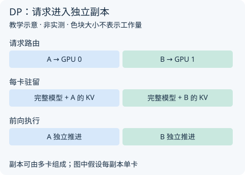

如果单卡可以容纳模型与目标并发所需的 KV，增加单卡副本是直接的吞吐扩展方式。两个副本可以同时推进两组请求，而某条请求的模型计算仍只使用其中一个副本。负载稀疏时，新增副本可能经常空闲；负载接近容量时，合理分流可以显著降低排队。

DP 副本内部也可以采用 TP。例如八张卡组成四个双卡 TP 实例：副本之间分请求，副本内部协作执行一条前向。这里独立处理请求的是双卡实例，而不是每张物理卡。缓存路由、共享存储和控制面仍可能在副本之间通信，所谓“基本无通信”应限定为模型前向的中间激活。

### 2. TP：切分同一层的矩阵运算

沿用线性层记法：输入 X 为 M×K，权重 W 为 N×K，输出 Y=XWᵀ 为 M×N。输出维切分把 W 沿 N 轴分为 W₀、W₁，每卡读取相同输入，分别得到 Y₀、Y₁。两部分拼起来才是完整输出；如果下一算子能够直接消费分片，就可以暂时保持这种布局。

传统文献常用 Y=XW 的权重方向，将输出维切分称为 column parallel。本文写 W 为 N×K，因此同一操作在存储图上看起来是切 W 的行。应先确认切的是输入维还是输出维，再理解“行并行、列并行”的名称。

归约维切分把 X 沿 K 分成 X₀、X₁，W 同样沿 K 分成 W₀、W₁：

```math
Y = X_0 W_0^T + X_1 W_1^T.
```

每卡得到的是完整输出形状的部分和。下一层需要完整值时，各卡必须求和，例如通过 All-Reduce。bias 应在归约后加一次，或者由实现安排等价的分配方式，避免每个部分和重复携带同一份 bias。

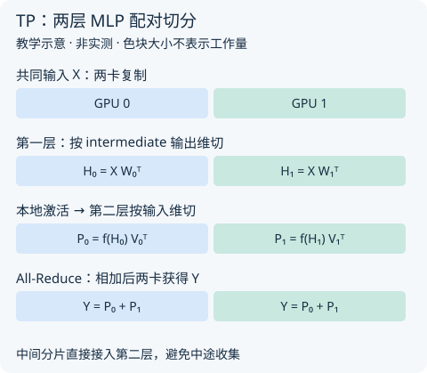

两层 MLP 展示了配对的意义。第一层将 hidden 映射到 intermediate，按 intermediate 输出维切分。逐元素激活可以在各卡本地执行。第二层把 intermediate 映射回 hidden，恰好按同一 intermediate 输入维切分，因此第一层分片直接作为第二层局部输入，最后再归约输出。对于门控 MLP，门控投影与上投影要采用相互匹配的切分，才能本地相乘。

Attention 也可以按 head 分配 Q、K、V 投影与注意力计算，最后通过输出投影合并。GQA 的 KV heads 少于 Query heads，TP 数量超过可独立切分的 KV heads 时，某些布局需要复制 KV。MLA 的 latent 缓存也有自己的布局限制，不能把权重 TP 的节省比例直接用于 KV。

TP 同时有机会减少每卡权重容量、权重读取量和计算量，但频繁通信进入每层关键路径。经典 Megatron 风格、激活在 block 边界复制的前向布局中，Attention 输出和 MLP 输出通常各有一次主要归约。SP、融合算子或其他布局会改变通信原语和位置，所以“两次”是具体执行模型的性质。

### TP 算例：把形状和通信量对齐

取一个 hidden size 为 4096、intermediate size 为 16384 的普通两层 MLP，暂时忽略门控分支。输入有 128 个 token。TP=2 时，每卡第一层权重为 8192×4096，第一层输出为 128×8192；第二层每卡权重为 4096×8192，局部输出为 128×4096。两张卡的局部输出相加，恢复完整 MLP 输出。

第一层每卡承担的参数和乘加量各为原来的一半，第二层同样如此。第一层中间输出没有先收集成 128×16384，因为第二层恰好只消费自己对应的 8192 个 intermediate 分量。这正是从相邻算子一起设计布局的收益，孤立地给每个矩阵选择切分后再补齐全部输出，可能引入本可避免的通信。

若局部输出采用每元素两字节，归约算子的逻辑张量大小为 128×4096×2=1 MiB。它描述待归约数据的大小，真实链路字节量还要看通信算法。把 token 数改为一，张量只有 8192 字节，固定启动延迟在总耗时中的比例便可能大幅上升。同一套 TP 布局在 Prefill 与低 batch Decode 中表现不同，原因可以直接从这个形状变化追踪。

Attention 的切分还要看模型自身的头结构。假设有 32 个 Query heads、8 个 KV heads，TP=4 时可以让每卡负责 8 个 Query heads 和 2 个 KV heads。若 TP 继续增大到超过 KV heads 数量，单靠 head 维切分便遇到离散约束。运行时可能复制 KV，或者结合上下文切分；不能把“更多卡”简单理解为每份状态都按相同比例继续缩小。

### 3. PP：按层分 stage，让多个任务交错推进

PP 将连续层分配给不同 stage。80 层模型采用四 stage 时，可以先以每 stage 20 层建立教学模型。请求先经过第一组层，再经过第二组，直到最后一组。边界传递 hidden states，权重留在各 stage 本地。

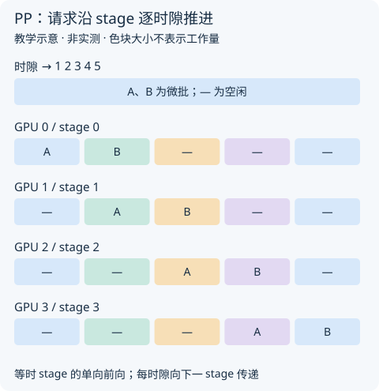

单条请求的层间依赖仍然存在。第二 stage 等待第一 stage 的输出，单个 token 的前向不能直接变成四分之一时间。吞吐收益来自不同请求或微批的交错：第二 stage 处理 A 时，第一 stage 可以处理 B。最慢 stage 决定稳定推进速度，层数相同也未必耗时相同。

在每 stage 耗时均为 τ、边界通信已包含、每个微批单向经过流水线的理想模型中，p 个 stage 处理 m 个微批约需要 (m+p−1)τ，stage 利用率为 m/(m+p−1)。四 stage 处理四个微批，需要七个时隙，利用率约为 57.1%。它描述一次单向前向的填充与排空，不是完整自回归服务的通用利用率公式。

Decode 还多了一条反馈依赖：下一 token 的输入需要上一 token 的采样结果，单请求必须完成全模型再开始下一轮。不同请求的独立性可以填充流水线，但动态 batch、请求结束、阶段工作量差异都会改变气泡。PP 适合用较低的边界通信频率换取容量扩展，跨节点部署可以将高频 TP 留在节点内，再以 PP 连接节点；这仍需实测，不能视为所有拓扑的最优组合。

### PP 的 stage 划分要看工作，不只看层数

一个 stage 的时间除了 Transformer block，还可能包含 embedding、最终归一化、词表投影和采样相关操作。输入与输出阶段的权重容量也可能不同。把层数平均分配，是建立第一版布局的起点；形成瓶颈以后，需要结合显存和执行时间调整边界。

例如四 stage 的时间分别为 2、2、3、2 ms，即使其他阶段都能每两毫秒接收一个微批，第三 stage 也只能每三毫秒推进一个。长时间运行后，上游排队或被反压，下游等待，吞吐受到最慢阶段限制。把部分层从第三 stage 移到邻近 stage，可能比单纯增加请求数更有效，但必须重新检查跨 stage 激活和每卡容量。

推理中的微批也有现实约束。拆得更小可以增加可交错的工作单元，却可能降低矩阵运算效率，并增加边界发送次数。动态请求不断加入和结束时，调度器还要维护每个微批的序列身份、位置与 KV 状态。流水线图中的方块代表逻辑工作单元，工程实现需要把它们连接到具体请求生命周期。

### 4. EP：把专家放到不同卡

MoE 的路由器为每个 token 选择专家。假设八个专家、Top-2、四张卡，每卡放两个完整专家。一个 token 可能被发送到两张卡，分别计算专家输出，再返回原位置并按路由权重合并。

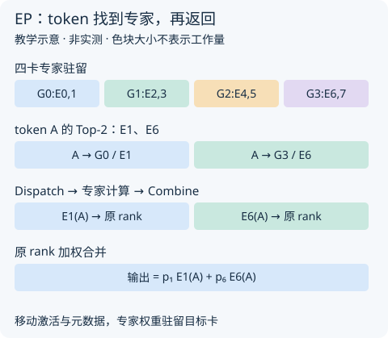

EP 的切分单位是专家，专家内部可以保持完整矩阵，也可以继续做 TP。发送的是 token 的 hidden states 及关联元数据，而不是每步把专家权重搬到 token 所在位置。Top-2 通常意味着两条专家计算路径；实际通信量还受本地命中、同卡专家、token 复制策略和通信融合影响。

EP 把专家存储与计算扩展到多卡，但引入不规则的 Dispatch/Combine。某个专家收到很多 token 时，其所在卡可能成为整个 MoE 层的慢点。后文会把它与 DP Attention 放到同一条执行路径中讨论。

### 5. SP：切分部分逐 token 算子

这里的 SP 特指 Megatron 风格的 sequence parallelism。在传统 TP 中，某些边界激活在各 rank 复制，LayerNorm、Dropout 或残差相关的逐 token 操作可能重复执行。SP 将这些激活沿 token 维切开，让各卡只处理其中一段，再在进入需要完整输入的 TP 算子前恢复合适布局。

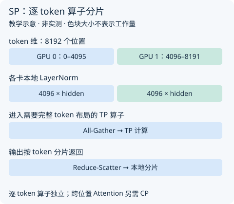

例如 8192×4096 的 hidden states，沿 token 维分为两个 4096×4096 张量。LayerNorm 在每个 token 的 hidden 维内完成，因此 token 分片之间相互独立。All-Gather 可以把 token 分片收集起来，Reduce-Scatter 则把归约结果直接分散到目标 rank，避免先得到完整复制输出再切开。

SP 的重点是减少特定位置的激活驻留和重复工作，并与 TP 的通信布局配合。它不是把完整 Attention 任意分成互不相关的半段，也不意味着权重容量自动减半。在 token 数很少的 Decode 中，序列维切分空间有限；训练和长 Prefill 通常更容易体现激活节省价值。

### 6. CP：上下文切开以后，Attention 如何保持正确

CP 将一个请求的上下文位置分布到多卡。长 Prefill 可以分配不同 Query 位置及其局部 Q/K/V，各卡再通过收集或环形交换访问所需 KV。因果 Attention 中，较早 Query 可见的位置少，简单连续等长切分未必工作均衡，分配方式要考虑因果三角形的计算量。

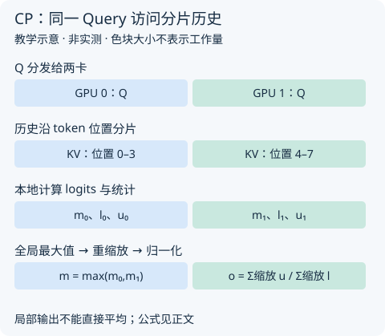

Decode 则通常复制或分发当前 Query，每卡只读取本地历史 KV，计算局部注意力统计量，再合并。设第 r 个分片的 logits 为 z，定义局部最大值 mᵣ、指数和 lᵣ 与未归一化向量 uᵣ：

```math
\begin{aligned}m_r&=\max_j z_{rj}, & l_r&=\sum_j e^{z_{rj}-m_r}, & u_r&=\sum_j e^{z_{rj}-m_r}v_{rj},\\m&=\max_r m_r, & l&=\sum_r e^{m_r-m}l_r, & u&=\sum_r e^{m_r-m}u_r,\\o&=u/l.\end{aligned}
```

各分片的局部 Softmax 使用不同分母，因此直接平均局部输出会改变全局权重。若一个分片的归一化权重总量是另一个分片的九倍，两者最终贡献也应按九比一合并。上式通过共同最大值重新缩放局部统计量，得到全局归一化结果。

实现还要正确处理因果 mask 和空分片；全部被 mask 的分片应贡献零权重，而不是让无效最大值导致数值异常。CP 节省每卡 KV 容量和读取量，同时增加跨卡统计合并及必要的数据交换。它与 SP 都涉及 token 维度，但 CP 显式处理跨上下文分片的 Attention 依赖。

| 方式 | 切分对象 | 主要交换 | 直接收益 |
| --- | --- | --- | --- |
| DP | 请求 | 控制与路由信息 | 扩展副本吞吐 |
| TP | 矩阵输入或输出维 | 激活归约、收集 | 每卡权重与计算减少 |
| PP | 层 | stage 边界激活 | 容量与流水线吞吐 |
| EP | 专家 | token 分发、回收 | 专家容量与计算扩展 |
| SP | 部分算子的 token 维 | 收集、归约分散 | 激活与重复工作减少 |
| CP | 上下文和 KV | KV 交换或局部统计合并 | 长上下文容量与执行扩展 |

## 三、通信怎样吃掉并行收益

### 1. 先看数据需要变成什么

All-Reduce 将各卡同形状的数据逐元素归约，让每卡获得完整结果。TP 中各卡计算不同部分和，但下一算子都要使用完整输出时，它正好满足需求。All-Gather 将不同分片收集并拼接，每卡得到全部分片。Reduce-Scatter 先归约，再让每卡仅保留结果的一部分。

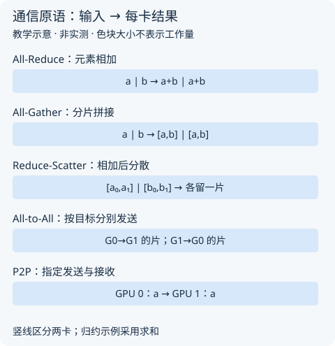

All-to-All 允许每卡向其他卡发送不同内容，适合专家路由中目的地不同的 token。实际 EP 的消息长度往往不相等，专用通信库可能将收发、重排、计数和同步融合实现。P2P 是点对点收发，PP 边界和跨实例 KV 传输都可以建立在类似数据流上。

All-Reduce 可以通过 Reduce-Scatter 加 All-Gather 实现，这是一种理解它的方式；库还会根据消息大小和拓扑选择 ring、tree 等算法。调用了一次集合通信，不等于只发生一次物理链路传输。分析带宽时应明确测的是算子载荷还是总链路流量。

### 2. 固定延迟与带宽分别限制什么

一个简化通信模型为：

```math
T_{\mathrm{comm}}\approx n\alpha+\frac{V}{B_{\mathrm{effective}}}.
```

n 表示模型中计入的串行启动或通信阶段数，alpha 是对应固定成本，V 是按所选口径统计的传输量。若把 V 定义为实际经过瓶颈链路的字节，B 就应采用该路径的有效带宽。不能把全体 GPU 的聚合带宽直接用于一条受限链路。

假设一个 40 层模型采用每 block 两次主要归约的 TP 前向布局，一轮 Decode 就有约 80 次归约。若每次串行固定开销假设为 10 μs，固定部分合计为 0.8 ms。这里尚未计算消息载荷，也没有假设所有通信都能重叠；数字只用于说明小消息为什么仍会很贵。

Prefill 一次处理许多输入 token，激活消息较大，更容易暴露带宽限制。低 batch Decode 的消息较小，但每生成一个 token 都要重复经过全部层，固定延迟更加突出。高并发 EP 则同时面对大量 token 交换和最慢专家的等待。阶段与负载改变以后，优化目标也会变化。

### 通信量还受到算法与拓扑影响

以理想 ring All-Reduce 为例，设通信组有 p 张卡，每卡输入张量大小为 S。一次 Reduce-Scatter 加 All-Gather 的过程中，每卡发送量约为 2(p−1)S/p，接收量也有相应规模。这个口径以每卡发送字节计算，不能再把收发都相加以后继续使用只衡量单方向传输的带宽。

该模型说明参与卡数增大以后，每卡传输量趋近于两倍张量大小，而串行步骤数量仍随组规模变化。小消息时，增加步骤可能比减少本地计算更显著。实际库会选择不同算法，链路可并行程度也不相同，因此这个公式适合帮助理解，具体部署应使用通信微基准和真实模型时间线。

两台各四卡的机器提供了一个拓扑例子。若每台内部高速互联，而两台之间只有较窄的网络出口，八卡 TP 的每层通信都可能跨越该出口。另一种布局是在每台内部做 TP=4，节点之间按 PP 传递 stage 边界输出。前者暴露更多高频跨节点同步，后者增加串行阶段与气泡；谁更好取决于消息形状、请求并发和网络，比较时需要固定总卡数。

同一节点内也要检查 GPU 与网卡的亲和性。离目标网卡较远的 GPU，数据可能经过额外 PCIe 路径或跨 CPU 插槽。逻辑上同为一个 EP 组，物理上不同专家之间的可用路径却可能差异很大。专家放置既要看访问频率，也要看流量经过哪里。

### 3. 互联、访问机制与通信库

这些技术分布在物理连接、网络协议、设备访问机制和软件通信库等层面，可以先用下表建立对应关系。

| 技术 | 所属层面 | 作用 |
| --- | --- | --- |
| PCIe | 通用硬件互联 | 连接 CPU、GPU、网卡等设备，承载设备间数据传输 |
| NVLink | 高速互联 | 提供 GPU 间的高带宽连接，降低跨卡通信成本 |
| NVSwitch | GPU 交换网络 | 连接多张 GPU，构建基于 NVLink 的高速互联拓扑 |
| InfiniBand | 跨节点网络 | 提供低延迟、高带宽网络，支持 RDMA 通信 |
| RoCE | 以太网 RDMA 协议 | 在以太网上实现 RDMA，效果依赖网络配置与拥塞控制 |
| GPUDirect RDMA | 设备数据访问机制 | 支持网卡等设备直接访问 GPU 显存，减少 CPU 主存中转 |
| NCCL | GPU 集合通信库 | 实现 All-Reduce、All-Gather、Reduce-Scatter 等通信操作 |
| DeepEP | MoE 专用通信库 | 优化专家并行中的 token Dispatch 与 Combine |
| Mooncake / NIXL | 数据传输基础设施 | 提供高效传输能力，可用于 KV Cache 等推理状态的跨设备、跨节点搬运 |

NVLink、InfiniBand 等提供数据传输的“道路”，NCCL、DeepEP 等在这些连接上组织数据交换与同步；GPUDirect RDMA 则影响网卡访问 GPU 数据的路径。它们共同决定一次通信怎样执行。

PCIe 提供通用设备互联。NVLink 提供 GPU 间的高速连接，NVSwitch 将多 GPU 组织成交换网络。节点内 GPU 是否真正通过这些链路互通，要看具体机器拓扑；“在同一台机器”并不自动代表任意两卡都有相同带宽。

跨节点常见 InfiniBand 或支持 RDMA 的以太网方案 RoCE。GPUDirect RDMA 让网卡能够直接访问 GPU 显存，减少经 CPU 主存中转的需要，但端到端表现仍受 GPU 到 NIC 的连接、交换机、拥塞与软件协议影响。

NCCL 提供集合通信；DeepEP 面向 MoE token Dispatch/Combine；Mooncake 与 NIXL 提供高效数据传输相关能力，可用于 KV 交接等路径。硬件决定可用的连接，库负责在这些连接上组织数据与同步。它们处于不同层次，不能用某个通信库名称替代拓扑分析。

通信与计算重叠需要独立工作。若下一算子立即消费归约结果，这段通信天然处于依赖链上；若另一批次已经准备好独立计算，就可能交错推进。即使时间线上重叠，网络传输也可能争用显存带宽或 GPU 执行资源，所以隐藏通信要用端到端收益确认。

## 四、MoE 的 DP Attention + EP

### 1. 专家 TP 与专家 EP

假设四卡部署八专家。专家 TP=4 时，每卡拥有每个专家的一部分矩阵，选中专家后多卡协作产生输出。EP=4 时，每卡拥有两个完整专家，token 前往专家所在位置，专家内部可以本地完成矩阵乘法。

两者改变的是计算与数据移动的组织。TP 可以让一个专家的工作分摊到多卡，但矩阵变小并引入归约；EP 保持完整专家矩阵，却可能让一些卡没有 token。batch 小时，Top-K 路由只覆盖少数专家，EP 组中出现空闲 rank 很自然。batch 增大后，更多 token 聚集到专家，完整专家矩阵更容易形成有效计算批次。

性能取决于专家尺寸、Top-K、路由分布、kernel、通信实现与拓扑。热门专家如果都位于同一卡，即使平均专家 token 数看起来合理，卡级工作量仍可能严重倾斜。

### 2. Attention 与专家层采用不同分布

Attention 没有专家维度，可以让各 rank 持有 Attention 权重，分别处理不同请求及其 KV。进入 MoE 后，把这些 rank 的 token 共同路由到专家分布所在的 EP 组。专家输出再返回 token 原来的 rank，继续后续本地 Attention。

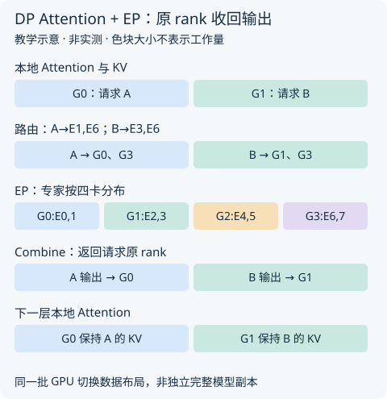

例如 rank 0 持有请求 A，rank 1 持有请求 B。它们先各自执行 Attention。A 的 token 选择专家 1 与 6，B 的 token 选择专家 3 与 6；专家 6 可以同时获得两边的 token。计算结束以后，A 的结果返回 rank 0，B 的结果返回 rank 1，KV 仍按原请求归属管理。

这与普通完整模型 DP 有根本区别：Attention rank 能够独立处理自己的注意力状态，但专家阶段需要跨 rank 协作。某些 rank 本轮没有本地请求时，也可能需要参与通信与专家服务。调度和通信组必须维持相容的执行次序。

更一般的部署中，每个 Attention 数据并行组内部还可以使用 TP，专家 EP 组覆盖多个这样的组。八张 GPU 可以在 Attention 层表现为四个 TP=2 的数据并行组，在专家层表现为一个 EP=8 组。这些并行名称复用了同一批物理卡，不能再把四乘二乘八当成所需卡数。框架参数的具体含义应按对应实现解释。

### 混合并行的收益与代价来自同一处

DP Attention 使各请求的注意力计算保持本地，尤其在某些 GQA 或 MLA 布局中，可以避免为了扩大专家计算组而同步扩大 Attention TP。这样有机会减少注意力侧通信或 KV 复制。但 Attention 权重会按数据并行组复制，需要将这部分容量计入预算。

专家层则希望看到更多 token。两个 Attention rank 各自只有很小的 batch，如果把 token 汇入同一 EP 组，某些专家能够获得更大的有效 batch，提高矩阵乘法效率。与此同时，token 来源更多、目的地更多，会增加交换与同步复杂度。把专家 batch 扩大到足够高效，与把跨卡通信控制在可接受范围，需要联合选择。

一个重要工程约束是层间执行协调。独立请求的长度不同，某个 rank 可能只剩一个 Decode token，另一个 rank 正在处理长 Prefill。若它们属于同一个专家通信组，参与本轮交换的数据量可以不同，但通信协议必须知道如何匹配这一轮。数据并行不意味着任意 rank 都可以脱离组内执行规则独自前进。

### 3. 专家负载决定等待时间

假设四张卡收到的专家任务量为 12、58、9、21 个 token，合计 100。若每 token 专家计算成本相同、忽略通信与其他算子，而且下一阶段等待全部卡完成，理想化计算利用率为：

```math
U=\frac{100}{4\times58}\approx43.1\%.
```

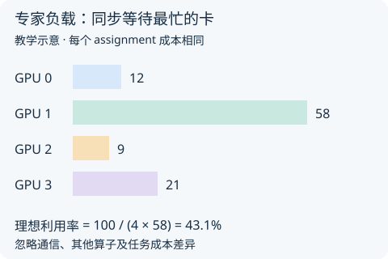

这个数字描述特定同步教学模型中的等待，并不是 GPU 硬件计数器的 SM 利用率。Top-K 情形下应统计 token-expert assignment，不能混用原始 token 数。专家矩阵不同、padding 或通信不均匀时，还应换成实际工作量估计。

Expert Placement 根据访问频率调整专家位置；冗余专家为同一逻辑专家增加物理副本，再将请求分流；EPLB 利用运行时统计更新映射。这些方法改变负载分布，同时消耗额外权重空间或迁移成本。它们应保持专家函数与路由语义，而不是任意将 token 换给另一个专家。

Grouped GEMM 主要提高多个专家小矩阵的执行效率；通信重叠主要减少暴露在关键路径上的等待。它们有助于利用资源，但不会自动让路由分布均匀。SGLang、vLLM 与 DeepEP 的相关实现可作为工程入口，具体组合需核实模型、硬件和版本支持。

## 五、Prefill/Decode 分离

### 1. 从批内调度走向资源池隔离

Prefill 通常一次推进许多输入位置，Decode 每条序列通常只推进少量新位置。前者容易形成大矩阵计算，后者在低 batch 下容易受权重与 KV 读取、kernel 启动及通信延迟影响。这是常见形状的性质；高 batch Decode 也可能受算力限制，短 Prefill 也可能无法充分利用计算单元。

统一部署让两阶段共享 GPU。长 Prefill 占据执行时间时，正在输出的请求可能出现较长 ITL。Chunked Prefill 通过切小输入工作并交错执行缓解干扰；PD 分离则让两阶段进入不同资源池，允许各自选择 batch、并行度与 kernel。

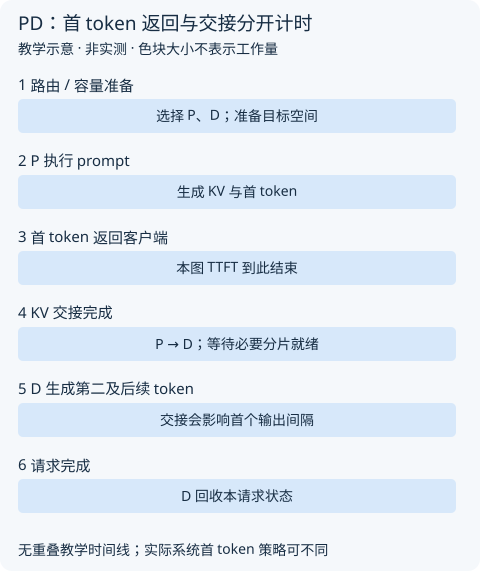

阶段分离减少直接争抢同一组 GPU 的情况，但增加 KV 传输、跨池排队和容量协调。两边都需要完成全模型相应前向的能力；P 池并不是只放前半层，D 池也不是只放后半层。它与按层切分的 PP 属于不同组织方式。

### 2. 一条请求怎样交接

路由器选择 P 与 D，目标侧准备足够的状态容量；P 执行 prompt 前向，产生 KV 和首 token 所需结果；KV 连同兼容性、布局和分片信息送到 D；D 确认依赖的数据就绪后继续自回归。源侧在传输依赖结束后释放本请求资源，或按缓存策略保留可复用前缀。

这是一条教学生命周期。目标空间可能提前预留，也可能分块申请；传输可以与 Prefill 分层或分块重叠；首 token 由哪侧采样、何时返回客户端，随实现而变。图和算例必须明确采用哪一种时间边界。

本文的教学时间线选择首 token 在 P 产生后返回，再完成交接，D 生成第二个及后续 token。因此交接可能主要表现为首、第二 token 之间较长的间隔；若系统等交接完成后才返回首 token，同一开销会更多进入 TTFT。评估应记录真实事件，不能仅凭“用了 PD”推定某个指标包含哪些时间。

### 3. KV 传输需要多少字节

普通 GQA Transformer 的完整历史 KV 载荷为：

```math
M_{\mathrm{KV}}=2SLH_{\mathrm{kv}}d_{\mathrm{head}}b.
```

S 是上下文 token 数，L 是注意力层数，H_kv 是 KV heads 数，d_head 是每 head 维度，b 是每元素字节数，前面的 2 对应 K 与 V。该式假设每层采用相同完整注意力布局；MLA、滑动窗口、混合注意力及量化状态应按实际存储重算。

取 S=8192、L=32、H_kv=8、d_head=128、b=2，得到 1,073,741,824 字节，即 1024 MiB。200 Gbps 除以 8 为 25 GB/s，若有效利用率假设为 80%，有效带宽为 20 GB/s，纯载荷传输时间约为 53.69 ms。

这里使用十进制 GB/s 与二进制 MiB，并在字节层换算。假设整份载荷经过指定聚合瓶颈链路，尚未计入排队、握手、页地址整理和转换。缓存命中可减少所需传输量，重叠可降低暴露时间；多网卡能否累加则取决于分片与路径。

### 4. 两边 TP 不同，怎样重新分片

P 端 TP=4、D 端 TP=2，模型有八个 KV heads。假设 P 的四卡分别保存 heads 0–1、2–3、4–5、6–7，D 的两卡需要 heads 0–3 与 4–7。传输必须把 P0、P1 的数据组织到 D0，把 P2、P3 的数据组织到 D1。

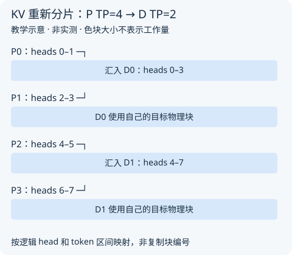

源地址与目标地址通常来自各自独立的 paged KV pool。逻辑上相同的 token 区间，并不对应相同物理 block 编号。协议必须知道层、head、token 范围、dtype、scale 与目标块位置；所有必要分片完成后，才能允许依赖它们的 Decode 使用。

异步传输期间，源块必须保持有效，目标块不能过早复用。失败或取消时也要等待在途操作安全结束再回收。不同 CP 布局、MLA latent 或混合状态会增加转换约束。跨实例传输因此是布局、同步与生命周期共同组成的系统机制。

### PD 的资源账也要包含复制与在途状态

当 P、D 各自形成完整服务能力时，两侧一般都要持有相应模型权重。与原来一个统一实例相比，阶段分离可能增加总权重驻留；如果原来就有多个统一副本，则比较方式又不同。合理的对照应固定总卡数和模型副本预算，而不是拿两套资源与原来一套资源直接比较吞吐。

在途 KV 也可能同时占据源与目标容量。传输开始后，源块仍被网络操作读取，目标块已经为接收预留。这段时间的数据存在双份占用。高并发交接如果只按已经开始 Decode 的请求统计目标容量，会低估接收池的压力；源侧过早回收则可能破坏传输正确性。

TP 不同还可能让源与目标的物理粒度不同。逻辑上的一个 token 区间，可以对应多个 head 分片和多个物理页。设计传输路径时，需要明确是源侧先打包、目标侧重排，还是直接以多个片段写入最终位置。打包减少消息数量，但增加复制；直接分片传输减少中间缓冲，却可能产生更多小消息。这与通信模型中的固定延迟和载荷成本直接对应。

### 5. 什么情况下值得分离

需要比较：减少的排队与阶段干扰，加上独立资源优化节省的执行时间，是否超过新增的暴露传输、协调和资源碎片成本。长输入可能加重统一部署中的干扰，也会产生更多 KV 传输；两种趋势需要同时计算。

P、D 资源池还可能复制模型权重，并失去统一池在流量波动时即时借用资源的灵活性。某时段输入工作很多而输出很少，D 池可能空闲；反过来，长输出突发会让 D 积压。独立扩缩容与资源配比是 PD 架构的一部分，而不是部署完成以后的附加问题。

## 六、集群视角的负载均衡

请求级均衡选择服务实例，专家级均衡调整专家工作，阶段级均衡分配 P、D 容量，网络级均衡关注通信路径和拥塞。四个层面的观察指标不同，不能用一个 GPU 平均利用率替代。

请求数尤其容易误导。实例 A 只有两个请求，但剩余 Prefill 有 32000 tokens、KV 占用 80%；实例 B 有八个请求，剩余 Prefill 只有 800 tokens、KV 占用 30%。仅按请求数量会倾向 A，实际等待却可能更长。路由应结合阶段、待处理 token、运行 Decode 规模与容量。

缓存命中又会改变有效工作。新请求在 A 可复用 7000/8000 的前缀，在 B 完全未命中，A 可能减少大量 Prefill；但若 A 队列过长，缓存收益也可能被等待抵消。可以估计各实例的排队、有效 Prefill 和后续 Decode 时间，再按服务目标选择。缓存目录与路由细节可参见已有 KV Cache 文章，本文只保留其与多实例部署的接口。

在简化线性容量模型中，到达率 λ、平均有效输入长度 S_in、输出长度 S_out，P 与 D 的等效单卡吞吐分别为 C_P、C_D，目标利用率为 u，则所需等效卡数约为 λS_in/(uC_P) 与 λS_out/(uC_D)。它用于第一轮容量预算；真实扩容按完整 TP/EP 实例取整，还需为尾延迟、网络、KV 上限和突发留余量。

Decode 吞吐随并发与上下文变化，P 的有效输入也受前缀命中影响，因此 C_P、C_D 应来自目标工作负载测量。扩缩容还涉及权重加载、缓存预热和请求排空，不能仅依据瞬时平均值频繁切换。

## 七、怎样选择并验证部署方案

### 1. 同样八张卡，解决的问题可以不同

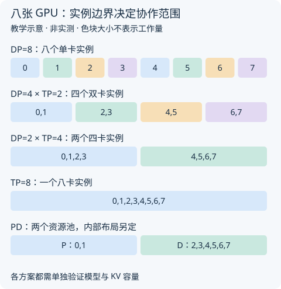

DP=8 提供八个单卡副本，前提是每卡装得下完整模型及请求空间。DP=4、TP=2 提供四个双卡实例；DP=2、TP=4 提供两个四卡实例；TP=8 把全部卡用于一个模型执行组。它们共享总卡数，但单实例容量、通信与副本数量不同。

P=2、D=6 只描述资源池大小，不代表 P 的两卡必然构成一个 TP=2 实例，也不代表六张 D 卡就是一个 TP=6 实例。应进一步明确池内实例数、每实例 TP/PP/EP 布局和跨池连接。

先计算容量下限，再寻找满足单请求时延的并行度，之后评估增加副本的吞吐收益，是一种实用的搜索顺序。对于 MoE、长上下文或复杂拓扑，容量与通信约束可能使最佳方案偏离简单顺序，仍应保留可对照的候选配置。

### 部署选择的一次完整推导

假设八卡集群需要服务一个两卡才能容纳的模型，且暂时忽略 PP、EP 和 CP。DP=8 的单卡副本方案首先被容量约束排除。剩下可以比较四个 TP=2 实例、两个 TP=4 实例和一个 TP=8 实例。三者都应给 KV、工作区和通信缓冲留出相同口径的余量。

先在低负载下测单请求。如果 TP=2 已经满足时延目标，扩大 TP 的价值需要看它是否带来足够多的时延改进，以及副本减少后的排队代价。若 TP=2 未达标而 TP=4 达标，可以再在两个四卡实例之间扩展请求吞吐。若所有方案都未达标，则还需检查 kernel、量化、硬件和模型结构，增加并行度不是唯一变量。

接着提高到达率。四个小实例可能拥有更多独立调度机会，也可能因为每实例 batch 太小而不能高效执行；一个大实例可以聚集请求，却可能付出更高同步成本，并形成更大的故障影响范围。观察队列增长曲线与达标吞吐，才能判断这些影响的净结果。

最后加入真实长度分布与缓存。均匀合成请求下的最佳布局，可能在长短请求混合或热门前缀集中时改变。部署结论应附带工作负载、并行组、网络和缓存条件，使下一次模型或流量变化时能够重新评估，而不是把一个参数组合固化为经验法则。

### 2. 测量要回答具体问题

固定总卡数，比较同一请求轨迹下的 E2E、Goodput 与成本，可以回答集群怎么组织更好。固定单实例规模和请求形状，测层时间、通信及 KV 占用，可以解释执行路径为何变化。两组实验的控制变量不同，应分别报告。

固定并发测试适合观察封闭负载下的完成能力；固定到达率测试更容易暴露队列增长和过载边界。长短输入、长短输出、缓存冷热、突发和稳态需要分桶，平均值不能替代 P95/P99。每次测试还应记录失败、拒绝和取消，避免只看成功样本。

通信占比应结合时间线解释。独立累加 kernel 时长可能超过真实墙钟时间，因为执行存在重叠；专家负载也应同时记录逻辑专家与物理 rank，才能区分路由倾斜和放置问题。模型权重、KV dtype、采样参数与投机解码设置都要固定。

完成一次部署选择时，应能说明：容量是否满足，哪个阶段限制请求，通信位于哪条依赖链，增加副本是否减少排队，以及在相同资源下有多少请求满足目标 SLO。多卡的价值最终体现为这些可测量的结果。

### 把时间线与服务指标连起来

假设某请求在统一部署中排队 20 ms，Prefill 用 30 ms，随后输出十九个 token，每个间隔 5 ms。若首 token 在 Prefill 结束时返回，TTFT 为 50 ms，E2E 为 145 ms。采用 PD 后，假设 P 侧排队降到 5 ms，Prefill 仍为 30 ms，首 token 立即返回；交接额外暴露 20 ms，D 侧排队 5 ms，后续十九个 token 的基础计算间隔仍为 5 ms，则 E2E 为 155 ms。

在这个教学例子里，TTFT 从 50 ms 降到 35 ms，但 E2E 增加 10 ms。首个输出间隔还会包含交接与 D 侧等待。它说明阶段隔离必须按用户消费结果的方式评价：只看首 token，会遗漏后续停顿；只看最终完成，又可能忽略交互反馈提前的价值。

如果另一组负载下，统一池中的长 Prefill 经常把 Decode 间隔从 5 ms 拉长到 15 ms，而 PD 能让多数后续间隔恢复稳定，那么同样的交接开销可能被后续收益覆盖。输出长度也改变这笔账：后续只有一个 token 时，可累计的间隔收益很少；后续有数百 token 时，稳定输出可能贡献更大的总收益。

这些数字均为假设，目的在于建立不重复计时的核算方法。实际记录应至少包含到达、开始 Prefill、首 token 生成与发送、传输开始与完成、D 接纳、各输出 token 以及请求结束。服务端事件与客户端观察需要分开，网络缓冲也可能改变客户端感知的输出间隔。

## 参考资料

1. [Megatron-LM：张量并行原论文](https://arxiv.org/abs/1909.08053)。两层 MLP 与 Attention 的并行组织。
2. [Reducing Activation Recomputation in Large Transformer Models](https://arxiv.org/abs/2205.05198)。Megatron 风格序列并行与激活布局。
3. [Ring Attention](https://arxiv.org/abs/2310.01889)。分布式上下文与分块注意力。
4. [NCCL 集合通信说明](https://docs.nvidia.com/deeplearning/nccl/user-guide/docs/usage/collectives.html)。通信原语及结果布局。
5. [GPUDirect RDMA 官方文档](https://docs.nvidia.com/cuda/gpudirect-rdma/)。GPU 显存与网络设备访问机制。
6. [DeepEP](https://github.com/deepseek-ai/DeepEP)。MoE Dispatch/Combine 通信。
7. [vLLM Expert Parallel Deployment](https://docs.vllm.ai/en/stable/serving/expert_parallel_deployment/)。Attention DP/TP 与专家 EP 的组合及 EPLB。
8. [vLLM Context Parallel Deployment](https://docs.vllm.ai/en/stable/serving/context_parallel_deployment/)。Prefill 与 Decode 上下文并行。
9. [SGLang DP、DPA 与路由](https://docs.sglang.io/docs/advanced_features/dp_dpa_router_guide)。普通副本与 Attention 数据并行的区分。
10. [SGLang PD Disaggregation](https://docs.sglang.io/docs/advanced_features/pd_disaggregation)。阶段分离与 KV 传输。
11. [DistServe](https://arxiv.org/abs/2401.09670)、[Splitwise](https://arxiv.org/abs/2311.18677)。阶段分离的系统设计与性能取舍。
12. [Mooncake](https://github.com/kvcache-ai/Mooncake)、[NIXL](https://github.com/ai-dynamo/nixl)。KV 等推理状态的数据传输基础设施。
13. 本站已有文章：[批处理调度](2026-11-10-llm-batching-scheduling.md)、[KV Cache 优化](2026-11-06-kv-cache-optimization.md)、[注意力优化](2026-10-29-attention-cost-and-optimization.md)。

框架文档核查日期：2026-11-27。实现细节随版本与模型支持变化，本文的公式与示意图均按各节列出的教学假设解释。
